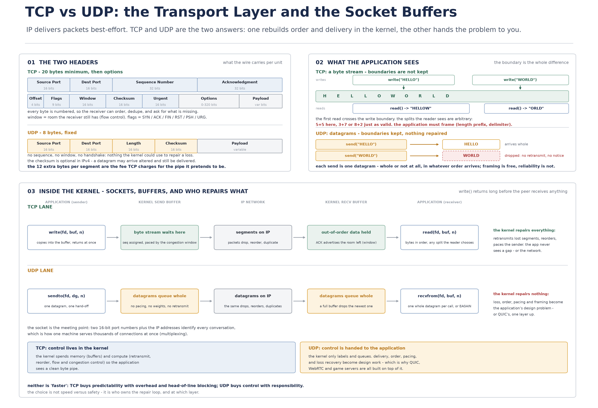

# [네트워크] TCP vs UDP와 전송 계층 소켓 버퍼 구조

- 작성일: 2026-11-17
- 키워드: Network, Transport Layer, TCP, UDP, Byte Stream, Datagram, Segment, Multiplexing, Port, Socket Buffer, SO_RCVBUF, SO_SNDBUF, Sequence Number, ACK, Sliding Window, Flow Control, Congestion Control, Nagle, TCP_NODELAY, Head-of-Line Blocking, QUIC, java.net.Socket, DatagramSocket, Netty

## 1. 핵심 요약 (What & Why)

운영체제 트랙의 7편에서 I/O 멀티플렉싱을 다뤘다. epoll이 알려주는 것은 "어떤 소켓에 읽을 데이터가 준비됐는가"까지다. 그 소켓 안의 데이터가 어떤 규칙으로 도착했고, 누가 잘못된 것을 고쳐 주는가는 그 다음 층의 문제다. 이번 편부터 시작하는 네트워크 트랙은 그 층, 즉 **전송 계층(Transport Layer)** 을 다룬다.

출발점은 IP의 성질이다. IP는 **패킷을 최선을 다해(best-effort) 전달할 뿐**이다. 중간에 큐가 차면 버리고, 경로가 다르면 순서가 뒤바뀌고, 회선 상태에 따라 같은 패킷이 두 번 도착할 수도 있다. 도착 보장도, 순서 보장도, 도착 통지도 없다. 그런데 애플리케이션은 "이 메시지가 빠졌는가", "순서는 맞는가"를 알아야 한다. 이 간극을 메우는 층이 전송 계층이고, 그 메우는 방식이 두 가지다.

- **TCP**: 커널이 간극을 메운다. 순서 번호를 붙이고, 도착을 확인하고(ACK), 빠진 것을 재전송하고, 받는 쪽의 처지를 고려해 속도를 조절한다. 대가로 헤더가 커지고(최소 20바이트), 메모리(버퍼)와 연산이 든다.
- **UDP**: 간극을 그대로 둔다. 8바이트 헤더에 포트와 길이만 적혀 있고, 손실·역전·복구는 전부 애플리케이션(또는 그 위에 얹힌 QUIC 같은 프로토콜)의 몫이다.

두 프로토콜의 공통점이 먼저 보여야 한다. 둘 다 **포트 번호로 다중화(multiplexing)한다**는 점이다. 하나의 IP 주소 위에서 수천 개의 연결이 동시에 존재할 수 있는 이유가 포트이고, 커널이 어느 소켓의 버퍼에 데이터를 넣을지 판단하는 기준도 포트다. TCP와 UDP의 모든 차이는 "이 다중화된 통로 안에서 무엇을 보장할 것인가"의 차이다.

## 2. 내부 메커니즘과 구조 (How it works)

### 2.1 write()와 실제 전송은 분리되어 있다

소켓 입출력의 첫 번째 사실은 간단하지만 자주 간과된다. **`write()`가 반환됐다는 것은 데이터가 도착지에 갔다는 뜻이 아니라, 커널의 송신 버퍼에 복사됐다는 뜻이다.**

커널은 소켓마다 두 개의 버퍼를 둔다.

- **송신 버퍼(send buffer)**: 애플리케이션이 `write()`로 넘긴 바이트가 잠시 대기하는 곳. 커널은 여기서 데이터를 꺼내 세그먼트로 자르고, 순서 번호를 붙이고, 상대의 수신 상황에 맞춰 전송한다.
- **수신 버퍼(recv buffer)**: 네트워크에서 도착한 데이터가 애플리케이션이 `read()`로 가져갈 때까지 대기하는 곳. 애플리케이션이 읽는 속도보다 도착이 빠르면 여기가 차고, 넘치면 데이터는 버려진다(TCP라면 버려지지 않도록 흐름 제어가 미리 속도를 줄인다).

```text
송신 측                                    수신 측
write()                                    read()
   |                                          ^
   v                                          |
[송신 버퍼] -> 세그먼트화 -> IP -----------> [수신 버퍼]
   (SO_SNDBUF)      (비신뢰, 무순서)          (SO_RCVBUF)
```

버퍼가 가득 차면 동작도 달라진다. 송신 버퍼에 남는 공간이 없으면 `write()`는 **블록**되거나(블로킹 소켓) `EAGAIN`을 반환한다(논블로킹 소켓). 7편의 이벤트 루프가 `EAGAIN`을 정상적인 상태로 다루었던 이유가 여기에 있다. 논블로킹 소켓에서 "쓸 수 없음"은 송신 버퍼가 찼다는 신호이고, 쓰기 가능 이벤트가 다시 오는 것은 버퍼에 자리가 났다는 신호다.

버퍼 크기는 조절 가능하다. `SO_SNDBUF`와 `SO_RCVBUF`가 그 크기다. 대역폭 지연 곱(bandwidth-delay product)이 큰 경로, 즉 긴 왕복시간(RTT)에 많은 데이터를 실어야 하는 연결에서는 버퍼가 작으면 회선을 가득 채울 수 없다. 반대로 수많은 연결을 다루는 서버에서는 버퍼 하나가 클수록 메모리가 그만큼 든다.

> [!NOTE]
> TCP는 소켓 버퍼를 **바이트의 줄**로 다루고, UDP는 **데이터그램의 상자**로 다룬다. 같은 `write()` 계열 시스템 콜이어도 버퍼에 쌓이는 단위가 다르고, 그 차이가 2.2와 2.4의 모든 차이로 이어진다.

### 2.2 TCP: 경계가 사라지는 바이트 스트림

TCP의 데이터 모델은 **바이트 스트림**이다. 송신 측이 `write()`을 세 번 호출하든 한 번 호출하든, 커널은 그것을 구분하지 않는다. 송신 버퍼에 쌓인 **바이트들의 연속**을 만들고, 그 연속에 처음부터 끝까지 **순서 번호(sequence number)** 를 붙인다. 세그먼트는 "바이트 연속에서 이 지점부터 저 지점까지"라는 구간이지, "애플리케이션이 보낸 한 메시지"가 아니다.

그래서 수신 측 애플리케이션이 겪는 일은 이렇다.

```java
// 송신 측
out.write("HELLO".getBytes());   // 5바이트
out.write("WORLD".getBytes());   // 5바이트

// 수신 측
byte[] buf = new byte[1024];
int n = in.read(buf);            // 8바이트("HELLOW")가 올 수도 있다
int m = in.read(buf);            // 나머지("ORLD")가 온다
```

`read()`는 "지금 버퍼에 도착해 있는 만큼"을 돌려줄 뿐, 송신 측의 호출 경계를 알지 못한다. **TCP에는 메시지 경계가 없다.** 이것이 초보자가 겪는 첫 번째 함정이고, 해결책은 애플리케이션이 직접 프레이밍하는 것뿐이다. 길이 접두사(앞에 몇 바이트가 온다), 구분자(개행, null), 혹은 HTTP나 protobuf처럼 프레임 규칙이 정해진 프로토콜을 쓰는 것.

헤더 구조는 이 모델을 지탱한다. 최소 20바이트의 헤더에는 다음이 들어 있다.

| 필드 | 크기 | 역할 |
| --- | --- | --- |
| 발신지/목적지 포트 | 각 16비트 | 다중화의 단위 (0~65535) |
| 순서 번호 (Sequence) | 32비트 | 이 세그먼트의 첫 바이트가 스트림의 몇 번째인가 |
| 확인 응답 (ACK) | 32비트 | 다음에 받고 싶은 바이트의 위치 (누적 확인) |
| 플래그 | 9비트 | SYN, ACK, FIN, RST, PSH, URG 등 연결 제어 |
| 윈도우 (Window) | 16비트 | 수신 측이 아직 받아낼 수 있는 바이트 수 (흐름 제어) |
| 체크섬 | 16비트 | 데이터 훼손 검사 |
| 옵션 | 가변 | MSS 협상, 윈도우 확장, 타임스탬프 등 |

순서 번호가 바이트 단위라는 점이 핵심이다. "몇 번째 패킷"이 아니라 "몇 번째 바이트"이므로, 세그먼트가 두 번 도착하면 중복으로 버리고, 중간이 빠지면 빈 구간을 정확히 알 수 있다. 수신 측이 ACK에 "여기까지 받았다, 다음은 이 바이트부터"라고 누적 응답하는 것도 같은 이유다.

### 2.3 커널이 대신 해 주는 세 가지 제어

TCP가 "신뢰성 있다"는 말의 실체는 커널이 세 가지 제어를 대신해 주는 것이다.

**재전송(ARQ)**. 세그먼트를 보내고 ACK가 정해진 시간 안에 오지 않으면 다시 보낸다. ACK는 누적이므로 한 세그먼트의 ACK가 유실돼도 뒤의 ACK가 그 사실을 대신 전달한다. 또한 수신 측이 중간 구간이 비었을 때 즉시 중복 ACK를 보내는 규칙 덕분에, 송신 측은 타임아웃을 기다리지 않고도 유실을 알아챈다(빠른 재전송).

**흐름 제어(Flow Control)**. 받는 쪽이 읽어 가는 속도보다 빨리 오면 수신 버퍼가 넘치므로, 수신 측은 ACK의 윈도우 필드에 "더 받을 수 있는 양"을 늘 놓는다. 송신 측은 확인되지 않은 데이터가 이 윈도우를 넘지 않게 전송량을 조절한다(slide window). **흐름 제어는 받는 쪽의 처지를 보호**한다.

**혼잡 제어(Congestion Control)**. 네트워크 자체가 병목일 때, 즉 중간 라우터의 큐가 넘칠 때 송신량을 줄이는 장치다. 송신 측은 별도의 혼잡 윈도우를 유지해 두 윈도우 중 작은 쪽으로 전송량을 정한다. 처음에는 조금만 보내 성공률을 확인하고(슬로 스타트), 유실이 관측되면 창을 줄이고, 무사히 흐르면 서서히 늘린다. **혼잡 제어는 네트워크 전체를 보호**한다. 흐름 제어와 혼잡 제어는 자주 섞이는데, 방향이 다르다. 하나는 수신자를 위한 것이고 하나는 공유 회선을 위한 것이다.

이 세 가지가 전부 커널 안에서 일어난다. 애플리케이션은 그 결과로 "순서대로, 빠짐없이 도착하는 바이트 줄"만 본다. 편리하지만, 그 대가 하나가 실무에서 유명한 문제로 나타난다. 스트림 앞쪽의 한 세그먼트가 유실되면, 뒤에 이미 도착한 데이터도 수신 버퍼에서 나가지 못하고 기다린다. **순서를 복원하기 위해 뒤의 데이터가 앞의 유실에 묶이는 것(HOL, Head-of-Line Blocking)** 이다. 커널이 완벽하게 복원해 주는 서비스의 이면이다.

### 2.4 UDP: 제어를 애플리케이션으로 넘긴다

UDP의 모델은 **데이터그램**이다. `sendto()` 한 번이 곧 하나의 데이터그램이고, 커널은 그 **경계를 그대로 보존**한다. 수신 측 `recvfrom()`은 정확히 하나의 데이터그램을 돌려준다. 버퍼가 데이터그램보다 작으면 잘려 나가고(남는 조각은 폐기), 수신 버퍼가 차면 새 데이터그램이 통째로 버려진다. TCP처럼 반쪽만 남기고 기다리는 일이 없다.

헤더는 8바이트가 전부다. 발신지 포트, 목적지 포트, 길이, 체크섬, 각 16비트. 순서 번호도, ACK도, 윈도우도 없다. 커널이 할 수 있는 일은 포트로 수신처를 정하고 데이터그램을 큐에 넣는 것까지다.

이 설계가 좋은 선택이 되는 경우가 세 가지 있다.

1. **최신성이 정확성보다 중요한 트래픽.** 음성·영상 통화에서 늦게 도착한 패킷은 버려지는 것이 맞다. 재전송해 온 데이터는 이미 늦었다.
2. **요청 하나가 응답 하나인 짧은 교환.** DNS 조회처럼 연결 수립 비용이 데이터보다 커지는 경우.
3. **제어를 직접 설계할 수 있는 경우.** 게임 서버, QUIC, WebRTC처럼 애플리케이션의 성질에 맞춘 신뢰성 규칙을 직접 만드는 경우. QUIC이 UDP 위에 만들어진 이유가 이것이다. "커널의 TCP 규칙" 대신 "사용자 공간의 자체 규칙"을 쓰기 위해.

> [!WARNING]
> "UDP는 빠르다"는 반쪽짜리 진실이다. 연결 수립과 재전송이 없다는 의미로는 맞지만, 실제 서비스에서는 TCP가 커널에서 하던 재전송·순서·속도 조절을 필요하게 되면 **애플리케이션이 직접 구현해야 하고**, 그 구현은 커널의 검증된 구현보다 느리고 버그가 많기 쉽다. UDP를 고른다는 것은 "빠르다"가 아니라 **"제어권을 가져온다"** 는 선언이다.

### 2.5 JVM과 스프링에서의 모양

자바 표준 라이브러리는 두 모델을 그대로 노출한다.

- **TCP**: `java.net.Socket`(클라이언트)과 `java.net.ServerSocket`(수신 대기). `getInputStream()`으로 꺼낸 스트림에서 `read()`를 호출하면 2.2의 그 일이 일어난다. 스트림이기 때문에 "패킷 단위"라는 감각이 코드에서 사라지고, 경계 만들기의 책임이 온전히 프로토콜 설계에 남는다.
- **UDP**: `java.net.DatagramSocket`. `send(DatagramPacket)`과 `receive(DatagramPacket)`가 데이터그램 단위다.

서버 쪽에서 실제로 접하는 것은 두 가지다.

**톰캣의 커넥터.** 기본 커넥터는 연결마다 스레드를 두는 블로킹 모델이지만, NIO 커넥터는 소수의 스레드가 셀렉터로 수천 개의 소켓을 감시한다. 7편의 epoll이 서블릿 컨테이너 안에서 쓰이는 형태다. 소켓마다 존재하는 송수신 버퍼와 스레드의 스택이, 연결 수가 늘 때 메모리가 드는 두 큰 축이다.

**네티(Netty).** 프레임워크 차원에서 프레이밍 문제를 푼다. `LengthFieldBasedFrameDecoder`, `DelimiterBasedFrameDecoder` 같은 디코더가 "바이트 스트림 -> 메시지 객체"의 변환을 표준 부품으로 제공하는 이유가 2.2의 문제 때문이다. `ByteBuf`가 자체 참조 카운트와 풀링을 쓰는 것은 소켓 버퍼와 힙 사이의 복사 비용을 줄이기 위해서다.

소켓 옵션은 커널 버퍼와 직접 연결된다.

- `SO_RCVBUF` / `SO_SNDBUF`: 수신·송신 버퍼의 크기. 연결당 메모리와 처리량의 거래.
- `TCP_NODELAY`: 네이글 알고리즘을 끈다. 네이글 알고리즘은 작은 데이터가 여러 세그먼트로 쪼개지지 않게, 앞의 작은 세그먼트가 확인될 때까지 다음 데이터를 모아 둔다. 지연에 민감한 요청-응답 서비스에서는 이 대기가 체감 지연이 되므로 끄는 것이 기본값이다(톰캣, 네티의 기본). 반대로 대량 전송이 주라면 모아 쓰는 쪽이 유리할 수 있다.
- `SO_KEEPALIVE`: 유휴 연결을 오래 살려 두되 반쪽 개방(상대가 비정상 종료)을 감지하는 수준의 옵션. 애플리케이션 수준의 하트비트를 대신하지는 못한다.

## 3. 구조 도식 (Diagram)



- **01 두 헤더의 구조 (왼쪽 위)**: TCP 헤더(최소 20바이트, 옵션으로 가변)와 UDP 헤더(8바이트 고정)의 필드를 나란히 두었다. TCP에만 있는 순서 번호, 확인 응답, 윈도우가 곧 재전송·흐름 제어·혼잡 제어의 재료다. UDP에는 포트와 길이만 있다. 이 열두 바이트의 차이가 아래 패널 전체를 결정한다.
- **02 애플리케이션이 보는 것 (오른쪽 위)**: 위쪽 TCP는 "HELLO"와 "WORLD"를 두 번 썼지만 첫 `read()`가 두 경계를 가로지른 "HELLOW"를 돌려준다. 바이트 스트림에서는 5+5와 3+7이 구분되지 않는다. 아래쪽 UDP는 `send()` 한 번이 곧 데이터그램 하나고, 하나는 통째로 도착하고 하나는 통째로 사라진다. 경계가 남고 복구가 없다.
- **03 커널 내부의 두 차선 (아래 넓은 패널)**: 송신 애플리케이션에서 수신 애플리케이션까지의 여정을 TCP 차선과 UDP 차선으로 나눠 그렸다. TCP 차선에서는 송신 버퍼에서 순서 번호가 붙고 혼잡 윈도우가 속도를 정하며, IP 계층의 유실·역전이 수신 버퍼에서 수리된다. 애플리케이션은 간격을 본 적이 없다. UDP 차선에서는 같은 유실·역전이 그대로 통과한다. 오른쪽 요약이 두 차선의 차이를 한 줄로 압축한다. 커널이 수리하는가, 애플리케이션이 수리하는가.

## 4. 비교 표

### 4.1 TCP vs UDP

| 항목 | TCP | UDP |
| --- | --- | --- |
| 연결 모델 | 연결 지향(3-way 핸드셰이크로 세션 수립) | 비연결(핸드셰이크 없음) |
| 데이터 단위 | 바이트 스트림(경계 없음) | 데이터그램(경계 보존) |
| 헤더 크기 | 최소 20바이트 + 옵션 | 8바이트 고정 |
| 신뢰성 | 커널이 재전송(ARQ), 중복 제거, 훼손 검사 | 없음(체크섬은 IPv4에서 선택) |
| 순서 보장 | 순서 번호로 복원 | 없음(도착한 순서 그대로) |
| 흐름 제어 | 있음(슬라이딩 윈도우, 수신 윈도우) | 없음 |
| 혼잡 제어 | 있음(혼잡 윈도우, 네트워크 보호) | 없음 |
| 전송 전 상태 | 연결당 커널 상태(버퍼, 상태 머신) 유지 | 연결 개념이 없어 상태가 없음 |
| 지연 특성 | 핸드셰이크와 재전송의 비용, HOL 블로킹 | 첫 바이트가 즉시 나가고 기다림이 없음 |
| 수신 버퍼가 찼을 때 | 흐름 제어로 송신 측이 멈춤(데이터 유실 없음) | 새 데이터그램 통째로 폐기 |
| 대표 활용 | HTTP/1.1, HTTP/2, 데이터베이스 접속, 파일 전송 | DNS, QUIC/HTTP3의 하부, WebRTC, 온라인 게임, 스트리밍 |

### 4.2 제어의 소재로 본 두 프로토콜

| 질문 | TCP | UDP |
| --- | --- | --- |
| 데이터가 빠지면? | 커널이 재전송 | 애플리케이션이 감지·복구하거나 무시 |
| 순서가 바뀌면? | 커널이 수신 버퍼에서 재정렬 | 애플리케이션이 순번을 달아 판단 |
| 너무 빨리 보내면? | 커널의 혼잡 제어가 속도를 줄임 | 애플리케이션(또는 QUIC)이 속도를 설계 |
| 메시지 경계는? | 없다 - 애플리케이션이 프레이밍 | 있다 - 데이터그램 단위 |
| 프로토콜 진화는? | 커널과 중간 장비에 갇힌다 | 사용자 공간에서 자유롭게(QUIC의 길) |

## 5. 내가 깨달은 점 (My Insight)

- **TCP는 패킷을 보내는 프로토콜이 아니라 바이트 스트림을 이어 붙이는 프로토콜이다.** 송신 측의 `write()` 횟수와 수신 측의 `read()` 횟수 사이에는 아무 관계가 없다. 이 사실을 모르면 "분명히 한 번에 보냈는데 왜 반 쪽만 오지"라는 버그가 된다. 알고 나면 보이는 것이 하나 늘어난다. 직접 만든 프로토콜이든 빌린 프로토콜(HTTP)이든, **어디서나 프레이밍이 먼저**다. 길이 접두사 하나를 앞에 붙이는 습관이 스트림 위의 모든 교환을 단순하게 만든다.

- **"UDP는 빠르다"가 아니라 "UDP는 제어를 넘긴다"가 맞다.** 두 프로토콜을 나누는 축은 속도가 아니라 **수리 회로의 소재**다. TCP는 수리 회로를 커널에 두고 모든 애플리케이션이 같은 검증된 회로를 공유한다. UDP는 수리 회로가 필요하면 각자 만든다. QUIC이 존재한다는 것은 그 회로를 사용자 공간에서 다시 잘 만들 수 있고, 그래야만 프로토콜을 커널 업그레이드 주기와 무관하게 진화시킬 수 있다는 증명이다. 기술 선택에서 "공통의 기본값을 쓸 것인가, 전용의 설계를 할 것인가"를 묻는 문제로 바꿔 보면 두 프로토콜 사이에서 판단이 쉬워진다.

- **신뢰성에는 계속되는 비용이 있다.** TCP의 재전송·재정렬·흐름·혼잡 제어는 커널이 버퍼와 연산으로 내는 서비스다. 연결 수천 개의 수신 버퍼와 송신 버퍼가 곧 메모리고, 유실마다의 재전송이 곧 대역폭이다. 그리고 HOL 블로킹처럼 "완벽한 복원"이 만드는 새로운 병목도 있다. **보장은 공짜가 아니고, 어떤 층이 어떤 값을 지불하는지가 설계의 품질을 정한다.**

- **`write()`의 반환은 전송의 완료가 아니다.** 로그 전송에 실패했다고 애플리케이션을 종료하는 코드, 쓰기 성공을 데이터 도착 확정으로 다루는 코드는 모두 이 사실을 놓친 것이다. TCP에서 전송의 확정은 ACK이고, 애플리케이션 수준의 확정은 응답이다. 층마다 "완료"의 의미가 다르다는 것을 코드에도 그대로 반영해야 한다.

## 6. 실무 관점 및 트레이드오프 (Trade-off)

### 6.1 무엇을 기준으로 고르는가

| 질문 | 예라면 | 아니라면 |
| --- | --- | --- |
| 데이터가 빠지면 곤란한가 | API 호출, DB 접속, 파일 전송 -> TCP | 실시간 음성·영상, 게임 상태 동기화 -> UDP |
| 요청-응답이 짧고 수십억 번인가 | DNS 조회 -> UDP(그리고 자체 재시도 규칙) | 상태가 있는 긴 세션 -> TCP |
| 최신성이 정확성보다 중요한가 | 통화, 라이브 스트리밍 -> UDP | 주문 생성, 결제 -> TCP |
| 프로토콜을 직접 진화시키고 싶은가 | HTTP3/QUIC -> UDP 위에 자체 구현 | 표준 HTTP로 충분 -> TCP |

> [!NOTE]
> 실무에서는 대부분 이미 정해져 있다. 웹이라면 HTTP가 TCP(또는 QUIC)를 대신 선택해 준다. 직접 고르는 지점은 커스텀 서버를 만들거나, 실시간 통신을 붙이거나, 사내 프로토콜을 설계할 때다. 그때 위의 네 질문이 그대로 기준이 된다.

### 6.2 TCP_NODELAY와 네이글 + 지연 ACK의 함정

네이글 알고리즘은 "작은 데이터를 쪼개 보내지 않는다"는 절약이고, 수신 측의 지연 ACK는 "즉시 확인하지 않아도 된다"는 절약이다. 그런데 이 두 절약이 만나면 최악의 조합이 된다. 송신 측은 앞의 작은 세그먼트가 확인되기를 기다리고, 수신 측은 확인을 잠시 미루는데, 그 사이에 상대의 응답이 오지 않으면 **수백 밀리초가 요청 하나에 추가된다.** 요청-응답을 오가는 일반적인 백엔드 서비스에서는 네이글 알고리즘을 끄는(`TCP_NODELAY`) 것이 표준이다.

> [!WARNING]
> `TCP_NODELAY`를 켜면 작은 쓰기가 그대로 작은 세그먼트가 된다. 루프 안에서 바이트 몇 개씩 수천 번 쓰는 코드는 이 옵션 하나로 트래픽이 늘고 세그먼트 수가 폭증할 수 있다. 옳은 고침은 옵션 조정이 아니라 **버퍼에 모아 한 번에 쓰는 것**이다. `BufferedOutputStream`이나 네티의 `write` 후 `flush` 패턴이 그 역할을 한다. "모아 쓰고 네이글은 끈다"가 한 쌍이다.

### 6.3 UDP 위에서 신뢰성이 다시 필요해지는 지점

UDP를 선택한 서비스는 대부분 결국 신뢰성의 일부를 다시 만들어야 한다. 다만 전부가 아니라 **필요한 만큼만**이다.

- QUIC(HTTP/3): TCP의 재전송·흐름·혼잡 제어를 사용자 공간에서 다시 구현하되, 스트림별로 나눠 HOL 블로킹을 없앴다. 연결 수립도 TLS 핸드셰이크와 겹쳐 단축했다.
- WebRTC: 미디어는 유실을 감수하고, 제어·텍스트 채널만 재전송 규칙을 둔다. 전부 아니면 전무의 신뢰성이 아니라 **데이터의 종류별 신뢰성**이다.
- 게임: 최신 위치는 재전송하지 않고, 이벤트(아이템 획득)는 확실히 보낸다.

> [!NOTE]
> 셋의 공통점이 이번 편의 결론이다. "신뢰성 있음/없음"의 이분법이 아니라 **어떤 데이터에 어떤 보장을 붙일 것인가**의 설계다. TCP는 그 설계를 커널이 대신 내린 것이고, UDP는 그 설계를 명시적으로 내려야 하는 것이다.

## 7. 참고 자료 (References)

- RFC 9293 (Transmission Control Protocol, TCP) - 순서 번호, ACK, 흐름 제어, 혼잡 제어의 표준 정의
- RFC 768 (User Datagram Protocol) - UDP 헤더와 데이터그램 모델의 원 정의
- RFC 9000 (QUIC: A UDP-Based Multiplexed and Secure Transport) - UDP 위에서 신뢰성을 재구현한 사례
- RFC 5681 (TCP Congestion Control), RFC 1122 (Requirements for Internet Hosts) - 혼잡 제어와 지연 ACK의 동작 규칙
- Linux man-pages: `tcp(7)`, `udp(7)`, `socket(7)` - `SO_RCVBUF`, `SO_SNDBUF`, `TCP_NODELAY`의 실제 의미와 기본값
- W. Richard Stevens, Bill Fenner, Andrew M. Rudoff. UNIX Network Programming, Volume 1: The Sockets Networking API (3rd ed.) - 소켓 버퍼와 시스템 콜의 상세
- Oracle Java Documentation: `java.net.Socket`, `java.net.DatagramSocket`, `java.net.SocketOptions` - 표준 라이브러리의 소켓 API와 옵션
- Apache Tomcat 문서: HTTP Connector (NIO) - 컨테이너의 소켓 처리 모델
- Netty User Guide 및 `LengthFieldBasedFrameDecoder` 문서 - 스트림 프레이밍의 표준 해법
- Marc-André Lemieux 외. "Why TCP Over UDP Is A Bad Idea (and QUIC Is Different)" 계열의 QUIC 설계 문서 - HOL 블로킹 제거와 사용자 공간 전송 계층의 설계 근거
