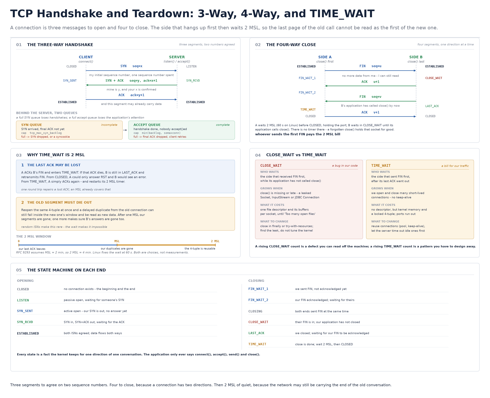

# [네트워크] TCP 3-Way / 4-Way 핸드셰이크와 TIME_WAIT

- 작성일: 2026-11-18
- 키워드: Network, TCP, 3-Way Handshake, 4-Way Handshake, ISN, SYN Queue, Accept Queue, Backlog, somaxconn, TCP State, FIN_WAIT, CLOSE_WAIT, LAST_ACK, TIME_WAIT, 2MSL, 4-tuple, Ephemeral Port, SO_REUSEADDR, SO_REUSEPORT, tcp_tw_reuse, tcp_tw_recycle, Keep-Alive, Connection Pool, HikariCP, RestTemplate, WebClient

## 1. 핵심 요약 (What & Why)

지난 편에서 TCP가 "커널이 간극을 메우는 프로토콜"이라는 것을 봤다. 순서 번호를 붙이고, ACK를 받고, 빠진 것을 다시 보내는 일을 커널이 대신한다. 그런데 그 커널은 그 일을 **아무 때나** 할 수 없다. 순서 번호를 붙이려면 "이 대화의 첫 바이트가 몇 번인가"를 양쪽이 합의해야 하고, 그 합의가 끝난 동안만 상태를 들고 있어야 한다. 이번 편은 그 상태, 즉 **연결(connection)을 언제 만들고 언제 지우는가**의 문제다.

연결을 여는 데는 세 개의 세그먼트가, 닫는 데는 네 개가 든다. 왜 하필 3과 4인지는 두 가지 성질에서 나온다.

- **여는 데 3개인 이유.** 양쪽이 각자의 초기 순서 번호(ISN)를 보내고, 상대가 그것을 확인해 줘야 한다. 그런데 두 번째로 말하는 쪽은 "네 번호 확인했다"와 "내 번호는 이거다"를 한 세그먼트에 함께 실을 수 있다. 그래서 4개가 3개로 줄어든다.
- **닫는 데 4개인 이유.** 연결은 전이중(full-duplex)이다. `FIN`은 "내가 보낼 데이터가 끝났다"는 **한 방향**의 선언일 뿐 연결을 지우지 않는다. 각 방향이 자기 FIN을 보내고 상대의 ACK를 받아야 하므로 FIN/ACK 짝이 두 번, 네 개가 된다.

그리고 그 끝에 하나가 더 남는다. 먼저 닫은 쪽은 연결이 사라진 뒤에도 **TIME_WAIT** 상태로 2MSL(리눅스에서는 60초)을 더 머문다. 이미 끝난 대화를 왜 붙들고 있는가. 이 편의 절반은 그 대답이다.

정리하면 세 문장이다.

1. **연결은 상태이고, 그 상태의 소유자는 커널이다.** 애플리케이션은 `connect()`, `accept()`, `close()`로만 그 상태에 개입한다.
2. **닫는 순서가 누가 무엇을 지불하는지를 정한다.** 먼저 닫은 쪽은 TIME_WAIT으로, 나중에 닫는 쪽은 CLOSE_WAIT으로 값을 치른다.
3. **TIME_WAIT은 버그가 아니라 청구서다.** 없애야 할 것은 이 상태가 아니라 이 상태를 많이 만드는 사용 패턴이다.

## 2. 내부 메커니즘과 구조 (How it works)

### 2.1 ISN: 순서 번호는 왜 임의의 수에서 시작하는가

TCP 연결은 네 개의 값으로 식별된다. 출발지 IP, 출발지 포트, 목적지 IP, 목적지 포트. 이 **4-tuple**이 연결의 이름표이고, 커널은 이 조합으로 "이 세그먼트가 어느 연결의 것인가"를 판단한다. 같은 서버 포트 8080에 수천 개의 클라이언트가 붙을 수 있는 이유가 여기 있다. 서버 포트는 하나지만 4-tuple은 수천 가지다.

그 이름표 위에서 순서 번호는 32비트를 도는 카운터다. 문제는 시작점이다. 만약 모든 연결이 0에서 시작한다면, 방금 닫힌 연결의 지연 세그먼트가 같은 4-tuple로 새로 열린 연결에 도착했을 때 그것이 옛 데이터인지 새 데이터인지 구분할 방법이 없다. 그래서 ISN은 매번 다르게 정한다.

RFC 9293은 ISN 선택을 시계 기반으로 규정한다. 대략 4마이크로초마다 1씩 증가하는 가상 시계에, 연결의 4-tuple과 비밀 키로 계산한 의사난수 값을 더하는 방식이다. 중요한 것은 이 값이 **외부에서 예측할 수 없어야 한다**는 조건이다. 예측 가능하면 공격자가 다음 연결의 순서 번호를 미리 알고 데이터를 끼워 넣을 수 있다.

여기에 작은 규칙이 하나 붙는다. **SYN과 FIN은 순서 번호를 하나씩 소비한다.** 데이터가 아닌 제어 플래그도 순서 공간의 한 칸을 차지한다. 그래서 SYN의 `seq=x`에 대한 응답이 `ack=x+1`이 된다. "SYN을 받았다"는 사실 자체를 번호로 표현하는 셈이다.

그리고 이것이 3-Way Handshake가 필요한 두 번째 이유다. 수신자 입장에서 첫 SYN은 그냥 도착한 세그먼트다. 이전 연결에서 늦게 도착한 SYN인지, 방금 시작된 연결의 SYN인지 알 수 없다. 알 수 없으니 **확인을 요구한다.** "이 번호로 시작하는 게 맞는가"를 물어야만 그 SYN을 신뢰할 수 있다.

### 2.2 3-Way Handshake와 두 개의 큐

서버는 네 단계로 연결을 받는다. `socket()`으로 껍데기를 만들고, `bind()`로 주소를 묶고, `listen()`으로 받을 준비를 하고, `accept()`로 꺼낸다. 이때 `listen()`이 받는 인자가 **backlog**이고, 이 숫자가 실제로 무엇을 제한하는지가 실무에서 자주 틀린다.

리눅스 2.2 이후 `listen()`의 backlog는 **완전히 연결된 소켓, 즉 애플리케이션이 아직 `accept()`하지 않은 소켓의 큐 길이**다. 연결이 반쯤 된 소켓의 큐는 별개의 설정(`net.ipv4.tcp_max_syn_backlog`)이 제한한다. 그리고 backlog 값은 `net.core.somaxconn`보다 크면 조용히 그 값으로 잘린다. 이 파일의 기본값은 리눅스 5.4부터 4096이고, 그 이전 커널에서는 128이었다.

```text
[SYN 도착] --> SYN 큐 (반쯤 연결)  --SYN/ACK-->  [최종 ACK 도착] --> accept 큐 (연결 완료) --> accept()
              tcp_max_syn_backlog                                     min(backlog, somaxconn)
```

두 큐는 차는 방식도, 차서 생기는 증상도 다르다.

| 큐 | 무엇이 쌓이나 | 넘치면 | 겉으로 보이는 증상 |
| --- | --- | --- | --- |
| SYN 큐 | SYN은 받았지만 최종 ACK가 아직 없는 연결 | SYN을 버린다. `tcp_syncookies`가 켜져 있으면(기본값 1) SYN 큐가 넘칠 때 상태 없이 쿠키로 응답한다 | 클라이언트가 SYN을 재전송하며 연결이 느려진다 |
| accept 큐 | 핸드셰이크는 끝났지만 `accept()`되지 않은 연결 | 커널이 마지막 ACK를 그냥 버린다(`tcp_abort_on_overflow`가 꺼져 있을 때) | 클라이언트는 연결된 줄 알고 데이터를 보내고 재전송한다. 서버는 나중에야 받는다 |

두 번째 줄이 실무에서 특히 고약하다. **서버가 `accept()`를 충분히 빨리 부르지 않으면, 클라이언트는 이미 연결이 성립했다고 믿는다.** 3-Way Handshake가 커널 수준에서 끝났기 때문이다. 애플리케이션이 바쁘거나, `accept()` 뒤의 처리가 블로킹이거나, 이벤트 루프에 무거운 작업이 끼어 있으면 이 큐가 찬다. "연결은 되는데 응답이 없다"는 장애의 절반은 여기서 온다.

톰캣의 기본값이 이 구조를 그대로 드러낸다.

- `acceptCount` = 100. `maxConnections`에 도달했을 때 운영체제 큐에 설 수 있는 연결 수. 즉 backlog다.
- `maxConnections` = 8192. 커넥터가 동시에 들고 처리하는 연결 수.
- `connectionTimeout` = 60,000ms가 속성 기본값이고, 톰캣에 들어 있는 `server.xml`은 20,000ms로 설정한다. `keepAliveTimeout`은 따로 지정하지 않으면 이 값을 그대로 쓴다.

읽는 순서가 중요하다. `maxConnections`까지는 톰캣이 받아서 들고 있고, 그 위로 넘치는 것이 `acceptCount` 큐이고, 그 큐가 넘치면 커널이 SYN을 버린다. 세 단계의 이름이 다르고, 각 단계의 실패 신호도 다르다.

### 2.3 4-Way Handshake: 방향마다 따로 닫는다

`close()`는 "보낼 데이터가 없다"는 뜻이지 "연결을 지운다"는 뜻이 아니다. 그래서 닫기가 네 단계다.

```text
A (먼저 닫는 쪽)                                     B (나중에 닫는 쪽)
ESTABLISHED                                          ESTABLISHED
   |  FIN seq=u          (보낼 데이터가 끝났다)        |
   |-------------------------------------------------->|  CLOSE_WAIT
FIN_WAIT_1                                           (B의 애플리케이션은 아직 close() 전)
   |  ACK u+1                                          |
   |<--------------------------------------------------|
FIN_WAIT_2                                           (B가 close() 호출)
   |  FIN seq=v                                        |
   |<--------------------------------------------------|  LAST_ACK
   |  ACK v+1                                          |
   |-------------------------------------------------->|  CLOSED
TIME_WAIT  (2 MSL 대기)
CLOSED
```

각 상태가 뜻하는 바는 이렇다.

| 상태 | 어느 쪽 | 의미 |
| --- | --- | --- |
| `FIN_WAIT_1` | 먼저 닫은 쪽 | FIN을 보냈고 아직 ACK를 못 받았다 |
| `FIN_WAIT_2` | 먼저 닫은 쪽 | 내 FIN은 확인됐고, 상대의 FIN을 기다린다 |
| `CLOSE_WAIT` | 나중에 닫는 쪽 | 상대의 FIN을 받아 ACK했다. **내 애플리케이션이 아직 `close()`를 안 했다** |
| `LAST_ACK` | 나중에 닫는 쪽 | 애플리케이션이 `close()`해서 FIN을 보냈고, 그 ACK를 기다린다 |
| `TIME_WAIT` | 먼저 닫은 쪽 | 닫기가 끝났다. 2MSL 뒤에 CLOSED |
| `CLOSING` | 양쪽 | 두 쪽이 거의 동시에 `close()`해서 FIN이 교차했다 |

`CLOSE_WAIT`이 이 표에서 유일하게 **애플리케이션의 코드 상태를 반영하는** 상태다. 나머지는 커널이 알아서 굴러가지만, `CLOSE_WAIT`에서 `LAST_ACK`으로 넘어가는 유일한 방법은 애플리케이션이 `close()`를 부르는 것이다. 커널에는 이 상태를 끝낼 타이머가 없다. 그래서 `CLOSE_WAIT`은 "우리 코드가 소켓을 닫지 않았다"는 사실을 커널이 대신 적어 준 기록이다.

여기에 반쪽 닫기(half-close)라는 개념이 붙는다. FIN을 보낸 쪽도 상대의 데이터는 계속 읽을 수 있다. HTTP에서 서버가 응답을 다 쓰고 FIN을 보내는 동안에도 클라이언트가 보내는 요청을 처리하는 구현이 가능한 이유다. 실제로는 대부분 양쪽이 곧바로 닫지만, 프로토콜은 그 두 방향을 독립으로 다룬다.

정상 종료가 아닌 경우는 `RST`다. 존재하지 않는 연결로 온 세그먼트, 이미 닫힌 연결로 온 데이터, 애플리케이션이 abort한 소켓에는 RST가 나간다. RST를 받은 쪽은 상태를 즉시 버리고 CLOSED로 간다. 흥미로운 규칙이 하나 있는데, RFC 9293은 RST를 보내는 쪽이 TIME_WAIT으로 들어가기를 권한다. 바쁜 서버에서 남는 상태를 정리하는 데 도움이 되기 때문이다.

### 2.4 TIME_WAIT이 2MSL인 이유

먼저 결론. RFC 9293은 **능동적으로 닫은 쪽이 2×MSL 동안 TIME_WAIT에 머물러야 한다**고 규정한다(MUST). MSL은 "세그먼트가 네트워크에서 살아 있을 수 있는 최대 시간"이고, 이 명세는 2분을 가정한다. 즉 2MSL은 4분이다. 물론 이것은 측정값이 아니라 **엔지니어링 선택**이라고 RFC가 직접 밝힌다. 리눅스는 더 짧게 잡아 TIME_WAIT을 60초로 고정한다(커널의 `TCP_TIMEWAIT_LEN`, MSL을 30초로 본 셈이다).

이 대기가 필요한 이유는 두 가지다.

**첫째, 마지막 ACK가 유실될 수 있다.** A가 마지막 ACK를 보내고 곧바로 CLOSED로 갔다고 하자. 그 ACK가 네트워크에서 사라지면 B는 LAST_ACK에서 FIN을 재전송한다. 그때 A가 CLOSED라면 그 FIN은 "존재하지 않는 연결로 온 세그먼트"이므로 RST로 응답한다. B는 정상적으로 닫히던 연결에서 오류를 만난다. 반대로 A가 TIME_WAIT에 살아 있으면 재전송된 FIN을 받고 ACK를 다시 보낸다. 그리고 그때 2MSL 타이머를 처음부터 다시 시작한다.

**둘째, 옛 세그먼트가 죽을 시간을 줘야 한다.** 닫히자마자 같은 4-tuple로 새 연결을 열면, 이전 연결의 지연된 중복 세그먼트가 새 연결의 수신 윈도우 안으로 들어올 수 있다. ISN이 매번 달라서 실제로 겹칠 확률은 매우 낮지만, TIME_WAIT은 그 확률을 0으로 만든다. 한 MSL이면 우리가 보낸 세그먼트가 네트워크에서 사라지고, 한 MSL이 더 지나면 상대가 보낸 세그먼트도 사라진다. **2MSL은 편도 한 번이 아니라 왕복 한 번**이라는 점이 핵심이다.

> [!NOTE]
> RFC는 예외도 둔다. TIME_WAIT 상태에서 상대가 새 SYN을 보내면, 새 ISN이 이전 연결의 마지막 순서 번호보다 크다는 조건 아래 2MSL을 기다리지 않고 연결을 다시 열 수 있다(MAY). TIME_WAIT이 절대적인 잠금이 아니라 "안전이 확인되면 풀 수 있는 대기"라는 뜻이다.

그렇다면 이 상태는 무엇을 잡고 있는가. 리눅스에서 TIME_WAIT 소켓은 애플리케이션의 파일 디스크립터를 잡지 않는다. 프로세스가 `close()`를 이미 호출했기 때문이다. 대신 커널 안에 가벼운 구조체로 남아 4-tuple을 점유하고 약간의 메모리를 쓴다. 즉 **fd 누수가 아니라 커널 메모리와 포트 자원의 문제**다. 이 구분이 뒤에 나오는 진단의 출발점이다.

TIME_WAIT은 세 가지 경우에 끝난다. 2MSL이 지나면 정상 종료. TIME_WAIT 상태에서 RST를 받으면 즉시 종료(`net.ipv4.tcp_rfc1337`이 꺼져 있을 때의 기본 동작). 그리고 시스템 전역 TIME_WAIT 소켓 수가 `tcp_max_tw_buckets`를 넘으면 커널이 강제로 정리하며 경고를 남긴다.

### 2.5 같은 TIME_WAIT, 다른 비용

TIME_WAIT이 자원이 되는 방식은 어느 쪽이 닫았는지에 따라 다르다.

**서버가 먼저 닫는 경우.** 서버의 로컬 포트는 고정(예: 8080)이고, 연결을 구분하는 것은 원격 IP와 포트다. 새 클라이언트는 새로운 4-tuple을 만들기 때문에 서버가 TIME_WAIT에 들고 있는 연결이 새 연결을 막지 않는다. 서버 쪽 TIME_WAIT은 포트 고갈이 아니라 **소켓 수와 커널 메모리**의 문제다.

**클라이언트가 먼저 닫는 경우.** 클라이언트는 나갈 때마다 임시 포트(ephemeral port)를 새로 받는다. 리눅스의 기본 범위는 32768~60999로 약 2만 8천 개다. 짧은 연결을 초당 수천 개씩 열고 닫으면 이 범위가 금방 TIME_WAIT으로 채워지고, 새 연결에 쓸 포트가 없어 `Cannot assign requested address`(EADDRNOTAVAIL)가 난다. 애플리케이션 코드에는 아무 문제가 없는데 커넥션이 안 열리는, 원인을 찾기 어려운 장애다.

여기서 한 가지가 더 따라 나온다. `bind()`가 "Address already in use"로 실패하는 것과 TIME_WAIT이 같은 뿌리다. 이미 존재하는 4-tuple은 다시 쓸 수 없고, TIME_WAIT은 그 4-tuple을 아직 놓지 않은 상태다. 서버를 재시작할 때 이 에러를 만나는 이유이기도 하다.

## 3. 구조 도식 (Diagram)



- **01 3-Way Handshake (왼쪽 위)**: 클라이언트와 서버 사이의 세 세그먼트와, 그 사이에 놓이는 두 상태(`SYN_SENT`, `SYN_RCVD`). 각 세그먼트가 무엇을 확인하는지, SYN이 순서 번호 하나를 소비한다는 점을 적었다. 아래쪽에는 서버 뒤에 숨은 두 큐를 나란히 두었다. SYN 큐가 차면 SYN이 사라지고, accept 큐가 차면 마지막 ACK가 사라진다. 두 실패가 클라이언트에게 전혀 다르게 보인다.
- **02 4-Way Close (오른쪽 위)**: FIN/ACK가 두 번 오가는 모양과, 먼저 닫는 쪽(A)과 나중에 닫는 쪽(B)의 상태. A는 마지막 ACK 뒤 TIME_WAIT으로 들어가 2MSL을 기다리고, B는 자기 애플리케이션이 `close()`를 부를 때까지 CLOSE_WAIT에 머문다. 아래 문장이 요점이다. 먼저 닫은 쪽이 2MSL 청구서를 낸다.
- **03 TIME_WAIT이 2MSL인 이유 (왼쪽 가운데)**: 두 개의 이유를 카드로 나눴다. 위는 마지막 ACK 유실 복구, 아래는 옛 중복 세그먼트 소멸. 그 아래 타임라인이 2MSL을 두 구간으로 보여 준다. 첫 MSL에 우리 세그먼트가 사라지고, 둘째 MSL에 상대의 응답이 사라진다. RFC의 2분 가정과 리눅스의 60초가 다르다는 것도 함께 적었다.
- **04 CLOSE_WAIT vs TIME_WAIT (오른쪽 가운데)**: 두 상태를 "누가 기다리는가", "무엇이 늘어날 때 늘어나는가", "무엇을 잃는가", "무엇을 고쳐야 하는가"로 나란히 비교했다. 왼쪽은 우리 코드의 결함, 오른쪽은 우리 트래픽의 청구서다.
- **05 상태 기계 (아래)**: 연결을 여는 다섯 상태와 닫는 여섯 상태를 한 줄씩 정리했다. 이 11개가 커널이 연결 하나에 대해 들고 있는 사실의 전부이고, 애플리케이션이 관여하는 지점은 `connect()`, `accept()`, `send()`, `close()` 네 개뿐이다.

## 4. 비교 표

### 4.1 3-Way Handshake vs 4-Way Handshake

| 항목 | 3-Way Handshake | 4-Way Handshake |
| --- | --- | --- |
| 목적 | 두 방향의 ISN을 합의하고 연결을 연다 | 두 방향을 각각 닫는다 |
| 세그먼트 | SYN, SYN+ACK, ACK | FIN, ACK, FIN, ACK |
| 왜 이 개수인가 | 두 번째 메시지에 ACK와 SYN을 함께 실을 수 있다 | FIN은 한 방향만 닫으므로 방향마다 한 쌍이 필요하다 |
| 시작 상태 | CLOSED, LISTEN | ESTABLISHED |
| 끝 상태 | ESTABLISHED | 한쪽은 CLOSED, 먼저 닫은 쪽은 TIME_WAIT |
| 중간 상태 | SYN_SENT, SYN_RCVD | FIN_WAIT_1, FIN_WAIT_2, CLOSE_WAIT, LAST_ACK, CLOSING |
| 순서 번호 소비 | SYN이 1 소비 | FIN이 1 소비 |
| 실패 신호 | 연결 timeout, SYN 재전송 | CLOSE_WAIT 누적, TIME_WAIT 누적, RST |
| 누가 결정하나 | 클라이언트가 시작 | 둘 중 누구든, 먼저 `close()`를 부른 쪽 |

### 4.2 TIME_WAIT vs CLOSE_WAIT

| 항목 | TIME_WAIT | CLOSE_WAIT |
| --- | --- | --- |
| 누가 | 먼저 `close()`한 쪽(능동 종료) | FIN을 받은 쪽(수동 종료) |
| 언제 | 마지막 ACK를 보낸 뒤 | 상대 FIN을 ACK한 뒤, 내 `close()` 전 |
| 지속 시간 | 2MSL(리눅스 60초)로 정해져 있다 | 애플리케이션이 `close()`할 때까지. 상한 없음 |
| 파일 디스크립터 | 잡지 않는다 | 계속 잡고 있다 |
| 무엇을 점유하나 | 4-tuple, 커널 메모리 | fd, 소켓 버퍼 |
| 누적되면 | 포트 고갈(클라이언트), 메모리 증가(서버) | fd 고갈, `Too many open files` |
| 원인 | 정상 동작. 짧은 연결을 너무 자주 열고 닫는 패턴 | 결함. `close()` 누락 또는 지연 |
| 대응 | 커넥션 재사용(풀, keep-alive), 서버가 먼저 닫게 하기 | `finally`나 try-with-resources로 닫기, 누수 지점 찾기 |
| 커널 설정으로 줄일 수 있나 | 일부 가능하지만 대개 잘못된 접근 | 불가능. 코드 문제다 |

### 4.3 상태 전이 한눈에 보기

| 상태 | 전이 조건 | 다음 상태 |
| --- | --- | --- |
| CLOSED | `connect()` -> SYN 전송 | SYN_SENT |
| LISTEN | SYN 수신 -> SYN+ACK 전송 | SYN_RCVD |
| SYN_SENT | SYN+ACK 수신 | ESTABLISHED |
| SYN_RCVD | ACK 수신 | ESTABLISHED |
| ESTABLISHED | 내가 `close()` -> FIN 전송 | FIN_WAIT_1 |
| ESTABLISHED | 상대 FIN 수신 | CLOSE_WAIT |
| FIN_WAIT_1 | 내 FIN의 ACK 수신 | FIN_WAIT_2 |
| FIN_WAIT_1 | 상대 FIN 수신(동시 종료) | CLOSING |
| FIN_WAIT_2 | 상대 FIN 수신 | TIME_WAIT |
| CLOSE_WAIT | 애플리케이션 `close()` -> FIN 전송 | LAST_ACK |
| LAST_ACK | 내 FIN의 ACK 수신 | CLOSED |
| TIME_WAIT | 2MSL 경과 | CLOSED |

## 5. 내가 깨달은 점 (My Insight)

- **연결의 주인은 커널이고, 애플리케이션은 입구와 출구만 쥐고 있다.** `accept()`와 `close()`가 전부다. 이 사실을 받아들이면 두 상태의 성격이 갈린다. `CLOSE_WAIT`은 **내가 아직 문을 안 닫았다**는 뜻이고, `TIME_WAIT`은 **내가 먼저 문을 닫았다**는 뜻이다. `ss`로 상태를 볼 때 이 두 문장으로 읽으면 "우리 잘못인가, 정상인가"가 즉시 갈린다.

- **커넥션 풀이 존재하는 이유는 두 개의 청구서를 동시에 없애기 때문이다.** 연결을 재사용하면 첫째, 3-Way Handshake에 드는 왕복 한 번과 CPU를 아낀다. 둘째, `close()`를 미루므로 TIME_WAIT도 만들지 않고 ephemeral 포트도 쓰지 않는다. 흔히 "풀은 성능 최적화"라고 배우지만, 정확히는 **프로토콜이 부과한 비용을 회피하는 설계**다. 풀이 없다는 것은 매 요청마다 핸드셰이크를 하고 매 요청마다 4-tuple을 새로 버린다는 뜻이다.

- **Keep-Alive의 진짜 어려움은 연결을 유지하는 것이 아니라 언제 끊을지 정하는 것이다.** 양쪽이 각자 유휴 타임아웃을 들고 있으면, 한쪽은 살아 있다고 믿는 연결을 다른 쪽은 이미 닫아 버린 상태가 생긴다. 그 연결로 요청을 보내는 순간 `connection reset`, `broken pipe`, 그리고 풀 안의 깨진 커넥션을 꺼내 쓰는 오류가 난다. 재시도로 덮는 것은 치료가 아니라 진통제다. 제대로 된 처방은 **한쪽의 타임아웃을 다른 쪽보다 반드시 짧게 두는 것**이다.

- **TIME_WAIT을 0으로 만드는 튜닝은 목표를 잘못 잡은 것이다.** `tcp_tw_reuse`를 켜고 `tcp_max_tw_buckets`를 낮추면 숫자는 줄어든다. 하지만 줄어든 것은 증상이고, 원인인 "짧게 열고 짧게 닫는 패턴"은 그대로다. 그 패턴을 고치면 TIME_WAIT은 자연히 줄고, 커널 파라미터는 건드릴 필요가 없어진다. 반대 방향으로 접근해야 하는 유일한 상태가 `CLOSE_WAIT`이다. 이쪽은 파라미터가 아니라 코드를 고쳐야 한다.

- **"연결은 되는데 응답이 없다"의 절반은 accept 큐다.** 3-Way Handshake는 커널이 끝내므로 클라이언트는 이미 연결됐다고 본다. 서버 애플리케이션이 `accept()`를 늦게 부르면 그 사실이 클라이언트에게는 보이지 않는다. 이때 클라이언트가 보는 것은 timeout이나 재전송이고, 서버가 보는 것은 차오르는 큐다. 두 관측이 같은 사건이라는 것을 알면 진단 순서가 완전히 달라진다.

## 6. 실무 관점 및 트레이드오프 (Trade-off)

### 6.1 누가 먼저 닫을 것인가

닫는 순서를 정하는 것이 곧 비용을 정하는 일이다. 두 가지 선택지가 있다.

- **서버가 먼저 닫는다.** 유휴 연결을 서버가 정리하는 쪽이 운영하기 쉽다. 서버는 자기 자원을 스스로 관리할 수 있고, 클라이언트 수만큼 설정을 흩뿌릴 필요가 없다. 대가는 서버에 TIME_WAIT이 쌓이는 것이다. 서버 포트는 고정이므로 포트 고갈은 아니고, 소켓 수와 메모리가 문제다.
- **클라이언트가 먼저 닫는다.** 서버는 깨끗하지만, 각 클라이언트가 ephemeral 포트를 TIME_WAIT으로 태운다. 클라이언트가 많으면 각자 조금씩 나눠 내므로 분산된다. 다만 한 프로세스가 초당 수천 건을 호출하는 구조라면 그 프로세스 하나가 포트를 고갈시킨다.

> [!NOTE]
> 리버스 프록시 뒤에 있는 구조라면 순서가 하나 더 있다. Nginx는 업스트림과의 유휴 연결을 `keepalive_timeout`으로 정리하고, 클라이언트 연결에는 `lingering_close`로 남은 데이터를 읽어 버린 뒤 닫는다. 프록시가 양쪽 모두에서 "먼저 닫는 쪽"이 되는 경우가 많고, 그래서 프록시에 TIME_WAIT이 몰린다. 정상이다.

### 6.2 진단: 어디를 보는가

| 보고 싶은 것 | 명령 | 읽는 법 |
| --- | --- | --- |
| 상태별 소켓 수 | `ss -tan state time-wait \| wc -l` | 값 자체보다 추세. 톱니처럼 오르내리면 정상 순환이다 |
| 전체 요약 | `ss -s` | `timewait` 항목과 총 소켓 수를 함께 본다 |
| 프로토콜 전역 카운터 | `nstat -az \| grep -i listen` | `TcpExtListenOverflows`, `TcpExtListenDrops`가 0이 아니면 accept 큐가 찼다는 뜻이다 |
| TIME_WAIT 강제 정리 여부 | `dmesg \| grep -i "time wait bucket"` | 이 메시지가 보이면 `tcp_max_tw_buckets`를 넘어 커널이 개입한 것이다 |
| 소켓 전역 통계 | `/proc/net/sockstat` | `TCP: inuse N orphan N tw N alloc N mem N`의 `tw`가 TIME_WAIT 수 |

`CLOSE_WAIT`을 볼 때는 절대값보다 **단조 증가 여부**가 중요하다. 정상 서비스에서도 순간적으로 존재하지만, 줄지 않고 쌓인다면 그 프로세스가 소켓을 닫지 않고 있다는 확실한 신호다. 같은 프로세스의 fd 수(`ls /proc/<pid>/fd | wc -l`)와 함께 보면 누수 지점이 좁혀진다.

### 6.3 SO_REUSEADDR과 SO_REUSEPORT

- `SO_REUSEADDR`: `bind()`할 때 TIME_WAIT 상태의 주소를 재사용할 수 있게 한다. 서버를 재시작할 때 "Address already in use"를 피하는 그 옵션이다. 톰캣, 네티, 스프링 부트 임베디드 서버가 기본으로 켠다.
- `SO_REUSEPORT`: 리눅스 3.9에서 들어왔다. **여러 소켓이 같은 주소와 포트에 동시에 `bind()`**할 수 있게 하고, 커널이 들어오는 연결을 그 소켓들에 분산한다. 여러 프로세스가 같은 포트로 각자 `listen()`하는 구조(예: 워커 프로세스 여러 개)를 커널 수준에서 만드는 것이다. Nginx의 `reuseport` 옵션이 이것이다.

> [!WARNING]
> 둘은 이름이 비슷하지만 목적이 다르다. `SO_REUSEADDR`은 "이미 끝난 연결의 흔적을 치워 달라"이고, `SO_REUSEPORT`는 "지금 살아 있는 리스너를 여러 개 두게 해 달라"이다. `SO_REUSEPORT`를 켜면 커널이 연결을 해시로 나누므로, 워커마다 부하가 고르지 않을 수 있다는 점도 함께 봐야 한다.

### 6.4 tcp_tw_reuse와 tcp_tw_recycle

- `net.ipv4.tcp_tw_reuse`: TIME_WAIT 소켓을 **나가는 연결**에 재사용한다. TCP 타임스탬프가 켜져 있을 때만 프로토콜상 안전하고, 기본값은 꺼짐이다. 리눅스 매뉴얼도 "기술 전문가의 조언 없이 바꾸지 말라"고 적는다. 클라이언트 쪽 ephemeral 포트 고갈에는 도움이 되지만, 근본 원인인 짧은 연결 패턴은 그대로다.
- `net.ipv4.tcp_tw_recycle`: 과거에 TIME_WAIT 소켓을 빠르게 재활용하던 옵션이다. **리눅스 4.12에서 커널에서 제거됐다.** NAT 뒤의 여러 호스트가 같은 공인 IP로 접속할 때 타임스탬프가 서로 어긋나 연결이 간헐적으로 끊기는 문제 때문에 폐기된 옵션이다. 지금 검색해서 나오는 튜닝 문서 중 이 값을 1로 설정하라고 하는 것은 모두 오래된 문서다.

> [!WARNING]
> "TIME_WAIT이 많다"는 이유로 `tcp_tw_recycle=1`을 넣는 것은 지금 커널에서는 아무 효과가 없고, 옛 커널에서는 NAT 환경에서 조용한 장애를 만든다. TIME_WAIT 관련 파라미터를 만질 때는 먼저 `tcp_timestamps`가 켜져 있는지, 클라이언트가 NAT 뒤에 있는지 확인해야 한다.

### 6.5 NAT와 로드 밸런서가 끼어들 때

NAT 장비는 여러 내부 호스트의 연결을 하나의 공인 IP와 제한된 포트로 변환한다. 이때 NAT 장비의 포트 풀이 먼저 고갈된다. 애플리케이션이 자기 서버 안에서 아무리 커넥션을 잘 재사용해도, 경유하는 NAT나 프록시가 연결을 끊고 포트를 돌려쓰면 TIME_WAIT은 그 장비에 쌓인다. **TIME_WAIT은 항상 "누가 먼저 닫았는가"의 위치를 따라간다**는 점을 기억하면, 어느 구간에서 숫자가 튀는지로 원인 구간을 좁힐 수 있다.

### 6.6 스프링에서 이 이야기가 나타나는 곳

자바 백엔드에서 TIME_WAIT과 CLOSE_WAIT은 추상화 뒤에 숨어 있다가, 트래픽이 늘 때 갑자기 드러난다.

**RestTemplate과 HttpURLConnection.** 기본 `SimpleClientHttpRequestFactory`는 `HttpURLConnection`을 쓴다. 연결 재사용은 JDK 내부의 keep-alive 캐시가 맡고, `http.maxConnections`의 기본값은 목적지당 5다. 즉 동시 요청이 5를 넘으면 연결이 새로 열리고, 유휴 연결은 서버가 keep-alive 시간을 알려 주지 않을 때 기본 5초 안팎으로 정리된다. 많은 요청을 짧게 던지는 코드에서 클라이언트 쪽 TIME_WAIT이 늘어나는 전형적인 모양이 여기서 나온다.

**WebClient와 Reactor Netty.** 연결 풀을 직접 들고 있으므로 재사용은 잘 되지만, 풀 크기와 유휴 타임아웃, 그리고 상대의 타임아웃과의 관계를 설정으로 맞춰야 한다. 풀이 서버보다 오래 살아 있는 연결을 들고 있으면 그 연결은 이미 상대에게 없는 연결이다.

**HikariCP.** DB 커넥션 풀도 같은 문제를 푼다. `maximumPoolSize`(기본 10)만큼 연결을 유지하고 `maxLifetime`(기본 30분)이 지나면 교체한다. 이 값은 DB나 그 앞의 프록시가 유휴 연결을 끊는 시간보다 **반드시 짧아야** 한다. DB가 먼저 끊으면 풀은 죽은 연결을 들고 있다가 꺼내 주고, 애플리케이션은 "통신 오류"를 본다. `idleTimeout`(기본 10분)도 같은 원리로 상대의 타임아웃보다 짧게 잡는다.

세 경우의 공통 원리는 하나다. **내 타임아웃이 상대의 타임아웃보다 짧아야 하고, 연결은 열고 닫는 것보다 빌려 쓰고 돌려주는 것이 싸다.**

## 7. 참고 자료 (References)

- RFC 9293 (Transmission Control Protocol, TCP) - 3-Way Handshake, 상태 기계, FIN 처리, TIME_WAIT의 2MSL 규정(MUST-13)과 재개 허용(MAY-2)
- RFC 793 (원 TCP 명세) - RFC 9293이 대체한 원문. MSL 2분 가정의 출처
- RFC 1122 (Requirements for Internet Hosts) - 호스트 요구사항과 TIME_WAIT 처리
- RFC 1337 (TIME-WAIT Assassination Hazards in TCP) - TIME_WAIT에서 RST를 받았을 때의 위험
- RFC 7323 (TCP Extensions for High Performance) - 타임스탬프와 PAWS. `tcp_tw_reuse`의 안전 조건
- Linux man-pages: `tcp(7)` - `tcp_tw_reuse`, `tcp_tw_recycle`, `tcp_max_syn_backlog`, `tcp_max_tw_buckets`, `tcp_rfc1337`, `tcp_abort_on_overflow`
- Linux man-pages: `listen(2)` - backlog의 의미 변화(리눅스 2.2)와 `somaxconn` 상한(5.4부터 4096)
- Linux man-pages: `socket(7)`, `ip(7)` - `SO_REUSEADDR`, `SO_REUSEPORT`, ephemeral 포트 범위
- Linux 커널 `Documentation/networking/ip-sysctl.rst` - 네트워크 관련 sysctl의 정의와 기본값
- Linux 커널 `include/net/tcp.h` - `TCP_TIMEWAIT_LEN`(60초) 정의
- W. Richard Stevens. TCP/IP Illustrated, Volume 1 - 연결 수립과 종료, TIME_WAIT의 고전적 설명
- W. Richard Stevens, Bill Fenner, Andrew M. Rudoff. UNIX Network Programming, Volume 1 - `listen()`, `accept()`, `SO_REUSEADDR`의 실무 규칙
- Apache Tomcat 문서: HTTP Connector - `acceptCount`, `maxConnections`, `connectionTimeout`, `keepAliveTimeout`의 기본값과 관계
- HikariCP 문서: Configuration - `maximumPoolSize`, `maxLifetime`, `idleTimeout`의 의미
- Oracle Java 문서: Networking Properties - `http.keepAlive`, `http.maxConnections`의 기본값과 동작
