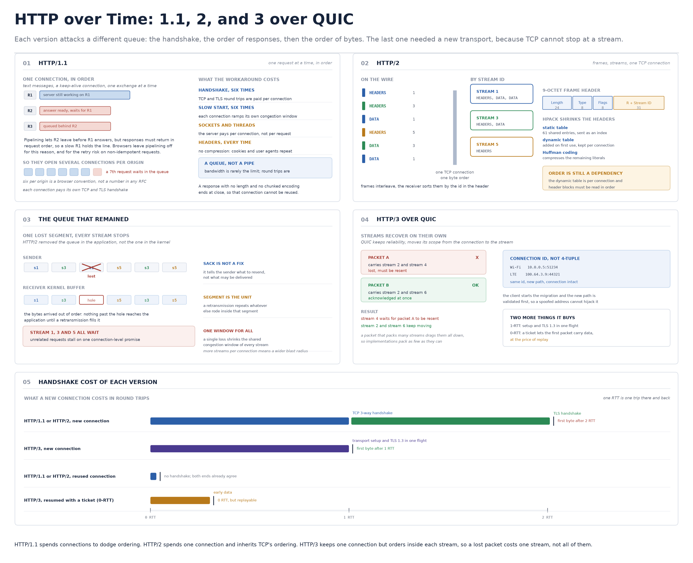

# [네트워크] HTTP/1.1 · HTTP/2 · HTTP/3(QUIC) 진화와 전송 구조

- 작성일: 2026-11-19
- 키워드: Network, HTTP/1.1, HTTP/2, HTTP/3, QUIC, Head-of-Line Blocking, Keep-Alive, Pipelining, Multiplexing, Binary Framing, HPACK, QPACK, Connection Migration, 0-RTT, TLS 1.3

## 1. 핵심 요약 (What & Why)

지난 두 편은 전송 계층 안쪽을 봤다. TCP가 순서 번호와 ACK로 IP의 간극을 메우고, 연결을 열고 닫는 데 왕복이 들고, 그 끝에 TIME_WAIT이라는 청구서가 남는다는 것까지. 이번 편은 그 위에 얹힌 **애플리케이션 프로토콜**이 그 전송 계층의 성질을 어떻게 다뤘는가의 이야기다.

HTTP가 느린 이유는 대역폭이 아니라 **기다림**이다. 그리고 그 기다림은 서로 다른 세 층에서 생긴다. 이 세 층을 구분하는 것이 이 편의 뼈대다.

1. **연결 수립 비용.** 요청을 보내기 전에 TCP 3-Way Handshake로 왕복 한 번, 그 위에 TLS 핸드셰이크로 또 한 번(혹은 두 번)이 든다. 데이터를 하나 보내기 전에 이미 왕복 두세 번을 쓴다.
2. **애플리케이션 계층의 Head-of-Line Blocking.** 한 연결에서 요청과 응답이 순서를 지켜야 한다면, 앞의 요청이 느릴 때 뒤의 요청은 이미 준비됐는데도 기다린다. 병목이 서버도 회선도 아닌 **순서 규칙**이다.
3. **전송 계층의 Head-of-Line Blocking.** TCP는 바이트의 연속 하나를 보장한다. 세그먼트 하나가 유실되면 그 뒤에 도착한 바이트는 커널 버퍼에 있으면서도 애플리케이션에 전달되지 않는다. 병목이 **프로토콜의 보장 방식**이다.

세 버전은 이 세 층을 하나씩 겨냥하며 진화했다.

- **HTTP/1.1**은 텍스트 프로토콜에 영속 연결을 기본으로 넣어 1번을 줄였다. 파이프라이닝으로 2번까지 풀려 했지만 "응답은 요청 순서대로"라는 규칙 때문에 실패했고, 그래서 브라우저는 **연결을 여러 개 여는 우회**로 2번을 피했다. 그 우회의 대가는 1번의 증가와 서버 자원이었다.
- **HTTP/2**는 전송 표현을 바이너리 프레임으로 바꿔 한 연결 위에 여러 스트림을 인터리빙했다. 연결 하나로 여러 요청을 동시에 처리하므로 1번과 2번이 함께 줄었다. 하지만 전송은 여전히 TCP 하나이므로 **3번은 손대지 못했다.** 한 연결의 모든 스트림이 하나의 바이트 순서를 공유하기 때문이다.
- **HTTP/3**는 전송 자체를 UDP 위에 다시 만들었다(QUIC). 신뢰성과 순서 보장을 **스트림 단위로** 옮겨 3번을 해소했고, TLS 1.3을 전송 계층에 통합해 1번을 1-RTT(재연결은 0-RTT)로 줄였으며, 연결을 IP·포트 조합이 아니라 Connection ID로 식별해 망이 바뀌어도 연결이 살아남게 했다.

정리하면 세 문장이다.

1. **HTTP/1.1의 다중 연결은 프로토콜의 순서 규칙을 피하려고 지불한 비용이다.** 연결 수는 성능 튜닝의 결과가 아니라 제약의 흔적이다.
2. **HTTP/2는 애플리케이션 계층의 큐를 없앴지만, TCP의 큐는 그대로 남았다.** 멀티플렉싱이 깊어질수록 남은 큐 하나의 영향력은 오히려 커진다.
3. **HTTP/3의 진짜 변화는 "TCP를 쓰지 않는다"가 아니라 "순서 보장의 단위를 연결에서 스트림으로 옮겼다"이다.** 손실 복구와 혼잡 제어는 여전히 있고, 그 적용 범위만 좁아졌다.

## 2. 내부 메커니즘과 구조 (How it works)

### 2.1 HTTP/1.1: 사람이 읽는 텍스트, 그리고 순서라는 족쇄

HTTP/1.1의 메시지는 텍스트다. 요청은 `메서드 SP 요청 대상 SP 버전 CRLF`, 이어서 헤더 필드들이 `이름: 값 CRLF`로 한 줄씩, 빈 줄 하나로 헤더의 끝을 표시하고, 그 뒤에 본문이 온다. 응답도 같은 모양이다. 이 형식의 장점은 명확하다. 파서가 단순하고, 프록시와 사람이 읽고 고칠 수 있으며, 확장이 헤더 추가만으로 가능하다.

대가는 세 가지다.

- **파싱 비용과 모호성.** 경계가 줄바꿈이므로 본문의 끝을 알려면 별도의 규칙이 필요하다. `Content-Length`가 있으면 그 바이트 수만큼, `Transfer-Encoding: chunked`면 청크 크기 줄을 따라가며, 둘 다 없으면 연결이 닫히는 것으로 끝을 표시한다.
- **헤더의 반복 전송.** 같은 오리진에 보내는 모든 요청이 같은 `Host`, `User-Agent`, `Accept`, 쿠키를 매번 다시 실어 보낸다. 쿠키가 수 KB로 커진 현대 웹에서는 요청 본문보다 헤더가 큰 경우도 흔하다. HTTP/1.1에는 헤더 압축이 없다.
- **요청 하나가 연결 하나를 독점한다.** 한 연결에서 요청을 보내고 응답을 다 받은 뒤에야 다음 요청을 보낼 수 있다. 앞의 응답이 늦으면 뒤의 요청은 **보내지도 못한다.**

두 번째와 세 번째가 HTTP/1.1의 성능 문제를 거의 전부 설명한다. 그리고 두 문제를 푸는 시도가 각각 **압축**과 **파이프라이닝**이었는데, 후자는 프로토콜 규칙 때문에 실패했다.

#### 영속 연결은 기본값이다

HTTP/1.0에서는 연결을 재사용하려면 `Connection: keep-alive`를 명시해야 했다. HTTP/1.1부터는 **영속 연결이 기본**이다. 클라이언트는 `Connection: close`를 보내거나 서버가 그 옵션을 돌려줄 때까지 같은 연결에 요청을 계속 보낼 수 있다.

여기에 실무에서 자주 놓치는 조건이 붙는다. RFC 9112는 영속 연결을 유지하려면 **모든 메시지가 자기 길이를 스스로 정의해야 한다**고 규정한다. 즉 `Content-Length`나 chunked 인코딩이 없어 "연결이 닫히면 끝"인 응답은 그 연결을 재사용할 수 없다. 서버는 응답을 보낸 뒤 요청 본문을 끝까지 읽거나 연결을 닫아야 한다. 남은 데이터가 다음 요청으로 오해되기 때문이다. 이 조건이 지켜지지 않는 구현이 만드는 고전적 장애가, 응답이 하나 밀려서 다음 요청에 이전 응답이 돌아오는 형태다.

#### 파이프라이닝은 왜 실패했는가

파이프라이닝은 단순한 발상이다. 응답을 기다리지 않고 요청을 연속으로 보내면 왕복 대기를 겹칠 수 있지 않은가.

RFC 9112는 이 발상을 받아들이되, 결정적인 문장을 함께 적는다. 서버는 안전한 메서드로 이루어진 파이프라인을 **병렬로 처리할 수 있지만(MAY), 응답은 요청이 도착한 순서대로 보내야 한다(MUST).** 서버가 아무리 병렬로 처리해도 클라이언트가 받는 순서는 고정이다. 첫 번째 요청이 무거운 쿼리라면, 뒤의 아홉 개는 서버에서 이미 끝나 있고 응답도 준비됐는데 첫 번째 응답 뒤에 줄을 서서 기다린다. 이것이 **애플리케이션 계층의 Head-of-Line Blocking**이다.

문제는 그뿐이 아니다. 파이프라인 중간에서 연결이 끊기면 어느 요청이 처리됐는지 알 수 없다. RFC 9112는 파이프라인 클라이언트가 응답을 못 받은 요청을 재시도해야 한다(SHOULD)고 하면서, 비멱등 메서드 뒤에서는 최종 응답을 받을 때까지 파이프라인을 하지 말라고 한다. 재시도가 중복 결제나 중복 주문이 될 수 있기 때문이다. 그래서 파이프라이닝은 **이론적으로는 옳고 실무적으로는 쓰이지 않는** 기능이 됐다. 주요 브라우저는 기본으로 켜지 않고, 중간 프록시가 순서를 어긋나게 하는 사례가 알려지면서 사실상 폐기됐다.

#### 그래서 남은 우회: 연결을 여러 개 연다

순서 규칙을 피할 방법이 없으니, 요청을 서로 다른 연결에 나눠 담는 수밖에 없다. 연결마다 별개의 TCP 바이트 순서가 생기고, 그 순서들이 서로를 막지 않는다.

RFC 9112는 "클라이언트는 주어진 서버에 대해 동시에 여는 연결 수를 제한하는 것이 좋다"고 적고, 이전 개정이 구체적인 상한을 뒀지만 **지금은 특정 최대값을 규정하지 않는다**고 명시한다. 실제 상한은 브라우저가 정한 관행이다. 오리진(스킴+호스트+포트)당 대개 6개가 그 관행이고, 이것은 표준이 아니라 구현 결정이라는 점이 중요하다.

이 우회의 청구서는 네 가지다.

- **핸드셰이크 반복.** 연결마다 TCP 3-Way Handshake와 TLS 핸드셰이크가 따로 든다. 6개를 열면 왕복 비용도 6배다.
- **혼잡 윈도우의 분리.** 연결마다 독립된 혼잡 윈도우를 갖고 느린 시작을 처음부터 다시 한다. 하나의 큰 파이프를 빨리 채우는 대신, 작은 파이프 여섯 개를 각각 예열하는 셈이다.
- **서버 자원의 선형 증가.** 연결마다 소켓, 버퍼, (블로킹 모델에서는) 스레드가 붙는다. 클라이언트가 많은 서비스에서 연결 수는 곧 메모리다.
- **6개를 넘는 요청은 여전히 기다린다.** 7번째 요청은 빈 연결이 생길 때까지 큐에서 대기한다. 이미지가 수십 장인 페이지에서 체감 지연이 사라지지 않는 이유다.

여기에 도메인 샤딩(정적 자원을 `static1.`, `static2.` 같은 여러 호스트로 나눠 상한을 곱하는 기법)이 붙으면 연결 수는 더 늘어난다. HTTP/2가 등장했을 때 이 기법을 거꾸로 꺼야 했던 이유가 여기 있다.

### 2.2 HTTP/2: 연결 하나 위에 여러 스트림을 얹다

HTTP/2는 HTTP의 **의미**를 바꾸지 않았다. 메서드, 상태 코드, 헤더 필드, 캐시 규칙은 그대로다. 바꾼 것은 그것을 실어 나르는 **표현**이다. 텍스트 줄 대신 바이너리 프레임을 쓰고, 연결을 하나만 쓴다.

#### 세 계층: 프레임, 메시지, 스트림

- **프레임(Frame)** 은 가장 작은 단위다. 모든 프레임은 **9옥텟 고정 헤더**로 시작한다. 24비트 길이, 8비트 타입, 8비트 플래그, 1비트 예약, 31비트 스트림 식별자로 이루어진다. 타입에는 `HEADERS`, `DATA`, `SETTINGS`, `WINDOW_UPDATE`, `RST_STREAM`, `GOAWAY`, `PING` 등이 있다.
- **메시지(Message)** 는 요청이나 응답 하나다. `HEADERS` 프레임 하나와 `DATA` 프레임 여러 개의 순서 있는 집합이다.
- **스트림(Stream)** 은 연결 안의 양방향 논리 통로다. 정수 ID로 식별되고, 클라이언트가 시작한 스트림은 홀수, 서버가 시작한 스트림은 짝수를 쓴다. 같은 ID를 재사용하지 않는다.

이 세 계층이 있으면 한 연결 위에서 여러 메시지의 프레임을 **섞어** 보낼 수 있다. A 요청의 `HEADERS`, B 요청의 `HEADERS`, A의 `DATA`, C의 `HEADERS`, B의 `DATA` 순으로 나가도 수신자는 스트림 ID로 각각을 조립한다. 이것이 멀티플렉싱이고, 애플리케이션 계층의 순서 문제를 없애는 원리다. RFC 9113은 스트림을 "한 연결 안에서 교환되는 독립적이고 양방향인 프레임의 연속"으로 정의한다.

주의할 점은 **프레임 순서가 여전히 의미 있다**는 것이다. 수신자는 프레임을 받은 순서대로 처리하며, 같은 스트림 안에서 `HEADERS`와 `DATA`의 순서는 의미를 갖는다. 없어진 것은 **다른 스트림 사이의 순서 구속**이다.

#### 흐름 제어는 두 겹이 된다

TCP에도 수신 윈도우가 있는데 HTTP/2는 그 위에 자체 흐름 제어를 한 겹 더 얹는다. 이유가 있다. 프록시나 게이트웨이가 한쪽 연결에서 받은 데이터를 다른 쪽 연결로 넘길 때, TCP 윈도우만으로는 **애플리케이션이 읽을 준비가 됐는지**를 알 수 없다. 커널 버퍼가 비었는지와 프로세스가 처리했는지는 다른 문제이기 때문이다.

그래서 HTTP/2는 스트림별 윈도우와 연결 전체 윈도우를 함께 두고, 초기값은 둘 다 65,535옥텟이다. 수신자는 `WINDOW_UPDATE` 프레임으로 창을 늘려 준다. 즉 **흐름 제어의 단위가 스트림**이므로, 한 스트림이 느린 소비자라고 해서 다른 스트림이 멈추지 않는다.

동시성은 `SETTINGS_MAX_CONCURRENT_STREAMS`로 제어한다. 서버가 "이 연결에서 동시에 열어 둘 수 있는 스트림 수"를 광고하고, 초과하면 `RST_STREAM`으로 거절한다. 톰캣의 HTTP/2 구현은 이 값을 기본 100으로 광고한다.

#### 우선순위는 실패한 기능이다

HTTP/2 초기(RFC 7540)는 스트림 사이의 의존 관계 트리와 가중치로 우선순위를 표현했다. 의도는 좋았지만 구현들이 서로 다르게 해석했고, 실제로 우선순위를 제대로 반영하는 구현이 드물었다. RFC 9113은 이 신호 체계를 **폐기(deprecated)** 하고, 대안으로 RFC 9218의 확장 가능한 우선순위 방식을 권한다. 흥미로운 점은 폐기의 이유가 성능 부족이 아니라 **합의 실패**라는 것이다. 프로토콜에 넣었다고 해서 다 쓰이는 것이 아니라는 사례다.

같은 운명을 맞은 기능이 서버 푸시다. `PUSH_PROMISE`로 서버가 클라이언트의 요청 없이 자원을 밀어 주는 기능은, 캐시 상태를 서버가 알 수 없고 실제 이득이 작다는 이유로 주요 브라우저가 지원을 걷어냈다. 그 자리는 `103 Early Hints`가 대신하고 있다. 힌트만 먼저 주고 클라이언트가 판단해 요청하는 쪽이 통제 가능성에서 낫다.

#### HPACK: 헤더를 어떻게 줄였나

HTTP/1.1의 헤더 반복을 해결하는 것이 **HPACK**(RFC 7541)이다. 세 가지를 조합한다.

- **정적 테이블.** `:method: GET`, `:status: 200`, `content-type`처럼 흔한 이름과 값을 61개 항목의 고정 표에 넣고 인덱스 하나로 보낸다.
- **동적 테이블.** 연결 중에 처음 등장한 헤더를 테이블에 추가하고, 이후에는 인덱스로 참조한다. 같은 `User-Agent`를 매 요청 보내지 않아도 되는 이유다.
- **허프만 코딩.** 문자열을 허프만 부호로 압축한다. 남은 리터럴의 크기를 줄인다.

여기에 의사 헤더(`:method`, `:path`, `:scheme`, `:authority`)로 요청 줄을 헤더 필드로 흡수한 것도 크다. 텍스트 요청 줄이 사라지고 모든 것이 헤더 블록 하나로 통일된다.

중요한 성질이 하나 있다. **동적 테이블은 연결에 종속된 상태이고, 헤더 블록은 순서대로 해석되어야 한다.** 어떤 헤더 블록이 동적 테이블의 인덱스를 참조한다면 그 항목을 추가한 이전 블록이 반드시 먼저 도착해야 한다. TCP는 순서를 보장하므로 HTTP/2에서는 문제가 없다. 그런데 순서를 보장하지 않는 전송 위에서는 이것이 곧바로 Head-of-Line Blocking이 된다. 이 사실이 2.3에서 QPACK이 필요한 이유다.

#### 남은 문제: TCP 계층의 Head-of-Line Blocking

HTTP/2의 멀티플렉싱은 애플리케이션 계층의 큐를 없앴다. 하지만 그 프레임들은 결국 **하나의 TCP 연결**을 지난다. TCP는 바이트의 연속 하나를 보장하고, 그 연속은 순서대로만 애플리케이션에 전달된다.

```text
송신: 스트림 1 [====][====]  스트림 3 [==]  스트림 1 [==]  스트림 5 [====]
                    |
                    v  세그먼트 하나가 유실
수신 커널 버퍼:  [도착][유실][도착][도착][도착][도착]
                    |
                    v  앞의 구멍이 메워질 때까지
애플리케이션:      (스트림 1, 3, 5가 모두 여기서 멈춘다)
```

패킷 하나가 유실되면 그 뒤에 도착한 바이트는 커널 수신 버퍼에 들어와 있지만, 구멍이 메워질 때까지 애플리케이션에 전달되지 않는다. 그 바이트들에 다른 스트림의 데이터가 섞여 있으면 **관계없는 스트림까지 함께 멈춘다.** SACK(선택적 확인)은 무엇을 다시 보낼지 정하는 효율을 높일 뿐, 전달 순서를 바꾸지 않는다.

여기에 두 가지가 더 붙는다.

- **재전송의 단위가 세그먼트다.** 스트림 단위로 다시 보낼 수 없다. 유실된 세그먼트 안에 스트림 3과 스트림 5의 데이터가 함께 있었다면 둘 다 다시 온다.
- **혼잡 윈도우를 공유한다.** 손실 하나가 연결 전체의 혼잡 윈도우를 줄이므로, 모든 스트림의 전송 속도가 같이 떨어진다. HTTP/1.1의 다중 연결에서는 한 연결의 손실이 다른 연결의 윈도우에 영향을 주지 않았는데, HTTP/2는 모든 요청이 한 연결에 모여 있으므로 손실의 영향 범위가 넓어졌다.

그래서 손실이 잦은 망에서는 HTTP/2의 이득이 줄어들고, 경우에 따라 연결 여섯 개를 쓰는 HTTP/1.1보다 체감이 나빠질 수 있다. 왕복이 길고 손실이 흔한 모바일 망이 정확히 그런 조건이다. 원인이 대역폭이 아니라 **프로토콜이 순서를 보장하는 범위**에 있기 때문이다.

### 2.3 HTTP/3와 QUIC: 순서 보장의 단위를 스트림으로 옮기다

#### 왜 TCP를 고치지 않았나

TCP에 스트림 개념을 넣으면 해결될 문제를, 왜 새 프로토콜을 만들어 UDP 위에 얹었는가. 이유는 두 가지다.

- **TCP는 배포된 코드다.** TCP 구현은 운영체제 커널에 있고, 그 사이에는 NAT, 방화벽, 로드 밸런서, DPI 장비가 있다. 이들이 TCP 헤더의 의미를 해석하고 상태를 들여다본다. 전송 계층을 바꾸려면 전 세계 커널과 미들박스를 함께 바꿔야 한다. UDP 위의 사용자 공간 프로토콜은 애플리케이션을 업데이트하는 것으로 배포된다.
- **TCP와 TLS는 계층이 분리되어 있다.** TLS는 TCP 연결이 성립한 뒤에야 시작할 수 있다. 즉 새 연결은 TCP 왕복 한 번을 다 쓰고 나서 TLS 왕복을 시작한다. 두 계층을 하나로 합치면 이 순차를 없앨 수 있다.

#### QUIC의 구성

QUIC(RFC 9000)은 UDP 데이터그램 위에 전송 계층을 다시 구현한다. 들어 있는 것은 다음과 같다.

- **신뢰 전송.** 패킷 번호, ACK 프레임, 재전송, 혼잡 제어, 흐름 제어. TCP가 하던 일을 사용자 공간에서 한다.
- **스트림.** 연결 안의 독립된 양방향·단방향 통로. 스트림별 흐름 제어와 연결 전체 흐름 제어가 따로 있다.
- **연결 관리.** Connection ID로 연결을 식별한다.
- **암호화와 핸드셰이크.** TLS 1.3(RFC 9001)을 전송 계층에 통합한다. 별도의 TLS 계층이 없다.

여기에 TCP에 없던 세부가 몇 가지 있다. **패킷 번호는 단조 증가하고, 재전송해도 같은 번호를 쓰지 않는다.** TCP는 재전송할 때 같은 순서 번호를 쓰므로 "이 ACK가 원본에 대한 것인가 재전송에 대한 것인가"라는 모호성이 생긴다(재전송 모호성). QUIC은 번호를 새로 부여해 이 모호성을 구조적으로 없애고, 왕복 시간 측정을 정확하게 만든다. 또 QUIC의 거의 모든 헤더는 암호화되고 헤더 보호가 적용되어, 중간 장비가 연결 상태를 들여다보거나 조작할 수 없다. 이것이 관측 가능성을 떨어뜨리는 대가로 프로토콜을 진화 가능하게 만든다.

#### 핸드셰이크: 1-RTT와 0-RTT

TLS 1.3은 새 연결의 대부분을 **한 번의 왕복**으로 성립시킨다. QUIC은 그 TLS 핸드셰이크를 전송 계층의 첫 패킷들에 직접 싣는다. 클라이언트는 첫 `Initial` 패킷에 TLS `ClientHello`를 담아 보내고, 서버는 `Handshake` 패킷에 자신의 인증서와 핸드셰이크 완료를 담아 응답한다. 그 왕복이 끝나면 전송 파라미터와 암호 키가 동시에 준비된다.

재연결은 더 짧다. 이전 세션에서 받은 티켓(PSK)을 쓰면 클라이언트가 **첫 패킷에 애플리케이션 데이터를 실어** 보낼 수 있다. 이것이 0-RTT(early data)다. RFC 9001은 이 데이터가 공격자에 의해 재전송될 수 있다고 명시한다. 서버는 재전송 방지 조치를 구현해야 하지만 그 방어가 완벽하지 않다고 인정한다. 그래서 0-RTT는 **성능 기능이 아니라 위험을 동반한 기능**이고, 재전송되어도 결과가 같은 요청(멱등)에만 써야 한다.

참고로 TCP 위의 HTTP/2도 TLS 1.3을 쓰면 새 연결에 TCP 1-RTT + TLS 1-RTT가 든다. HTTP/3가 아끼는 것은 이 **두 왕복을 하나로 합치는 것**이다.

#### 스트림 독립성과 손실 복구

QUIC의 손실 복구는 TCP와 근본적으로 다르다. RFC 9000은 이렇게 적는다. "패킷 손실이 발생하면 그 패킷에 데이터가 실린 스트림만 재전송을 기다리며, 다른 스트림은 계속 진행할 수 있다." 손실의 영향 범위가 연결 전체에서 **그 패킷에 실린 스트림들**로 좁아진다.

여기에 정직한 단서가 붙는다. 여러 스트림의 데이터를 한 패킷에 담으면 그 패킷 하나의 유실이 그 스트림들을 동시에 막는다. 그래서 구현은 전송 효율을 해치지 않는 범위에서 **한 패킷에 담는 스트림 수를 최소화**하도록 권고받는다. 즉 QUIC의 HoL 해소는 프로토콜이 보장하는 성질이지만, 그 정도는 **패킷을 어떻게 채우는가**라는 구현 결정에 달려 있다. "HTTP/3는 HoL Blocking이 없다"는 문장은 정확히는 "연결 수준의 HoL Blocking이 없다"이다.

또 하나, 스트림별로 순서와 신뢰성을 따로 들고 있으므로 **스트림 단위 재전송**이 가능하다. 유실된 패킷에 여러 스트림이 섞여 있어도 각 스트림은 자기 데이터만 다시 받는다. TCP가 세그먼트 단위로만 재전송할 수 있었던 것과 대비된다.

#### QPACK: 압축과 순서의 트레이드오프

앞서 봤듯 HPACK의 동적 테이블은 "헤더 블록이 순서대로 도착한다"는 전제 위에 서 있다. HTTP/3의 스트림은 순서 없이 도착하므로 그대로 쓸 수 없다. **QPACK**(RFC 9204)은 이 전제를 명시적인 참조로 바꾼다.

동적 테이블에 항목을 넣는 일은 별도의 단방향 스트림(인코더 스트림)에서 하고, 헤더 블록은 "몇 번째 항목을 참조한다"는 절대·상대 인덱스로 그 항목을 가리킨다. 수신자는 참조된 항목이 아직 도착하지 않았으면 그 헤더 블록의 해석을 잠시 멈춘다(blocked stream). 인코더는 이 대기가 얼마나 길어져도 되는지를 설정으로 조절한다.

즉 QPACK은 **압축 효율과 HoL Blocking을 맞바꾸는 손잡이를 노출**한다. 참조를 많이 쓰면 헤더는 작아지지만 그만큼 다른 스트림의 도착에 의존하게 된다. HTTP/3가 "HoL Blocking을 없앴다"고 말할 때 헤더 압축 계층에서는 여전히 작은 HoL이 존재한다는 점이 정확한 이해다. RFC 9114도 QPACK을 "얼마나 많은 HoL Blocking을 허용할지 인코더가 제어할 수 있게 하는 HPACK의 변형"으로 소개한다.

#### Connection Migration

TCP 연결의 이름표는 4-tuple(출발지 IP, 출발지 포트, 목적지 IP, 목적지 포트)이다. 지하철에서 Wi-Fi가 끊기고 LTE로 넘어가면 출발지 IP가 바뀌고, 그것은 곧 **다른 연결**이다. 기존 연결은 죽고, 새 연결로 TCP 핸드셰이크와 TLS 핸드셰이크를 처음부터 다시 한다. 다운로드가 끊기고 영상이 끊기는 이유다.

QUIC의 연결 이름표는 **Connection ID**다. IP와 포트가 바뀌어도 CID가 같으면 같은 연결이다. RFC 9000은 CID를 두어 "엔드포인트 주소(IP와 포트)의 변화에도 연결이 살아남게" 한다고 설명한다. 새 경로로 옮길 때는 **경로 검증(path validation)** 을 먼저 한다. 새 주소로 검증 패킷을 보내 응답이 오는지 확인하는 절차로, 주소를 위조한 제3자가 연결을 가로채지 못하게 한다. 그리고 마이그레이션은 **클라이언트만 시작**한다. 서버는 클라이언트가 검증한 경로로만 논프로빙 패킷을 보낸다. NAT가 포트를 재할당하는 경우(NAT rebinding)도 같은 절차로 감지하고 검증한다.

#### UDP의 대가

TCP를 버린 대가는 UDP를 싫어하는 네트워크다. 기업 방화벽은 종종 UDP 아웃바운드를 막고, 일부 장비는 UDP를 낮은 우선순위로 처리하거나 세션을 짧게 끊는다. 그래서 HTTP/3에는 **발견과 폴백** 절차가 필수다.

- **발견.** 클라이언트는 HTTP/2 응답의 `Alt-Svc` 헤더(RFC 7838)나 DNS의 `HTTPS`/`SVCB` 레코드(RFC 9460)로 "이 오리진은 h3도 지원한다"는 사실을 알게 된다.
- **폴백.** h3 연결이 실패하면 클라이언트는 TCP 기반 연결로 되돌아간다. 브라우저는 실패한 오리진을 기억해 일정 기간 h3 시도를 건너뛴다.

즉 HTTP/3의 첫 요청은 **h2로 시작해서 h3를 배우는** 경우가 흔하다. 이 학습 비용 때문에 짧은 세션에서는 h3의 이득이 상쇄될 수 있다.

## 3. 구조 도식 (Architecture Diagram)



- **01 HTTP/1.1 (왼쪽 위)**: 한 연결에서 요청과 응답이 순서를 지켜야 한다. 파이프라이닝이 응답 순서 규칙에 막히는 지점과, 그 우회로 오리진당 여러 연결(관행 6개)을 여는 구조를 함께 적었다. 아래에 그 비용 네 가지를 카드로 정리했다.
- **02 HTTP/2 (오른쪽 위)**: 하나의 TCP 연결 위에서 여러 스트림의 프레임이 인터리빙된다. 9옥텟 프레임 헤더의 필드 구성, 스트림 ID의 홀수·짝수 규칙, 그리고 HPACK의 정적·동적 테이블이 어디에 붙는지 보여 준다.
- **03 남은 큐 (왼쪽 가운데)**: 세그먼트 하나가 유실됐을 때 수신 버퍼와 애플리케이션 사이에서 벌어지는 일. 도착한 바이트가 버퍼에는 있는데 애플리케이션에는 전달되지 않는다는 점을 표시하고, 그 결과가 SACK·재전송 단위·혼잡 윈도우 세 가지로 이어지는 것을 옆에 정리했다.
- **04 HTTP/3 / QUIC (오른쪽 가운데)**: UDP 위의 스트림 독립성. 유실된 패킷 A에 실린 스트림만 멈추고, 다른 패킷에 실린 스트림은 계속 진행한다. 오른쪽에는 Connection ID로 망이 바뀌어도 연결이 유지되는 경로와, 1-RTT·0-RTT 핸드셰이크를 함께 두었다.
- **05 핸드셰이크 왕복 비교 (아래)**: 새 연결과 재연결에서 각 버전이 쓰는 왕복 수를 같은 축 위에 놓았다. HTTP/1.1·HTTP/2는 TCP 왕복 뒤에 TLS 왕복이 오고, HTTP/3는 둘을 한 왕복으로 합치며, 0-RTT는 첫 패킷에 데이터를 싣는다.

## 4. 비교 표 (Comparison)

### 4.1 세 버전의 구조 비교

| 항목 | HTTP/1.1 | HTTP/2 | HTTP/3 |
| --- | --- | --- | --- |
| 전송 프로토콜 | TCP | TCP | UDP 위의 QUIC |
| 메시지 포맷 | 텍스트(요청 줄 + 헤더 + CRLF) | 바이너리 프레임(9옥텟 헤더) | 바이너리 프레임(QUIC 스트림 위) |
| 헤더 표현 | 그대로 텍스트, 압축 없음 | HPACK(정적 61항목 + 동적 테이블 + 허프만) | QPACK(동적 테이블을 명시적 참조로) |
| 멀티플렉싱 단위 | 없음. 연결 하나에 요청 하나 | 스트림(연결 하나에 여러 스트림) | 스트림(연결 하나에 여러 스트림, 전송이 스트림별) |
| 새 연결 핸드셰이크 | TCP 1-RTT + TLS(1.3이면 1-RTT, 1.2면 2-RTT) | TCP 1-RTT + TLS, 이후 ALPN으로 h2 협상 | 1-RTT(전송과 TLS 통합), 재연결은 0-RTT 가능 |
| 애플리케이션 계층 HoL | 있음. 응답 순서 규칙 | 없음. 스트림이 서로를 막지 않음 | 없음 |
| 전송 계층 HoL | 있음(연결당 요청 하나라 영향이 국소적) | 있음. 손실 하나가 연결의 모든 스트림을 멈춤 | 없음. 손실은 그 패킷에 실린 스트림만 막음 |
| 헤더 압축의 HoL | 해당 없음 | 없음(TCP가 순서 보장) | 있음(참조 대기). 인코더 설정으로 조절 |
| 연결 식별 | 4-tuple | 4-tuple | Connection ID |
| 연결 마이그레이션 | 불가. 새 연결 필요 | 불가. 새 연결 필요 | 가능. 경로 검증 후 CID 유지 |
| 동시성 제어 | 연결 수(브라우저 관행 6개) + 서버 커넥션 풀 | `SETTINGS_MAX_CONCURRENT_STREAMS`, 스트림·연결 흐름 제어 | 스트림 수 제한, 스트림·연결 흐름 제어 |
| 우선순위 | 없음(연결 순서로만) | RFC 7540 트리는 폐기, RFC 9218로 대체 | RFC 9218 |
| 서버 푸시 | 없음 | 있었으나 브라우저가 지원 철회(103 Early Hints로 대체) | 같은 상황 |
| 대표 실패 모드 | 연결 6개 소진, 큐 대기, 헤더 비대 | 패킷 손실 시 전 스트림 정지 | UDP 차단, 0-RTT 재전송, 폴백 지연 |

### 4.2 무엇이 어느 지연을 겨냥하는가

| 지연의 층 | 원인 | HTTP/1.1 | HTTP/2 | HTTP/3 |
| --- | --- | --- | --- | --- |
| 연결 수립 | TCP + TLS 왕복 | 연결을 6개 열어 왕복을 6배로 지불 | 연결 하나로 왕복을 1회로 줄임 | 왕복 자체를 1회로 합치고 재연결은 0회 |
| 애플리케이션 계층 큐 | 응답 순서 규칙 | 다중 연결로 우회(부분적) | 스트림 멀티플렉싱으로 해소 | 동일 |
| 전송 계층 큐 | TCP의 순서 보장 | 영향 범위가 연결 하나로 작음 | 영향 범위가 연결 전체로 커짐 | 스트림 단위로 좁힘 |
| 헤더 크기 | 반복 전송 | 그대로 | HPACK | QPACK |

이 표가 이 편의 결론이다. 세 버전은 대체 관계가 아니라 **서로 다른 층의 문제를 푼 결과**이고, 그래서 어느 버전이 빠른지는 **어느 층이 병목인지**에 달려 있다.

## 5. 내가 깨달은 점 (My Insight)

- **클라이언트-엣지 구간과 서비스 내부 구간은 같은 프로토콜이라도 다른 판단이 필요하다.** 브라우저와 CDN·ALB·Nginx 사이에서는 HTTP/2·3의 이득이 명확하다. 왕복이 길고, 손실이 흔하고, 동시에 수십 개의 자원을 받아야 하기 때문이다. 반면 백엔드 내부의 서비스 간 호출에서는 HTTP/2의 "연결 하나"가 곧 **로드 밸런싱의 단위를 연결로 고정**시키는 문제가 된다. L4 로드 밸런서(쿠버네티스 Service의 iptables/IPVS, TCP 프록시)는 연결이 열릴 때 백엔드를 고르고 그 연결의 모든 요청을 그 백엔드로 보낸다. gRPC 클라이언트가 파드마다 장기 연결 하나를 들고 있으면, 파드 수가 늘어도 연결 수는 그대로여서 부하가 몇 개 파드에 고정된다. HTTP/1.1 커넥션 풀은 반대로 요청 단위로 분산되지만, 연결 하나가 한 번에 요청 하나만 처리하므로 동시성이 곧 풀 크기가 된다. 그래서 내부 통신에서 HTTP/2를 쓰려면 L7 프록시(Envoy, Istio, HTTP/2를 이해하는 ALB)나 클라이언트 사이드 부하 분산(headless Service + gRPC `round_robin`)이 **함께** 필요하다. 프로토콜만 바꾸면 절반만 바뀐다.

- **"HTTP/2를 켜면 빨라진다"는 문장은 병목의 위치를 말하지 않는다.** 연결 수립이 병목이면 HTTP/3의 1-RTT·0-RTT가 답이다. 앱 계층 큐가 병목이면 HTTP/2의 멀티플렉싱이 답이다. 전송 계층 큐가 병목이면 HTTP/3의 스트림 독립성이 답이다. 셋 다 아닌데 프로토콜을 바꾸면 아무 일도 일어나지 않는다. 실제로 사내망처럼 왕복이 짧고 손실이 거의 없는 환경에서 HTTP/3는 거의 이득이 없고, 폴백 비용만 남는다.

- **톰캣에서 HTTP/2를 켜면 연결은 줄고 스레드는 늘 수 있다.** 서블릿 API는 블로킹이므로 HTTP/2 스트림 하나가 처리되는 동안 컨테이너 스레드 하나를 점유한다. 즉 멀티플렉싱은 "한 연결에 여러 요청"을 가능하게 하지만, 그 요청들을 **동시에 처리하려면 그만큼 스레드가 필요**하다. 톰캣은 이를 두 개의 손잡이로 조절한다. `maxConcurrentStreams`(연결당 활성 스트림 상한, 기본 100)와 `maxConcurrentStreamExecution`(연결당 스레드를 배정할 스트림 상한, 기본 20)이다. 후자가 없으면 연결 하나가 `maxThreads`를 통째로 삼킬 수 있다. 커넥션 수를 줄이는 최적화가 스레드 풀을 고갈시키는 역전이 여기서 생긴다. 리액티브 스택(WebFlux, Netty, gRPC)에서는 이 산수가 달라진다.

- **HTTP/2는 실패의 단위도 연결로 만든다.** HTTP/1.1에서 연결 하나가 죽으면 그 연결에 있던 요청 하나가 실패하고 나머지 다섯 연결은 멀쩡하다. HTTP/2에서는 TCP 연결 하나에 모든 요청이 실려 있으므로, 그 연결이 끊기면(GOAWAY 없이 RST가 오면) **모든 진행 중 스트림이 한꺼번에 죽는다.** 그래서 GOAWAY의 의미가 커진다. 서버가 연결을 정리할 때 GOAWAY로 "이 시점 이후의 새 스트림은 받지 않는다"고 알리고, 진행 중인 스트림은 끝까지 처리하는 절차가 없으면 배포·스케일 인 때마다 요청이 유실된다. 톰캣의 `drainTimeout`, Nginx의 graceful shutdown, Envoy의 drain 시퀀스가 모두 이 문제를 다룬다.

- **Keep-Alive의 유휴 타임아웃 문제는 프로토콜을 올려도 사라지지 않는다.** 지난 편에서 본 "한쪽은 살아 있다고 믿는 연결을 다른 쪽은 이미 닫은 상태"는 HTTP/2에서도 그대로다. 오히려 연결이 더 오래 살아남으므로(재연결 비용이 크므로) 그 창이 넓어진다. `keepAliveTimeout`(톰캣 HTTP/2는 프레임 사이 유휴 기준 기본 20초)과 클라이언트 풀의 유휴 타임아웃, 그리고 앞단 프록시의 타임아웃을 **짧은 순서로 정렬**하는 일은 여전히 사람이 해야 한다.

- **0-RTT는 공짜가 아니라 위험을 할인받는 것이다.** 첫 패킷에 데이터를 실으면 왕복을 아끼지만, 그 데이터는 재전송될 수 있다. 결제·주문·재고 차감처럼 재실행이 곤란한 요청에 early data를 허용하면 중복 처리의 문이 열린다. 그래서 0-RTT는 "멱등 요청에만"이라는 규율과 함께, 서버가 early data를 거절할 수 있는 경로를 반드시 남겨 두는 방식으로 다뤄야 한다.

- **QUIC이 UDP를 쓴 이유는 성능이 아니라 진화 가능성이다.** 커널과 미들박스를 통과하지 않아도 되는 사용자 공간 프로토콜이기 때문에, 암호화와 핸드셰이크를 섞고, 패킷 번호를 새로 부여하고, 연결을 CID로 식별하는 결정을 한꺼번에 할 수 있었다. TCP를 고치는 길이 사실상 막혀 있었다는 것이 QUIC의 출발점이다. 반대로 그 대가는 UDP를 막는 네트워크이고, 그래서 HTTP/3는 폴백을 전제로 설계된 프로토콜이다.

## 6. 실무 관점 및 트레이드오프 (Trade-offs & Best Practices)

### 6.1 UDP 차단과 Alt-Svc 폴백

> [!NOTE]
> HTTP/3는 "지원하면 쓰는" 프로토콜이지 "무조건 쓰는" 프로토콜이 아니다. 클라이언트는 `Alt-Svc`나 DNS `HTTPS` 레코드로 h3 지원 사실을 알게 되고, UDP가 막혀 있으면 TCP 기반 연결로 폴백한다. 이 폴백이 실패 경로가 아니라 **정상 경로**라는 점을 운영 설계에 넣어야 한다. h3만 열어 두고 h2/1.1 경로를 닫으면 UDP를 막는 망의 사용자는 아예 접속하지 못한다. 리버스 프록시에서 h3를 켤 때는 같은 오리진에 대해 h2와 1.1을 함께 유지한다.

- 확인할 것: 서버가 실제로 h3 요청을 얼마나 받는가. CDN·ALB 대시보드나 액세스 로그의 프로토콜 필드로 확인한다. "켰다"와 "쓰인다"는 다르다.
- 폴백이 잦다면 원인은 대개 경로다. 기업 프록시, VPN, 일부 ISP의 UDP 정책. 서버 설정으로 해결되지 않는다.

### 6.2 0-RTT와 재전송 공격

> [!WARNING]
> 0-RTT(early data)는 재전송될 수 있다. RFC 9001은 0-RTT 데이터가 공격자에 의해 재전송될 수 있으므로 "재전송되었을 때 원치 않는 결과를 만드는 행동을 시작할 수 있는 지시"를 실어 보내기에 적합하지 않다고 명시한다. 결제, 주문, 포인트 적립, 재고 차감 같은 요청을 early data로 허용하지 않는다. 허용해야 한다면 애플리케이션 계층에 멱등성 키를 두고 중복을 걸러 내야 한다. 쿠키나 세션 갱신처럼 재실행해도 결과가 같은 요청이 안전한 범위다.

### 6.3 HTTP/2 단일 연결과 L4 로드 밸런서

> [!WARNING]
> HTTP/2(그리고 gRPC)의 장기 연결은 L4 로드 밸런서에서 부하 불균형을 만든다. L4는 연결 단위로 백엔드를 고르므로, 연결 수가 적으면 파드 하나에 트래픽이 몰린다. 증상은 "파드 하나만 CPU가 높고 나머지는 논다"로 나타나고, 오토스케일러는 평균을 보므로 반응하지 않는다. 처방은 프로토콜이 아니라 배치다. L7 프록시(Envoy·Istio·HTTP/2를 종단하는 ALB)로 요청 단위 분산을 만들거나, 클라이언트 사이드 부하 분산(headless Service + gRPC `round_robin`, 또는 서비스 메시의 EDS)을 쓴다. HTTP/1.1 커넥션 풀을 쓰는 구간에서는 반대로 **풀 크기가 동시성 상한**이라는 점을 기억해야 한다.

### 6.4 Spring과 톰캣에서의 적용 지점

- **HTTP/2 켜기.** Spring Boot는 `server.http2.enabled=true`로 컨테이너의 h2 지원을 켠다. 브라우저와의 h2는 TLS + ALPN이 전제이므로 TLS 설정이 함께 필요하다. 평문 h2(h2c)는 앞단 프록시가 h2로 말해 주는 경우나 사전 지식(prior knowledge) 방식으로만 쓰이고, 일반 브라우저는 평문으로 h2를 협상하지 않는다.
- **HTTP/3는 애플리케이션 서버가 아니라 엣지의 일이다.** 톰캣과 서블릿 컨테이너에는 HTTP/3 구현이 없다. 실무 구성은 엣지(CDN, Nginx의 QUIC 지원 모듈, Envoy)에서 h3를 종단하고, 그 뒤 구간은 h2나 1.1로 잇는 형태다. 즉 HTTP/3 도입은 코드 변경이 아니라 **배포 경로 변경**이다. Spring 애플리케이션은 프로토콜이 무엇이든 `X-Forwarded-Proto`, `Forwarded` 헤더로 원래 스킴을 알아야 리다이렉트와 쿠키 Secure 속성이 맞는다.
- **프록시 업스트림.** Nginx의 업스트림 연결은 기본이 HTTP/1.1이고, `proxy_http_version 1.1`로 유지한다. gRPC는 별도의 `grpc_pass` 경로로 다룬다. 업스트림에 h2를 쓰려면 프록시가 h2를 이해해야 하고, 그러지 못하면 요청 단위 분산을 잃는다.
- **커넥션 수명 손잡이.** 톰캣 `maxKeepAliveRequests`(기본 100)는 HTTP/1.1 연결이 재사용할 수 있는 요청 수의 상한이다. 100번째 요청 뒤에는 서버가 연결을 닫으므로, 그 시점에 클라이언트가 요청을 보내면 실패할 수 있다. `keepAliveTimeout`은 1.1에서는 요청 사이 유휴, HTTP/2에서는 스트림이 없는 동안 프레임 사이의 유휴를 뜻한다(HTTP/2 기본 20초). 클라이언트 풀의 `maxLifetime`·`idleTimeout`과 앞단 프록시의 타임아웃을 이 값들과 함께 정렬한다.
- **관측 먼저.** Nginx의 `$server_protocol`, ALB 액세스 로그의 프로토콜 필드, 톰캣 액세스 로그로 실제 프로토콜 분포를 확인한다. h2·h3 비율이 낮다면 애플리케이션 튜닝 전에 협상 경로(ALPN, Alt-Svc, 프록시 업스트림)를 먼저 본다.

### 6.5 지연을 측정하는 순서

프로토콜을 바꾸기 전에 어느 층이 병목인지 나눠서 본다.

| 보고 싶은 것 | 어떻게 보나 | 해석 |
| --- | --- | --- |
| 연결 수립 비용 | TLS 핸드셰이크 시간, 새 연결 비율 | 새 연결이 잦다면 커넥션 재사용·풀 설정이 먼저다 |
| 앱 계층 큐 | 서버 처리 시간 대비 클라이언트 체감 시간의 차이, 큐 대기 | 서버가 빠른데 느리면 순서·동시성 문제다 |
| 전송 계층 큐 | 재전송률, RTT 분포, 손실률 | 손실이 유의미하면 스트림 독립성이 있는 전송이 유리하다 |
| 헤더 크기 | 요청 헤더 바이트, 쿠키 크기 | 헤더가 본문보다 크면 압축 이전에 쿠키 설계를 본다 |

이 순서를 지키면 "HTTP/3로 올렸는데 왜 그대로인가"라는 상황을 줄일 수 있다. 대개 그 답은 손실이 문제가 아니었거나, 병목이 커넥션 풀이었거나, 폴백이 계속 일어나고 있었기 때문이다.

## 7. 참고 자료 (References)

- RFC 9110 (HTTP Semantics) - 메서드, 상태 코드, 헤더 필드의 의미
- RFC 9112 (HTTP/1.1) - 메시지 포맷, 영속 연결(9.3), 파이프라이닝과 응답 순서 규칙(9.3.2), 동시 연결 수 권고(9.4)
- RFC 9113 (HTTP/2) - 프레임 계층과 9옥텟 프레임 헤더(4.1), 스트림과 멀티플렉싱(5), 흐름 제어(5.2), 우선순위 신호 폐기(5.3.2)
- RFC 7540 (원 HTTP/2 명세) - RFC 9113이 대체한 원문. 폐기된 우선순위 트리의 원형
- RFC 7541 (HPACK) - 정적 테이블, 동적 테이블, 허프만 코딩
- RFC 9204 (QPACK) - HTTP/3용 필드 압축. 참조 기반 동적 테이블과 블로킹 허용치
- RFC 9114 (HTTP/3) - QUIC 위의 HTTP 매핑, 필드 압축 절(4.2.1)
- RFC 9000 (QUIC) - 스트림, 흐름 제어, 패킷 번호, 연결 마이그레이션(9)
- RFC 9001 (TLS in QUIC) - 1-RTT·0-RTT 핸드셰이크(4.6), 0-RTT 재전송 공격(9.2)
- RFC 9002 (QUIC Loss Detection and Congestion Control) - 패킷 번호 기반 손실 감지와 혼잡 제어
- RFC 9218 (Extensible Prioritization Scheme for HTTP) - RFC 7540 우선순위를 대체하는 `priority` 헤더와 `PRIORITY_UPDATE`
- RFC 7838 (HTTP Alternative Services) - `Alt-Svc`를 통한 HTTP/3 발견
- RFC 9460 (SVCB and HTTPS DNS Records) - DNS로 전송 파라미터를 알리는 경로
- RFC 9293 (TCP) - 비교 대상이 되는 TCP의 순서 보장과 재전송
- Apache Tomcat 문서: HTTP/2 Upgrade Protocol - `maxConcurrentStreams`, `maxConcurrentStreamExecution`, `initialWindowSize`, `keepAliveTimeout` 기본값과 스트림별 스레드 요구
- Apache Tomcat 문서: HTTP Connector - `maxThreads`, `maxConnections`, `acceptCount`, `maxKeepAliveRequests`
- Nginx 문서: `ngx_http_v2_module`, `ngx_http_v3_module`, `proxy_http_version`, `grpc_pass`
- Envoy 문서: HTTP connection manager의 프로토콜 협상과 드레이닝 동작
- Spring Boot 문서: `server.http2.enabled`와 임베디드 컨테이너별 HTTP/2 지원 범위
