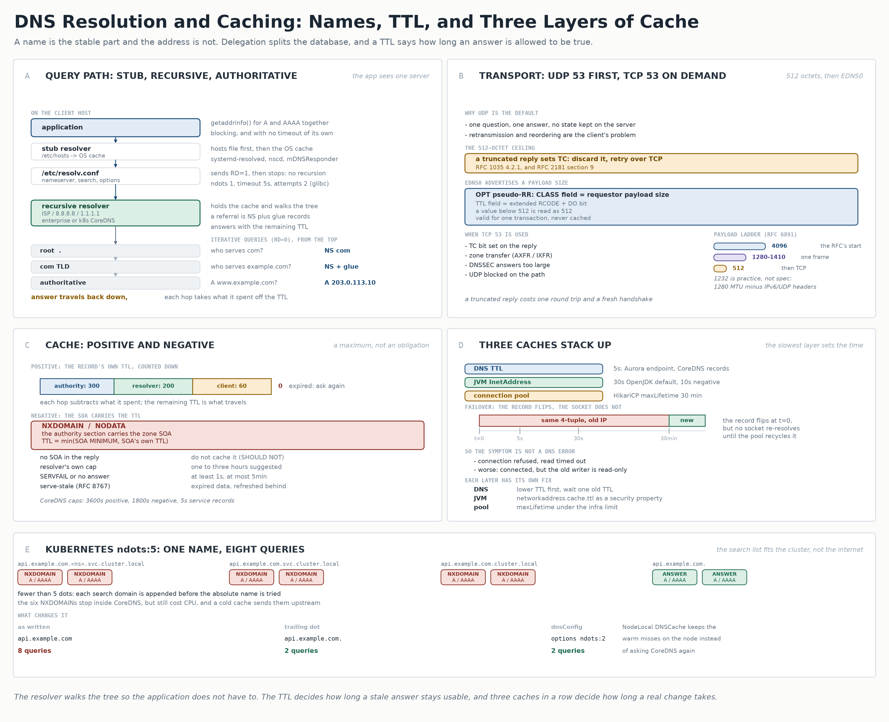

# [네트워크] DNS 동작 원리와 캐싱 · TTL

- 작성일: 2026-11-20
- 키워드: Network, DNS, Recursive Resolver, Authoritative Name Server, TTL, Negative Caching, NXDOMAIN, EDNS0, InetAddress, CoreDNS

## 1. 핵심 요약 (What & Why)

지난 세 편은 연결이 열린 뒤의 이야기였다. TCP가 순서와 재전송을 맡고, 연결을 열고 닫는 데 왕복이 들고, 그 위에서 HTTP가 진화했다. 그런데 그 연결을 열려면 먼저 **상대의 IP 주소**를 알아야 한다. 이번 편은 요청이 나가기도 전에 벌어지는 그 단계, 이름을 주소로 바꾸는 일을 다룬다.

왜 IP가 아니라 이름인가. IP 주소는 **위치**에 묶인 값이고 위치는 바뀐다. 서버를 다른 리전으로 옮기고, 장애로 대기 인스턴스로 넘어가고, 오토스케일러가 인스턴스를 갈아 끼우면 주소는 달라진다. 애플리케이션과 설정 파일과 인증서가 그 주소를 직접 들고 있으면, 인프라가 바뀔 때마다 코드를 바꿔 배포해야 한다. 그래서 **변하지 않는 이름**을 식별자로 두고, 이름에서 주소로 가는 매핑만 따로 관리한다. 그 매핑을 한 곳에 모아 두면 규모가 커질 수 없으므로, DNS는 이름 공간을 **계층으로 나누고 하위 존의 관리를 위임**하는 분산 데이터베이스가 됐다. 위임의 대가로 답은 여러 서버를 거쳐 조립되고, 그 답을 매번 왕복해서 받아 오는 비용을 줄이려고 **TTL이라는 유효 기간**을 붙여 캐시한다.

정리하면 세 문장이다.

1. **DNS는 이름 공간을 위임으로 나눈 분산 데이터베이스이고, TTL은 "이 답을 언제까지 믿을지"를 적어 둔 계약이다.** 주소 변경의 전파 속도와 질의량은 이 계약 하나로 결정된다.
2. **질의 경로는 두 종류의 리졸버로 나뉜다.** 애플리케이션은 스텁 리졸버(hosts 파일, OS 캐시, `resolv.conf`)를 거쳐 재귀 리졸버에 묻고, 재귀 리졸버가 루트 → TLD → 권한 네임서버를 **반복 질의**로 따라가 답을 조립해 캐시한 뒤 돌려준다. 애플리케이션이 보는 서버는 재귀 리졸버 하나뿐이다.
3. **DNS 장애와 TTL 오설정이 백엔드 장애로 이어지는 이유는, DNS가 요청 경로의 첫 번째 의존성이면서 그 결과가 한동안 유지되는 캐시이기 때문이다.** DNS TTL 위에 JVM의 `InetAddress` 캐시가, 그 위에 커넥션 풀의 연결 수명이 겹치면, 실제 전환은 가장 긴 층의 시간만큼 늦어진다. 이때 애플리케이션이 보는 증상은 "DNS 오류"가 아니라 **"커넥션이 안 된다"**이다.

## 2. 내부 메커니즘과 구조 (How it works)

### 2.1 이름 공간: 계층, 존, 위임

DNS의 이름 공간은 루트 `.`를 꼭짓점으로 하는 트리다. `www.example.com.`은 `com` 아래 `example` 아래 `www`라는 라벨의 연속이고, 끝의 점은 루트를 뜻하는 절대 이름(FQDN) 표시다. RFC 1035는 라벨을 63옥텟 이하, 전체 이름을 255옥텟 이하, UDP 메시지를 512옥텟 이하로 제한한다. 이 숫자들이 뒤에서 다시 나온다.

트리 전체를 한 기관이 들고 있지는 않다. **존(zone)** 이라는 관리 단위로 잘라 각각 다른 네임서버가 **권한(authoritative)** 을 갖는다. 상위 존은 자식 존의 존재를 `NS` 레코드로 알리고, 질의를 자식 쪽으로 넘긴다. 이것이 **위임(delegation)** 이다. `com` 존은 `example.com`의 네임서버가 누구인지만 알고, 그 안의 레코드는 모른다. 관리를 나눴기 때문에 확장이 가능하고, 그 대신 답을 얻는 데 여러 서버를 거치게 된다.

루트 존은 `a.root-servers.net`부터 `m.root-servers.net`까지 열세 개의 이름으로 운영되고, 각 이름은 애니캐스트로 세계 여러 지점에 걸쳐 있다. 열세 개의 "서버"라는 표현은 정확히는 열세 개의 **이름**이고 실제 인스턴스 수는 훨씬 많다.

#### 레코드 타입

| 타입 | 담는 것 | 실무에서의 쓰임 |
| --- | --- | --- |
| `A` | IPv4 주소 | 서비스의 최종 도착지. 로드 밸런서·서버 IP |
| `AAAA` | IPv6 주소 | 같은 역할의 IPv6 판. A와 함께 조회된다 |
| `CNAME` | 다른 이름(정규 이름) | 별칭. CDN·서드파티 서비스로 넘길 때 |
| `NS` | 존을 서비스하는 네임서버 이름 | 위임의 근거. 상위 존과 존 자신의 apex에 존재 |
| `SOA` | 존의 원본 서버, 관리자 메일, serial, refresh, retry, expire, minimum | 존의 메타데이터이자 **부정 응답의 TTL 공급원** |
| `TXT` | 임의 문자열 | 도메인 소유 검증, SPF/DKIM/DMARC, 각종 인증 |

여기에 `PTR`(역방향), `MX`(메일), `SRV`(서비스 위치), `CAA`(인증서 발급 제한), `HTTPS`/`SVCB`(RFC 9460, 전송 파라미터 광고)가 더해진다. 지난 편에서 본 HTTP/3 발견 경로가 바로 이 `HTTPS` 레코드였다.

`SOA`의 필드 중 `minimum`은 원래 "존의 기본 TTL"이라는 뜻이었는데, RFC 2308이 그 의미를 **부정 응답의 TTL**로 재정의했다. 이 하나의 필드가 NXDOMAIN 캐시의 수명을 정한다는 점이 2.3에서 중요해진다.

#### CNAME 체인과 apex 제약

`CNAME`은 이름 하나를 다른 이름으로 바꾸는 레코드다. 질의를 받은 네임서버는 대상 이름에 요청한 타입이 없고 `CNAME`이 있으면, 그 `CNAME`을 응답에 넣고 **질의 이름을 정규 이름으로 바꿔 처음부터 다시 조회**한다(RFC 1034 4.3.2). 그래서 클라이언트는 `CNAME` 한 줄과 최종 `A` 레코드를 함께 받는다. 체인은 여러 단계일 수 있고, 고리는 오류로 처리해야 한다.

여기에 강한 제약이 붙는다. **`CNAME`이 있는 노드에는 다른 데이터가 있으면 안 된다**(RFC 1034 3.6.2). RFC 1912는 그 이유를 더 직설적으로 적는다. `CNAME`과 `NS`, `MX`, `TXT`를 같은 이름에 두려 하면 서버가 `CNAME`을 보고 나머지를 무시하거나 존 전체를 거부한다. 이 규칙은 "정규 이름의 데이터와 별칭의 데이터가 다를 수 없다"를 보장하기 위한 것이다.

문제는 **apex(존의 꼭짓점, 예: `example.com.`)** 다. apex에는 `SOA`와 `NS`가 반드시 있어야 한다. 그러므로 apex에는 `CNAME`을 둘 수 없다. 그런데 실무에서는 apex를 CDN이나 호스팅으로 넘기고 싶은 요구가 끊임없이 생긴다. `www`는 `CNAME`으로 넘기면 되지만 `example.com`은 안 된다. 그래서 표준 밖의 우회가 생겼다.

- **ALIAS / ANAME**: 권한 네임서버가 질의 시점에 대상 이름을 대신 조회해 `A`/`AAAA`를 만들어 응답한다. 클라이언트에게는 평범한 `A` 응답으로 보이고, apex에 둘 수 있다. 공급자별 확장이라 이식성이 없다.
- **CNAME Flattening**: `CNAME`을 설정에 적어 두고, 권한 서버가 응답할 때 체인을 미리 풀어 `A`로 바꿔 내보낸다. Cloudflare가 대표적이고, Amazon Route 53의 Alias 레코드도 같은 계열의 발상이다.

두 방식 모두 **권한 서버 안에서만 성립하는 눈속임**이다. 외부에서 `dig CNAME example.com`을 하면 `CNAME`이 아니라 `A`가 보인다. 그리고 캐시되는 것은 대상의 TTL이 아니라 권한 서버가 정한 TTL이므로, 대상이 바뀌었을 때 전파 속도가 대상의 TTL을 따르지 않는다. apex에 붙인 CDN의 IP가 바뀌는 상황에서 예상보다 오래 옛 주소가 남는 이유가 여기 있다.

### 2.2 질의 흐름: 스텁 리졸버와 재귀 리졸버

```text
애플리케이션 (getaddrinfo / InetAddress)
   |
   +-- /etc/nsswitch.conf: hosts: files dns
   |      +-- /etc/hosts 명시 항목 (있으면 여기서 끝)
   |      +-- OS 캐시 (systemd-resolved, nscd, macOS mDNSResponder)
   |
   +-- /etc/resolv.conf 의 nameserver (스텁 리졸버가 보내는 곳)
          |
          v
   재귀 리졸버 (ISP / 8.8.8.8 / 1.1.1.1 / 사내·k8s CoreDNS)  [RD=1]
          |  캐시에 있으면 즉시 응답. 없으면 반복 질의 시작
          +--> 루트 "."            "com은 어디 있나"  -> NS com
          +--> "com" TLD           "example.com은?"   -> NS example.com
          +--> "example.com" 권한   "www.example.com A?" -> A 203.0.113.10
          |
          v  답을 TTL만큼 캐시하고 스텁에 돌려줌
   애플리케이션에는 재귀 리졸버 하나만 보인다
```

#### 스텁 리졸버: 애플리케이션 쪽의 첫 단계

애플리케이션이 이름을 해석할 때 부르는 것은 보통 `getaddrinfo()`이고, 자바에서는 `InetAddress.getAllByName()`이다. 이 라이브러리는 DNS 서버에 바로 묻지 않는다. 먼저 로컬에서 결정할 수 있는 것을 결정한다.

- **`/etc/hosts`**: 명시된 이름은 DNS 질의 없이 끝난다. 컨테이너 오케스트레이션에서 서비스 이름을 hosts에 심는 구성이 아직도 쓰이는 이유다.
- **OS 캐시**: 리눅스에서는 `systemd-resolved`나 `nscd`가, macOS에서는 `mDNSResponder`가 별도 캐시를 들고 있다. 즉 DNS TTL 위에 OS 캐시가 한 겹 더 있다.
- **`/etc/resolv.conf`**: `nameserver`(glibc는 최대 3개), `search`(짧은 이름에 붙여 볼 도메인 목록), `options ndots / timeout / attempts`를 담는다. glibc 기본값은 `ndots:1`, `timeout:5`초, `attempts:2`다. 이 기본값이 2.4의 쿠버네티스 이야기와, 이름 해석이 느릴 때 애플리케이션이 견디는 시간(5초 × 2회 × 서버 수)을 결정한다.

스텁 리졸버는 **재귀를 하지 않는다**. `RD`(Recursion Desired) 비트를 세워 재귀 리졸버에 넘기고, 그 답을 그대로 받는다. "스텁"이라는 이름이 여기서 나온다. 위임 추적의 책임이 없고, 캐시도 최소한이다.

#### 재귀 리졸버: 대신 물어봐 주는 쪽

재귀 리졸버는 ISP, 공용 DNS(8.8.8.8, 1.1.1.1), 사내 DNS, 쿠버네티스의 CoreDNS다. 이쪽은 `RD`를 받으면 **최종 답이나 오류를 만들어 돌려줄 의무**가 있고, 그 과정에서 루트부터 권한까지 스스로 질의한다. 이 자기 질의를 **반복 질의(iterative query)** 라 하고, `RD=0`으로 보낸다.

권한 네임서버는 최종 답을 모르면 "모른다"고 하지 않고 **추천(referral)** 을 준다. "이 이름은 내 존이 아니다. `example.com`의 네임서버는 여기 있고, 그들의 주소는 이렇다"는 형태다. RFC 1034 4.3.2가 이 절차를 규정한다.

- referral은 `NS` 레코드 집합과, 그 네임서버의 주소를 담은 **글루 레코드(glue)** 로 이루어진다.
- 글루가 필요한 이유는 순환이다. `example.com`의 네임서버가 `ns1.example.com`이면, 그 주소를 알려면 `example.com`을 질의해야 하는데 그 질의를 할 네임서버의 주소를 모른다. 상위 존이 자식 존 안의 주소를 미리 들고 있어야 이 고리가 끊긴다.

재귀 리졸버는 이렇게 얻은 답을 TTL만큼 캐시하고, **남은 TTL을 줄여서** 클라이언트에 돌려준다. 그래서 같은 레코드라도 어느 캐시에서 왔는지에 따라 남은 TTL이 다르다. `dig`로 볼 때마다 TTL이 줄어드는 것을 보는 이유다.

#### 왜 UDP 53이 기본인가

DNS 질의는 대부분 작다. 이름 하나에 타입 하나를 묻고, 답은 `A` 레코드 몇 줄이다. 이런 트래픽에 3-Way Handshake를 붙이면 얻는 것 없이 왕복만 늘어난다. UDP는 연결 상태가 없으므로 서버는 질의 하나에 응답 하나로 끝나고, 상태를 유지할 필요도 없다. 수백만 클라이언트를 받는 루트·TLD 서버에게 이 성질은 성능이 아니라 **생존 조건**이다. 재전송은 클라이언트가 맡는다. RFC 1035는 UDP 질의가 유실될 수 있으니 재전송 전략이 필요하고, 응답 순서를 신뢰하지 말라고 적는다.

대가는 크기다. RFC 1035는 UDP 메시지를 **512옥텟 이하**로 제한하고, 넘치면 잘라서 `TC`(truncated) 비트를 세우라고 한다. `TC`를 받은 클라이언트는 그 응답을 신뢰하지 말고 **다시 TCP로 질의해야 한다**(RFC 2181 9절).

#### TCP 53을 쓰는 조건

정리하면 다음과 같다.

- **`TC` 비트가 세워진 응답을 받았을 때.** 잘린 응답에는 레코드 집합의 일부만 들어 있어 그대로 쓰면 틀린 답이 된다.
- **존 전송(AXFR/IXFR).** RFC 1035는 존 전송에 UDP를 쓸 수 없다고 명시한다. 수만 개 레코드를 순서와 완결성이 보장된 스트림으로 받아야 한다.
- **DNSSEC 서명이 붙은 큰 응답.** 서명까지 실으면 응답이 수 KB가 되기 쉽다.
- **EDNS0를 지원하지 않는 상대와 큰 응답.** 또는 UDP 자체가 방화벽에서 막힌 망.

DNS over TCP는 메시지 앞에 2바이트 길이 필드를 붙인다. 스트림에서 메시지 경계를 알려면 이 표시가 필요하다. 그리고 서버는 유휴 연결을 약 2분 뒤에 닫는 것이 권장된다. DNS over TLS(853, RFC 7858)와 DNS over HTTPS(443, RFC 8484)도 결국 이 TCP/TLS 위에 있다.

#### EDNS0: 512의 벽을 옵션으로 넘다

512옥텟 제한은 1987년의 합리적인 값이었지만 DNSSEC과 긴 TXT 레코드 앞에서 곧 벽이 됐다. RFC 6891의 **EDNS0**은 프로토콜을 새로 만들지 않고 **의사 레코드(pseudo-RR)** 하나를 덧붙여 확장한다.

- 질의의 additional 섹션에 `OPT` 레코드를 넣고, 그 **CLASS 필드에 "내가 받을 수 있는 UDP payload 크기"** 를 적는다.
- 512 미만 값은 512로 취급한다(MUST).
- RFC 6891은 시작점으로 **4096옥텟**을 권하고, 실패하면 **1280–1410옥텟**으로 내려가고, 그래도 안 되면 512로 돌아가 TCP 재시도를 감수하라고 한다.
- `OPT`의 TTL 필드는 확장 RCODE와 플래그로 재활용되고, `DO` 비트가 DNSSEC 레코드를 함께 달라는 표시다.
- 요청자가 광고한 크기는 **그 트랜잭션 안에서만 유효**하고 캐시해서는 안 된다(MUST NOT).

실무 관행은 4096보다 **1232**다. 4096을 광고하면 경로 MTU를 넘어 IP 조각화가 일어나고, 조각 하나만 유실돼도 응답 전체가 사라지기 때문이다. 1232는 IPv6 최소 MTU 1280에서 IPv6·UDP 헤더 48바이트를 뺀 값으로, 이른바 DNS Flag Day 2020이 권고한 값이다. 이 숫자는 RFC에 적힌 명세값이 아니라 **운영 관행값**이라는 점을 구분해 둔다.

### 2.3 캐싱과 TTL

#### TTL의 정의

RFC 2181 8절은 TTL을 이렇게 확정한다. TTL은 **부호 없는 수**이고 최소 0, 최대 2^31−1이며, 전송할 때 32비트 중 하위 31비트에 담고 최상위 비트는 0으로 둔다. 최상위 비트가 선 값은 0으로 취급한다. 그리고 중요한 문장이 따라온다.

> **TTL은 최대 수명이지 의무 수명이 아니다.**

즉 TTL이 3600이라고 해서 3600초 동안 반드시 캐시해야 하는 것이 아니고, 리졸버는 언제든 상한을 두고 더 일찍 버릴 수 있다. 반대로 오래 들고 있는 것은 상한이 있기 전까지 허용된다. 이 비대칭이 "TTL을 줄였는데도 옛 주소로 간다"는 현상의 한쪽 원인이다. **캐시는 짧게 버릴 권리가 있지만, 길게 들고 있을 권리도 있다.**

#### Positive Caching

정상 응답은 레코드마다 붙은 TTL에서 카운트다운한다. 권한 네임서버가 `TTL 300`으로 답하면 재귀 리졸버는 300초를 세고, 100초 뒤에 들어온 질의에는 `TTL 200`으로 답한다. 같은 레코드 집합(RRSet) 안의 TTL은 모두 같아야 하며, 다르면 가장 낮은 값으로 취급한다(RFC 2181 5.2). 이 규칙이 없으면 집합의 일부만 만료되는 모순이 생긴다.

#### Negative Caching: 없는 것도 캐시한다

없는 이름을 매번 루트까지 물어보는 것은 낭비다. 그래서 **부정 응답도 캐시**한다. RFC 2308이 이 규칙을 정리했다. 두 종류를 구분하는 것이 핵심이다.

| 구분 | 응답 코드 | 뜻 | 캐시 키 |
| --- | --- | --- | --- |
| `NXDOMAIN` | RCODE 3 | 그 이름 자체가 없다 | QNAME + QCLASS |
| `NODATA` | RCODE 0, answer 비어 있음 | 이름은 있지만 그 타입이 없다 | QNAME + QTYPE + QCLASS |

`NODATA`를 `NXDOMAIN`과 구분해야 하는 이유가 이 키의 차이에서 나온다. `example.com`에 `A`는 없고 `MX`만 있다면, `A` 질의에 대한 `NODATA`를 `NXDOMAIN`처럼 캐시해서는 `MX` 질의까지 "이름이 없다"로 오답이 된다.

수명은 어디서 오는가. 부정 응답에는 TTL을 붙일 레코드가 answer 섹션에 없다. 그래서 권한 서버는 **존의 `SOA` 레코드를 authority 섹션에 함께 넣고, 그 `SOA`의 TTL을 `min(SOA.MINIMUM, SOA의 TTL)`로 정한다.** 이 값이 부정 응답의 수명이고, 0이 되면 캐시된 부정 응답은 다시 쓰면 안 된다.

여기에 RFC 2308의 단서가 붙는다. **`SOA`가 없는 부정 응답은 캐시하지 않는 것이 좋다(SHOULD NOT).** TTL을 세는 기준이 없으면 캐시된 오답이 서버 사이를 순환하며 영원히 남을 수 있기 때문이다. 그리고 리졸버가 부정 응답의 상한을 두는 것도 권장한다. 1~3시간이 적절하고 1일을 넘기지 말라는 것이 그 권고다.

RFC 9520(2023)은 여기에 **해석 실패**까지 더했다. `SERVFAIL`이나 응답 없음 같은 실패도 캐시하되, **최소 1초, 최대 5분**을 지키고, 반복 실패에는 백오프를 걸라는 것이다(최소 1초는 MUST, 5분 초과는 MUST NOT). 실패를 캐시하지 않으면 죽은 네임서버 하나가 매 질의마다 타임아웃을 유발해 전체 지연을 끌어올린다. 캐시를 너무 길게 잡으면 복구된 뒤에도 5분씩 기다린다.

#### 구현체의 실제 상한

명세가 허용하는 범위 안에서 구현체는 자기 상한을 정한다. 쿠버네티스에서 가장 흔히 보는 CoreDNS를 예로 들면 이렇다.

- `cache` 플러그인: 정상 응답 최대 3600초, 부정 응답 최대 1800초, 최소 5초. `SERVFAIL`은 5초. 기본 용량 9984개.
- `kubernetes` 플러그인: 서비스·파드 레코드의 TTL 기본값 **5초**(0~3600 조정 가능). 0으로 두면 캐시를 막는다.

즉 클러스터 안에서 서비스 이름을 조회하면, 레코드는 5초 만에 만료되고 CoreDNS의 캐시가 그 답을 최대 5초 더 들고 있을 수 있다. 2.4에서 이 숫자가 JVM 캐시·커넥션 풀과 겹칠 때 무슨 일이 생기는지 본다.

#### 짧은 TTL과 긴 TTL

TTL은 **전파 속도와 질의량을 맞바꾸는 손잡이**다. 짧으면 변경이 빨리 퍼지고 질의가 늘어난다. 길면 질의가 줄고 변경이 늦게 퍼진다. 여기에 세 번째 항목이 있다. TTL이 짧으면 권한 네임서버가 잠깐 죽었을 때 캐시가 비어 버려 **장애가 그대로 노출된다.** 길면 그 시간을 캐시가 버텨 준다. RFC 8767의 serve-stale(만료된 답을 일단 주고 백그라운드로 갱신)은 이 세 번째 항목을 최적화한 장치이고, CoreDNS는 `serve_stale`로 기본 1시간까지 그렇게 할 수 있다.

정리하면 TTL은 "얼마나 자주 바뀌는가"만이 아니라 **"얼마나 빨리 복구되어야 하는가"** 로 정해야 한다.

### 2.4 백엔드에서 겹치는 캐시 세 층

여기부터가 이 편의 실전 부분이다. DNS TTL은 **한 층일 뿐**이고, 자바 백엔드에서는 그 위에 두 층이 더 있다.

```text
층 1  DNS TTL            권한 레코드 5~300초, 리졸버 캐시, OS 캐시
       |
층 2  JVM InetAddress    networkaddress.cache.ttl  기본 30초 (OpenJDK)
       |                  음수 조회는 별도 캐시, 기본 10초
       |
층 3  커넥션 풀           HikariCP maxLifetime 기본 30분
       |                  HTTP 클라이언트의 keep-alive 연결도 같은 성질
       v
실제로 연결이 향하는 IP = 세 층이 모두 갱신된 뒤에야 바뀐다
```

#### 층 2: JVM의 `InetAddress` 캐시

`java.net`은 이름 해석 결과를 프로세스 안에 캐시한다. 성공한 조회와 실패한 조회를 모두 캐시하며, 정책은 `java.security`의 **보안 속성**으로 정한다.

- `networkaddress.cache.ttl`: 성공 조회를 몇 초 캐시할지. `-1`(또는 음수)은 영구, `0`은 캐시 안 함.
- `networkaddress.cache.negative.ttl`: 실패 조회. 기본 **10초**. JDK의 `java.security` 파일에 `networkaddress.cache.negative.ttl=10`으로 들어 있어 실효 기본값이 10초이고, OpenJDK 코드의 내부 기본 상수는 0이므로 **이 파일 항목이 실제 기본값을 만든다**는 점이 헷갈리기 쉽다.
- `networkaddress.cache.stale.ttl`(JDK 20 이후): TTL이 만료됐는데 재조회가 실패했을 때 옛 값을 계속 쓸 시간. 기본은 사용 안 함.

`networkaddress.cache.ttl`의 기본값은 문서상 조건부다. Oracle의 Networking Properties 문서는 **"SecurityManager가 설치되어 있으면 `-1`(영구), 없으면 구현체 정의"** 라고 적는다. OpenJDK 구현의 `InetAddressCachePolicy`는 `DEFAULT_POSITIVE = 30`이므로, SecurityManager가 없는 보통의 서버 애플리케이션에서 기본값은 **30초**다. 그리고 JDK 24에서 JEP 486으로 SecurityManager를 켜는 것 자체가 불가능해졌으므로, "영구 캐시" 기본값은 이제 과거의 이야기다. 오래된 자료가 "자바는 기본적으로 DNS를 영원히 캐시한다"고 말하는 것은 SecurityManager 시절의 동작이다.

설정 방법에도 함정이 있다. 이 세 속성은 **`-D` 옵션이나 `System.setProperty()`로는 적용되지 않는다.** Oracle 문서가 그렇게 못박는다. 적용하려면 다음 둘 중 하나다.

1. `java.security`(또는 `conf/security/java.security`)에 값을 쓴다.
2. **첫 이름 해석 이전에** `java.security.Security.setProperty("networkaddress.cache.ttl", "60")`을 호출한다.

OpenJDK 구현은 폴백으로 `sun.net.inetaddr.ttl` 시스템 프로퍼티도 읽지만, 이 이름은 문서화된 계약이 아니다. `-Dnetworkaddress.cache.ttl`을 걸어 두고 "왜 안 먹지" 하는 상황이 여기서 나온다.

핵심은 이것이다. **JVM 캐시의 TTL은 DNS TTL과 무관하다.** DNS 레코드 TTL을 5초로 줄여도 JVM이 30초(또는 `-1`)를 들고 있으면 애플리케이션은 30초 동안 옛 IP를 쓴다. 반대로 JVM을 5초로 줄여도 OS 리졸버 캐시와 재귀 리졸버 캐시가 남아 있으면 그 앞에서 기다린다.

#### 층 3: 커넥션 풀

DNS 조회는 **새 연결을 만들 때만** 일어난다. 이미 열려 있는 TCP 연결은 IP 주소를 다시 묻지 않는다. 그 연결은 4-tuple(출발 IP, 출발 포트, 목적 IP, 목적 포트)로 성립해 있고, 그 안에서 DNS는 이미 잊혀 있다.

그래서 커넥션 풀의 수명이 곧 **DNS 전파의 상한**이 된다. HikariCP의 기본값은 이렇다.

| 설정 | 기본값 | 의미 |
| --- | --- | --- |
| `maxLifetime` | 1800000ms (30분) | 연결의 최대 수명. 사용 중인 연결은 회수하지 않고, 닫힐 때 제거 |
| `idleTimeout` | 600000ms (10분) | 유휴 연결 회수 (단 `minimumIdle < maximumPoolSize`일 때만) |
| `keepaliveTime` | 120000ms (2분) | 유휴 연결을 꺼내 핑하고 되돌려 놓음 |
| `connectionTimeout` | 30000ms (30초) | 풀에서 연결을 기다리는 최대 시간 |

HikariCP 문서는 `maxLifetime`을 **DB나 인프라가 강제하는 연결 제한보다 몇 초 짧게** 잡으라고 권한다. 그 이유는 이 값이 단순한 자원 관리가 아니라 **낡은 주소를 버리는 유일한 자연 회수 장치**이기 때문이다.

이 세 층이 겹칠 때 실제로 벌어지는 일은 이렇다.

1. DB가 Multi-AZ 페일오버로 대기 인스턴스로 넘어간다. AWS 문서 기준 소요는 보통 60~120초이고, 그 사이 엔드포인트의 DNS 레코드가 새 인스턴스를 가리키도록 바뀐다.
2. DNS 레코드 자체의 TTL은 짧다. AWS는 Aurora MySQL의 DNS TTL이 5초라고 안내하고, RDS의 JVM TTL을 60초 이하로 두라고 권고한다.
3. 그런데 애플리케이션에는 이미 열려 있는 DB 커넥션이 남아 있다. 그 커넥션은 **옛 인스턴스의 IP**를 향한다. 새 IP는 풀에서 연결을 새로 만들 때만 쓰인다.
4. 결과는 "연결이 안 된다"(`Connection refused`, 타임아웃) 또는 더 나쁘게는 **"성공했는데 읽기 전용"** 이다. Aurora MySQL에서 옛 writer가 read-only로 남아 있으면, 재연결한 줄 알았던 커넥션이 쓰기에서 실패한다.
5. 여기에 JVM 캐시가 30초, DNS TTL이 5초, 재귀·OS 캐시가 몇 초를 더하면, 장애가 끝난 뒤에도 수십 초에서 수 분 동안 오류가 계속된다.

ALB나 오토스케일링 환경도 같은 구조다. 로드 밸런서의 IP는 고정이 아니고, 노드가 늘거나 교체되면 바뀐다. 애플리케이션이 ALB 도메인을 쓰고 있더라도 JVM 캐시와 keep-alive 연결이 옛 IP를 붙들고 있으면 새 노드로 트래픽이 가지 않는다. **DNS를 잘 설정하는 것만으로는 부족하고, 세 층을 함께 정렬해야 한다.**

처방은 층별로 다르다.

- **DNS**: 전환 전에 TTL을 줄여 둔다(6.1).
- **JVM**: `networkaddress.cache.ttl`을 서비스 특성에 맞게 명시한다. 자주 바뀌는 대상이면 30~60초, 고정된 내부 대상이면 기본값도 무방하다.
- **풀**: `maxLifetime`을 인프라의 연결 제한과 장애 전환 시간보다 짧게 잡는다. `keepaliveTime`으로 죽은 연결을 미리 걷어낸다.
- **애플리케이션**: 재시도 가능한 오류(연결 거부, 타임아웃)와 불가능한 오류(read-only, 인증 실패)를 구분한다. Aurora처럼 writer/reader 역할이 바뀌는 대상은 토폴로지를 아는 드라이버(AWS Advanced JDBC Wrapper 등)가 DNS보다 정확한 판단을 할 수 있다.
- **관측**: "DNS가 이상하다"를 로그로 확인할 수 있어야 한다. `UnknownHostException`, 커넥션 타임아웃의 비율, 커넥션 생성 간격을 지표로 둔다.

#### 쿠버네티스의 `ndots:5`: 이름 하나에 질의 다섯 개

쿠버네티스는 파드의 `/etc/resolv.conf`를 이렇게 만든다.

```text
nameserver 10.32.0.10
search <namespace>.svc.cluster.local svc.cluster.local cluster.local
options ndots:5
```

`ndots`는 **이름에 점이 몇 개 이상 있어야 "절대 이름"으로 먼저 질의할지**를 정하는 문턱이다. glibc의 기본값은 1이다. 이름에 점이 `ndots`개 **미만**이면, 리졸버는 그 이름을 절대 이름으로 보내지 않고 `search` 목록을 하나씩 붙여 가며 먼저 질의한다.

쿠버네티스가 이 값을 5로 올린 이유는 정당하다. `my-service`나 `my-service.other-namespace` 같은 **클러스터 내부 이름을 짧게 쓰기 위해서**다. 점이 0~4개인 이름은 search를 붙여 봐야 `my-service.default.svc.cluster.local` 같은 진짜 이름을 찾을 수 있다.

문제는 **외부 도메인**이다. `api.example.com`은 점이 2개라 `ndots:5` 문턱에 못 미친다. 그래서 리졸버는 이 순서로 질의한다.

```text
api.example.com.default.svc.cluster.local      -> NXDOMAIN
api.example.com.svc.cluster.local              -> NXDOMAIN
api.example.com.cluster.local                  -> NXDOMAIN
api.example.com.                               -> 실제 답
```

`getaddrinfo`는 보통 `A`와 `AAAA`를 함께 묻는다. 그러면 search가 붙은 세 번이 여섯 번, 절대 이름 한 번이 두 번이 되어 **이름 하나에 여덟 번의 질의**가 나간다. 클러스터 밖으로 나가는 것은 마지막 한 쌍뿐이고, **앞의 여섯 번은 CoreDNS가 NXDOMAIN으로 직접 답한다.** 빨리 끝나면 지연은 작지만, CoreDNS가 바쁘거나 업스트림으로 넘어가면 이 여섯 번이 그대로 지연이 된다. 파드가 많고 외부 API를 자주 부르는 클러스터에서 CoreDNS의 QPS와 지연이 함께 오르는 전형적인 원인이다.

완화책은 세 가지다.

- **FQDN으로 쓴다.** `api.example.com.`처럼 끝에 점을 붙이면 ndots와 무관하게 절대 이름으로 질의한다. 설정 파일에서 외부 호스트를 적을 때 점을 붙이는 습관이 이 비용을 없앤다.
- **`ndots`를 낮춘다.** 파드 스펙의 `dnsConfig.options`로 `ndots:2` 정도로 두면 클러스터 내부 이름은 그대로 쓰면서 외부 이름의 불필요한 질의가 줄어든다. 다만 점이 많은 내부 이름을 짧게 쓰던 코드가 있으면 깨질 수 있으니, 내부 이름 사용 방식을 먼저 확인해야 한다.
- **캐시를 가까이 둔다.** NodeLocal DNSCache를 두면 search 질의의 NXDOMAIN이 노드에서 끝나 CoreDNS 부하가 줄어든다. 부정 캐시가 이 증폭을 흡수하는 구조이므로, 캐시가 비는 순간이 곧 증폭이 시작되는 순간이다.

#### 이름 해석이 느릴 때 애플리케이션에 생기는 일

`getaddrinfo`는 **블로킹 호출**이다. 재귀 리졸버가 응답하지 않으면 glibc 기본값 기준으로 5초를 기다리고, 다른 네임서버로 넘어가고, 그것을 2회 반복한다. 서버 수가 3개면 최악의 경우 한 번의 이름 해석에 30초가 걸린다.

톰캣 스레드가 이 호출에 걸려 있으면 그 스레드는 요청을 처리하지 못한다. 이름 해석 지연이 몇 초만 이어져도 스레드 풀이 고갈되고, 그때부터는 DNS와 무관한 요청까지 밀린다. **DNS 장애가 스레드 고갈로 번지는 경로**가 여기 있다. 이름 해석에 타임아웃을 걸 수 있는 클라이언트(비동기 리졸버, 별도 스레드 풀)를 쓰거나, 적어도 `options timeout`과 `attempts`를 서비스 특성에 맞게 줄이는 것이 방어선이다.

## 3. 구조 도식 (Architecture Diagram)



- **A 질의 경로 (왼쪽 위)**: 애플리케이션이 `getaddrinfo`로 시작해 `/etc/hosts`, OS 캐시, `resolv.conf`를 거쳐 재귀 리졸버에 닿고, 재귀 리졸버가 루트 → TLD → 권한 네임서버를 반복 질의로 따라가는 흐름을 한 줄로 놓았다. referral과 글루 레코드가 어디서 쓰이는지, 그리고 애플리케이션에는 재귀 리졸버 하나만 보인다는 점을 함께 표시했다.
- **B 전송 선택 (오른쪽 위)**: UDP 53이 기본인 이유와, 512옥텟·`TC` 비트·TCP 53 폴백 조건을 정리했다. EDNS0가 `OPT` 레코드의 CLASS 필드로 payload 크기를 광고하고, 4096 → 1280~1410 → 512 → TCP로 내려가는 순서를 화살표로 두었다.
- **C 캐시의 두 종류 (왼쪽 가운데)**: 정상 응답의 TTL 카운트다운과, `NXDOMAIN`·`NODATA`가 `SOA`를 authority 섹션에 실어 `min(SOA.MINIMUM, SOA TTL)`로 수명을 얻는 구조를 나란한 타임라인으로 비교했다. 캐시 키의 범위 차이도 함께 적었다.
- **D 세 층의 함정 (오른쪽 가운데)**: DNS TTL → JVM `InetAddress` 캐시 → 커넥션 풀의 `maxLifetime`이 순서대로 겹치는 모습과, 페일오버 시점에 어느 층이 먼저 갱신되고 어느 층이 옛 IP를 붙들고 있는지를 시간축으로 보여 준다.
- **E `ndots:5` 증폭 (아래)**: 외부 이름 하나에 대해 search 도메인이 붙은 질의가 먼저 나가고 마지막에야 절대 이름 질의가 나가는 순서와, 끝에 점을 붙였을 때와 `ndots`를 낮췄을 때 질의 수가 어떻게 달라지는지 비교했다.

## 4. 비교 표 (Comparison)

### 4.1 재귀 리졸버 vs 권한 네임서버

| 항목 | 재귀 리졸버 (Recursive) | 권한 네임서버 (Authoritative) |
| --- | --- | --- |
| 대표 예 | ISP DNS, 8.8.8.8, 1.1.1.1, 사내 DNS, CoreDNS | 존을 직접 서비스하는 서버, 매니지드 DNS(Route 53, Cloudflare) |
| 하는 일 | 위임을 따라가 최종 답을 조립 | 자기 존의 데이터에 대해서만 답 |
| 위임 추적 | 한다. 루트부터 반복 질의 | 하지 않는다. 모르면 referral 또는 NXDOMAIN |
| 캐시 | 적극적으로 캐시(TTL 동안) | 자기 존 데이터는 캐시가 아니라 원본 |
| `RD` 비트 | 받는다(1). 최종 답 의무 | 무시하거나 `RA=0`으로 응답 |
| `AA` 비트 | 세우지 않는다 | 자기 존 답에 세운다 |
| 실패 시 | 다른 업스트림·캐시·serve-stale로 버팀 | 그 존의 이름은 해석 불가 |
| 부하 특성 | 사용자 수에 비례, 상태를 들고 있음 | 전 세계 질의를 받음, 무상태에 가까움 |

### 4.2 UDP 53 vs TCP 53

| 항목 | UDP 53 | TCP 53 |
| --- | --- | --- |
| 기본 사용 | 일반 질의의 기본값 | 폴백과 특수 목적 |
| 연결 | 없음. 질의 하나에 응답 하나 | 3-Way Handshake 필요 |
| 크기 한계 | 512옥텟(RFC 1035), EDNS0로 확장 | 스트림. 2바이트 길이 필드로 경계 표시 |
| 손실 처리 | 클라이언트가 재전송 | 전송 계층이 재전송 |
| 쓰는 조건 | 대부분의 정상 질의 | `TC` 수신, 존 전송, DNSSEC 큰 응답, UDP 차단 |
| 서버 비용 | 상태 없음. 대규모에 유리 | 연결마다 상태. 유휴 연결은 약 2분 뒤 정리 권고 |
| 위험 | 스푸핑(응답 위조), 조각화 손실 | 연결 수립 지연, 방화벽 정책 |

### 4.3 Positive Cache vs Negative Cache

| 항목 | Positive | Negative |
| --- | --- | --- |
| 대상 | 존재하는 레코드 | `NXDOMAIN`, `NODATA` |
| TTL 출처 | 레코드 자체의 TTL | authority 섹션 `SOA`의 `min(SOA.MINIMUM, SOA TTL)` |
| 캐시 키 | QNAME + QTYPE + QCLASS | `NXDOMAIN`: QNAME + QCLASS / `NODATA`: QNAME + QTYPE + QCLASS |
| 없을 때 | 그냥 매번 질의 | `SOA` 없는 부정 응답은 캐시하지 말 것(SHOULD NOT) |
| 상한 권고 | 리졸버가 자유롭게 상한 설정 | 1~3시간 권고, 1일 초과 지양(RFC 2308) |
| 실패 응답 | 해당 없음 | `SERVFAIL` 등은 1초 이상 5분 이하(RFC 9520) |
| 흔한 사고 | 긴 TTL로 전환 지연 | 오타 도메인의 `NXDOMAIN`이 오래 남아 복구 지연 |

### 4.4 짧은 TTL vs 긴 TTL

| 항목 | 짧은 TTL (수십 초) | 긴 TTL (수 시간~하루) |
| --- | --- | --- |
| 변경 전파 | 빠름 | 느림. 옛 TTL만큼 기다려야 함 |
| 질의량 | 많음. 권한·재귀 리졸버 부하 증가 | 적음 |
| 권한 서버 장애 시 | 캐시가 금방 비어 장애가 그대로 노출 | 캐시가 버텨 줌(serve-stale과 궁합) |
| 적합한 대상 | 페일오버 대상(DB 엔드포인트, Blue/Green), 자주 바뀌는 LB | 잘 안 바뀌는 MX, TXT, 정적 자산 도메인 |
| 운영 부담 | 모니터링·전환 절차가 촘촘해야 함 | 전환 계획에 사전 대기가 필수 |

### 4.5 세 캐시 층의 손잡이

| 층 | 손잡이 | 기본값(확인된 값) | 무엇을 지배하나 |
| --- | --- | --- | --- |
| DNS | 레코드 TTL, `SOA MINIMUM` | CoreDNS `kubernetes` 5초, Aurora DNS 5초 | 다른 리졸버·OS 캐시가 답을 믿는 시간 |
| JVM | `networkaddress.cache.ttl` / `.negative.ttl` | OpenJDK 30초 / 10초 | 프로세스가 `InetAddress`를 믿는 시간 |
| 풀 | `maxLifetime`, `keepaliveTime`, keep-alive | HikariCP 30분 / 2분 | 이미 열린 연결이 옛 IP를 붙드는 시간 |

## 5. 내가 깨달은 점 (My Insight)

- **DNS는 이름 변환기가 아니라, 분산 시스템의 최종 일관성을 TTL이라는 시간 창으로 타협한 캐시 계층이다.** 권한 데이터는 한 곳에서 즉시 바뀌지만, 그 사실이 세상에 퍼지는 데는 TTL만큼의 시간이 걸린다. 그 창 안에서 세상은 옛 답을 **틀린 답이 아니라 유효한 답**으로 취급한다. 이 모델을 받아들이면 "왜 아직도 옛 IP로 가느냐"는 질문은 버그가 아니라 설계된 지연이 된다. 문제는 그 지연을 아는 사람이 배포하는 사람과 다른 경우다.

- **장애는 세 층이 겹칠 때 난다.** DNS TTL을 5초로 줄여도 JVM이 30초를 들고 있으면 30초이고, JVM을 5초로 줄여도 풀이 30분짜리 연결을 붙들고 있으면 30분이다. 실제 전환 시간은 **가장 긴 층**이 정한다. 그래서 "TTL을 줄였다"는 조치는 세 층 중 한 층만 손댄 것이고, 그 사실을 모르면 장애 원인을 DNS에서 찾다가 시간을 다 쓴다.

- **DNS 장애의 증상은 DNS 오류로 나타나지 않는다.** 애플리케이션 로그에는 `Connection refused`, `Read timed out`, `500`이 남는다. 이름 해석은 이미 성공했거나(옛 IP로), 아니면 블로킹으로 스레드를 잡아먹고 있다. 그래서 DNS를 의심하려면 "이 커넥션이 어느 IP로 갔는가", "이 IP를 언제 조회했는가"를 볼 수 있어야 한다. 이 질문에 답하지 못하는 시스템은 DNS 장애를 진단할 수 없다.

- **커넥션 풀은 성능 장치이면서 DNS 전파의 마지막 방어선이자 마지막 저항선이다.** 풀이 없으면 매 요청이 새 연결이고 DNS 변경이 즉시 반영되지만 성능이 무너진다. 풀이 있으면 성능을 얻는 대신 `maxLifetime`만큼의 전파 지연을 진다. 이 맞바꿈을 인식하고 `maxLifetime`을 인프라의 연결 제한보다 짧게 두는 것이, 두 이득을 모두 조금씩 얻는 유일한 방법이다.

- **부정 캐시는 장애를 양쪽으로 움직인다.** 없으면 죽은 네임서버 하나가 매 질의를 타임아웃까지 끌고 가고, 쿠버네티스의 `ndots:5` 증폭을 그대로 맞는다. 너무 길면 오타 도메인을 고쳐 배포해도 한동안 `NXDOMAIN`이 남는다. RFC가 "1초 이상, 5분 이하"처럼 양쪽에 문턱을 둔 이유가 여기 있다.

- **`ndots:5`는 DNS 설정이 아니라 애플리케이션의 이름 쓰기 규칙에 대한 비용 청구서다.** 클러스터 안에서 `my-service`라고 짧게 쓰는 편의를 얻는 대신, 클러스터 밖 이름마다 질의가 몇 배로 늘어난다. 이 비용은 코드와 설정 어디에도 보이지 않고 CoreDNS 지표에만 보인다. 끝에 점을 붙이는 습관 하나가 그 청구서를 없앤다.

## 6. 실무 관점 및 트레이드오프 (Trade-offs & Best Practices)

### 6.1 전환 전에 TTL을 미리 줄인다

DNS 기반 전환(Blue/Green, DB 페일오버, CDN 교체)의 표준 절차는 **전환 시점에 TTL을 바꾸는 것이 아니라, 전환 전에 미리 줄여 두는 것**이다.

1. 전환 최소 **옛 TTL의 두 배** 전에 TTL을 30~60초로 낮춘다. 이유는 두 가지다. 첫째, 이미 배포된 옛 답이 옛 TTL만큼 캐시에 남아 있다. 둘째, 그 캐시가 만료된 뒤 새 TTL로 다시 채워지는 시간이 필요하다.
2. TTL이 실제로 낮아졌는지 확인한다. 권한 서버 설정만 바꾸고 `dig`로 확인하지 않으면, 앞단 캐시나 CDN이 옛 TTL로 답하고 있을 수 있다.
3. 전환한다. 이때 애플리케이션 층(JVM 캐시, 커넥션 풀)이 준비되어 있는지도 함께 본다. DNS만 짧게 해 두고 `maxLifetime`이 30분이면 절반의 조치다.
4. 안정화 후 TTL을 원래 값으로 되돌린다.

> [!NOTE]
> TTL을 줄이는 것은 **질의량을 늘리는 일**이다. 권한 서버와 재귀 리졸버, 그리고 사내 CoreDNS에 그만큼 부하가 간다. 짧은 TTL을 상시로 두는 구성은 캐시의 이득을 스스로 버리는 것이므로, 전환 기간에만 낮추고 되돌리는 편이 낫다. 반대로 상시 페일오버가 필요한 대상(DB 엔드포인트, 오토스케일링되는 LB)은 짧은 TTL이 정답이고, 그 부하는 감당할 설계를 함께 해야 한다.

> [!WARNING]
> apex 도메인에 `CNAME`을 둘 수 없다는 규칙을 우회하려고 ALIAS/ANAME/CNAME Flattening을 쓸 때는, **그 TTL이 대상의 TTL이 아니라는 점**을 기억해야 한다. 권한 서버가 대신 조회해 만들어 준 `A` 레코드의 TTL은 그 서버가 정한 값이다. CDN 쪽에서 IP를 바꿔도 apex의 TTL이 길면 그만큼 늦게 퍼진다. 전환 계획에는 양쪽 TTL을 모두 적어 둔다.

### 6.2 점검 도구와 순서

```bash
# 권한 서버까지 직접 따라가며 어느 단계에서 답이 나오는지 본다
dig +trace api.example.com

# 재귀 리졸버의 캐시를 보지 않고 권한 서버에 직접 묻는다
dig @ns1.example.com api.example.com +norecurse

# 남은 TTL을 확인한다. 두 번 조회해 줄어드는 폭으로 캐시 여부를 안다
dig +noall +answer api.example.com

# 부정 응답과 SOA를 함께 본다. NXDOMAIN이면 authority 섹션에 SOA가 온다
dig api.example.com A
dig api.example.com AAAA

# OS·스텁 리졸버 계층을 본다
getent hosts api.example.com
resolvectl query api.example.com     # systemd-resolved

# 클러스터 안에서 파드의 시야로 본다
kubectl exec -it <pod> -- cat /etc/resolv.conf
kubectl exec -it <pod> -- dig api.example.com
```

읽는 순서가 중요하다. **권한 → 재귀 → 스텁 → 애플리케이션** 순으로 내려와야 어느 층에서 옛 답이 나오는지 알 수 있다. 권한에서 새 IP가 나오는데 애플리케이션이 옛 IP로 간다면, 문제는 DNS가 아니라 JVM 캐시나 커넥션 풀이다.

### 6.3 자바·스프링에서의 적용 지점

- **JVM DNS 캐시.** `java.security`에 값을 두거나, 첫 해석 전에 `Security.setProperty("networkaddress.cache.ttl", "60")`을 호출한다. `-D`로는 적용되지 않는다는 점을 배포 문서에 적어 둔다. 컨테이너에서는 이미지의 JDK 설정을 바꾸는 대신 `JAVA_TOOL_OPTIONS`로 `-Dsun.net.inetaddr.ttl`을 쓰는 사례가 있는데, 이 이름은 문서화된 계약이 아니므로 의존하지 않는 편이 좋다.
- **HikariCP.** `spring.datasource.hikari.max-lifetime`을 DB·네트워크의 연결 제한보다 짧게 잡는다. 기본 30분은 안전한 값이지만, 페일오버가 1분 안에 끝나야 하는 서비스에는 너무 길다. `keepalive-time`은 `max-lifetime`보다 작아야 하고, `connection-test-query`보다 JDBC4의 `isValid()`를 쓰는 편이 낫다.
- **HTTP 클라이언트.** `HttpClient`(JDK), `WebClient`(Reactor Netty), `RestTemplate`(Apache HttpClient, OkHttp) 모두 연결을 재사용한다. DNS 재조회는 새 연결에서만 일어나므로, `Connection: close`를 쓰거나 풀의 유휴 시간을 짧게 두지 않으면 같은 문제가 생긴다. Reactor Netty는 `HttpClient.create().connectionProvider(...)`의 `maxIdleTime`·`maxLifeTime`으로 조절한다.
- **타임아웃 정렬.** 이름 해석 타임아웃, 커넥션 타임아웃, 읽기 타임아웃을 **짧은 순서로** 정렬한다. 이름 해석이 커넥션 타임아웃보다 길면, 애플리케이션은 이름을 해석하는 동안 이미 실패한 요청을 붙들고 있게 된다.
- **관측.** 커넥션 타임아웃·`UnknownHostException`·`SERVFAIL` 응답 비율을 지표로 둔다. DNS 문제는 이 지표들이 먼저 움직이고, 애플리케이션 오류율은 그 뒤에 따라온다.

### 6.4 쿠버네티스에서의 적용 지점

> [!NOTE]
> 파드의 `ndots:5`는 클러스터 내부 이름을 짧게 쓰기 위한 기본값이다. 클러스터 밖 도메인을 자주 호출하는 서비스라면 `dnsConfig.options`로 `ndots`를 낮추거나 외부 호스트를 FQDN(끝에 점)으로 적는다. CoreDNS의 `cache` 플러그인 상한(최대 3600초)과 `kubernetes` 플러그인의 서비스 레코드 TTL(기본 5초), 파드의 `ndots`가 함께 질의량을 결정한다는 점을 기억한다. 파드가 많을수록 이 증폭은 CoreDNS의 CPU와 업스트림 지연으로 청구된다.

- **NodeLocal DNSCache.** 노드마다 캐시를 두어 search 질의의 `NXDOMAIN`을 노드에서 끝낸다. CoreDNS 부하와 지연이 함께 줄어든다.
- **CoreDNS 관측.** `coredns_dns_requests_total`, `coredns_cache_hits_total`, `coredns_cache_entries`를 본다. `NXDOMAIN` 비율이 높고 그 대부분이 search 도메인이 붙은 이름이면 `ndots` 문제다.
- **`dnsConfig` 조정.** `options: [{name: "ndots", value: "2"}]`처럼 낮출 수 있다. 내부 이름을 짧게 쓰는 코드가 있는지 먼저 확인해야 한다.
- **서비스 레코드의 TTL.** `kubernetes` 플러그인 TTL 기본 5초는 엔드포인트 변경(스케일아웃, 롤링 배포)이 빠르게 반영되도록 하기 위한 값이다. 이 값을 늘리면 클라이언트가 옛 파드 IP로 오래 간다.

### 6.5 무엇을 먼저 볼 것인가

| 증상 | 의심할 층 | 먼저 확인할 것 |
| --- | --- | --- |
| 전환 후 일부 요청만 옛 서버로 감 | 커넥션 풀·keep-alive | 풀 `maxLifetime`, 유휴 연결 수, 연결 생성 시각 |
| 전환 후 전부 옛 서버로 감 | JVM 캐시·리졸버 캐시 | `networkaddress.cache.ttl`, `dig` 남은 TTL, OS 캐시 |
| 특정 이름만 해석 실패 | 권한·부정 캐시 | `dig @권한`, `NXDOMAIN` 여부, `SOA MINIMUM` |
| 이름 해석이 간헐적으로 수 초 지연 | 재귀 리졸버·스텁 설정 | `options timeout/attempts`, CoreDNS 지연, `ndots` |
| 클러스터 밖 호출만 느림 | `ndots` 증폭 | 파드 `resolv.conf`, search 질의 수, CoreDNS QPS |
| 장애 복구 후 수 분간 오류 지속 | 세 층 전부 | 세 층의 시간 값을 표로 나열해 가장 긴 것을 찾는다 |

## 7. 참고 자료 (References)

- RFC 1034 (Domain Names — Concepts and Facilities) - 이름 공간과 위임, CNAME 규칙(3.6.2), 리졸버와 권한 서버의 역할(4.3), 반복 질의와 referral·글루(4.3.2)
- RFC 1035 (Domain Names — Implementation and Specification) - 라벨 63옥텟·이름 255옥텟·UDP 512옥텟(2.3.4), 레코드 형식, SOA 필드(3.3.13), UDP 사용과 `TC`(4.2.1), TCP 사용과 2바이트 길이 필드(4.2.2)
- RFC 1912 (Common DNS Operational and Configuration Errors) - CNAME과 다른 데이터의 공존 금지(2.4)
- RFC 2181 (Clarifications to the DNS Specification) - RRSet TTL의 동일성(5.2), TTL의 정의와 31비트 범위(8), `TC` 비트의 의미와 TCP 재질의(9)
- RFC 2308 (Negative Caching of DNS Queries) - `NXDOMAIN`과 `NODATA`의 구분(2), `SOA MINIMUM`의 재정의(4), 부정 응답 캐시 규칙과 상한 권고(5)
- RFC 6891 (Extension Mechanisms for DNS, EDNS0) - `OPT` 의사 레코드(6.1), 요청자 payload 크기와 512 미만 처리(6.2.3), 4096·1280~1410 폴백(6.2.5)
- RFC 8767 (Serving Stale Data to Improve DNS Resiliency) - 만료된 답을 일시적으로 서비스하는 절차
- RFC 9520 (Negative Caching of DNS Resolution Failures) - 해석 실패의 최소 1초·최대 5분 캐시, 백오프
- RFC 7858 / RFC 8484 - DNS over TLS, DNS over HTTPS
- RFC 9460 (SVCB and HTTPS Resource Records) - 전송 파라미터 광고와 HTTP/3 발견
- Oracle, Networking Properties (Java SE 21 & JDK 21) - `networkaddress.cache.ttl`(SecurityManager 유무에 따른 기본값), `networkaddress.cache.negative.ttl`(기본 10초), `networkaddress.cache.stale.ttl`, `-D`·`System.setProperty()`로 설정되지 않는다는 설명
- OpenJDK `sun.net.InetAddressCachePolicy` - `DEFAULT_POSITIVE = 30`, 속성 조회 순서와 `sun.net.inetaddr.*` 폴백
- OpenJDK `conf/security/java.security` - `networkaddress.cache.negative.ttl=10` 기본 설정
- JEP 486 (Permanently Disable the Security Manager) - JDK 24에서 SecurityManager를 켤 수 없게 된 변경
- HikariCP 문서 - `maxLifetime` 1800000ms, `idleTimeout` 600000ms, `keepaliveTime` 120000ms, `connectionTimeout` 30000ms와 권고 사항
- Amazon RDS 사용자 가이드, Failing over a Multi-AZ DB instance - 페일오버 시 DNS 레코드 변경, JVM TTL을 60초 이하로 둘 것을 권고
- AWS Knowledge Center, Aurora MySQL 페일오버 후 read-only 오류 - Aurora MySQL DNS TTL 5초, 다층 DNS 캐시 주의
- Kubernetes 문서, DNS for Services and Pods - 파드 `resolv.conf`의 `search` 목록과 `options ndots:5`
- CoreDNS 문서, `kubernetes` 플러그인 - 레코드 TTL 기본 5초(0~3600)
- CoreDNS 문서, `cache` 플러그인 - 정상 3600초·부정 1800초 상한, 최소 5초, `SERVFAIL` 5초, `serve_stale`
- Linux man-pages, `resolv.conf(5)` - `ndots` 기본 1(최대 15), `timeout` 기본 5초, `attempts` 기본 2, `nameserver` 최대 3
