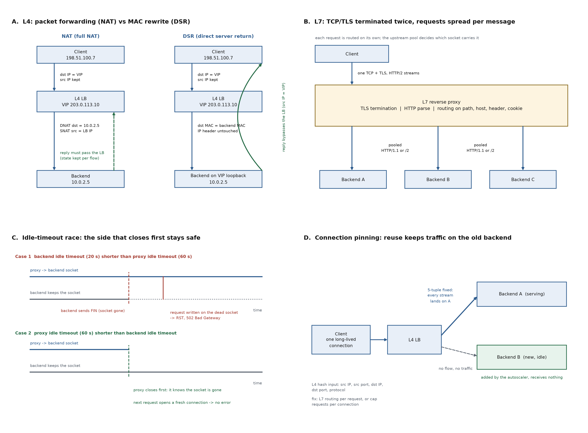

# [네트워크] 로드 밸런싱(L4 vs L7)과 커넥션 풀링

- 작성일: 2026-11-21
- 키워드: Network, Load Balancing, L4, L7, Reverse Proxy, DSR, NAT, Health Check, Connection Pooling, Keep-Alive, HTTP/2

## 1. 핵심 요약 (What & Why)

지난 네 편은 "하나의 연결" 안에서 벌어지는 일이었다. TCP가 순서와 재전송을 맡고, 연결을 열고 닫는 데 왕복이 들고, 그 위에서 HTTP가 진화했고, 마지막 편에서 그 연결의 상대 주소를 이름으로 찾는 방법을 봤다. 이번 편은 그 연결들이 **여러 대의 서버로 흩어지는 지점**을 다룬다. 요청을 어디로 보낼지 정하는 일, 그리고 그 결정이 커넥션 재사용과 만날 때 생기는 마찰이다.

**왜 서버 한 대로는 안 되는가.** 한 대의 처리량에는 한계가 있고, 그 한 대가 죽으면 서비스 전체가 죽는다. 그래서 서버를 늘리는데, 늘리는 순간 "이 요청을 어느 서버로 보낼 것인가"라는 문제가 새로 생긴다. 이름 하나에 IP 여러 개를 두는 DNS 라운드로빈이 가장 싼 답처럼 보이지만, 이것은 **분배가 아니라 후보 목록**이다. 어느 IP를 쓸지는 클라이언트가 정하고, 그 결정은 TTL 동안 캐시에 굳는다. 서버 하나가 죽어도 TTL이 만료될 때까지 클라이언트는 계속 그 IP로 접속을 시도하고, 이미 열려 있는 커넥션은 이름 해석 자체를 다시 하지 않으므로 새 서버로 옮겨 가지도 않는다. 게다가 요청의 내용(경로, 헤더)을 보고 나눌 수도 없고, 서버의 상태를 물어볼 수도 없다. 그래서 요청이 실제로 도착하는 지점에서 연결을 받아 나눠 주는 장치, **로드 밸런서**가 필요해진다.

**L4와 L7은 무엇을 기준으로 나누는가.** L4 로드 밸런서는 IP와 포트, 즉 4-tuple로 이루어진 **플로우 단위**로 패킷을 넘긴다. TCP 연결을 종단하지 않고 목적지 주소나 MAC만 바꿔 흘려보내므로 싸고 빠르고 어떤 프로토콜이든 상관하지 않는다. 대신 HTTP를 보지 못하므로 경로 기반 분기가 불가능하고, 하나의 TCP 연결 안에 실린 요청은 전부 같은 백엔드에 고정된다. L7 로드 밸런서는 클라이언트와 TCP/TLS를 먼저 종단하고 HTTP 메시지를 파싱해서, 경로·호스트·헤더·쿠키를 보고 **요청 하나 단위**로 백엔드를 고른다. 대신 종단이 두 번 일어나고, CPU와 인증서 관리 비용을 치르고, 원래 클라이언트 IP를 헤더로 옮겨 적어야 한다.

**커넥션 풀링이 이 그림을 어렵게 만드는 이유.** 매 요청마다 TCP 3-Way와 TLS 핸드셰이크를 다시 하는 비용은 크다. 그래서 애플리케이션은 HTTP Keep-Alive와 커넥션 풀로 연결을 재사용하고, DB 앞에서도 HikariCP 같은 풀로 커넥션을 붙들고 있다. 문제는 이 재사용이 **로드 밸런서의 분배를 무력화하는 방향으로** 작동한다는 점이다. 연결이 오래 살수록 그 연결은 처음 고른 백엔드에 계속 묶이고, 오토스케일러가 새 서버를 붙여도 살아 있는 연결은 넘어가지 않는다. 그리고 여러 층이 각자 유휴 타임아웃을 가지고 있으므로, 그 순서가 어긋나면 한쪽은 이미 닫힌 소켓에 요청을 쓰고 `RST`를 받는다. 사용자가 보는 것은 `502 Bad Gateway`다.

정리하면 세 문장이다.

1. **로드 밸런싱은 "어디로 보낼지"를 정하는 일이지만, 실제 난이도는 "이미 열린 연결을 어떻게 다룰지"에 있다.** L4는 플로우를, L7은 요청을 단위로 삼고, 그 단위의 길이가 곧 분배의 해상도가 된다.
2. **L7의 핵심 가치는 요청 단위 분산이고, 그 대가는 종단 두 번과 홉 하나다.** TLS 종단, 경로 라우팅, 재시도, 업스트림 커넥션 풀 재사용은 모두 "요청을 읽을 수 있다"는 하나의 능력에서 나온다.
3. **Keep-Alive와 커넥션 풀은 핸드셰이크를 아껴 주지만, L4 아래에서는 부하 분산을 막고, 타임아웃 순서가 어긋나면 502의 원인이 된다.** 재사용의 이득과 분배의 이득은 같은 자원(연결 수명)을 두고 다투며, 그 균형점은 계층마다의 타임아웃을 정렬해서 만든다.

## 2. 내부 메커니즘과 구조 (How it works)

### 2.1 분배의 세 층위: 이름, 플로우, 요청

요청이 서버에 닿기까지 분배가 일어날 수 있는 지점은 세 곳이다.

| 층위 | 단위 | 정하는 주체 | 볼 수 있는 것 | 한계 |
| --- | --- | --- | --- | --- |
| DNS | 이름 → IP 목록 | 클라이언트(리졸버) | 아무것도 | TTL 캐시, 헬스 체크 없음, 연결 재사용과 무관 |
| L4 | 4-tuple 플로우 | 로드 밸런서 | IP, 포트, 프로토콜 | HTTP 내용, 연결 내 요청 구분 |
| L7 | HTTP 요청 | 리버스 프록시 | 경로, 호스트, 헤더, 쿠키, 메서드 | 종단 비용, 원 IP 상실, 홉 증가 |

DNS는 이미 4편에서 다뤘으므로 여기서는 그 한계만 정리한다. DNS 기반 분배가 "분배"라고 부르기 어려운 이유는 네 가지다.

- **결정이 캐시에 굳는다.** TTL 동안 같은 IP가 반복 사용되므로, 트래픽은 순간이 아니라 TTL 창의 평균으로 나뉜다. 부하가 몰리는 시점에 새 서버를 붙여도 그 사실이 퍼지는 데 TTL만큼 걸린다.
- **서버의 상태를 모른다.** 죽은 서버의 레코드를 지우기 전까지 클라이언트는 계속 그 IP로 연결을 시도한다. 헬스 체크 개념 자체가 없다.
- **연결 재사용과 정면으로 충돌한다.** 이름 해석은 **새 연결을 열 때만** 일어난다. Keep-Alive로 연결을 붙들고 있는 클라이언트는 DNS가 바뀌어도 새 서버를 보지 못한다. 재사용을 잘할수록 분배가 안 된다.
- **내용을 볼 수 없다.** 같은 이름 아래 `/api`는 A로, `/static`은 B로 보내는 일은 DNS로 불가능하다.

그래서 실제 분배는 L4 또는 L7 계층에서 한다. 두 계층의 차이는 "무엇을 종단하는가"로 요약된다.

### 2.2 L4: 4-tuple과 플로우, 그리고 NAT와 DSR

L4 로드 밸런서가 보는 것은 패킷의 헤더 중 전송 계층까지다. 연결을 식별하는 값은 **4-tuple**이다. 출발지 IP, 출발지 포트, 목적지 IP, 목적지 포트에 프로토콜(TCP/UDP)을 더한 것이 하나의 플로우를 정의하고, 로드 밸런서는 이 플로우를 백엔드 하나에 매핑하는 **플로우 테이블**을 유지한다. 같은 플로우에 속한 패킷은 모두 같은 백엔드로 간다. 이것이 L4의 장점이자 한계다.

패킷을 백엔드로 넘기는 방식은 크게 두 가지다.

#### NAT 방식 (full NAT / SNAT + DNAT)

가장 직관적인 방식이다. 로드 밸런서가 목적지 IP를 백엔드 주소로 바꾸고(DNAT), 필요하면 출발지 IP도 로드 밸런서 주소로 바꾼다(SNAT). 백엔드 입장에서 클라이언트는 로드 밸런서이므로, 응답도 로드 밸런서로 돌아온다. 로드 밸런서는 플로우 테이블을 역으로 조회해 출발지를 원래 클라이언트 주소로 되돌려 보낸다.

```text
[NAT]  client 198.51.100.7:51234
          |  dst=VIP:443, src=198.51.100.7:51234
          v
        L4 LB  (flow table: 198.51.100.7:51234 -> 10.0.2.5:8080)
          |  dst=10.0.2.5:8080, src=10.0.2.1:61000   <- DNAT + SNAT
          v
        backend 10.0.2.5
          |  응답: dst=10.0.2.1:61000
          v
        L4 LB  (역변환)
          |  dst=198.51.100.7:51234, src=VIP:443
          v
        client
```

구조상의 특징이 세 가지 있다. 첫째, **응답이 반드시 로드 밸런서를 지나므로** 대역폭이 양방향으로 소모된다. 응답이 큰 서비스(이미지, 스트리밍)에서는 이것이 병목이 된다. 둘째, **비대칭 라우팅에 취약하다.** 백엔드가 기본 게이트웨이를 통해 응답을 내보내면 로드 밸런서를 우회해 나가고, 그 패킷의 출발지는 백엔드 주소다. 클라이언트는 자기가 보낸 적 없는 주소에서 온 패킷을 받고 버린다. 그래서 백엔드의 기본 게이트웨이를 로드 밸런서로 두거나 정책 라우팅을 걸어야 한다. 셋째, SNAT을 하면 **원래 클라이언트 IP가 백엔드에서 사라진다.** 로그와 접근 제어에서 클라이언트를 구분해야 한다면 원 IP 보존 옵션을 켜거나 다른 방식을 골라야 한다.

로드 밸런서는 플로우 테이블 항목에 유휴 만료 시간을 둔다. 만료된 뒤 같은 4-tuple로 패킷이 오면 그 패킷은 **새 플로우**로 취급되어 다른 백엔드로 갈 수 있다. 클라이언트는 이미 연결이 살아 있다고 믿고 있는데 서버 쪽 상태는 사라진 상태다. AWS Network Load Balancer의 문서는 이 지점을 명시한다. TCP 플로우의 기본 유휴 타임아웃은 350초이고 60~6000초 범위에서 바꿀 수 있으며, 만료 후 클라이언트나 대상이 데이터를 보내면 클라이언트는 **TCP RST**를 받는다. TCP keepalive 패킷은 이 타이머를 다시 시작시킨다.

#### DSR 방식 (Direct Server Return)

응답 트래픽이 로드 밸런서를 우회하는 방식이다. 요청은 로드 밸런서를 지나되, 로드 밸런서는 **IP 헤더를 건드리지 않고 목적지 MAC 주소만 백엔드의 MAC으로 바꾼다.** 같은 L2 세그먼트에서는 이렇게 하면 프레임이 백엔드로 직접 전달된다. 백엔드는 패킷의 목적지 IP가 자기 것이 아니라는 것을 알지만, 그 주소(VIP)를 루프백 인터페이스에 올려 두고 받아들인다. 응답은 출발지 IP를 VIP로 해서 **클라이언트로 직접** 나간다.

```text
[DSR]  client 198.51.100.7
          |  dst=VIP:443
          v
        L4 LB  (dst MAC만 backend MAC으로 교체. IP 헤더 그대로)
          |
          v
        backend (VIP를 lo에 보유, ARP 응답 금지)
          |  응답: src=VIP:443, dst=198.51.100.7  ----> client (LB를 지나지 않음)
```

DSR이 성립하려면 조건이 붙는다.

- **VIP가 백엔드에도 있어야 한다.** 루프백 인터페이스에 VIP를 올려 두어야 커널이 그 목적지의 패킷을 자기 것으로 받는다.
- **백엔드가 VIP에 대해 ARP로 응답하면 안 된다.** 같은 서브넷의 다른 장비가 백엔드의 MAC을 VIP로 학습하면 VIP로 가는 트래픽이 백엔드로 직접 흘러 로드 밸런서를 건너뛴다. 리눅스에서는 `arp_ignore`와 `arp_announce`로 억제한다.
- **L2 인접성이 필요하다.** MAC을 다시 써서 보내는 방식이므로 로드 밸런서와 백엔드가 같은 브로드캐스트 도메인에 있어야 한다. 다른 서브넷이면 IP-in-IP나 GRE로 감싸서 보내는 터널 변형을 쓴다.

얻는 것은 명확하다. 응답이 로드 밸런서를 지나지 않으므로 **대역폭 병목이 사라지고**, 백엔드가 응답을 직접 만들어 보내므로 **원 클라이언트 IP가 그대로 보존된다.** 대신 로드 밸런서는 요청 방향만 보게 되므로, 비대칭 트래픽에 대한 모니터링과 방화벽 정책이 복잡해진다.

#### "TCP를 종단하지 않는다"는 것의 의미

NAT든 DSR이든 L4는 TCP 연결을 자기 것으로 만들지 않는다. 이 사실 하나에서 제약이 전부 따라 나온다.

- **HTTP를 볼 수 없다.** 경로, 호스트, 헤더, 쿠키를 모르므로 `/api`와 `/static`을 나눌 수 없고, 헤더 기반 카나리 배포도 불가능하다. TLS도 종단하지 않으므로(별도의 TLS 리스너를 두는 제품은 종단하지만 라우팅은 여전히 플로우 단위다) 암호화된 내용은 볼 방법이 없다.
- **재시도를 할 수 없다.** 백엔드가 요청을 받고 응답을 만들다가 죽으면, 로드 밸런서는 그 요청이 무엇이었는지도 모른다. 다른 백엔드로 다시 보내려면 요청을 복사해 들고 있어야 하는데, L4는 그렇지 않다.
- **연결 안의 요청이 고정된다.** HTTP/1.1의 지속 연결이든 HTTP/2의 멀티플렉싱이든, 하나의 TCP 연결 안에 실린 요청은 그 연결의 4-tuple을 공유한다. 따라서 그 연결이 사는 동안 모든 요청은 같은 백엔드로 간다.
- **헬스 체크가 거칠다.** TCP 포트가 열려 있는지만 확인하거나, HTTP 상태를 보려면 별도 경로로 직접 찔러 봐야 한다.

세 번째 항목은 뒤에서 다시 다룬다. L4가 나쁘다는 것이 아니라, **분배의 해상도가 플로우라는 점을 알고 써야 한다**는 뜻이다.

### 2.3 L7: 종단을 두 번 하고, 요청마다 고른다

L7 로드 밸런서(리버스 프록시)는 연결을 하나가 아니라 **두 개**로 본다. 클라이언트와의 연결, 그리고 백엔드와의 연결. 앞의 연결을 받아 TCP와 TLS를 자기 쪽에서 끝내고, 뒤의 연결을 별도로 맺는다.

```text
client --[TCP + TLS]--> L7 LB --[TCP, pooled]--> backend A
                          |
                          +---[TCP, pooled]--> backend B
                          |
                          +---[TCP, pooled]--> backend C

클라이언트 연결 1개 : 요청 N개
백엔드 연결 M개     : 요청 N개를 나눠 실음 (M << N, 연결은 재사용)
```

이 구조가 만드는 능력은 다음과 같다.

**요청 단위 라우팅.** HTTP 메시지를 파싱할 수 있으므로 호스트, 경로, 메서드, 헤더, 쿠키, 쿼리로 백엔드를 고를 수 있다. 가중치를 주거나, 새 버전에 1%만 보내는 카나리 배포도 같은 능력 위에서 된다. 경로별로 다른 서비스로 보내는 API 게이트웨이의 기본 동작이 이것이다.

**업스트림 커넥션 재사용.** L7은 클라이언트 연결과 별개로 백엔드와의 연결을 **풀**로 들고 있다. 요청이 올 때마다 백엔드와 새로 핸드셰이크하지 않고, 이미 맺어 둔 유휴 연결에 요청을 실어 보낸다. nginx를 예로 들면 업스트림 그룹에 `keepalive`를 두어 워커 프로세스마다 유휴 연결을 캐시하고, `proxy_http_version 1.1`로 백엔드와 HTTP/1.1로 말하며, `Connection` 헤더를 비워 홉 단위 헤더가 백엔드로 새어 나가지 않게 한다.

```nginx
upstream backend {
    server 10.0.2.5:8080;
    server 10.0.2.6:8080;

    keepalive 32;              # 워커당 유휴 연결 캐시 크기
    keepalive_requests 1000;   # 연결 하나로 처리할 최대 요청 수
    keepalive_time 1h;         # 연결의 최대 사용 시간
    keepalive_timeout 60s;     # 유휴 연결을 붙들고 있을 시간
}

server {
    location /api/ {
        proxy_pass http://backend;
        proxy_http_version 1.1;
        proxy_set_header Connection "";
        proxy_set_header X-Forwarded-For $proxy_add_x_forwarded_for;
        proxy_set_header X-Forwarded-Proto $scheme;
    }
}
```

문서 기준으로 `keepalive`의 기본값은 워커당 32개, `keepalive_requests`는 1000, `keepalive_time`은 1시간, `keepalive_timeout`은 60초다. 최근 버전에서는 업스트림 keep-alive와 `proxy_http_version 1.1`이 기본으로 켜지지만, 그 이전 버전에서는 위 세 줄을 명시하지 않으면 **백엔드와 매 요청마다 새 연결을 맺는다.** 이 경우 L7을 쓴다는 이점(요청 단위 분산)은 얻지만, 백엔드 입장에서는 커넥션 폭풍을 맞는다.

**버퍼링과 재시도.** 요청을 먼저 받아 두면(버퍼링) 백엔드가 응답하기 전에 죽었을 때 다른 백엔드로 재시도할 수 있다. 응답을 버퍼링하면 느린 클라이언트가 백엔드의 연결을 오래 붙들지 못하게 할 수 있다. 다만 요청 본문을 버퍼링하는 구성에서는 큰 업로드가 디스크나 메모리를 거치고, 스트리밍 응답(SSE, 청크 전송)은 버퍼링이 오히려 지연을 만든다.

**HTTP/2의 위치.** 클라이언트 쪽이 HTTP/2라면 하나의 TCP 연결 위에 여러 스트림이 동시에 흐른다. RFC 9113은 클라이언트가 같은 호스트·포트 쌍에 대해 **하나 이상의 연결을 열지 말 것**을 권고하므로(`9.1 Connection Management`), 다운스트림에서는 연결 수가 극단적으로 줄어든다. L7은 이 스트림을 각각 독립된 요청으로 다루어 서로 다른 백엔드로 보낼 수 있다. 반면 백엔드 쪽 연결을 HTTP/2로 유지하면 스트림이 다시 한 연결에 실리지만, **어느 스트림을 어느 연결에 실을지는 프록시가 정하므로** 분배는 여전히 요청 단위로 유지된다. L4 아래에서 문제가 되는 것은 다운스트림의 연결 고정이고, L7 아래에서는 같은 현상이 생기지 않는다.

**치르는 비용.** TLS 종단이 로드 밸런서에서 일어나므로 CPU를 쓰고, 인증서를 그 지점에서 관리해야 한다. 백엔드까지 다시 암호화하면 종단이 두 번이라 이득이 줄어든다. 원래 클라이언트 IP는 사라지므로 `X-Forwarded-For` 같은 헤더로 옮겨 적어야 하고, 그 헤더는 신뢰 경계를 정하지 않으면 위조될 수 있다. 그리고 프록시가 하나 더 끼므로 지연이 한 홉 늘고, 그 프록시가 죽으면 뒤의 모든 백엔드가 함께 사라진다는 단일 장애점도 생긴다.

### 2.4 알고리즘, 헬스 체크, 그리고 연결을 끊는 일

**알고리즘.** 로드 밸런서가 "어느 백엔드"를 고르는 규칙은 크게 두 갈래다. 상태를 보지 않고 순서대로 돌리는 방식(Round Robin, 가중치 RR)과, 백엔드의 현재 상태를 보는 방식(Least Connections, Least Response Time)이다. 앞의 방식은 요청 비용이 균일할 때 잘 맞고, 뒤의 방식은 요청마다 처리 시간이 크게 다를 때 유리하다. 여기에 세션 친화를 위한 해시 계열이 붙는다.

- **Round Robin**: 구현이 단순하고 상태가 필요 없다. 요청 비용이 균일하다는 가정이 깨지면 한 백엔드에 무거운 요청이 몰린다.
- **Weighted Round Robin**: 서버 성능이 다를 때 가중치로 보정한다. nginx의 `weight`가 이 방식이다.
- **Least Connections**: 처리 중인 연결 수가 가장 적은 곳으로 보낸다. 연결 수가 곧 부하라는 가정이 필요하고, 이를 위해 백엔드별 카운터를 유지한다.
- **IP Hash / Source Hash**: 클라이언트 IP를 해시해 같은 클라이언트를 같은 백엔드로 보낸다. 세션을 서버 메모리에 두는 구식 애플리케이션에서 쓴다. NAT 뒤의 많은 클라이언트가 하나의 IP로 보이면 한 백엔드에 몰리고, 백엔드가 추가·제거되면 매핑이 크게 흔들린다.
- **Consistent Hashing**: 해시 공간을 링으로 두고 키와 서버를 같은 링에 배치한다. 서버 하나가 빠져도 그 서버가 맡던 키만 재배치되므로 캐시 적중률이 유지된다. nginx의 `hash ... consistent`가 ketama 방식을 쓴다. 캐시 서버나 샤딩된 저장소 앞에서 의미가 있다.
- **Random Two Choices**: 무작위로 두 개를 뽑아 부하가 적은 쪽을 고른다. 전체 상태를 공유하지 않아도 되므로 대규모에서 값싸게 편향을 줄인다.

**헬스 체크.** 알고리즘이 아무리 좋아도 죽은 백엔드로 보내면 소용없다. 능동(active) 헬스 체크는 로드 밸런서가 주기적으로 백엔드에 요청을 보내 응답 코드로 판정한다. 스프링 부트에서는 보통 `/actuator/health`를 찌르고, 쿠버네티스에서는 readiness probe가 같은 역할을 한다. 수동(passive) 헬스 체크는 실제 트래픽의 실패를 세어 판정한다. nginx는 `max_fails`(기본 1회)와 `fail_timeout`(기본 10초)로, 그 시간 안에 실패가 그 횟수만큼 나면 그 시간 동안 서버를 사용 불가로 본다.

여기서 자주 틀리는 것이 **liveness와 readiness의 구분**이다. readiness는 "지금 트래픽을 받아도 되는가"이고, liveness는 "이 프로세스가 살아 있는가"다. readiness에 DB 연결 가능 여부를 넣는 것은 타당하지만, liveness에 넣으면 DB가 잠깐 느려질 때 모든 인스턴스가 동시에 재시작되어 장애를 증폭시킨다. 헬스 체크 자체가 트래픽이라는 점도 잊기 쉽다. 백엔드가 수십 대이고 주기가 2초라면 그것만으로 초당 수십 건의 요청이 발생하고, 그 요청이 DB를 건드리면 헬스 체크가 부하의 일부가 된다.

**연결을 끊는 일: 드레이닝과 그레이스풀 셧다운.** 백엔드를 목록에서 빼는 순간과 그 백엔드가 실제로 트래픽을 받지 않게 되는 순간 사이에는 항상 틈이 있다. 배포나 스케일 인에서 이 틈을 메우지 않으면 `502`와 `504`가 그 틈의 크기만큼 발생한다.

1. 로드 밸런서(또는 오케스트레이터)가 대상 목록에서 인스턴스를 뺀다.
2. 그 사실이 모든 로드 밸런서 노드에 전파될 때까지 시간이 걸린다. 쿠버네티스에서는 엔드포인트 슬라이스 갱신과 kube-proxy 반영이 비동기다.
3. 인스턴스는 **새 연결을 받지 않으면서** 처리 중인 요청을 끝낸다. 톰캣은 커넥터를 멈추고 진행 중인 요청을 기다리는 모드를 지원하고, 스프링 부트는 `server.shutdown=graceful`로 이를 켠다.
4. 진행 중인 요청이 끝나면 종료한다.

쿠버네티스에서는 `preStop` 훅에 짧은 대기를 넣어 2번의 전파 지연을 덮고, `terminationGracePeriodSeconds`가 `preStop` 시간과 드레이닝 시간을 합한 것보다 길어야 한다. 이 값의 기본값은 30초이므로, 드레이닝에 30초 이상 걸리는 애플리케이션은 기본값으로는 중간에 잘린다.

### 2.5 커넥션 풀링: 핸드셰이크를 지불하지 않는 방법

새 연결을 여는 비용은 **왕복 횟수**로 측정된다. TCP는 3-Way 핸드셰이크로 1 RTT를 쓰고, 그 위에 TLS 1.3이 1 RTT(재개하면 0-RTT), TLS 1.2가 2 RTT를 더 쓴다. 첫 요청을 보내기 전에 이미 두세 번의 왕복이 지나간다는 뜻이다. 여기에 TCP의 혼잡 윈도가 작은 상태에서 시작한다는 점이 겹치면, 새 연결의 첫 바이트들은 같은 RTT라도 더 느리게 나간다. 커넥션 재사용은 이 왕복을 통째로 지우는 일이다.

**HTTP 계층의 재사용.** HTTP/1.1은 연결이 기본적으로 지속된다. RFC 9112는 응답 후 연결을 닫지 않는 것이 기본이고, 닫으려면 `Connection: close`를 보내야 한다고 규정한다(`9.3 Persistence`). 지속 연결을 유지하려면 모든 메시지가 자기 길이를 스스로 정의해야 하고(Content-Length 또는 청크), 서버는 요청 본문을 끝까지 읽거나 연결을 닫아야 한다. 그렇지 않으면 남은 바이트가 다음 요청으로 오해된다.

**애플리케이션 계층의 재사용.** 스프링에서 외부 API를 부를 때 쓰는 클라이언트는 저마다 풀을 가진다.

- `RestTemplate`의 기본 팩토리는 `SimpleClientHttpRequestFactory`이고, 이는 `HttpURLConnection`을 쓴다. JVM 전역의 keep-alive 캐시에 기대는 방식이라 **우리가 크기를 정하는 풀이 아니다.**
- `Apache HttpClient`는 `PoolingHttpClientConnectionManager`로 경로별 최대 연결 수(`setMaxPerRoute`)와 전체 최대 연결 수(`setMaxTotal`)를 정한다. 대기 시간도 함께 정해야 한다. 정하지 않으면 풀이 고갈될 때 요청이 무한정 줄을 선다.
- `WebClient`(Reactor Netty)는 `maxConnections`, `pendingAcquireTimeout`, `maxIdleTime`, `maxLifeTime`으로 풀을 설정한다. 논블로킹이므로 스레드를 잡지 않고 대기하지만, 풀 크기가 동시 요청 수보다 작으면 결국 대기가 발생한다.

**DB 계층의 재사용.** DB 커넥션은 HTTP 연결보다 훨씬 비싸다. 커넥션 하나가 DB 서버 쪽의 프로세스나 스레드, 세션 상태, 인증 결과를 점유하고, 트랜잭션 격리 수준과 임시 테이블 같은 세션 단위 자원도 붙는다. 그래서 애플리케이션은 시작할 때 커넥션을 몇 개 맺어 두고 돌려 쓴다. 스프링 부트의 기본은 HikariCP이고, 문서 기준 기본값은 다음과 같다.

| 설정 | 기본값 | 의미 |
| --- | --- | --- |
| `maximumPoolSize` | 10 | 풀이 가질 수 있는 최대 커넥션 수 |
| `minimumIdle` | `maximumPoolSize`와 같음 | 유지할 최소 유휴 커넥션 수. 기본이면 고정 크기 풀처럼 동작 |
| `connectionTimeout` | 30000ms | 풀에서 커넥션을 얻기까지 기다리는 최대 시간 |
| `idleTimeout` | 600000ms | 유휴 커넥션을 정리하기 시작하는 시간 (`minimumIdle`보다 클 때만 적용) |
| `maxLifetime` | 1800000ms | 커넥션 하나의 최대 수명 |
| `keepaliveTime` | 120000ms | 유휴 커넥션을 살아 있는지 확인하는 주기 (최소 30000ms) |

`maxLifetime`에는 문서가 직접 붙인 규칙이 있다. **DB나 인프라가 강제하는 연결 수명보다 몇 초 짧게 두라**는 것이다. MySQL의 `wait_timeout`(기본 28800초)처럼 서버가 유휴 커넥션을 끊는 설정이 있고, 그 앞에 커넥션 프록시나 로드 밸런서가 또 있으면 가장 짧은 제한이 실제 수명을 정한다. 풀이 그보다 오래 붙들고 있으면, 풀은 살아 있다고 믿는 커넥션에 쿼리를 보내고 실패를 받는다. `keepaliveTime`은 이 위험을 줄이는 보조 장치로, 유휴 커넥션을 주기적으로 꺼내 `isValid()`로 확인하고 돌려놓는다.

**풀 크기.** 풀이 크면 좋다는 직관은 대개 틀린다. 커넥션 수가 늘면 DB 쪽에서 컨텍스트 스위칭과 락 경합이 늘고, 처리량은 어느 지점에서 오히려 줄어든다. HikariCP 문서도 Oracle의 실측 예를 인용하며 커넥션을 늘리는 것이 성능에 부정적일 수 있다고 적는다. 출발점으로 흔히 쓰는 것은 리틀의 법칙이다. 동시에 처리해야 하는 요청 수를 평균 처리 시간으로 나눈 값이 필요한 동시성이고, 그것이 곧 풀 크기의 하한이다. 여기에 여유를 조금 더하고, 그 이상은 측정으로 정한다.

### 2.6 풀링과 로드 밸런서가 만날 때: 두 개의 함정

여기까지는 각 계층의 이야기다. 문제는 이 계층들이 겹칠 때 생긴다.

#### 함정 1: 연결 고정 (connection pinning)

L4 로드 밸런서 아래에서 클라이언트와 백엔드가 오래 사는 연결을 유지하면, 그 연결은 처음 고른 백엔드에 계속 묶인다. 로드 밸런서는 이미 정해진 4-tuple의 플로우를 뒤집지 않는다. 클라이언트가 그 연결로 보내는 모든 요청은 같은 백엔드로 간다.

오토스케일링 환경에서 이 현상은 분배를 조용히 무력화한다. 새 인스턴스가 추가되어도 기존 클라이언트의 연결이 끊기지 않으면 새 인스턴스는 트래픽을 받지 못하고, 부하는 오래된 인스턴스에 그대로 남는다. 로드 밸런서 지표에는 두 인스턴스가 모두 healthy로 보이므로, 원인은 "새 서버에 트래픽이 안 온다"는 형태로만 드러난다.

HTTP/2는 이 문제를 **악화시킨다.** RFC 9113이 같은 호스트·포트에 하나의 연결만 열도록 권고하기 때문에(`9.1 Connection Management`), 클라이언트 하나가 사실상 연결 하나로 모든 요청을 보낸다. 그 연결이 백엔드 A에 있으면 그 클라이언트의 트래픽 전체가 A에 있다. HTTP/1.1 시절에는 브라우저가 도메인당 여러 연결을 열어 통계적으로 분산되는 효과가 있었지만, HTTP/2에서는 그 우연이 사라진다.

해법은 세 방향이다.

- **L7로 옮긴다.** 요청 단위로 고르므로 연결이 어디에 있든 상관없다. 가장 확실하다.
- **연결의 수명을 제한한다.** 연결 하나로 처리할 요청 수나 시간에 상한을 둔다. nginx의 `keepalive_requests`·`keepalive_time`, Envoy의 `max_requests_per_connection`, gRPC 서버의 최대 연결 수명 설정이 이 역할을 한다. 상한에 닿으면 연결이 닫히고, 다음 요청은 새 연결이므로 다시 분배된다.
- **클라이언트가 직접 고르게 한다.** gRPC나 스프링 클라우드 로드밸런서처럼 클라이언트 쪽에서 인스턴스 목록을 받아 연결을 나눠 맺는 방식이다. 서버 측 로드 밸런서를 건너뛰므로 지연이 줄지만, 클라이언트마다 구현이 필요하다.

#### 함정 2: 유휴 타임아웃 경합과 half-open 소켓

두 번째는 더 미묘하고 더 자주 502로 나타난다. 유휴 연결을 닫는 주체가 양쪽에 있고, 그 타이머의 순서가 어긋날 때 생긴다.

프록시와 백엔드 사이의 연결을 생각하자. 양쪽 모두 "이 연결로 마지막 데이터가 오간 지 얼마나 됐는지"를 세고, 각자의 기준을 넘으면 닫는다. 문제는 **닫는 쪽과 모르는 쪽이 다르다**는 것이다.

RFC 9112는 이 경합을 그대로 서술한다.

> A client, server, or proxy MAY close the transport connection at any time. For example, a client might have started to send a new request at the same time that the server has decided to close the "idle" connection. From the server's point of view, the connection is being closed while it was idle, but from the client's point of view, a request is in progress.
>
> — RFC 9112, `9.5 Failures and Timeouts`

같은 문서의 `9.6 Tear-down`은 그 결과를 더 구체적으로 적는다. 서버가 TCP 연결을 즉시 닫으면, 클라이언트가 그 전에 보낸 요청에 대해 서버의 TCP 스택이 **reset 패킷**을 보내고, 그 reset이 클라이언트의 아직 읽지 않은 입력 버퍼를 지워 버릴 수 있다는 것이다. 그래서 서버는 보통 쓰기 방향만 먼저 닫는 half-close를 하고, 클라이언트의 종료를 기다린 뒤 완전히 닫는다.

백엔드가 먼저 닫는 경우를 시간 순으로 보면 이렇다.

1. 백엔드의 유휴 타임아웃이 만료되어 백엔드가 `FIN`을 보낸다.
2. 프록시는 그 `FIN`을 아직 처리하지 못했거나, 처리했지만 그 연결을 풀에서 꺼내는 사이에 요청이 도착한다.
3. 프록시는 살아 있다고 믿는 소켓에 요청을 쓴다.
4. 백엔드는 이미 닫힌 연결이므로 `RST`를 보내거나, 요청을 읽지 못한 채 사라진다.
5. 프록시는 백엔드의 응답을 받지 못했으므로 `502 Bad Gateway`를 만든다. 응답 대기 중 타임아웃이면 `504`다.

거꾸로 **프록시가 먼저 닫으면** 이 경합이 사라진다. 프록시는 자기가 닫은 연결을 알고 있으므로 그 연결을 다시 쓰지 않고, 다음 요청에는 새 연결을 연다. 닫는 쪽은 자기가 닫았다는 사실을 아는 쪽이어야 한다.

그래서 나오는 규칙이 **"다운스트림의 유휴 만료가 업스트림보다 조금 짧아야 한다"** 이다. 프록시에서 백엔드로 가는 방향을 기준으로, 프록시(다운스트림 쪽)의 타임아웃이 백엔드(업스트림)의 타임아웃보다 짧으면 프록시가 항상 먼저 닫는다. AWS ALB 문서도 같은 방향을 권고한다. 애플리케이션의 유휴 타임아웃을 로드 밸런서의 유휴 타임아웃보다 크게 두라고 적고, 그 이유로 "애플리케이션이 먼저 연결을 닫으면 로드 밸런서가 그 사실을 알기 전에 요청을 보낼 수 있고, 그때 502가 발생한다"는 점을 든다.

이 규칙은 DB에도 그대로 적용된다. 풀이 DB보다 먼저 커넥션을 정리하면(`maxLifetime` < DB의 유휴 제한) 풀이 끊긴 커넥션에 쿼리를 보내는 일이 없다. HikariCP가 "인프라 제한보다 몇 초 짧게"라고 하는 이유가 이것이다.

## 3. 구조 도식 (Architecture Diagram)



- **A 패킷 포워딩 (왼쪽 위)**: L4의 두 방식을 나란히 두었다. NAT 쪽은 목적지 IP와 출발지 IP가 모두 다시 쓰이고 응답이 로드 밸런서를 거쳐 돌아오는 경로를, DSR 쪽은 IP 헤더를 건드리지 않고 MAC만 바꾸며 응답이 로드 밸런서를 우회해 클라이언트로 직접 나가는 경로를 화살표로 구분했다. DSR 백엔드가 VIP를 루프백에 들고 있어야 한다는 조건도 상자에 적었다.
- **B 두 개의 연결 (오른쪽 위)**: 클라이언트와는 TCP/TLS 하나로 이어지고, 로드 밸런서 안에서 HTTP를 파싱한 뒤 백엔드와는 별도의 풀링된 연결로 나뉘는 구조를 위아래 두 층으로 표현했다. 아래쪽 화살표 세 개가 "요청마다 하나의 백엔드"를 뜻하고, 각 연결이 유휴 상태로 재사용된다는 점을 라벨로 표시했다.
- **C 타임아웃 경합 (왼쪽 아래)**: 같은 유휴 구간을 두고 두 타임아웃의 길이를 바꿔 가며 비교했다. 위쪽은 백엔드가 먼저 닫는 경우로, 프록시가 죽은 소켓에 요청을 써서 `RST`와 502가 되는 지점을 표시했다. 아래쪽은 프록시가 먼저 닫는 경우로, 다음 요청이 새 연결로 나가 오류가 없는 흐름을 보여 준다.
- **D 연결 고정 (오른쪽 아래)**: 하나의 오래 사는 연결이 L4의 5-tuple 해시에 묶여 특정 백엔드에 남는 모습이다. 오토스케일러가 새 백엔드를 추가해도 그 인스턴스로는 플로우가 생기지 않아 트래픽이 가지 않는다는 점과, 해결 방향(L7 라우팅 또는 연결당 요청 수 상한)을 함께 적었다.

## 4. 비교 표 (Comparison)

### 4.1 L4 로드 밸런서(NAT) vs L4 로드 밸런서(DSR) vs L7 로드 밸런서(리버스 프록시)

| 항목 | L4 · NAT | L4 · DSR | L7 · 리버스 프록시 |
| --- | --- | --- | --- |
| 동작 계층 | 전송 계층 (IP, 포트) | 전송 계층 (IP, 포트) | 애플리케이션 계층 (HTTP) |
| 분배 단위 | 4-tuple 플로우 | 4-tuple 플로우 | HTTP 요청 |
| TCP 종단 | 하지 않음 | 하지 않음 | 두 번 (클라이언트 쪽, 백엔드 쪽) |
| TLS 종단 | 하지 않음 (리스너가 종단해도 라우팅은 플로우 단위) | 하지 않음 (백엔드가 종단) | 로드 밸런서에서 종단 (재암호화 선택) |
| 라우팅 기준 | IP, 포트, 프로토콜 | IP, 포트, 프로토콜 | 호스트, 경로, 헤더, 쿠키, 메서드, 가중치 |
| 응답 경로 | 로드 밸런서를 거침 | 클라이언트로 직접 (LB 우회) | 로드 밸런서를 거침 |
| 원 클라이언트 IP | SNAT 시 상실 | 보존 | 상실 (`X-Forwarded-For`로 전달) |
| 연결 재사용과의 관계 | 연결 안의 요청이 한 백엔드에 고정 | 같음 (고정이 더 오래 지속) | 요청마다 분배되어 고정 없음 |
| 재시도·버퍼링 | 불가 | 불가 | 가능 (요청 단위) |
| 지연·오버헤드 | 낮음 (패킷 경로만) | 가장 낮음 (단방향만 경유) | 높음 (파싱, TLS, 두 개의 연결) |
| 확장·구성 제약 | 백엔드의 기본 게이트웨이 정렬 필요 | L2 인접성, VIP 루프백, ARP 억제 필요 | 인증서 관리, CPU, 단일 장애점 대비 |
| 적합한 상황 | 임의 TCP/UDP, 초저지연, 대용량 응답 | 대용량 응답 + 원 IP 보존 + L2 인접 | HTTP 라우팅, 카나리, 게이트웨이, 세션 무관 서비스 |

### 4.2 로드 밸런싱 알고리즘 비교

| 알고리즘 | 참고하는 상태 | 강점 | 약점 | 쓰는 곳 |
| --- | --- | --- | --- | --- |
| Round Robin | 없음 | 단순, 균등, 상태 비용 없음 | 요청 비용 차이를 무시 | 균일한 API 서버 |
| Weighted Round Robin | 가중치 | 성능이 다른 서버 혼용 | 가중치는 정적 | 이기종 인스턴스 |
| Least Connections | 활성 연결 수 | 느린 요청이 몰리지 않음 | 연결 수 ≠ 부하 | 처리 시간 편차가 큰 서비스 |
| Least Response Time | 응답 시간 | 실제 지연 반영 | 측정·상태 공유 비용 | 지연 민감 서비스 |
| IP/Source Hash | 클라이언트 주소 | 세션 친화, 상태 불필요 | NAT 뒤 편향, 멤버 변경에 취약 | 레거시 세션 유지 |
| Consistent Hashing | 해시 링 | 멤버 변경 시 재배치 최소 | 링 관리, 부하 편향 보정 필요 | 캐시·샤딩 앞단 |
| Random Two Choices | 두 후보의 부하 | 상태 공유 없이 편향 감소 | 최적 배치는 아님 | 대규모 분산 환경 |

### 4.3 커넥션 재사용 전략 비교

| 전략 | 재사용 단위 | 절약하는 것 | 남는 비용 | 분배에 미치는 영향 |
| --- | --- | --- | --- | --- |
| 재사용 없음 (`Connection: close`) | 없음 | 없음 | 매 요청 TCP + TLS 핸드셰이크 | 항상 새로 분배되지만 성능이 무너짐 |
| HTTP/1.1 Keep-Alive | 하나의 TCP 연결 | 핸드셰이크, 혼잡 윈도 재시작 | 유휴 연결의 메모리·파일 디스크립터 | 연결이 사는 동안 백엔드 고정 (L4) |
| HTTP 클라이언트 풀 | 정해진 수의 TCP 연결 | 핸드셰이크 + 동시성 제어 | 풀 고갈 시 대기 | 풀 크기만큼만 분산 |
| HTTP/2 멀티플렉싱 | 하나의 TCP 연결, 다수 스트림 | 핸드셰이크 + HOL 블로킹(애플리케이션 계층) | TCP 계층 HOL은 남음 | L4 아래에서 고정이 가장 심함 |
| DB 커넥션 풀 | 세션을 가진 DB 커넥션 | 인증, 세션 초기화, 프로세스 생성 | DB 자원, 유휴 커넥션 유지 비용 | (DB 앞 LB가 있으면 같은 고정 문제) |

### 4.4 계층별 타임아웃 손잡이

아래 값은 각 제품 문서에 적힌 **기본값**이며, 측정치가 아니다. 같은 이름의 설정이 계층마다 다른 뜻을 가지므로, 정렬할 때는 "누가 누구의 클라이언트인가"를 기준으로 읽어야 한다.

| 위치 | 설정 | 문서상 기본값 | 이 값이 만료되면 |
| --- | --- | --- | --- |
| 클라이언트-ALB | `idle_timeout.timeout_seconds` | 60초 (1~4000초) | ALB가 유휴 연결을 닫음 |
| 클라이언트-ALB | `client_keep_alive.seconds` | 3600초 (60~604800초) | ALB가 `Connection: close` 또는 `GOAWAY`로 정상 종료 |
| ALB-백엔드 | 위와 같은 `idle_timeout` | 60초 | ALB가 백엔드 연결을 닫음 |
| NLB-백엔드 (TCP) | 유휴 타임아웃 | 350초 (60~6000초) | 플로우 추적 중단, 이후 패킷에 `RST` |
| nginx (클라이언트 쪽) | `keepalive_timeout` | 75초 | 클라이언트 연결을 닫음 |
| nginx (백엔드 쪽) | 업스트림 `keepalive_timeout` | 60초 | 유휴 업스트림 연결을 닫음 |
| 톰캣 | `keepAliveTimeout` | `connectionTimeout` 값 (배포판 `server.xml`은 20000ms) | 다음 요청을 기다리다 연결을 닫음 |
| 톰캣 | `maxKeepAliveRequests` | 100 | 그 요청 수를 채우면 연결을 닫음 |
| HikariCP | `maxLifetime` | 1800000ms (30분) | 커넥션을 폐기하고 새로 만듦 |
| HikariCP | `idleTimeout` | 600000ms (10분) | 유휴 커넥션 정리 대상이 됨 |

## 5. 내가 깨달은 점 (My Insight)

- **로드 밸런서의 성능은 "분배 속도"가 아니라 "분배 단위의 크기"로 결정된다.** L4의 단위는 4-tuple이고, 그 단위의 수명은 연결의 수명과 같다. 그래서 커넥션을 오래 재사용하는 최적화가 L4에서는 분배의 해상도를 떨어뜨리는 역최적화가 된다. 같은 설정이 한 계층에서는 성능이고 다른 계층에서는 병목이라는 점이, 이 주제를 "설정 모음"이 아니라 "층위의 문제"로 만든다.

- **L7이 제공하는 모든 기능은 "요청을 읽을 수 있다"는 하나의 사실에서 파생된다.** 경로 라우팅, 카나리, 재시도, 버퍼링, 업스트림 풀 재사용이 각각 별개 기능처럼 보이지만, TCP를 종단하고 HTTP를 파싱한다는 결정 하나에서 전부 따라 나온다. 반대로 L4의 모든 제약도 "읽지 않는다"는 결정 하나에서 나온다. 기능 목록보다 이 결정을 먼저 보면 어떤 제품을 골라야 할지가 빨리 정해진다.

- **4편(DNS TTL)과 이번 편은 같은 문제의 두 얼굴이다.** DNS 편에서는 "이름 → 주소" 매핑이 TTL 동안 캐시에 굳어 전환이 늦어졌다. 이번 편에서는 "주소 → 백엔드" 매핑이 연결 수명 동안 플로우 테이블에 굳어 분배가 늦어진다. 두 경우 모두 **변경의 전파를 지연시키는 캐시**가 원인이고, 그 캐시의 수명을 정하는 값이 각각 TTL과 keep-alive/`maxLifetime`이다. 전환 계획을 세울 때 두 값을 함께 봐야 하는 이유가 여기 있다.

- **502는 "백엔드가 죽었다"는 뜻이 아니라 "연결에 대한 두 주체의 믿음이 어긋났다"는 뜻인 경우가 많다.** 백엔드는 정상이고 프록시도 정상인데, 둘 사이의 소켓 하나가 서로 다른 상태로 남아 있을 때 502가 난다. 그래서 502를 만나면 "어느 서버가 죽었나"보다 "누가 먼저 닫았고, 상대는 그 사실을 언제 알았나"를 물어야 한다. RFC 9112의 `9.5`·`9.6`이 이 질문의 답을 이미 적어 두고 있다.

- **풀 크기는 성능 손잡이가 아니라 동시성 손잡이다.** 커넥션을 늘리면 대기 시간이 줄 것 같지만, 실제로는 DB 쪽 경합이 늘어 처리량이 줄어드는 구간이 먼저 온다. 풀은 "동시에 몇 개를 처리할 것인가"를 정하는 장치이고, 그 값은 애플리케이션의 동시성 요구에서 나와야 한다. `maximumPoolSize`를 감으로 올리는 것은 그 결정을 측정 없이 하는 일이다.

- **타임아웃은 계층마다 따로 존재하지 않고 하나의 사슬을 이룬다.** 브라우저, 로드 밸런서, 프록시, 톰캣, HikariCP, DB가 각자 유휴 시간을 세고, 그중 **가장 먼저 닫는 쪽**이 사슬의 약한 고리를 만든다. 안전한 순서는 언제나 "바깥에서 안으로 갈수록 길게"다. 이 순서를 한 장의 표로 그려 두지 않으면, 각 계층을 따로 최적화한 결과가 합쳐져서 502가 된다.

## 6. 실무 관점 및 트레이드오프 (Trade-offs & Best Practices)

### 6.1 타임아웃 정렬: 안쪽으로 갈수록 길게

정렬 규칙은 하나다. **연결의 양 끝 중, 먼저 닫는 쪽이 "자기가 닫았다는 사실을 아는 쪽"이어야 한다.** 프록시에서 백엔드로 가는 연결이라면 프록시가 먼저 닫아야 하고, 그 말은 프록시의 유휴 타임아웃이 백엔드의 것보다 짧아야 한다는 뜻이다.

```text
                  A                B                C
client -------> LB ----------> tomcat ----------> DB

A(클라이언트 쪽 유휴) < B(LB의 업스트림 유휴) < tomcat keepAliveTimeout
                                             HikariCP maxLifetime < DB 유휴 제한
```

톰캣의 기본값을 그대로 두면 이 사슬이 어긋나기 쉽다. `keepAliveTimeout`은 `connectionTimeout`을 따르고, 배포판 `server.xml`의 `connectionTimeout`은 20초로 설정되어 있다. ALB의 유휴 타임아웃 기본값은 60초다. 즉 **기본 설정끼리 맞추면 백엔드가 먼저 닫는다.** ALB의 60초가 지나기 전에 톰캣이 20초에 연결을 닫고, 그 짧은 틈에 ALB가 요청을 보내면 502가 된다. 이 조합은 설정을 하나도 바꾸지 않은 기본 상태에서 이미 어긋나 있다.

> [!NOTE]
> 방향을 반대로 잡는 구성도 있다. ALB의 유휴 타임아웃은 클라이언트 연결과 백엔드 연결 **양쪽에 동시에** 적용되는 하나의 값이다. 그래서 클라이언트 쪽 사정(느린 업로드, 긴 폴링)으로 이 값을 늘리면 백엔드 쪽 연결도 함께 늘어나고, 이번에는 톰캣이 먼저 닫는 문제가 다시 생긴다. ALB를 쓴다면 `idle_timeout`을 늘리는 대신 업로드 구간에 주기적으로 바이트를 흘려 타이머를 되돌리는 편이 안전하다. ALB는 HTTP/2 PING 프레임으로는 이 타이머를 되돌리지 않는다는 점도 문서에 명시되어 있다.

> [!WARNING]
> `maxLifetime`을 "길게 두면 커넥션을 아낀다"고 이해하면 반대다. 풀이 DB의 유휴 제한보다 오래 커넥션을 붙들면, 죽은 커넥션에 쿼리를 보내는 빈도가 오히려 늘어난다. MySQL의 `wait_timeout`처럼 서버가 끊는 설정이 있고, 그 앞에 커넥션 프록시나 관리형 DB의 유휴 정책이 또 있으면 가장 짧은 제한이 실제 수명이다. 그 값을 확인하고 `maxLifetime`을 몇 초 짧게 두는 것이, 재사용 이득과 실패 회피를 동시에 얻는 방법이다. `keepaliveTime`은 이 위험을 더 줄이는 보조 장치이지, `maxLifetime`을 대신하지 않는다.

### 6.2 배포와 스케일링에서 연결을 다루는 순서

무중단 배포에서 502가 나는 지점은 거의 항상 "목록에서 뺐지만 아직 트래픽이 오는" 구간이다. 순서를 코드와 설정으로 못 박아 둔다.

1. **readiness를 먼저 내린다.** 새 요청을 받지 않겠다는 신호를 로드 밸런서에 보낸다. 이 시점에 엔드포인트 목록에서 빠지기 시작하지만, 전파에는 시간이 걸린다.
2. **`preStop`으로 그 전파 지연을 덮는다.** 쿠버네티스라면 `preStop`에 몇 초의 대기를 두어, 목록 갱신이 모든 노드에 반영될 시간을 준다.
3. **진행 중인 요청을 끝낸다.** 스프링 부트는 `server.shutdown=graceful`로 커넥터를 멈추고 진행 중인 요청을 기다린다. 이때 대기 상한이 `spring.lifecycle.timeout-per-shutdown-phase`(기본 30초)다.
4. **커넥션 풀을 정리한다.** DB 풀과 HTTP 클라이언트 풀을 닫아 서버 쪽 자원을 반납한다.
5. **종료한다.** `terminationGracePeriodSeconds`가 `preStop` + 3번의 대기 시간보다 커야 한다. 기본 30초이므로, 3번에서 30초를 기다리게 해 두면 5번에서 잘린다.

L4를 쓰고 있다면 여기에 **연결 수명 상한**이 하나 더 필요하다. 새 인스턴스로 트래픽을 옮기려면 기존 연결이 끊겨야 하므로, `keepalive_requests`나 `max_requests_per_connection` 같은 값으로 연결의 수명을 유한하게 만들어 둔다. 이 값이 무한이면 스케일 아웃은 지표상으로만 일어나고 실제 분배는 일어나지 않는다.

### 6.3 점검 도구와 순서

```bash
# 지금 이 호스트에 어떤 연결이 얼마나 오래 살아 있는지 본다.
# CLOSE-WAIT이 많으면 애플리케이션이 close()를 하지 않은 것이고,
# TIME-WAIT이 많으면 닫는 쪽이 이 호스트라는 뜻이다.
ss -tan state established '( dport = :8080 )' | wc -l
ss -tan state time-wait | wc -l
ss -tano | awk '{print $1, $2, $3, $4}' | sort | uniq -c | sort -rn | head

# 한 번의 요청에서 어느 단계에 시간이 쓰이는지 나눠 본다.
# time_connect(핸드셰이크), time_appconnect(TLS), time_starttransfer(첫 바이트)를 분리한다.
curl -sS -o /dev/null -w \
  'dns=%{time_namelookup} conn=%{time_connect} tls=%{time_appconnect} ttfb=%{time_starttransfer} total=%{time_total}\n' \
  https://example.com/api/health

# 재사용이 실제로 되고 있는지 본다. 같은 keep-alive 연결로 두 번 보내면 두 번째의 conn 값이 0에 가깝다.
for i in 1 2 3; do
  curl -sS -o /dev/null -w "conn=%{time_connect} " https://example.com/api/health
done; echo

# 백엔드와 프록시의 유휴 타임아웃을 직접 대조한다.
# 백엔드의 실제 설정값은 /actuator/env 또는 설정 파일에서, 프록시는 아래에서 확인한다.
curl -s https://example.com/actuator/health | head -c 200
```

프록시 쪽은 로그와 지표로 본다. nginx라면 `$upstream_addr`으로 요청이 어느 백엔드로 갔는지, `$upstream_response_time`과 `$request_time`으로 프록시가 쓴 시간과 백엔드가 쓴 시간을 나눠 볼 수 있다. `502`와 `504`의 비율, 그리고 업스트림 연결 재사용 횟수(`$upstream_connect_time`이 0에 가까운 비율)를 함께 보면, "연결을 다시 맺고 있는가"와 "끊긴 연결에 쓰고 있는가"를 구분할 수 있다.

스프링 쪽은 액추에이터 지표로 본다. `hikaricp.connections.active`, `hikaricp.connections.idle`, `hikaricp.connections.pending`, `hikaricp.connections.timeout`을 보면 풀 고갈과 대기 시간이 드러난다. 톰캣은 `tomcat.threads.busy`, `tomcat.connections.current`로 스레드와 연결의 포화를 본다. 이 지표들과 로드 밸런서의 대상별 연결 수를 같은 시간축에 놓으면, 연결 고정인지 풀 고갈인지가 구분된다.

### 6.4 스프링 부트에서의 설정 지점

```yaml
server:
  port: 8080
  shutdown: graceful          # 커넥터를 멈추고 진행 중인 요청을 기다린다
  tomcat:
    connection-timeout: 5s    # 요청 라인을 기다리는 시간
    keep-alive-timeout: 65s   # 앞단 LB(60초)보다 길게 두어 LB가 먼저 닫게 한다
    max-keep-alive-requests: 200
    threads:
      max: 200
    accept-count: 100

spring:
  lifecycle:
    timeout-per-shutdown-phase: 30s   # graceful 종료의 대기 상한
  datasource:
    hikari:
      maximum-pool-size: 10
      minimum-idle: 10
      connection-timeout: 3000
      max-lifetime: 1740000       # DB/인프라 제한보다 조금 짧게 (29분)
      keepalive-time: 120000
      validation-timeout: 2000

management:
  endpoint:
    health:
      probes:
        enabled: true             # /actuator/health/{liveness,readiness}
      show-details: never
  health:
    livenessstate:
      enabled: true
    readinessstate:
      enabled: true
```

`keep-alive-timeout`을 앞단 타임아웃보다 길게 두는 것이 이 예의 핵심이다. ALB의 60초보다 톰캣의 값이 길어야 ALB가 먼저 닫고, 톰캣은 자기 연결이 닫힌 것을 알고 다음 요청을 새 연결로 받는다. 단, 이 값을 늘리면 유휴 연결이 그만큼 오래 남아 파일 디스크립터와 메모리를 점유하므로, `max-keep-alive-requests`로 수명의 다른 축을 제한해 둔다.

### 6.5 무엇을 먼저 볼 것인가

- **서비스가 HTTP이고 라우팅·카나리·재시도가 필요하면 L7을 기본으로 둔다.** L4로 시작하면 나중에 경로 라우팅이 필요해질 때 구조를 다시 짜야 하고, 그때 연결 고정 문제까지 함께 떠안는다.
- **L4는 "HTTP를 볼 필요가 없는 트래픽"에 쓴다.** 데이터베이스 포트, gRPC처럼 자체 로드 밸런싱을 가진 프로토콜, 대용량 스트리밍, 초저지연이 필요한 구간이다. 이때는 연결 수명 상한을 반드시 함께 정한다.
- **타임아웃 표를 먼저 그린다.** 계층이 늘 때마다 각 층의 유휴 타임아웃과 최대 수명을 한 표에 적고, 바깥에서 안으로 갈수록 길어지는지 확인한다. 이 표가 없으면 502가 날 때마다 추측으로 설정을 바꾸게 된다.
- **풀 크기는 측정으로 정한다.** 동시 요청 수와 평균 처리 시간으로 하한을 잡고, DB의 활성 세션 수와 대기 시간을 보며 조정한다. 풀을 늘려서 빨라지는지 먼저 확인하는 편이, 늘린 뒤에 원인을 찾는 것보다 싸다.

## 7. 참고 자료 (References)

- RFC 9110 (HTTP Semantics) - 메서드의 안전성·멱등성(9.2), 재시도 가능 조건과 `Connection` 헤더 필드(7.6.1), 프록시의 역할
- RFC 9111 (HTTP Caching) - 중간 캐시가 연결 재사용과 별개로 응답을 재사용하는 층
- RFC 9112 (HTTP/1.1) - 지속 연결의 기본값과 `close` 옵션(9.3), 파이프라이닝과 재시도(9.3.1, 9.3.2), 동시 연결 수(9.4), 유휴 타임아웃과 경합(9.5), half-close와 TCP reset 문제(9.6)
- RFC 9113 (HTTP/2) - 스트림과 멀티플렉싱, 연결 관리와 "호스트·포트당 하나의 연결" 권고(9.1)
- RFC 9293 (TCP) - 연결 상태 전이와 half-close, keepalive
- NGINX, `ngx_http_upstream_module` - `keepalive`(워커당 기본 32), `keepalive_requests`(1000), `keepalive_time`(1h), `keepalive_timeout`(60s), `max_fails`·`fail_timeout`(1회/10초), `hash ... consistent`(ketama)
- NGINX, `ngx_http_proxy_module` - `proxy_http_version`, `proxy_set_header Connection ""`, `proxy_buffering`, `proxy_next_upstream`
- NGINX, `ngx_http_core_module` - `keepalive_timeout`(기본 75초), `keepalive_requests`
- NGINX, `ngx_stream_core_module`과 `stream` 블록 - TCP/UDP 계층 프록시(L4) 구성
- Amazon Web Services, Application Load Balancer 사용자 가이드 - 연결 유휴 타임아웃 기본 60초와 범위(1~4000초), 애플리케이션 타임아웃을 더 길게 두라는 권고와 502 발생 원리, HTTP 클라이언트 keep-alive 기본 3600초, `Connection: close`·`GOAWAY`로의 정상 종료, HTTP/2 PING 미지원
- Amazon Web Services, Network Load Balancer 사용자 가이드 - TCP 유휴 타임아웃 기본 350초(60~6000초), 만료 후 `RST`, TCP keepalive에 의한 타이머 재시작, TLS 리스너 350초 고정, UDP 120초, ENI 연결 추적 타임아웃과의 정합
- Amazon Web Services, Elastic Load Balancing - 대상 그룹 헬스 체크와 상태 전이, 교차 영역 부하 분산
- Apache Software Foundation, Tomcat 10.1 HTTP Connector 설정 - `connectionTimeout`(60000ms, 배포판 `server.xml`은 20000ms), `keepAliveTimeout`(connectionTimeout을 따름), `maxKeepAliveRequests`(100), `maxConnections`(8192), `maxThreads`(200), `acceptCount`(100)
- Spring Boot Reference Documentation - `server.shutdown=graceful`, `spring.lifecycle.timeout-per-shutdown-phase`, 액추에이터 헬스 프로브(liveness/readiness), HikariCP 기본 설정
- HikariCP 문서 - `maximumPoolSize`(10), `minimumIdle`, `connectionTimeout`(30000ms), `idleTimeout`(600000ms), `maxLifetime`(1800000ms, "인프라 제한보다 몇 초 짧게"), `keepaliveTime`(120000ms, 최소 30000ms), TCP keepalive 권고
- Kubernetes 문서 - 파드 종료 흐름(`preStop`, SIGTERM), `terminationGracePeriodSeconds`(기본 30초), readiness·liveness probe, 엔드포인트 전파
- Envoy 문서 - 업스트림 연결 풀, `max_requests_per_connection`, `idle_timeout`, HTTP/2 업스트림 옵션
- gRPC 문서 - 연결 수명 관리(최대 연결 수명)와 클라이언트 측 로드 밸런싱
- PostgreSQL Wiki, Connection pool sizing - 커넥션 수 산정에 대한 경험적 출발점
