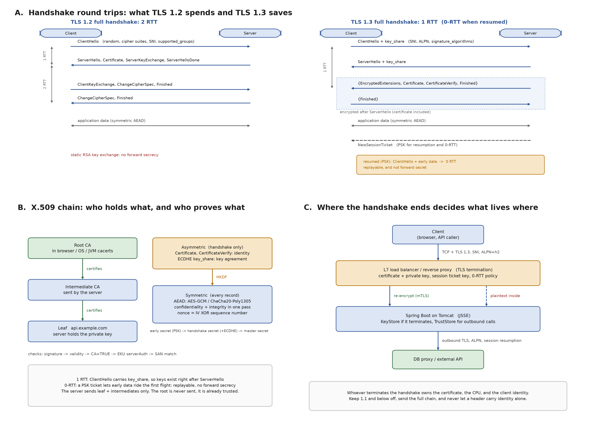

# [네트워크] HTTPS와 TLS 1.3 핸드셰이크

- 작성일: 2026-11-22
- 키워드: Network, HTTPS, TLS 1.2, TLS 1.3, Handshake, ECDHE, AEAD, Forward Secrecy, Session Ticket, 0-RTT, Replay Attack, X.509, Certificate Chain, SNI, ALPN, OCSP, ACME, JSSE, KeyStore, TrustStore

## 1. 핵심 요약 (What & Why)

지난 다섯 편은 연결에 대한 이야기였다. TCP가 순서와 재전송을 맡고(1편), 연결을 열고 닫는 데 왕복이 들고(2편), 그 위에서 HTTP가 진화했고(3편), 연결의 상대 주소를 이름으로 찾고(4편), 늘어난 서버로 그 연결을 나누고 재사용했다(5편). 그런데 이 모든 이야기에서 한 가지가 빠져 있었다. **지나가는 바이트가 평문**이라는 점이다. 5편에서 "L7 로드 밸런서가 TCP와 TLS를 종단한다"고 여러 번 적었지만, TLS가 무엇을 하고 그 종단이 왜 비용인지는 끝까지 다루지 않았다. 이번 편이 그 빈칸이다.

**평문 HTTP에는 세 가지가 없다.** 첫째, 경로 위의 누구든 내용을 읽을 수 있다(도청). 둘째, 누구든 내용을 바꿔 넣을 수 있고 받는 쪽은 그 사실을 모른다(변조). 셋째, 응답하는 쪽이 정말 그 도메인의 주인인지 확인할 방법이 없다(사칭). 하나의 TCP 연결은 클라이언트와 서버 사이에서 혼자 있지 않다. 가정용 공유기, 통신사 망, 회사 프록시, CDN, 로드 밸런서를 차례로 지나고, 그중 어느 지점에서든 같은 연결의 바이트를 들여다보거나 고칠 수 있다. HTTPS는 이 셋을 각각 암호화, 무결성 검사, 인증서 검증으로 막는다.

**비대칭키와 대칭키는 역할이 다르고, TLS는 그 둘을 순서대로 쓴다.** 공개키 암호는 상대를 확인하고(서명 검증) 세션 키를 안전하게 약속하는 데 쓰고, 실제 데이터는 대칭키로 암호화한다. 이유는 단순하다. 공개키 연산은 대칭키 연산보다 훨씬 무겁기 때문에 모든 바이트에 쓸 수 없고, 대칭키만 쓰자니 그 키를 어떻게 나눠 가질지가 문제로 남는다. TLS는 "인증서로 상대를 확인하고, 확인된 상대와 임시 대칭키를 합의한 뒤, 나머지는 대칭으로 빠르게" 처리하는 프로토콜이다. 이 합의 절차가 **핸드셰이크**이고, 그 절차의 왕복 횟수가 HTTPS의 첫 바이트 지연을 결정한다.

**TLS 1.2에서 1.3으로 갈 때 줄어든 것은 왕복만이 아니다.** TLS 1.2의 전체 핸드셰이크는 2-RTT이고, 정적 RSA 키 교환을 허용했으며, CBC 계열 암호군과 압축, 재협상을 남겨 두었다. TLS 1.3은 클라이언트가 첫 패킷에 자기 몫의 키 교환 값을 함께 보내 1-RTT로 줄였고(재개하면 0-RTT), ECDHE만 남겨 전방향 비밀성을 필수로 만들었고, AEAD 외의 암호군을 스펙에서 지웠고, 인증서까지 암호화했다. 즉 1.3의 개선은 "빠르게"보다 **"설정 실수로 약한 조합이 선택될 여지를 없앴다"** 쪽이 더 크다.

정리하면 세 문장이다.

1. **TLS는 인증(비대칭)과 암호화(대칭)를 분업시킨 프로토콜이고, 핸드셰이크는 그 둘을 잇는 유일한 구간이다.** 데이터 구간의 비용은 대칭키 연산 하나이고, 비싼 연산과 왕복은 전부 이 앞 구간에 몰려 있다.
2. **TLS 1.3의 1-RTT는 클라이언트가 서버의 선택을 미리 추측해 첫 패킷에 키 교환 값을 실었기 때문에 가능해졌다.** 왕복 하나를 아낀 대가로 추측이 틀리면 재시도(HelloRetryRequest)가 필요하고, 그 추측이 성립하는 이유는 현대 구현의 키 교환 그룹이 사실상 하나로 수렴했기 때문이다.
3. **0-RTT는 왕복을 0으로 만드는 대신 재전송 가능성과 전방향 비밀성 상실을 함께 들여온다.** 그래서 0-RTT는 "성능 기능"이 아니라 "요청의 멱등성에 대한 계약"이고, 결제·주문처럼 두 번 실행되면 안 되는 경로에서는 꺼야 한다.

## 2. 내부 메커니즘과 구조 (How it works)

### 2.1 평문이 잃는 세 가지와, TLS가 지켜 주지 않는 것

먼저 무엇을 막는지 정확히 적는다. TLS가 막는 위협과 막지 못하는 위협을 나눠 두면, 뒤에서 나오는 실패 모드(`PKIX path building failed`, SNI 불일치)가 왜 "TLS 버그"가 아닌지 이해하기 쉬워진다.

| 위협 | 평문 HTTP | TLS의 방어 |
| --- | --- | --- |
| 도청 | 그대로 노출 | AEAD 암호화 (레코드 단위) |
| 변조 | 탐지 불가 | AEAD 인증 태그, 핸드셰이크 transcript 해시 |
| 사칭 | 탐지 불가 | X.509 인증서와 CertificateVerify 서명 |
| 재전송 | 구분 불가 | 레코드 시퀀스 번호, Finished MAC (0-RTT 예외) |
| 순서 재배열·절단 | TCP에 의존 | 시퀀스 번호와 암호화된 레코드 경계 |

반대로 TLS가 지켜 주지 않는 것이 있다.

- **누가 어디에 접속했는지.** IP 주소와 포트는 헤더에 그대로 있고, TLS 1.3도 SNI(접속하려는 도메인 이름)는 암호화하지 않는다. 인증서를 암호화해도 SNI가 평문이므로 "어느 사이트에 갔는가"는 경로 위에서 여전히 보인다.
- **트래픽의 크기와 타이밍.** 패킷의 길이와 간격으로 통신의 성격을 추정하는 분석은 TLS로 막히지 않는다. TLS 1.3은 레코드 패딩 기능을 두어 이를 흐리게 할 수 있게 했지만 기본으로 켜지는 않는다.
- **서버의 선의와 애플리케이션의 결함.** 인증서는 "이 도메인의 주인이 맞다"만 보증한다. 그 서버가 안전한 코드를 돌린다는 보장은 없고, TLS가 끝난 뒤의 인가·검증은 애플리케이션의 몫이다.
- **클라이언트의 신원.** 기본 TLS는 서버만 인증한다. 클라이언트도 인증서를 내미는 것은 mTLS를 켰을 때의 이야기다.

### 2.2 비대칭키와 대칭키의 분업, 그리고 AEAD

TLS의 암호 사용은 두 구간으로 나뉜다.

**핸드셰이크 구간(비대칭).** 이 구간에서 비대칭키는 두 가지 일을 한다. 첫째, **서명**. 서버는 자신의 장기 개인키로 핸드셰이크 transcript에 서명하고(CertificateVerify), 클라이언트는 인증서의 공개키로 그것을 검증한다. 이것이 "지금 대화하는 상대가 그 도메인의 주인"이라는 증명이다. 둘째, **키 교환**. 양쪽이 각자 임시 키 쌍을 만들어 공개 값만 주고받고(ECDHE), 같은 대칭 비밀을 각자 계산한다. 임시 개인 값은 그 세션에서만 쓰고 버리므로, 나중에 서버의 장기 개인키가 유출되어도 지나간 트래픽을 복호화할 수 없다. 이것이 **전방향 비밀성(PFS)** 이다.

**데이터 구간(대칭).** 핸드셰이크가 끝나면 양쪽은 같은 대칭키를 들고 있다. 이후의 모든 레코드는 이 키로 암호화되고, 인증 태그로 무결성을 확인한다. AEAD(Authenticated Encryption with Associated Data)는 암호화와 무결성 검사를 한 번의 연산으로 처리하는 방식이고, TLS 1.3은 AES-GCM과 ChaCha20-Poly1305만 쓴다. AEAD에서 절대 하면 안 되는 것은 **같은 키에 같은 nonce를 재사용하는 것**이다. nonce가 겹치면 두 평문의 XOR이 그대로 드러나 암호가 무너진다. 그래서 TLS는 레코드마다 증가하는 시퀀스 번호를 nonce에 섞는다.

분업을 한 줄로 적으면 이렇다. **비대칭키는 "누구와 이야기하는가"를 정하고, 대칭키는 "무엇을 이야기하는가"를 감춘다.** 핸드셰이크의 모든 비용(왕복, 서명 검증, 인증서 전송)은 앞의 절반에 있고, 그 비용을 한 번만 치르기 위해 연결을 재사용하는 것이다(5편의 커넥션 풀링).

### 2.3 TLS 1.2: 2-RTT, 그리고 정적 RSA가 남긴 구멍

TLS 1.2의 전체 핸드셰이크는 네 번의 플라이트, 즉 **2-RTT**다.

```text
[TCP 3-way handshake: 1 RTT]

Client                                                        Server
  |  ClientHello (random, cipher suites, SNI, groups)  --->    |
  |                                                            |
  |  <--- ServerHello, Certificate, ServerKeyExchange,         |  1 RTT
  |       ServerHelloDone                                      |
  |                                                            |
  |  ClientKeyExchange, ChangeCipherSpec, Finished      --->   |
  |  <--- ChangeCipherSpec, Finished                           |  2 RTT
  |                                                            |
  |  <==============  application data  ==================>    |
```

핸드셰이크 키가 나오는 시점이 늦는 이유는 순서에 있다. 클라이언트는 서버가 어떤 그룹을 골랐는지(ServerKeyExchange)를 받은 뒤에야 자기 몫의 키 교환 값을 만들 수 있다. TLS 1.2에서는 이 순서를 바꿀 방법이 스펙에 없었고, 그래서 왕복이 하나 더 필요했다.

여기에 정적 RSA 키 교환이라는 선택지가 있었다. 이 방식에서 클라이언트는 premaster secret을 만들어 **서버 인증서의 RSA 공개키로 암호화**해 보내고, 서버는 개인키로 복호화한다. 왕복은 같지만 성질이 다르다.

- **전방향 비밀성이 없다.** 세션 키가 서버의 장기 개인키로 감싸여 전달되므로, 트래픽을 저장해 둔 공격자가 나중에 개인키를 얻으면 지나간 트래픽을 전부 복호화할 수 있다("지금 수집하고 나중에 복호화").
- **복호화 실패가 정보가 된다.** 잘못된 암호문을 넣었을 때의 반응 차이로 평문을 추출하는 공격 계열(Bleichenbacher 유형)이 계속 나왔고, 구현이 방어 코드로 그 구멍을 메우는 구조가 오래 유지됐다.
- **서버가 키 교환 방식을 사실상 정한다.** 클라이언트가 ECDHE를 제안해도 서버 설정에 RSA만 남아 있으면 RSA가 선택되고, 그 순간 PFS가 사라진다. 설정 한 줄이 보안 성질을 뒤집는 구조였다.

TLS 1.2가 ECDHE를 쓰면 PFS는 얻는다. 그러나 1.2 스펙에는 CBC 모드 암호군(MAC-then-encrypt의 패딩 오라클 위험), 압축(CRIME), 재협상(재협상 공격), DSA 서명, 사용자 정의 DH 그룹이 남아 있었다. **스펙이 허용하는 약한 조합이 너무 많다는 것**이 1.2의 근본 문제였다.

### 2.4 TLS 1.3: 1-RTT는 추측에서 나온다

TLS 1.3의 전체 핸드셰이크는 **1-RTT**다.

```text
[TCP 3-way handshake: 1 RTT]

Client                                                        Server
  |  ClientHello + key_share (+ SNI, ALPN, sig_algs) --->      |
  |                                                            |  1 RTT
  |  <--- ServerHello + key_share                              |
  |  <=== {EncryptedExtensions, Certificate,                   |
  |        CertificateVerify, Finished}                        |
  |                                                            |
  |  {Finished}  --->                                          |
  |                                                            |
  |  <==============  application data  ==================>    |
  |  <--- NewSessionTicket                                     |
```

줄어든 왕복 하나의 정체는 **`key_share`** 다. 클라이언트는 서버가 어떤 그룹을 쓸지 모르지만, 사실상 X25519 하나면 충분하다는 것을 안다. 그래서 첫 패킷에 자기 ECDHE 공개 값까지 실어 보낸다. 서버는 ServerHello에서 자기 공개 값을 주고, 그 순간 양쪽 모두 같은 핸드셰이크 비밀을 계산할 수 있다. 남은 핸드셰이크 메시지(인증서, 서명, Finished)는 이미 키가 있으므로 **암호화된 채로** 한 플라이트에 실려 간다.

추측이 틀리면 어떻게 되는가. 서버가 다른 그룹을 원하면 `HelloRetryRequest`로 클라이언트에게 다시 묻고, 왕복이 하나 늘어난다. 즉 1-RTT는 스펙이 보장하는 상한이 아니라 **"기본 그룹이 일치할 때의 값"** 이다. RFC 8446은 P-256을 필수, X25519를 권고로 두지만, 실제 구현의 기본 그룹은 X25519로 수렴해 있어 추측이 빗나가는 일은 드물다. 이 구조가 HTTP/3에서 더 중요해진다. 3편에서 본 QUIC의 1-RTT는 TLS 1.3의 이 1-RTT를 전송 계층의 첫 패킷들에 얹은 결과이고, `key_share`를 첫 비행에 싣는 성질이 없었다면 성립하지 않았다.

**스펙에서 지운 것들.** TLS 1.3은 다음을 제거했다. 정적 RSA 키 교환, 정적 DH/ECDH, CBC 모드, RC4, 3DES, 압축, 재협상, DSA 서명, 사용자 정의 DH 그룹. 남은 암호군은 다섯 개이고(그중 실질적으로 쓰이는 것은 AES-128-GCM, AES-256-GCM, ChaCha20-Poly1305 셋), 전부 AEAD다. 키 교환과 서명 알고리즘이 암호군에서 분리되어 따로 협상된다. 결과적으로 **"약한 조합을 고르는 설정"이라는 실패 모드 자체가 사라졌다.**

**중간 장비 호환 모드.** 세상의 모든 방화벽과 프록시가 TLS 1.3을 이해하는 것은 아니었다. 그래서 클라이언트는 첫 비행에 더미 `ChangeCipherSpec` 레코드를 끼워 넣고, `legacy_session_id`를 그대로 되돌려받는 호환 모드를 함께 구현한다. 겉보기에는 TLS 1.2와 비슷한 흔적을 남기고, 실제 내용은 1.3으로 흐른다. 이 때문에 패킷을 볼 때 `ChangeCipherSpec`이 보인다고 해서 그것이 1.2라는 뜻은 아니다.

**다운그레이드 방어.** 서버는 TLS 1.3을 지원하는 클라이언트와 1.2로 협상하게 되면 `server_random`의 마지막 8바이트에 정해진 상수를 넣는다. 클라이언트는 그 값을 보고 "중간자가 협상을 끌어내렸다"고 판단해 연결을 끊는다. 3편에서 HTTP/3 폴백을 다룰 때 나온 "폴백 지연"과 같은 계열의 문제지만, TLS는 그 흔적을 값으로 남겨 탐지한다.

### 2.5 메시지 단위로 본 핸드셰이크

| 메시지 | 방향 | 담는 것 | 주의할 점 |
| --- | --- | --- | --- |
| `ClientHello` | C → S | `random`, `cipher_suites`, `supported_versions`, `key_share`, `supported_groups`, `signature_algorithms`, SNI(`server_name`), ALPN, `pre_shared_key`(마지막 확장) | SNI와 ALPN은 평문. `pre_shared_key`가 마지막에 와야 하는 이유는 그 안의 binder가 앞선 확장 전체의 해시에 묶이기 때문 |
| `ServerHello` | S → C | 선택한 `cipher_suite`, `key_share`, `legacy_session_id` 반향, (재개 시) `pre_shared_key` | 여기까지가 평문. 이 메시지 뒤부터 모든 레코드가 암호화됨 |
| `EncryptedExtensions` | S → C | ALPN 결과, early data 수락 여부 등 **키에 영향을 주지 않는** 서버 파라미터 | 키 교환에 영향을 주는 확장은 여기 올 수 없음. 그래서 ServerHello와 분리된 별도 메시지다 |
| `Certificate` | S → C | 서버 인증서 체인(leaf 먼저, 이어서 중간 CA) | root는 보내지 않는 것이 일반적. 각 인증서는 직전 인증서를 서명한 것이어야 함 |
| `CertificateVerify` | S → C | transcript 해시에 대한 서버의 서명 (`rsa_pss_rsae_sha256`, `ecdsa_secp256r1_sha256`, `ed25519` 등) | 인증서의 공개키가 실제로 그 개인키를 쥐고 있음을 증명 |
| `Finished` | 양방향 | `finished_key`로 계산한 HMAC (transcript 해시 기반) | 협상된 모든 파라미터와 메시지 순서가 변조되지 않았음을 확인 |
| `NewSessionTicket` | S → C | PSK identity, `ticket_lifetime`, `ticket_age_add`, `max_early_data_size` | 핸드셰이크가 끝난 뒤에 보냄. 다음 연결의 재개와 0-RTT에 쓰임 |
| `KeyUpdate` | 양방향 | 새 트래픽 키로 전환하라는 요청 | 장시간 연결에서 키를 갱신. TLS 1.2의 재협상을 대체 |

세부가 두 가지 더 있다.

**transcript 해시.** 양쪽은 주고받은 핸드셰이크 메시지를 순서대로 이어 붙여 해시를 만든다. CertificateVerify의 서명 대상도, Finished의 MAC 대상도 이 해시다. 그래서 중간자가 ClientHello의 암호군 목록이나 SNI를 바꿔 넣으면 해시가 달라지고 Finished에서 걸린다. TLS 1.3이 "핸드셰이크 전체가 서명된다"고 말하는 이유가 이것이다.

**SNI와 ALPN의 위치.** 둘 다 ClientHello의 확장으로 실린다. SNI는 서버가 같은 IP와 포트에서 여러 도메인을 받을 때 어느 인증서를 내밀지 고르는 힌트이고, ALPN은 `h2`, `http/1.1`처럼 애플리케이션 프로토콜을 고르는 협상이다. 이 둘이 평문이라는 점이 실무에서 두 가지 형태의 사고를 만든다. 하나는 SNI 불일치(엉뚱한 인증서가 나가 호스트 검증 실패), 다른 하나는 ALPN 불일치(백엔드가 `h2`를 모르는데 앞단이 `h2`로 말해 502)다.

### 2.6 키 스케줄: 비밀이 세 단계로 올라간다

TLS 1.3은 HKDF로 비밀을 조합해 단계별 키를 만든다. RFC 8446의 구조를 그대로 옮기면 이렇다.

```text
              0
              |
              v
    PSK --> HKDF-Extract = Early Secret
              |
              +--> Derive-Secret("ext binder" | "res binder")   (재개용 binder)
              |
              v
  (EC)DHE --> HKDF-Extract = Handshake Secret
              |
              +--> Derive-Secret("c hs traffic")  = client_handshake_traffic_secret
              +--> Derive-Secret("s hs traffic")  = server_handshake_traffic_secret
              |
              v
       0 ---> HKDF-Extract = Master Secret
              |
              +--> Derive-Secret("c ap traffic")  = client_application_traffic_secret
              +--> Derive-Secret("s ap traffic")  = server_application_traffic_secret
              +--> Derive-Secret("exp master")    = exporter_master_secret
              +--> Derive-Secret("res master")    = resumption_master_secret
```

읽는 방법은 이렇다. **Early Secret**은 PSK만으로 만들어진다. 그래서 0-RTT 데이터의 키는 서버의 임시 키가 섞이지 않은, 전방향 비밀성이 없는 키다. **Handshake Secret**은 여기에 (EC)DHE 결과가 더해져 만들어진다. ServerHello가 오간 직후 이 값으로 핸드셰이크 트래픽 키가 나오고, 그때부터 인증서가 암호화된다. **Master Secret**은 핸드셰이크가 끝난 뒤의 애플리케이션 트래픽 키와, 나중에 세션 티켓으로 나갈 resumption 비밀을 만든다. 레코드 하나를 암호화할 때는 트래픽 비밀에서 유도한 키와 IV를 쓰고, nonce는 IV와 레코드 시퀀스 번호를 XOR해 만든다. 시퀀스 번호가 매번 달라지므로 nonce가 겹치지 않는다.

여기서 하나 더. TLS 1.3의 레코드는 겉으로 보면 전부 `application_data` 타입이다. 실제 내용이 핸드셰이크 메시지인지 애플리케이션 데이터인지는 암호문 안쪽의 타입 바이트에 들어 있다. 그래서 경로 위의 장비는 어디까지가 핸드셰이크인지 구분할 수 없다. 3편에서 QUIC이 헤더를 암호화해 관측 가능성을 떨어뜨린 것과 같은 방향의 결정이다.

### 2.7 세션 재개와 0-RTT, 그리고 재전송

매 연결마다 인증서를 검증하고 서명을 주고받는 비용을 아끼려고, TLS는 이전 세션의 결과를 다음 연결에 재사용한다. TLS 1.2에서는 세션 ID나 세션 티켓(RFC 5077)이 그 역할을 했고, TLS 1.3에서는 둘을 **PSK(Pre-Shared Key)** 하나로 통합했다.

동작은 이렇다. 핸드셰이크가 끝나면 서버가 `NewSessionTicket`을 보낸다. 그 안에는 resumption 비밀에서 유도한 PSK와, 그것을 식별할 티켓 값, 수명, `ticket_age_add`가 들어 있다. 다음 연결에서 클라이언트는 ClientHello에 `pre_shared_key` 확장으로 그 티켓을 제시하고, 서버가 받아들이면 인증서와 CertificateVerify를 **생략**한다. 1-RTT는 그대로지만 서명 검증과 인증서 전송이 사라진다. 서버는 이 티켓을 한 번만 쓰도록(단일 사용) 발급하거나, 재사용을 허용하되 시간 창을 두는 방식으로 재전송을 막는다. `ticket_lifetime`은 7일을 넘기지 않도록 권고된다.

**0-RTT(early data)** 는 여기서 한 걸음 더 간다. 재개할 때 클라이언트는 PSK를 제시하는 그 첫 비행에 애플리케이션 데이터까지 실어 보낸다. 서버가 그 PSK를 받아들이면 왕복 0으로 첫 요청이 도착한다. 대가는 두 가지다.

- **전방향 비밀성이 없다.** early data의 키는 PSK만으로 유도된다. 서버의 임시 키가 섞이지 않으므로, 그 티켓의 PSK가 유출되면 그 데이터는 복호화된다.
- **재전송될 수 있다.** 공격자가 그 첫 비행을 가로채 그대로 다시 보내면 서버는 그것이 새 요청인지 재전송인지 구분할 근거가 없다. PSK에는 서버가 준 난수가 섞여 있지 않고, 클라이언트의 신선도를 증명할 왕복이 아직 없기 때문이다.

RFC 8446은 그래서 0-RTT를 "애플리케이션 계층이 재전송의 의미를 이해하고 있을 때만" 쓰라고 못 박고, 서버가 재전송 방어(단일 사용 티켓, 시간 창)를 구현해야 한다고 적는다. 3편에서 QUIC의 0-RTT를 다룰 때 나온 결론과 같다. **0-RTT는 멱등 요청에만.** 그리고 서버는 early data를 거절할 수 있는 경로를 반드시 남겨야 한다. 거절되면 클라이언트는 그 데이터를 핸드셰이크 완료 후에 다시 보내야 하고, 이때 애플리케이션이 "이미 처리했다"고 착각하지 않도록 상태 코드(425 Too Early, RFC 8470)로 알려 주는 것이 표준적인 방법이다.

### 2.8 인증서: 신뢰의 사슬을 누가 어디까지 들고 있는가

핸드셰이크가 "이 도메인의 주인"을 확인하는 방식은 인증서 체인이다.

```text
Root CA        (self-signed, 브라우저/OS/JVM의 TrustStore에 미리 들어 있음)
   |
   | certifies
   v
Intermediate CA (서버가 체인에 함께 보내는 것이 보통)
   |
   | certifies
   v
Leaf (example.com)  ---- 서버가 개인키를 들고 있음
```

**서버가 보내는 것**은 leaf와 중간 CA다. root는 보내지 않는다. 클라이언트가 이미 root를 신뢰하고 있으므로 보낼 필요가 없고, 보낸다고 해서 신뢰가 늘지도 않는다(자기가 보낸 root를 자기가 신뢰한다면 그것은 신뢰가 아니다).

**클라이언트가 하는 일**은 체인 조립과 검증이다.

1. leaf를 시작으로, 각 인증서의 발급자 이름과 다음 인증서의 주체 이름을 맞춰 체인을 만든다. 체인에 없는 중간 CA가 필요하면 AIA 확장의 URL로 내려받기를 시도한다.
2. 각 단계의 서명을 상위 인증서의 공개키로 검증한다.
3. 모든 인증서의 유효 기간을 확인한다.
4. 중간 CA가 `BasicConstraints: CA=TRUE`이고 경로 길이 제한을 넘지 않는지 확인한다.
5. leaf의 `KeyUsage`(서명 용도)와 `ExtendedKeyUsage`(`serverAuth`)가 이 용도에 맞는지 확인한다.
6. leaf의 `subjectAltName`에 접속한 호스트 이름이 있는지 확인한다. 현대 브라우저는 CN 필드를 쓰지 않고 SAN만 본다.
7. 폐기 여부를 확인한다(CRL, OCSP, OCSP stapling).

**TrustStore**는 이 검증의 출발점, 즉 신뢰 앵커의 목록이다. 브라우저는 자체 저장소를, OS는 시스템 저장소를, 자바는 `$JAVA_HOME/lib/security/cacerts`를 쓴다. 이 셋은 서로 다른 파일이고 서로 자동으로 동기화되지 않는다. 리눅스 컨테이너에 `ca-certificates` 패키지를 설치해도 JVM의 `cacerts`는 그대로인 경우가 많은 이유가 이것이다.

**폐기 확인**은 오래된 골칫거리다. CRL은 목록을 내려받아야 하고 목록이 커지면 비용이 커진다. OCSP는 인증서마다 실시간 질의를 하므로 지연이 생기고, 질의 자체가 "이 사용자가 이 사이트에 간다"는 정보를 CA에 노출한다. **OCSP stapling**은 서버가 미리 받아 둔 OCSP 응답을 핸드셰이크에 첨부해 이 두 문제를 줄이는 방식이고, 최근 브라우저들은 OCSP 실시간 조회를 줄이고 CRL 기반 검사로 옮겨 가는 추세다. 어느 쪽이든 **폐기 확인은 신뢰의 필수 요소가 아니라 최선 노력**으로 취급되는 경우가 많다는 점을 알아 두어야 한다.

**인증서를 자동으로 받는 절차**가 ACME(RFC 8555)다. 클라이언트는 계정 키를 만들고, 발급 대상 도메인에 대한 인가를 챌린지로 증명한 뒤, CSR을 제출해 인증서를 받는다. 챌린지 방식이 세 가지이고, 그 차이가 운영에서 중요하다.

- **HTTP-01**: `http://도메인/.well-known/acme-challenge/토큰` 경로로 지정된 값을 서빙한다. 80번 포트가 외부에서 접근 가능해야 하고, 와일드카드 인증서는 발급받을 수 없다.
- **DNS-01**: `_acme-challenge.도메인`에 TXT 레코드를 넣는다. 80번 포트가 필요 없고 와일드카드가 가능하지만, DNS API 권한을 자동화 도구에 넘겨야 한다.
- **TLS-ALPN-01**(RFC 8737): 443 포트의 TLS 핸드셰이크에서 특별한 ALPN 값으로 응답한다. 80번 포트를 쓸 수 없고 DNS도 못 만질 때의 우회로다.

## 3. 구조 도식 (Architecture Diagram)



- **A 핸드셰이크 왕복 비교 (왼쪽 위)**: TLS 1.2와 TLS 1.3의 비행을 나란히 두었다. 1.2는 ClientHello 뒤에 서버가 그룹을 정해 주고, 클라이언트가 그제야 자기 키 교환 값을 만드는 순서라 왼쪽에 1 RTT와 2 RTT 구간을 나눠 표시했다. 1.3은 `key_share`가 첫 비행에 실려 ServerHello 직후 키가 나오고, 이후 메시지가 한 플라이트로 묶이므로 구간 전체가 1 RTT다. 그 플라이트에는 점선 상자로 암호화 구간을 표시했고, 아래의 파선 화살표는 핸드셰이크 뒤에 오는 NewSessionTicket(재개용 PSK)이고, 주황 상자는 재개 시 0-RTT가 어떤 대가를 치르는지 적은 주석이다.
- **B 인증서 체인과 역할 분리 (오른쪽 위)**: Root CA가 TrustStore에 있고, 서버는 leaf와 중간 CA만 보낸다는 사실을 위아래로 나눠 표시했다. 왼쪽 사슬 아래에는 클라이언트가 실제로 확인하는 항목(서명, 유효기간, CA 여부, EKU, SAN)을 한 줄로 적었다. 오른쪽에는 비대칭키(신원 증명, 키 교환)와 대칭키(AEAD 레코드 암호화)의 담당 구간을 HKDF 화살표로 이어 두었고, 키 스케줄의 Early, Handshake, Master 세 단계도 함께 적었다.
- **C L7 종단과 백엔드 (아래)**: 클라이언트에서 L7 로드 밸런서까지 TLS가 살아 있고, 로드 밸런서에서 종단된 뒤 백엔드(톰캣)까지는 다시 TLS를 걸거나(재암호화, mTLS) 평문으로 잇는 두 갈래를 그렸다. 백엔드는 키스토어(직접 종단할 때)와 트러스트스토어(밖으로 나갈 때)를 나눠 들고 있고, 마지막 홉에서 다시 TLS로 외부 API에 닿는다. 종단 위치가 인증서·CPU·클라이언트 신원을 어디에 두는지를 한눈에 비교할 수 있게 했다.

## 4. 비교 표 (Comparison)

### 4.1 TLS 1.2 vs TLS 1.3

| 항목 | TLS 1.2 (RFC 5246) | TLS 1.3 (RFC 8446) |
| --- | --- | --- |
| 전체 핸드셰이크 왕복 | 2-RTT | 1-RTT |
| 세션 재개 | 1-RTT (세션 ID 또는 세션 티켓) | 1-RTT (PSK) |
| 0-RTT(early data) | 없음 | PSK 재개 시 가능 (재전송 위험 동반) |
| 키 교환 | RSA(정적), DHE, ECDHE | (EC)DHE만. 정적 RSA·정적 DH 제거 |
| 전방향 비밀성 | ECDHE를 골랐을 때만 | 필수 (항상) |
| 암호군 | AEAD + CBC(MAC-then-encrypt), RC4, 3DES | AEAD 전용. AES-GCM, ChaCha20-Poly1305 등 5종 |
| 키 교환·서명 협상 | 암호군 이름에 함께 묶임 | 암호군과 분리해 따로 협상 |
| 인증서 전송 | 평문 | 암호화 (ServerHello 이후 전부) |
| SNI | 평문 | 평문 (인증서만 암호화됨) |
| 압축 | 지원 (CRIME 위험) | 제거 |
| 재협상 | 지원 (재협상 공격 이력) | 제거. `KeyUpdate`로 키만 갱신 |
| 핸드셰이크 무결성 | Finished가 일부만 커버 | transcript 해시로 전체 커버 |
| 다운그레이드 방어 | 없음 | `server_random`의 하위 8바이트에 상수 삽입 |
| 키 유도 | PRF (버전별 정의) | HKDF, Early/Handshake/Master 3단계 |

### 4.2 ACME 챌린지 비교

| 항목 | HTTP-01 | DNS-01 | TLS-ALPN-01 |
| --- | --- | --- | --- |
| 증명 대상 | 80 포트의 HTTP 응답 | DNS TXT 레코드 | 443 포트의 TLS 핸드셰이크 |
| 필요한 권한 | 웹 서버의 파일 배치 | DNS 존 편집 API | 웹 서버의 TLS 설정 |
| 와일드카드 | 불가 | 가능 | 불가 |
| 80 포트 필요 | 필요 | 불필요 | 불필요 |
| 443 포트 필요 | 불필요 | 불필요 | 필요 |
| 자동화 난이도 | 낮음 (파일만 쓰면 됨) | 중간 (DNS API 자격 증명 관리) | 중간 (서버 재시작·설정 필요) |
| 흔한 실패 원인 | 리다이렉트·프록시가 경로를 가로챔, 80 차단 | TXT 전파 지연, API 권한 부족 | 다른 서버가 443을 점유 |

### 4.3 TLS 종단 위치 비교

| 항목 | 패스스루 (L4·SNI 라우팅) | L7 종단 | L7 종단 + 백엔드 재암호화 | End-to-End mTLS |
| --- | --- | --- | --- | --- |
| 핸드셰이크가 일어나는 곳 | 백엔드 | 로드 밸런서 | 로드 밸런서 + 백엔드 | 백엔드 (양방향) |
| 인증서를 두는 곳 | 백엔드 | 로드 밸런서 | 로드 밸런서, 백엔드 | 백엔드, 클라이언트 |
| 경로 기반 라우팅 | 불가 (SNI까지만) | 가능 | 가능 | 가능 (프록시가 종단해야) |
| 내부 구간 암호화 | 유지 | 해제됨 | 유지 | 유지 |
| 클라이언트 신원 | 백엔드가 직접 봄 | 헤더로 전달(위조 가능) | 헤더 또는 재암호화로 전달 | 백엔드가 인증서로 직접 검증 |
| CPU 부담 | 백엔드 | 엣지에 집중 | 양쪽 | 백엔드 |
| 운영 복잡도 | 낮음 | 낮음 (인증서 한 곳) | 중간 | 높음 (클라이언트 인증서 발급·회전) |
| 적합한 상황 | 백엔드가 인증서를 직접 관리해야 할 때 | 대부분의 웹 서비스 | 내부 규정상 평문 금지 | 서비스 간 제로 트러스트, 금융·의료 |

### 4.4 암호 프리미티브의 역할 분담

| 성질 | 담당 | 쓰이는 곳 | 대표 알고리즘 |
| --- | --- | --- | --- |
| 신원 증명 | 비대칭 서명 | CertificateVerify | RSA-PSS, ECDSA P-256, Ed25519 |
| 키 합의 | 비대칭 키 교환 | ClientHello/ServerHello의 `key_share` | ECDHE (X25519, P-256) |
| 데이터 기밀성·무결성 | 대칭 AEAD | 모든 애플리케이션 레코드 | AES-128-GCM, AES-256-GCM, ChaCha20-Poly1305 |
| 비밀 유도 | 해시 기반 KDF | 키 스케줄 | HKDF-SHA256, HKDF-SHA384 |
| 무결성 확인 | HMAC | Finished | HMAC-SHA256 |

## 5. 내가 깨달은 점 (My Insight)

- **3편의 QUIC과 이번 편은 같은 발명의 두 얼굴이다.** 3편에서 "HTTP/3는 TLS 1.3을 전송 계층에 통합해 1-RTT를 얻었다"고 적었는데, 그 통합이 가능했던 이유는 TLS 1.3 자체가 1-RTT였기 때문이다. TLS 1.3이 `key_share`를 첫 비행에 싣지 않았다면 QUIC은 전송 파라미터와 암호 키를 같은 왕복에 준비할 수 없었다. 즉 HTTP/3의 성능은 QUIC의 창의성만이 아니라 **TLS 1.3의 메시지 순서 변경**이 만든 것이고, 두 문서를 따로 읽으면 이 인과가 보이지 않는다.

- **5편의 "TLS 종단 비용"은 핸드셰이크 비용이고, 그래서 커넥션 재사용과 같은 문제다.** L7 로드 밸런서가 비싼 이유는 암호화 자체가 아니라, 새 연결마다 인증서 검증과 서명 확인을 대신 해 주기 때문이다. 5편에서 본 커넥션 풀링과 Keep-Alive는 이 비용을 지우는 장치이고, TLS 1.3의 세션 재개는 그것을 **연결이 끊긴 뒤에도** 이어 가는 장치다. 두 문서가 다루는 대상은 다르지만 최적화의 대상은 같은 "왕복과 서명"이다. 로드 밸런서를 여러 대 두고 세션 티켓 키를 공유하지 않으면, 재개가 노드마다 실패해 이 이득이 사라진다는 점도 이 연결선 위에 있다.

- **`PKIX path building failed`는 클라이언트의 문제가 아니라 대개 서버의 문제다.** 이 메시지는 자바가 "신뢰 앵커까지 이어지는 경로를 만들 수 없다"고 말하는 것이고, 실제 원인의 대부분은 서버가 중간 CA를 체인에 넣지 않은 것이다. 클라이언트의 `cacerts`에 root가 없는 경우도 있지만, 그보다 흔한 것은 leaf만 보내는 잘못된 서버 설정이다. 이 오류를 만나면 `cacerts`를 만지기 전에 `openssl s_client`로 서버가 무엇을 보내는지 먼저 봐야 한다.

- **SNI 불일치는 "인증서가 틀렸다"가 아니라 "서버가 고르는 기준이 틀렸다"이다.** 같은 IP에 여러 도메인을 두고 기본 인증서만 내밀면, 접속한 이름과 인증서의 SAN이 달라 호스트 검증에서 실패한다. TLS 1.3이 인증서를 암호화해도 이 실패는 그대로 남는다. SNI가 평문이고, 서버가 그 값으로 인증서를 고르기 때문이다. 와일드카드 인증서의 깊이 제한(`*.example.com`은 `a.b.example.com`을 덮지 않음)도 같은 계열의 함정이다.

- **0-RTT를 켜는 결정은 보안 설정이 아니라 API 설계 결정이다.** early data는 재전송될 수 있으므로, 서버가 "이 요청이 두 번 실행되어도 되는가"를 답할 수 있어야 한다. 조회 API는 안전하고, 결제·주문·재고 차감은 안전하지 않다. 이 판단은 TLS 설정 파일이 아니라 엔드포인트의 성질에서 나오므로, 인프라 담당자가 아니라 API를 설계한 사람이 해야 한다. 3편에서 QUIC의 0-RTT를 두고 "위험을 동반한 기능"이라고 적은 것과 정확히 같은 결론이다.

- **HTTPS의 신뢰는 암호가 아니라 운영에서 완성된다.** 암호 스펙은 TLS 1.3에서 거의 정리됐다. 남은 실패는 대부분 만료된 인증서, 체인 누락, 잘못된 SNI, 갱신 자동화의 침묵 같은 운영 문제다. 그래서 "TLS 1.3을 켰다"는 보안 조치의 끝이 아니라 시작이고, 실제 위험을 줄이는 일은 인증서 수명을 자동으로 관리하고 만료를 감시하는 쪽에 있다.

## 6. 실무 관점 및 트레이드오프 (Trade-offs & Best Practices)

### 6.1 종단 위치가 옮기는 것들

TLS를 어디서 끝낼지는 "성능 vs 보안"의 문제처럼 보이지만, 실제로는 **무엇을 어디에 두는가**의 문제다.

- **L7 종단**: 인증서와 개인키가 엣지 한 곳에 모인다. 갱신이 한 번이면 되고, CPU 부담이 백엔드에서 사라지며, 경로 기반 라우팅과 카나리 배포가 가능해진다. 대신 엣지와 백엔드 사이 구간이 평문이 되고, 클라이언트 신원은 헤더로만 전달된다.
- **재암호화(bridging)**: 엣지에서 종단한 뒤 백엔드와 다시 TLS를 맺는다. 내부 구간 규정을 지키면서 엣지의 라우팅 능력을 유지하는 절충이다. 대신 핸드셰이크가 두 번, 인증서 관리가 두 벌이 된다. 내부 구간은 세션 재개와 커넥션 풀을 함께 써서 비용을 눌러야 한다.
- **패스스루**: 로드 밸런서가 바이트만 흘려보내고 백엔드가 종단한다. 종단 지점이 백엔드이므로 서버마다 인증서가 필요하고, 경로 라우팅은 포기해야 한다(SNI까지만 볼 수 있다).
- **mTLS**: 서비스 간 통신에서 양쪽이 인증서를 낸다. 클라이언트 신원이 헤더가 아니라 암호로 증명되므로 위조가 불가능하다. 대신 클라이언트 인증서의 발급·회전·폐기를 자동화해야 하고, 그 자동화가 없으면 인증서 만료가 곧 서비스 전면 장애가 된다.

> [!NOTE]
> 종단을 로드 밸런서에서 하고 클라이언트 정보를 헤더로 넘기는 구성에서, 그 헤더는 **인증 수단이 아니라 힌트**다. `X-Forwarded-For`나 `X-Forwarded-Client-Cert`는 클라이언트가 직접 보낼 수도 있는 값이므로, 엣지에서 반드시 덮어쓰거나 제거해야 한다. 엣지를 우회하는 경로가 하나라도 있으면 그 경로로는 헤더를 위조해 다른 사용자로 행세할 수 있다. mTLS를 켰는데도 백엔드가 헤더만 믿고 있다면, 그 구성은 암호를 쓰면서 암호의 이점을 버린 셈이다.

### 6.2 세션 티켓과 0-RTT 운영

세션 재개는 공짜 이득처럼 보이지만, 운영에서 세 가지를 함께 정해야 한다.

1. **티켓 키를 어디에 둘 것인가.** 서버가 티켓을 암호화하는 키를 노드마다 다르게 가지면, 재개 요청이 다른 노드에 도착할 때 복호화에 실패해 재개가 무산된다. 로드 밸런서나 서버 군이 여러 대라면 티켓 키를 공유하거나, 키를 주기적으로 회전하면서 이전 키를 일정 기간 함께 보관해야 한다.
2. **수명을 얼마로 둘 것인가.** 길면 재개의 이득이 커지고, 짧으면 전방향 비밀성의 창이 좁아진다. RFC 8446은 7일을 상한으로 권고한다. 재개된 세션은 원래 세션의 인증 결과를 물려받으므로, 인증서가 폐기되어도 티켓 수명 동안은 이전 신뢰가 유지된다는 점을 감안해야 한다.
3. **0-RTT를 켤 것인가.** 켠다면 엣지나 프레임워크에서 경로별로 끌 수 있어야 한다.

> [!WARNING]
> 0-RTT를 결제, 주문, 포인트 적립, 재고 차감 같은 엔드포인트에 허용하면 중복 처리의 문이 열린다. early data는 공격자가 그대로 재전송할 수 있고, 서버는 그것이 새 요청인지 재전송인지 구분할 근거를 갖지 못한다. 허용해야 한다면 애플리케이션 계층에 멱등성 키를 두어 중복을 걸러 내야 하고, 그것은 TLS 설정이 아니라 코드의 일이다. 그리고 0-RTT로 보낸 요청은 전방향 비밀성도 없다. 그 요청이 민감한 정보를 담고 있다면 왕복 하나를 아낀 대가가 너무 크다.

### 6.3 자바와 스프링에서의 설정 지점

자바에서 TLS는 JSSE가 담당하고, 설정은 세 층으로 나뉜다. **시스템 속성**, **SSLContext**, 그리고 **프레임워크 설정**이다.

```yaml
server:
  port: 443
  ssl:
    enabled: true
    key-store: classpath:keystore.p12       # 서버 자신의 인증서 + 개인키
    key-store-type: PKCS12
    key-store-password: ${KEYSTORE_PASSWORD}
    key-alias: api
    enabled-protocols: TLSv1.3,TLSv1.2      # 1.2는 남기되 1.1 이하는 끊는다
    client-auth: none                       # mTLS면 need 또는 want
    trust-store: classpath:truststore.p12   # client-auth 사용 시 검증 앵커
  http2:
    enabled: true                           # ALPN으로 h2 협상
  forward-headers-strategy: framework       # 앞단 종단 시 X-Forwarded-Proto 반영
```

- **KeyStore vs TrustStore.** 둘은 방향이 반대다. KeyStore는 "내가 누구인지"를 증명하는 개인키와 인증서 체인을 담고(서버 신원), TrustStore는 "내가 누구를 믿는지"의 신뢰 앵커를 담는다(상대 검증). 서버가 외부 API를 호출하면 그때는 자기 TrustStore로 상대를 검증한다. 이 두 파일을 같은 것으로 착각하면 "인증서를 넣었는데 왜 검증이 실패하는가"에서 막힌다. 기본 타입은 Java 9 이후 PKCS12이고, `cacerts`의 기본 비밀번호는 `changeit`이다(운영에서는 바꾸는 것이 원칙이지만, 바꾸면 JSSE 기본 경로가 깨지므로 `javax.net.ssl.trustStorePassword`를 함께 지정해야 한다).
- **JDK 버전.** TLS 1.3은 JDK 11에서 JEP 332로 표준 지원되고, JDK 8의 후기 업데이트에도 백포트되었다. JDK 11 이상에서는 `TLSv1.3`과 `TLSv1.2`가 기본 활성 프로토콜이고, `jdk.tls.disabledAlgorithms`가 오래된 알고리즘을 막는다.
- **호스트 이름 검증.** `HttpsURLConnection`과 Java 11의 `HttpClient`는 기본으로 호스트 이름을 검증한다. 반면 `SSLSocket`을 직접 만들어 쓰는 코드는 `SSLParameters.setEndpointIdentificationAlgorithm("HTTPS")`를 켜지 않으면 **암호화만 하고 사칭은 막지 못한다.** 커스텀 `TrustManager`로 검증을 통째로 끄는 코드(모두 신뢰)는 개발 편의를 위해 쓰이지만, 그 코드가 운영에 들어가면 TLS의 절반을 버리는 셈이다.
- **스프링 부트 3.1 이후의 SSL 번들.** `spring.ssl.bundle.*`로 인증서 묶음을 정의하고 `server.ssl.bundle`로 참조하면, PEM과 JKS를 같은 방식으로 다루고 `reload-on-update`로 무중단 갱신을 할 수 있다. 앞단 로드 밸런서에서 종단하는 구성이라면 서버 쪽 인증서는 필요 없지만, 내부 재암호화나 mTLS를 쓴다면 이 설정이 인증서 회전의 자동화 지점이 된다.

> [!NOTE]
> JVM의 `cacerts`와 OS의 신뢰 저장소는 별개다. 리눅스 컨테이너에 `ca-certificates`를 설치하거나 사내 root를 OS에 등록해도, 자바 애플리케이션은 여전히 `cacerts`만 본다. 사내 CA가 서명한 인증서를 쓰는 환경에서 `PKIX path building failed`가 나오는 흔한 이유가 이것이고, 해결은 `keytool -importcert -cacerts -file 사내root.crt -alias 사내ca` 또는 `-Djavax.net.ssl.trustStore` 지정이다. 컨테이너 이미지를 다시 빌드하면 이 변경이 사라지는 것도 함께 주의해야 한다.

### 6.4 인증서 수명 관리

인증서는 "한 번 발급하면 끝"이 아니라 "주기적으로 만료되는 설정"이다. 공개 CA의 인증서 수명은 짧아지는 추세이고(90일이 흔하다), 수명이 짧아질수록 자동 갱신이 필수가 된다.

- **발급은 ACME로 자동화한다.** 80 포트를 열 수 있으면 HTTP-01이 가장 단순하고, 와일드카드가 필요하거나 80을 열 수 없으면 DNS-01을 쓴다. DNS-01은 DNS API 자격 증명을 자동화 도구에 넘기는 일이므로, 그 자격 증명의 권한을 해당 존으로 좁혀야 한다.
- **갱신은 만료 전에, 실패는 감시한다.** 자동 갱신은 조용히 실패하는 것이 가장 위험하다. 갱신 성공 여부와 남은 일수를 지표로 내보내고, 만료 임계값에 경보를 건다. `X509Certificate.getNotAfter()`로 애플리케이션에서 직접 확인할 수도 있다.
- **체인을 함께 배포한다.** leaf만 배포하면 클라이언트에 따라 성공하기도 하고 실패하기도 한다. 브라우저는 AIA로 중간 CA를 내려받아 메우지만, 그 경로가 막힌 클라이언트(사내망, 일부 모바일 SDK, 자바 클라이언트)는 실패한다. `fullchain` 형태로 leaf와 중간 CA를 함께 내보내는 것이 안전하다.
- **CAA 레코드와 CT 로그를 확인한다.** CAA(RFC 8659)는 "이 도메인의 인증서는 이 CA만 발급할 수 있다"를 DNS에 적는 것이고, 잘못 설정하면 갱신이 조용히 거부된다. CT 로그는 발급된 인증서가 공개적으로 기록되는 구조로, 도메인 소유자가 모르는 발급을 탐지하는 수단이 된다.

### 6.5 점검 도구와 순서

```bash
# 서버가 실제로 무엇을 보내는지 본다. 체인 누락, SNI 불일치를 한 번에 확인할 수 있다.
openssl s_client -connect api.example.com:443 -servername api.example.com -showcerts </dev/null 2>&1 \
  | sed -n '/Certificate chain/,/---/p'

# 협상 결과를 본다. Protocol, Cipher, ALPN이 함께 나온다.
openssl s_client -connect api.example.com:443 -servername api.example.com -alpn h2,http/1.1 </dev/null 2>&1 \
  | grep -E "Protocol|Cipher|ALPN|Verify return code"

# TLS 1.3만 허용되는지, 1.1 이하가 거부되는지 확인한다.
openssl s_client -connect api.example.com:443 -tls1_1 </dev/null 2>&1 | head -5
openssl s_client -connect api.example.com:443 -tls1_3 </dev/null 2>&1 | grep Protocol

# 인증서 만료일과 SAN을 직접 본다.
echo | openssl s_client -connect api.example.com:443 -servername api.example.com 2>/dev/null \
  | openssl x509 -noout -subject -issuer -dates -ext subjectAltName

# JVM이 신뢰하는 앵커 목록과, 애플리케이션이 보는 trustStore 경로를 확인한다.
keytool -list -cacerts -storepass changeit | head -20
java -XshowSettings:properties -version 2>&1 | grep -E "java.home|javax.net.ssl"

# 핸드셰이크를 로그로 보고 싶다면 (운영에서는 짧게, 토큰·키 로그 주의).
java -Djavax.net.debug=ssl:handshake -jar app.jar
```

`curl`도 같은 정보를 준다. `curl -v`는 ALPN 협상 결과와 인증서 검증 결과를 출력하고, `--tlsv1.3 --tls-max 1.3`으로 버전을 고정해 시험할 수 있다. 5편에서 쓴 `-w '%{time_appconnect}'`는 이 핸드셰이크에 쓰인 시간을 따로 보여 준다. 새 연결이 잦은 서비스라면 이 값이 곧 TLS 비용이고, 그 비용을 줄이는 답은 대개 세션 재개와 커넥션 재사용이다.

### 6.6 무엇을 먼저 볼 것인가

- **핸드셰이크 실패를 만나면 계층을 나눠 확인한다.** TCP가 열리는가(`time_connect`), TLS가 성립하는가(`time_appconnect`), 인증서 검증이 통과하는가(오류 메시지 종류), 호스트 이름이 맞는가(SAN). `PKIX path building failed`는 체인, `No subject alternative names`는 SAN, `Received fatal alert: handshake_failure`는 프로토콜·암호군 불일치다.
- **TLS 1.3을 켜는 것은 보안 설정이 아니라 기본값에 가깝다.** 스펙이 약한 조합을 지웠으므로, 할 일은 1.3을 켜는 것보다 **1.1 이하를 끄는 것**과 오래된 클라이언트를 파악하는 것이다.
- **인증서는 코드가 아니라 배포물로 다룬다.** 만료 감시, 자동 갱신, 체인 포함 배포를 파이프라인에 넣는다. 수동 갱신은 반드시 한 번은 잊힌다.
- **종단 위치를 먼저 정하고, 그 결정에 맞춰 클라이언트 신원 전달 방식을 정한다.** 엣지 종단이면 헤더 신뢰 경계를, mTLS면 인증서 회전 자동화를 함께 설계해야 한다. 둘 중 하나만 하면 나중에 보안 검토에서 되돌아온다.

## 7. 참고 자료 (References)

- RFC 8446 (The Transport Layer Security Protocol Version 1.3) - 핸드셰이크 메시지(4), `key_share`와 `supported_groups`(4.2.8), `pre_shared_key`(4.2.11), `early_data`(4.2.10), 인증서와 CertificateVerify(4.4), 세션 티켓(4.6.1), 키 스케줄(7.1), 0-RTT와 재전송(8), 다운그레이드 방어(4.1.3), 중간 장비 호환 모드(부록 D.4), 필수 알고리즘(9.1)
- RFC 5246 (TLS 1.2) - 전체 핸드셰이크와 ChangeCipherSpec, 정적 RSA 키 교환, PRF
- RFC 5077 (TLS Session Resumption without Server-Side State) - 세션 티켓
- RFC 8470 (Using Early Data in HTTP) - 425 Too Early
- RFC 5280 (Internet X.509 PKI Certificate and CRL Profile) - 인증서 필드, `BasicConstraints`, `KeyUsage`, `ExtendedKeyUsage`, 이름 제약, 경로 검증
- RFC 9525 (Service Identity in TLS) - SAN 기반 호스트 이름 확인
- RFC 6960 (OCSP) - 온라인 폐기 상태 확인
- RFC 8555 (ACME) - 계정, 주문, 인가, 챌린지
- RFC 8737 (TLS-ALPN-01) - ACME의 TLS 기반 챌린지
- RFC 8659 (CAA) - 인증서 발급 권한 지정
- RFC 6962 (Certificate Transparency) - 발급 기록
- RFC 6797 (HSTS) - HTTPS 강제와 다운그레이드 방지
- RFC 9001 (Using TLS to Secure QUIC) - 1-RTT·0-RTT 핸드셰이크의 QUIC 통합, 0-RTT 재전송(9.2)
- RFC 9113 (HTTP/2) - TLS 1.2 이상 요구와 암호군 제한(9.2), ALPN(3.3)
- RFC 9114 (HTTP/3) - TLS 1.3 전용(3.1)
- Mozilla, SSL Configuration Generator - 서버별 권장 프로토콜·암호군 조합
- Oracle, Java Secure Socket Extension (JSSE) Reference Guide - 기본 프로토콜과 `jdk.tls.disabledAlgorithms`, `javax.net.ssl.*` 시스템 속성, `cacerts`
- Oracle, JDK 11 JEP 332 (TLS 1.3) - 자바의 TLS 1.3 지원 범위와 기본값
- Spring Boot Reference Documentation - `server.ssl.*`, `server.http2.enabled`, `server.forward-headers-strategy`, SSL 번들(`spring.ssl.bundle.*`)과 인증서 리로드
- Apache Tomcat Documentation, SSL/TLS Configuration How-To - `SSLHostConfig`, 프로토콜·암호군 설정, 클라이언트 인증서 인증
- NGINX, `ngx_http_ssl_module` - `ssl_protocols`, `ssl_ciphers`, `ssl_session_cache`, `ssl_session_tickets`, `ssl_session_ticket_key`, `ssl_stapling`
- Let's Encrypt Documentation - 인증서 수명과 갱신 권고, ACME 챌린지 유형, 발급 제한
- Amazon Web Services, Elastic Load Balancing 사용자 가이드 - TLS 리스너, SNI 기반 인증서 선택, 보안 정책, 백엔드 재암호화
- OWASP Transport Layer Security Cheat Sheet - 프로토콜·암호군 선택과 HSTS, 인증서 검증 원칙
