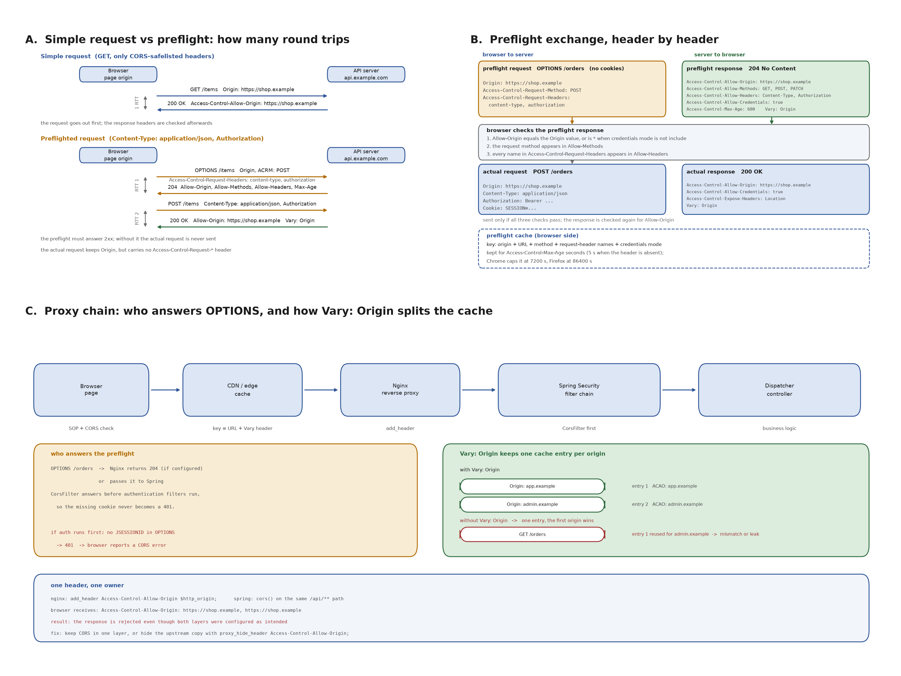

# [네트워크] CORS와 Preflight 요청 원리

- 작성일: 2026-11-23
- 키워드: Network, CORS, Same-Origin Policy, Origin, Simple Request, Preflight, OPTIONS, Access-Control-Allow-Origin, Access-Control-Max-Age, Credentials, Vary, CSRF, Reverse Proxy, Spring Security

## 1. 핵심 요약 (What & Why)

지난 여섯 편은 모두 **연결**에 대한 이야기였다. TCP가 순서와 재전송을 맡고(1편), 연결을 열고 닫는 데 왕복이 들고(2편), 그 위에서 HTTP가 진화했고(3편), 연결의 상대 주소를 이름으로 찾고(4편), 늘어난 서버로 그 연결을 나누고 재사용했고(5편), 마지막 편에서 그 연결의 바이트를 암호화했다(6편). 이번 편은 그 연결이 끝난 뒤, 응답이 이미 도착한 뒤에 벌어지는 일이다.

**증상은 늘 비슷하다.** 네트워크 탭에는 `200 OK`가 찍혀 있고 응답 본문도 보이는데, 스크립트에는 값이 들어오지 않는다. 콘솔에는 `No 'Access-Control-Allow-Origin' header is present on the requested resource` 같은 한 줄이 남는다. 서버 로그를 보면 요청은 정상 처리됐고, DB에도 값이 들어갔다. 즉 **서버는 할 일을 다 했는데 브라우저가 결과를 건네주지 않은 것**이다. 이 장면이 CORS를 "서버 설정 문제"로 오해하게 만드는 지점이고, 동시에 CORS의 성격을 가장 정확히 보여 주는 지점이다.

**출처(origin)는 URL이 아니라 세 요소의 묶음이다.** RFC 6454는 출처를 scheme, host, port 세 개의 튜플로 정의한다. 경로와 쿼리 문자열은 출처에 들어가지 않는다. 그래서 `https://shop.example.com/orders/1`과 `https://shop.example.com/cart`는 같은 출처지만, `http://shop.example.com`과 `https://shop.example.com`은 서로 다른 출처다. 포트가 명시되지 않은 URL은 scheme의 기본 포트로 정규화되므로 `https://shop.example.com`과 `https://shop.example.com:443`은 같은 출처다.

**동일 출처 정책(SOP)은 "읽기"를 막는 규칙이고, 그 이유는 브라우저가 쿠키를 자동으로 붙이기 때문이다.** 사용자가 은행 사이트에 로그인해 두면 그 도메인의 쿠키가 브라우저에 남는다. 만약 `evil.example`의 스크립트가 `bank.example`의 API를 호출했을 때 응답 본문까지 읽을 수 있다면, 공격자는 사용자의 세션으로 잔액과 거래 내역을 훔칠 수 있다. 공격자의 서버에서 직접 호출하면 쿠키가 없으니 소용없지만, **사용자의 브라우저 안에서 실행되는 스크립트는 그 사용자의 자격 증명을 들고 있다.** SOP는 이 지점을 막는다. 다른 출처의 응답은 받아도 스크립트에 건네지 않는다.

**SOP가 막지 못하는 것도 분명히 해야 한다.** `<form>`은 어떤 출처로든 POST를 보낼 수 있고, ``와 `<script>`는 GET으로 무엇이든 가져온다. 즉 SOP는 **요청의 전송**을 막는 정책이 아니라 **응답의 열람**을 막는 정책이다. 그래서 "브라우저가 요청을 막는다"는 표현은 부정확하고, CSRF(사용자가 의도하지 않은 요청을 대신 보내게 하는 공격)는 SOP가 원래 막지 못하는 영역이다. 이 둘을 섞으면 "CORS를 설정했으니 CSRF는 안전하다"는 잘못된 결론에 도달한다.

**CORS는 SOP를 푸는 것이 아니라, 서버가 지정한 출처에 한해 읽기를 허락하는 절차다.** 서버는 응답 헤더에 "이 출처에는 이 응답을 보여줘도 된다"고 적고, 브라우저가 그 선언을 확인한 뒤에야 스크립트에 본문을 넘긴다. 허락하지 않은 출처의 요청도 서버까지는 도달한다. 브라우저가 거절하는 것은 **읽기**뿐이다. 그러므로 CORS는 서버를 보호하는 접근 제어가 아니라 **브라우저 사용자의 데이터를 지키는 장치**이고, 서버 측 인증·인가·CSRF 방어와 역할이 다르다.

정리하면 세 문장이다.

1. **출처는 scheme·host·port의 튜플이고, SOP는 그 셋이 다른 응답을 스크립트에 건네지 않는 브라우저 규칙이다.** CORS는 그 규칙을 없애는 것이 아니라, 서버가 헤더로 명시한 출처에만 읽기를 허락하는 예외 절차다.
2. **Simple Request와 Preflight의 경계는 "HTML 폼으로도 만들 수 있는 요청인가"다.** `application/json`이나 `Authorization`은 폼이 만들 수 없는 모양이므로, 브라우저는 서버에 먼저 물어보는 왕복 하나를 더 쓴다.
3. **CORS는 서버를 지키지 않는다.** 요청은 이미 도달했고 로그에도 남는다. 서버 측 CSRF·인가 방어를 대체하지 못하며, `curl`과 `Postman`은 CORS를 아예 확인하지 않는다.

## 2. 내부 메커니즘과 구조 (How it works)

### 2.1 출처 판정: 세 요소만 본다

브라우저는 페이지를 로드한 출처와 요청 대상 URL의 출처를 비교해 같은 출처인지 판정한다. 비교 대상은 scheme, host, port 셋뿐이다.

| 페이지의 출처 | 요청 대상 | 같은 출처 | 이유 |
| --- | --- | --- | --- |
| `https://shop.example.com` | `https://shop.example.com/api/orders` | 예 | 경로는 출처에 포함되지 않음 |
| `https://shop.example.com` | `https://shop.example.com:443/api` | 예 | 기본 포트로 정규화됨 |
| `https://shop.example.com` | `http://shop.example.com/api` | 아니오 | scheme 다름 |
| `https://shop.example.com` | `https://api.example.com/orders` | 아니오 | host 다름 (서브도메인도 별개) |
| `https://shop.example.com` | `https://shop.example.com:8443/api` | 아니오 | port 다름 |
| `http://localhost:3000` | `http://localhost:8080/api` | 아니오 | port 다름 |
| `http://127.0.0.1:3000` | `http://localhost:3000/api` | 아니오 | host 문자열이 다름 |

마지막 줄이 개발 환경에서 자주 걸리는 지점이다. 프론트엔드 개발 서버(`localhost:3000`)와 백엔드(`localhost:8080`)는 **포트가 다르므로 처음부터 교차 출처**다. 로컬이니까 괜찮겠지 하는 가정이 성립하지 않고, 실제로는 운영과 똑같이 CORS 설정이 필요하다.

**불투명 출처(opaque origin).** 모든 출처가 `scheme://host:port`로 직렬화되지는 않는다. `sandbox` 속성이 걸린 iframe, `data:` URL에서 만들어진 문서 등은 다른 출처와 비교할 수 없는 **불투명 출처**가 되고, `Origin` 헤더에는 `null`로 나간다. 서버가 편의를 위해 `Access-Control-Allow-Origin: null`을 허용 목록에 넣으면, 그 순간 샌드박스된 어떤 문서든 사용자 브라우저에서 그 API를 읽을 수 있게 된다. `null`은 "아무 출처도 아님"이 아니라 "비교 불가능한 출처"이므로 허용 목록에 넣지 않는 것이 원칙이다.

**`document.domain`은 레거시다.** 예전에는 서브도메인끼리 SOP를 완화하려고 `document.domain = "example.com"`을 양쪽에서 설정했다. 이 설정은 출처의 port를 `null`로 만드는 방식으로 동작하므로 격리 경계를 흐리고, 현재는 폐기 절차에 있다. 새 코드에서는 쓰지 않고, 서브도메인 간 통신이 필요하면 CORS로 명시하는 쪽이 맞다.

### 2.2 SOP가 막는 것과 막지 않는 것

| 행위 | SOP | 결과 |
| --- | --- | --- |
| 다른 출처 API의 응답 본문 읽기 (`fetch`, `XMLHttpRequest`) | 막음 | CORS 헤더가 없으면 스크립트는 TypeError만 받음 |
| 다른 출처로 `<form>` POST 전송 | 막지 않음 | 전송되고 서버가 처리함. 응답은 읽지 못함 |
| 다른 출처의 이미지·스크립트·스타일 로드 | 막지 않음 | 로드는 되지만 캔버스 픽셀 읽기 등은 제한됨 |
| 다른 출처 iframe 삽입 | 막지 않음 | 삽입은 되고, 내부 DOM 접근이 막힘 |
| `window.open`으로 연 창의 DOM 접근 | 막음 | 참조는 열리지만 내용 접근 불가 |
| 쿠키 전송 | 출처가 아니라 쿠키 속성 | `SameSite`, `Domain`, `Secure`가 결정 |

표의 두 번째 줄이 CSRF의 통로다. 폼 전송은 SOP와 무관하게 나가므로, 서버는 "이 요청이 우리 사이트의 폼에서 왔는가"를 스스로 확인해야 한다. SOP가 브라우저 안에서 막아 주는 것은 **응답의 열람**뿐이다.

### 2.3 Simple Request: 폼이 만들 수 있는 모양

명세(Fetch Standard)는 "simple request"라는 용어를 쓰지 않고, "preflight를 유발하지 않는 요청"과 "CORS-safelisted request header"로 표현한다. 옛 CORS 명세의 용어가 관행으로 남은 것이다. 조건은 다음과 같다. 하나라도 어긋나면 Preflight가 발생한다.

| 조건 | 내용 |
| --- | --- |
| 메서드 | `GET`, `HEAD`, `POST` 중 하나 |
| 헤더 | 사용자 에이전트가 자동으로 넣는 헤더와 금지된 요청 헤더를 제외하고, 수동으로 설정한 헤더가 모두 CORS-safelisted request header여야 함 |
| safelisted 헤더 목록 | `Accept`, `Accept-Language`, `Content-Language`, `Content-Type`, `Range` |
| 헤더 값 제한 | 값의 길이가 128바이트 이하. `Accept-Language`·`Content-Language`는 허용 문자 집합이 따로 있고, `Range`는 `bytes=시작-끝` 형태의 단일 범위만 허용 |
| `Content-Type` 값 | `application/x-www-form-urlencoded`, `multipart/form-data`, `text/plain` 세 가지 중 하나 (파라미터 제외한 MIME 타입 기준) |
| XHR 추가 조건 | `XMLHttpRequest.upload`에 이벤트 리스너를 등록하지 않았을 것 |
| 스트림 | 요청 본문에 `ReadableStream`을 쓰지 않을 것 |

**왜 이렇게 생겼는가.** 기준은 "브라우저가 폼 없이도 보낼 수 있었던 요청"이 아니라, 반대로 **"HTML 폼만으로도 만들 수 있는 요청"** 이다. `Content-Type` 세 종류는 `<form>`이 만들 수 있는 유일한 값들이다. `enctype`을 지정하지 않으면 `application/x-www-form-urlencoded`, 파일을 붙이면 `multipart/form-data`, `text/plain`은 폼의 `enctype`으로 지정 가능하다. 폼이 만들 수 있는 요청이라면 공격자도 폼으로 만들 수 있으므로, 서버는 이미 그런 요청에 대한 방어(CSRF 토큰, SameSite 쿠키, Origin 검사)를 갖추고 있다고 가정할 수 있다. 그래서 굳이 미리 물어보지 않는다.

반대로 `application/json`은 폼이 만들 수 없다. 폼의 `enctype`에 그 값이 없기 때문이다. 그러니 `Content-Type: application/json`인 요청은 "CSRF 수준의 위협"으로 볼 수 없고, 서버가 그 모양을 예상했는지 확인해야 한다. `Authorization` 헤더도 마찬가지다. 이것이 "JSON API는 항상 Preflight가 붙는다"는 실무 감각의 근거다.

```javascript
// Preflight 없음: 폼이 만들 수 있는 모양
await fetch("https://api.example.com/login", {
  method: "POST",
  headers: { "Content-Type": "application/x-www-form-urlencoded" },
  body: new URLSearchParams({ id: "user", pw: "secret" }),
});

// Preflight 발생: application/json + Authorization
await fetch("https://api.example.com/orders", {
  method: "POST",
  credentials: "include",
  headers: {
    "Content-Type": "application/json",
    "Authorization": "Bearer ...",
  },
  body: JSON.stringify({ itemId: 42 }),
});
```

### 2.4 Preflight: 서버에 먼저 물어보는 왕복

Preflight는 `OPTIONS` 메서드로 나가는 별도의 HTTP 요청이다. 본 요청과 같은 연결을 재사용할 수 있지만, **왕복 하나를 더 쓰는 것은 피할 수 없다.**

```text
[Preflight]
OPTIONS /orders HTTP/1.1
Host: api.example.com
Origin: https://shop.example.com
Access-Control-Request-Method: POST
Access-Control-Request-Headers: content-type,authorization

HTTP/1.1 204 No Content
Access-Control-Allow-Origin: https://shop.example.com
Access-Control-Allow-Methods: GET, POST, PATCH
Access-Control-Allow-Headers: Content-Type, Authorization
Access-Control-Allow-Credentials: true
Access-Control-Max-Age: 600
Vary: Origin

[본 요청]
POST /orders HTTP/1.1
Host: api.example.com
Origin: https://shop.example.com
Content-Type: application/json
Authorization: Bearer ...
Cookie: SESSION=...

HTTP/1.1 200 OK
Access-Control-Allow-Origin: https://shop.example.com
Access-Control-Allow-Credentials: true
Vary: Origin
Content-Type: application/json
```

읽을 때 주의할 점이 네 가지 있다.

- **`Access-Control-Request-*` 헤더는 Preflight에만 있다.** 본 요청에는 `Origin`만 붙는다. 둘은 서로 다른 HTTP 요청이므로, 서버는 두 요청 모두에 CORS 응답 헤더를 붙여야 한다. Preflight 응답에만 헤더를 붙이고 본 응답에 빠뜨리는 실수가 흔하고, 이때 브라우저는 본 응답을 읽지 못한다.
- **Preflight 요청에는 쿠키가 실리지 않는다.** 명세가 정한 것이고, 그래서 서버의 인증 필터가 Preflight를 401/403으로 거절하면 본 요청은 아예 나가지 않는다. 뒤에서 다룰 Spring Security의 필터 순서 문제가 여기서 나온다.
- **Preflight 응답은 성공 상태여야 한다.** 4xx/5xx가 오면 브라우저는 설정 미비로 판단하고 본 요청을 보내지 않는다.
- **본 요청이 200이어도 된다는 뜻이 아니다.** 브라우저는 본 응답에서도 `Access-Control-Allow-Origin`을 다시 확인한다. 검사는 두 번 일어난다.

**Preflight 캐시.** 매 요청마다 `OPTIONS`를 보내면 왕복이 두 배가 되므로, 브라우저는 Preflight 결과를 캐시한다. 캐시 키에는 출처, 요청 URL, 메서드, 요청 헤더 이름 집합, credentials 모드가 들어간다. 이 중 하나라도 달라지면 다른 항목으로 보고 다시 `OPTIONS`를 보낸다. 그래서 "GET은 캐시되는데 POST만 매번 느리다" 같은 증상이 생기고, 헤더 하나(`X-Request-Id` 같은)를 추가하는 순간 캐시가 무효화되기도 한다. 유효 기간은 `Access-Control-Max-Age`로 정하고, 헤더가 없으면 브라우저 기본값(5초)이 적용된다.

### 2.5 인증 정보를 포함한 요청

교차 출처 `fetch`는 기본적으로 쿠키를 보내지 않는다. 보내려면 `credentials: "include"`(`XMLHttpRequest`는 `withCredentials = true`)를 지정해야 하고, 그 순간 규칙이 바뀐다.

- **서버는 `Access-Control-Allow-Credentials: true`를 보내야 한다.** 없으면 브라우저는 응답을 버린다.
- **`Access-Control-Allow-Origin: *`는 쓸 수 없다.** 자격 증명을 포함한 요청에는 정확한 출처 하나를 돌려줘야 한다. 허용 목록에서 요청의 `Origin`을 찾아 그대로 되돌려 주는 방식(`echo`)을 쓴다.
- **`Set-Cookie`도 무시된다.** `Access-Control-Allow-Origin`이 `*`인 응답의 `Set-Cookie`는 브라우저가 저장하지 않는다. 세션을 심으려는 로그인 API가 `*`를 쓰면 "응답은 오는데 로그인이 안 되는" 증상이 된다.
- **Preflight 자체는 자격 증명을 싣지 않지만, 그 응답에 `Access-Control-Allow-Credentials: true`가 있어야** 캐시된 Preflight가 자격 증명 요청에도 유효하다.
- **쿠키 정책은 CORS와 별개로 적용된다.** 교차 사이트 요청에 쿠키를 실으려면 `SameSite=None; Secure`가 필요하고, 브라우저의 서드파티 쿠키 정책이 이를 다시 막을 수 있다. CORS 헤더를 완벽히 맞춰도 쿠키가 실리지 않으면 서버는 익명 요청을 받는다.

여기에 자주 붙는 함정이 하나 더 있다. `SameSite=Lax`(최근 브라우저 기본값)인 세션 쿠키는 교차 사이트 `fetch`에 실리지 않는다. 프론트와 API가 서로 다른 사이트라면 `SameSite=None; Secure`로 바꿔야 하는데, 그 변경은 CORS 설정이 아니라 쿠키 설정이며, 보안 영향(CSRF 노출 면적)도 함께 커진다.

### 2.6 `Vary: Origin`: 캐시가 출처를 구분하게 만드는 헤더

서버가 요청의 `Origin`을 보고 그 값을 그대로 `Access-Control-Allow-Origin`에 되돌려 주는 구조(허용 목록 방식)는 거의 모든 실무 API가 쓰는 형태다. 이때 반드시 함께 붙여야 하는 헤더가 `Vary: Origin`이다.

이유는 중간 캐시에 있다. CDN이나 리버스 프록시가 응답을 캐시할 때, 캐시 키가 URL뿐이라면 **`https://shop.example.com`의 요청에 대해 만들어진 응답(헤더에 `Access-Control-Allow-Origin: https://shop.example.com`)이 `https://admin.example.com`의 요청에도 그대로 나간다.** 결과는 두 갈래다. 허용되지 않아야 할 출처가 허용된 응답을 받거나(정보 노출), 허용되어야 할 출처가 남의 출처가 적힌 응답을 받아 CORS 오류를 겪는다. 후자는 "가끔 되고 가끔 안 되는" 형태로 나타나서 원인을 찾기 어렵다.

`Vary: Origin`을 붙이면 캐시 키에 `Origin` 요청 헤더가 포함되어 출처별로 다른 항목이 만들어진다. 정확해지는 대신 **캐시 항목 수가 출처 수만큼 늘고 적중률이 떨어진다.** 반대로 `Access-Control-Allow-Origin: *`는 모든 출처에 같은 응답이라 `Vary`가 필요 없고, 그래서 공개 데이터 API가 `*`를 선호하는 이유가 성능이 아니라 캐시 효율에 있다.

> [!NOTE]
> `Vary: Origin`은 CORS 헤더를 동적으로 만들 때만 필요하다. `Access-Control-Allow-Origin: *`처럼 응답이 출처와 무관하면 붙일 이유가 없고, 붙이면 캐시만 쪼개진다. 반대로 허용 목록으로 되돌려 주는 구조에서 `Vary`를 빠뜨리면, 애플리케이션 로직은 맞는데 캐시를 거친 요청만 실패하는 재현 어려운 버그가 된다.

### 2.7 실패 모드

CORS 오류의 특징은 **브라우저가 자바스크립트에 원인을 알려주지 않는다**는 점이다. 스크립트는 `TypeError: Failed to fetch`만 받고, 구체적인 이유는 개발자 도구 콘솔에만 남는다. 의도된 설계다. 오류 메시지가 상세하면 그것 자체로 서버의 허용 정책을 탐색하는 정보가 되기 때문이다.

| 콘솔 메시지의 형태 | 실제 원인 |
| --- | --- |
| `No 'Access-Control-Allow-Origin' header is present` | 본 응답 또는 Preflight 응답에 헤더가 없음. 보통 필터 순서·경로 매핑 누락 |
| `The 'Access-Control-Allow-Origin' header contains multiple values '..., ...'` | Nginx와 애플리케이션이 각각 헤더를 붙여 중복됨 |
| `The value of the 'Access-Control-Allow-Origin' header must not be the wildcard '*' when the request's credentials mode is 'include'` | 자격 증명 요청에 `*`를 사용 |
| `Response to preflight request doesn't pass access control check` | `OPTIONS`가 401/403/404, 또는 `Allow-Methods`·`Allow-Headers`에 값 누락 |
| `Redirect is not allowed for a preflight request` | Preflight 응답이 3xx. 브라우저별 구현 차이가 있음 |
| `The request's credentials mode is 'include'`와 `Set-Cookie` 무시 | `Allow-Origin: *` 응답의 쿠키는 저장되지 않음 |
| 오류 없이 값이 `null` | 문서의 출처가 불투명 출처(sandbox iframe 등) |

## 3. 구조 도식 (Architecture Diagram)



- **A 단순 요청과 Preflight의 왕복 (왼쪽 위)**: 같은 교차 출처 요청 두 개를 위아래로 두었다. 위쪽은 `GET`에 safelisted 헤더만 붙은 경우로, 브라우저가 곧바로 본 요청을 보내고 응답 헤더를 나중에 검사한다(1 왕복). 아래쪽은 `application/json`과 `Authorization`이 붙은 경우로, `OPTIONS` 한 번과 본 요청 한 번을 차례로 보낸다(2 왕복). 왼쪽에 왕복 구간을 표시해, Preflight가 지연이 아니라 **왕복 하나**를 더 쓰는 비용임을 드러냈다.
- **B Preflight의 헤더 상호작용 (오른쪽 위)**: 위쪽 상자는 브라우저가 보내는 `OPTIONS` 요청(`Origin`, `Access-Control-Request-Method`, `Access-Control-Request-Headers`)이고, 오른쪽 상자는 서버가 돌려주는 허용 목록(`Allow-Origin`, `Allow-Methods`, `Allow-Headers`, `Max-Age`, `Vary`)이다. 가운데 검사 목록이 브라우저가 실제로 확인하는 세 가지 조건이고, 아래 두 상자는 검사를 통과한 뒤에야 나가는 본 요청과 그 응답이다. 맨 아래 상자는 Preflight 캐시 키 구성을 적어, 헤더 하나가 달라져도 `OPTIONS`가 다시 나간다는 점을 표시했다.
- **C 프록시 체인과 헤더 중복 (아래)**: 클라이언트에서 CDN, Nginx, Spring Security 필터 체인, 컨트롤러로 이어지는 경로를 그렸다. Nginx와 Spring 양쪽이 `Access-Control-Allow-Origin`을 붙이면 값이 `A, A`로 합쳐져 브라우저가 거절한다는 점과, `proxy_hide_header`로 한쪽을 지우는 해결 방향을 주석으로 달았다. 오른쪽 아래 표는 `Vary: Origin`이 있을 때와 없을 때 캐시 항목이 어떻게 갈리는지 보여 준다.

## 4. 비교 표 (Comparison)

### 4.1 Simple Request vs Preflight Request

| 항목 | Simple Request | Preflight를 동반한 요청 |
| --- | --- | --- |
| 사전 `OPTIONS` | 없음 | 있음 |
| 왕복 수 | 1 | 2 (Preflight 캐시가 유효하면 1로 상각) |
| 허용 메서드 | `GET`, `HEAD`, `POST` | 제한 없음 (서버가 허용한 것) |
| 허용 요청 헤더 | safelisted 5종, 값 128바이트 이하 | 서버가 `Allow-Headers`로 명시한 헤더 |
| `Content-Type` | `application/x-www-form-urlencoded`, `multipart/form-data`, `text/plain` | 제한 없음 (`application/json` 포함) |
| 커스텀 헤더 | 불가 | `Allow-Headers`에 명시하면 가능 |
| `Authorization` | 불가 (Preflight 유발) | 가능 |
| 서버 부담 | 본 요청만 처리 | `OPTIONS` 처리 경로가 추가로 필요 |
| 첫 요청 지연 | 없음 | 왕복 하나 추가 |
| 캐시 | 응답 캐시만 관련 | Preflight 캐시(`Max-Age`) 별도 |
| 실무 인상 | "GET은 되는데 POST가 안 된다" | "JSON API는 늘 OPTIONS가 먼저 찍힌다" |

### 4.2 자격 증명 미포함 vs 포함

| 항목 | `credentials: "omit"` / `"same-origin"` (기본) | `credentials: "include"` |
| --- | --- | --- |
| 쿠키 전송 | 교차 출처에는 전송 안 함 | 전송 (`SameSite` 정책에 따름) |
| `Access-Control-Allow-Origin` | `*` 또는 특정 출처 | 반드시 특정 출처 하나. `*`면 응답이 차단됨 |
| `Access-Control-Allow-Credentials` | 불필요 | `true` 필수 |
| `Allow-Methods`·`Allow-Headers`의 `*` | 와일드카드로 동작 | 와일드카드가 문자 그대로 취급되어 동작하지 않음. 명시 필요 |
| `Set-Cookie` | `Allow-Origin: *`인 응답은 저장 안 됨 | 저장 가능 (서드파티 쿠키 정책 별도 적용) |
| `Expose-Headers` | `*` 가능 | 명시 목록 필요 (브라우저에 따라 `*` 허용) |
| Preflight 캐시 | credentials 모드가 키에 포함 | 같은 URL이라도 별도 항목으로 캐시됨 |
| 서버 설정 난이도 | 낮음 (공개 데이터에 적합) | 높음 (허용 출처를 정확히 관리해야 함) |

### 4.3 CORS 관련 헤더의 역할

| 헤더 | 방향 | 역할 | 자주 하는 실수 |
| --- | --- | --- | --- |
| `Origin` | 요청 | 브라우저가 붙이는 출처. 스크립트가 임의로 바꿀 수 없음 | 서버가 이 값을 믿고 인증 수단으로 사용 |
| `Access-Control-Request-Method` | 요청 (Preflight) | 본 요청이 쓸 메서드 | 본 요청에도 있다고 착각 |
| `Access-Control-Request-Headers` | 요청 (Preflight) | 본 요청이 쓸 헤더 이름 목록(소문자) | 대소문자 비교로 허용 실패 |
| `Access-Control-Allow-Origin` | 응답 | 읽기를 허락할 출처 | 중복 부착, 동적 처리 시 `Vary` 누락 |
| `Access-Control-Allow-Methods` | 응답 (Preflight) | 허용 메서드 | `OPTIONS` 자체를 빠뜨림 |
| `Access-Control-Allow-Headers` | 응답 (Preflight) | 허용 요청 헤더 | `Content-Type`을 빠뜨림 |
| `Access-Control-Allow-Credentials` | 응답 | 자격 증명 요청 허용 | Preflight 응답에만 붙이거나 아예 빠뜨림 |
| `Access-Control-Expose-Headers` | 응답 | 스크립트가 읽을 수 있는 응답 헤더 추가 | `Location`, `X-Total-Count`를 못 읽어서 생기는 버그 |
| `Access-Control-Max-Age` | 응답 (Preflight) | Preflight 캐시 유효 기간(초) | 브라우저 상한을 넘겨 설정하고 상한이 적용됨을 모름 |
| `Vary` | 응답 | 캐시 키에 요청 헤더 포함 | 허용 목록 방식인데 `Origin`을 빠뜨림 |

### 4.4 요청 출처에 따른 처리 요약

| 상황 | 브라우저 동작 | 서버가 할 일 |
| --- | --- | --- |
| 같은 출처 | CORS 검사 없음 | 없음 |
| 교차 출처 + safelisted 요청 | 본 요청 전송 후 응답 헤더 검사 | 본 응답에 `Allow-Origin` |
| 교차 출처 + 그 외 요청 | `OPTIONS` 선행 | `OPTIONS` 응답 + 본 응답 양쪽에 헤더 |
| Preflight 캐시 유효 | `OPTIONS` 생략 | 없음 (캐시가 대신함) |
| 서버 간 호출 (`curl`, `RestTemplate`) | CORS 무관 | 인증·인가만 신경 |

## 5. 내가 깨달은 점 (My Insight)

- **5편과 6편이 "경로"와 "연결"을 지켰다면, CORS는 "브라우저 안"을 지킨다.** TLS는 경로 위의 중간자가 바이트를 읽거나 고치지 못하게 하고, 로드 밸런서는 연결을 어디로 보낼지 정한다. 그런데 그 두 장치를 완벽히 갖춰도, 사용자의 브라우저에서 실행되는 스크립트가 다른 출처의 데이터를 읽는 문제는 남는다. 그 마지막 층이 SOP와 CORS다. 계층 순서로 보면 **전송(TCP) → 표현(HTTP) → 이름(DNS) → 분배(LB) → 암호(TLS) → 브라우저 정책(CORS)** 이고, CORS는 이 사슬에서 유일하게 **서버가 아니라 클라이언트가 강제하는 규칙**이다. 그래서 서버 설정만 보고 판단하면 틀리기 쉽다.

- **"서버는 200 OK를 줬는데 브라우저만 막는다"는 현상은 CORS의 본질이 아니라 설계 의도다.** 서버는 자기가 받은 요청에 성실히 응답했고, 그 요청이 어느 출처의 스크립트에서 왔는지는 `Origin` 헤더로 알 수 있지만 그것을 강제할 의무는 없다. 브라우저가 응답을 건네지 않는 이유는 **서버를 보호하려는 것이 아니라 사용자의 데이터를 다른 출처의 스크립트에 넘기지 않으려는 것**이다. 이 관점을 잡으면 두 가지가 따라온다. 첫째, CORS 오류가 났다는 것은 **요청이 서버에 도달했다는 증거**일 수 있다(POST면 부작용도 이미 일어났을 수 있다). 둘째, `curl`로는 항상 성공하므로 "서버는 정상"이라는 진단과 "브라우저에서는 실패"라는 현상이 모순이 아니다.

- **그래서 CORS는 CSRF 방어를 대체하지 못한다.** Simple Request는 Preflight 없이 서버에 도달하고, `<form>`은 SOP와 무관하게 전송되며, `curl`과 `Postman`은 `Origin`을 확인하지 않는다. CORS를 엄격하게 걸면 "공격자가 응답을 읽지 못하게" 될 뿐, "공격자가 요청을 보내지 못하게" 되지는 않는다. CSRF 방어는 서버가 상태 변경 요청에 대해 토큰을 검증하거나, `SameSite` 쿠키를 쓰거나, `Origin`·`Sec-Fetch-Site` 헤더를 직접 검사해야 완성된다. 2편에서 본 "연결이 열렸다는 것과 요청이 정당하다는 것은 다르다"는 구분이 여기에도 그대로 적용된다.

- **Spring Security에서 Preflight가 401/403이 되는 것은 CORS 설정의 문제가 아니라 필터 순서의 문제다.** 공식 문서가 이유를 한 문장으로 적어 두었다. Preflight 요청에는 쿠키(`JSESSIONID`)가 없으므로, 인증 필터가 CORS 처리보다 앞에 있으면 "쿠키가 없다 → 인증되지 않았다 → 거절"로 흐른다. 브라우저는 그 401을 "Preflight 실패"로 보고 본 요청을 보내지 않는다. 해결은 `OPTIONS`를 전부 열어 주는 것이 아니라(그것도 동작하지만 부작용이 크다), **CORS 처리를 인증 앞단으로 올리는 것**이다. `CorsFilter`가 그 역할을 하고, Spring Security의 `http.cors()`가 이 필터를 체인의 앞쪽에 등록한다.

- **Nginx와 애플리케이션이 각각 헤더를 붙이는 구성은 "설정을 두 배로 한" 것이 아니라 "규칙을 깨뜨린" 것이다.** `Access-Control-Allow-Origin`은 응답에 하나만 있어야 하고, 두 계층이 붙이면 `A, A`로 합쳐져 브라우저가 거절한다. 이 문제가 고약한 이유는 양쪽 설정을 따로 보면 둘 다 맞다는 점이다. CORS는 **한 계층에서만 책임지는 것이 원칙**이고, 부득이하게 겹칠 때는 `proxy_hide_header`로 하위 계층의 헤더를 지워야 한다.

- **`Vary: Origin`은 정확성과 캐시 효율을 맞바꾸는 헤더다.** 허용 목록을 동적으로 되돌려 주는 순간 응답은 출처에 의존하게 되고, 캐시는 그 사실을 알아야 한다. `Vary`를 빠뜨리면 캐시를 거친 요청만 간헐적으로 실패하고, 붙이면 출처 수만큼 캐시 항목이 늘어 적중률이 떨어진다. 5편에서 본 "캐시는 키가 전부다"라는 원칙이 HTTP 헤더 층에서 반복되는 셈이다. 공개 데이터에 `*`를 쓰는 것이 성능 최적화가 아니라 **캐시 가능성을 지키는 선택**이라는 점도 이 맥락에서 이해했다.

## 6. 실무 관점 및 트레이드오프 (Trade-offs & Best Practices)

### 6.1 Spring에서 CORS를 켜는 두 갈래와 그 차이

Spring에는 CORS를 설정하는 지점이 두 개 있고, 둘은 **요청이 도달하는 시점**이 다르다.

| 구분 | Spring MVC (`WebMvcConfigurer.addCorsMappings`, `@CrossOrigin`) | Spring Security (`http.cors(...)` + `CorsConfigurationSource`) |
| --- | --- | --- |
| 실제 처리 주체 | `HandlerMapping`의 CORS 처리기, `DispatcherServlet` 구간 | `CorsFilter` (서블릿 필터) |
| 실행 위치 | 보안 필터 체인 **뒤** | 보안 필터 체인 **앞**, 인증 필터보다 앞 |
| Preflight가 인증에 막히는가 | 막힌다 (인증 설정에 따라 401/403) | 막히지 않는다 |
| 설정 단위 | 경로 패턴, 컨트롤러·메서드 애노테이션 | `CorsConfigurationSource`, 보안 체인별 |
| 적합한 경우 | 보안 필터가 없는 단순 API, 세밀한 컨트롤러 단위 제어 | 인증이 걸린 API (대부분의 실무) |

```java
// Spring MVC 방식: DispatcherServlet 구간에서 처리된다
@Configuration
public class WebConfig implements WebMvcConfigurer {
    @Override
    public void addCorsMappings(CorsRegistry registry) {
        registry.addMapping("/api/**")
                .allowedOrigins("https://shop.example.com")
                .allowedMethods("GET", "POST", "PATCH")
                .allowedHeaders("Content-Type", "Authorization")
                .exposedHeaders("Location")
                .allowCredentials(true)
                .maxAge(1800);
    }
}
```

```java
// Spring Security 방식: CorsFilter가 인증 필터보다 앞에서 Preflight를 처리한다
@Bean
CorsConfigurationSource corsConfigurationSource() {
    CorsConfiguration config = new CorsConfiguration();
    config.setAllowedOrigins(List.of("https://shop.example.com"));
    config.setAllowedMethods(List.of("GET", "POST", "PATCH"));
    config.setAllowedHeaders(List.of("Content-Type", "Authorization"));
    config.setExposedHeaders(List.of("Location"));
    config.setAllowCredentials(true);
    config.setMaxAge(1800L);

    UrlBasedCorsConfigurationSource source = new UrlBasedCorsConfigurationSource();
    source.registerCorsConfiguration("/api/**", config);
    return source;
}

@Bean
SecurityFilterChain filterChain(HttpSecurity http) throws Exception {
    http.cors(Customizer.withDefaults())     // 위 bean을 사용
        .csrf(CsrfConfigurer::disable)       // API 서버라면 토큰 대신 다른 방어를 함께 검토
        .authorizeHttpRequests(auth -> auth
            .requestMatchers("/api/public/**").permitAll()
            .anyRequest().authenticated());
    return http.build();
}
```

두 방식을 함께 쓰면 Security가 MVC 설정을 자동으로 가져다 쓴다. 다만 `CorsConfigurationSource` 빈이 여러 개면 자동 구성이 결정하지 못하므로, 체인마다 `.cors(cors -> cors.configurationSource(...))`로 명시해야 한다.

**Spring의 기본값을 알아 두면 설정 누락을 줄일 수 있다.** `@CrossOrigin`과 MVC 전역 설정은 기본으로 모든 출처, 모든 헤더를 허용하고, 메서드는 `@CrossOrigin`이 매핑된 메서드, 전역 설정이 `GET`, `HEAD`, `POST`다. `maxAge`는 30분(1800초)이다. `allowCredentials`는 기본이 꺼져 있다. 그리고 `allowCredentials(true)`와 `allowedOrigins("*")`를 함께 두면 애플리케이션이 기동 단계에서 예외로 멈춘다. 그 조합이 브라우저에서 성립하지 않기 때문이다. 동적 허용이 필요하면 `allowedOriginPatterns`를 쓴다.

> [!WARNING]
> `allowedOrigins("*")`에 `allowCredentials(true)`를 더하면 시작조차 되지 않지만, 더 위험한 것은 **와일드카드를 넓게 잡은 채 자격 증명을 켜는 설정**이다. 허용 출처를 하나라도 잘못 넣으면 그 출처의 모든 스크립트가 사용자의 세션으로 API를 읽고 쓸 수 있다. CORS는 인가 수단이 아니므로, 허용 출처 목록을 권한 경계처럼 관리하면 안 된다. 실제 권한은 서버의 인증과 인가가 판단해야 한다.

### 6.2 필터 순서: Preflight가 인증에 막히는 지점

Spring Security 문서는 이 문제를 이렇게 설명한다. Preflight 요청에는 쿠키가 없으므로, CORS 처리가 인증 처리보다 뒤에 있으면 요청은 "인증되지 않은 요청"이 되어 거절된다. 그래서 `CorsFilter`를 앞단에 두는 것이 정석이고, `http.cors()`가 그것을 한다.

실무에서 자주 나오는 변형이 세 가지 있다.

- **`OPTIONS`만 열어 주는 방식**: `.requestMatchers(HttpMethod.OPTIONS, "/**").permitAll()`을 추가하면 Preflight는 통과한다. 동작은 하지만 CORS 응답 헤더는 `CorsFilter`나 MVC 처리기가 붙여야 하므로, 결국 CORS 설정은 따로 필요하다. "일단 열어 두는" 처방으로 남용되기 쉽다.
- **`securityMatcher` 범위 밖에 둔 API**: 보안 체인이 `/api/**`만 감시하고 CORS가 다른 경로에 등록되면, 그 경로의 Preflight는 아무도 처리하지 않아 404가 된다. 경로 패턴이 겹치는지 확인해야 한다.
- **게이트웨이에서 Preflight를 직접 응답**: API 게이트웨이나 Nginx가 `OPTIONS`를 204로 끊는 구성이다. 애플리케이션 부하는 줄지만, 허용 목록을 두 곳에서 관리하게 되고 한쪽이 낡으면 6.3의 중복 헤더 문제와 같은 종류의 불일치가 생긴다.

### 6.3 Nginx와 애플리케이션의 헤더 중복

리버스 프록시 뒤에 Spring을 두고 양쪽에서 CORS 헤더를 붙이면, 응답 헤더가 합쳐지면서 값이 중복된다. 브라우저는 `Access-Control-Allow-Origin`에 값이 둘 이상이면 응답을 거절한다. 같은 값이 두 번 반복돼도 마찬가지다.

```nginx
location /api/ {
    proxy_pass http://backend;

    # 백엔드가 이미 CORS 헤더를 붙인다면, 프록시에서 한 번만 책임지도록 정리한다.
    # 둘 중 하나만 선택한다.
    proxy_hide_header Access-Control-Allow-Origin;
    proxy_hide_header Access-Control-Allow-Credentials;
    proxy_hide_header Vary;

    add_header Access-Control-Allow-Origin $http_origin always;
    add_header Access-Control-Allow-Credentials "true" always;
    add_header Vary "Origin" always;

    if ($request_method = OPTIONS) {
        add_header Access-Control-Allow-Methods "GET, POST, PATCH, DELETE" always;
        add_header Access-Control-Allow-Headers "Content-Type, Authorization" always;
        add_header Access-Control-Max-Age 600 always;
        return 204;
    }
}
```

읽을 때 주의할 점이 있다.

- **`add_header`는 상속 규칙이 있다.** 현재 레벨에 `add_header`가 하나라도 있으면 상위 레벨의 `add_header`는 상속되지 않는다. 그래서 `location`에서 하나만 추가했을 때 공통 헤더가 통째로 사라지는 일이 생긴다.
- **`always`를 붙여야 오류 응답에도 헤더가 나간다.** 4xx/5xx 응답에서 CORS 헤더가 사라지면, 브라우저는 진짜 원인(401 등) 대신 CORS 오류만 보여 준다. 디버깅이 두 배로 어려워지는 지점이다.
- **`$http_origin`을 그대로 되돌려 주는 구성은 검증이 없다.** 모든 출처를 허용하는 것과 같으므로, 허용 목록을 `map`으로 검증하거나 애플리케이션에 맡기는 편이 낫다.
- **`if`는 `location` 안에서 `return`·`add_header`·`rewrite` 정도만 쓰는 것이 안전하다.** 복잡한 조건 분기는 `map`으로 옮긴다.

### 6.4 `Access-Control-Max-Age`와 브라우저 상한

`Max-Age`를 크게 잡으면 Preflight 왕복이 줄어들지만, 브라우저마다 상한이 있고 서버가 지정한 값이 그대로 적용되지 않는다.

| 항목 | 값 |
| --- | --- |
| 헤더가 없을 때 기본값 | 5초 |
| Firefox 상한 | 86400초 (24시간) |
| Chromium 상한 (v76 이후) | 7200초 (2시간) |
| Chromium 상한 (v76 이전) | 600초 (10분) |
| Spring `CorsConfiguration` 기본값 | 1800초 (30분) |

그래서 `Max-Age: 86400`을 보내도 Chrome에서는 2시간만 유효하다. 반대로 값을 너무 짧게 두면 Preflight가 자주 나가고, 허용 목록을 바꿨을 때 변경이 늦게 반영되는 문제(캐시된 Preflight가 이전 허용 목록을 계속 들고 있는 문제)도 생긴다. 허용 출처를 자주 바꾸는 환경이라면 `Max-Age`를 짧게 두는 것이 안전하고, 거의 바뀌지 않는다면 길게 두는 것이 낫다.

> [!NOTE]
> Preflight 캐시는 서버가 아니라 브라우저에 있다. 그래서 서버에서 허용 출처를 지워도 이미 캐시된 클라이언트는 만료 전까지 이전 허용 목록으로 요청을 보낸다(그 요청도 서버의 인가를 다시 통과해야 하므로 곧바로 위험해지지는 않는다). 반대로 새 출처를 추가한 직후에는 캐시 때문에 이전 상태가 잠시 유지될 수 있다.

### 6.5 CORS 자체를 없애는 선택지

CORS 설정을 정교하게 맞추는 대신, **교차 출처를 만들지 않는** 구성이 실무에서 자주 선택된다.

| 방식 | 구조 | 장점 | 단점 |
| --- | --- | --- | --- |
| 동일 도메인 리버스 프록시 | `https://app.example.com/api` → 백엔드로 프록시 | CORS 불필요, 쿠키가 1st party, Preflight 없음 | 프록시가 단일 장애점, 배포 결합, 경로 규칙 관리 |
| BFF (Backend for Frontend) | 화면 서버가 세션을 들고 내부 API를 호출 | 토큰을 브라우저에 두지 않음, CORS 불필요 | 서버 한 계층 추가, 세션 저장소 필요 |
| API 게이트웨이 단일 도메인 | 게이트웨이가 `/api` 경로를 라우팅 | 도메인 하나로 정리, 정책 일원화 | 게이트웨이 설정이 병목, 경로 충돌 |
| 개발 서버 프록시 | Vite `server.proxy`, Next.js `rewrites` | 개발 중 CORS 설정 불필요 | 운영 구성과 다르므로 배포 시 검증 필요 |

개발 단계에서 프론트 개발 서버의 프록시를 쓰면 CORS를 아예 만나지 않지만, 그 사실이 운영에서도 안전하다는 뜻은 아니다. 운영에서 프론트와 API가 다른 도메인이면 CORS는 다시 등장한다. **개발 환경에서 CORS를 우회했다면, 운영 배포 전에 실제 도메인 조합으로 한 번은 검증해야 한다.**

### 6.6 CORS와 CSRF의 경계

정리하면 이렇다. CORS는 **읽기**를, CSRF 방어는 **쓰기**의 정당성을 다룬다.

- Simple Request(`text/plain`, `application/x-www-form-urlencoded`, `multipart/form-data`)는 Preflight 없이 서버에 도달한다. 서버가 상태를 바꾸는 엔드포인트가 이 Content-Type을 받는다면 CSRF 노출 면적이 있다.
- `curl`, `Postman`, 서버 간 HTTP 클라이언트는 `Origin`을 확인하지 않는다. CORS는 브라우저에서만 동작하는 규칙이다.
- 따라서 서버는 상태 변경 요청에 대해 ① CSRF 토큰 검증, ② `SameSite` 쿠키, ③ `Origin`·`Sec-Fetch-Site` 헤더 검사 중 최소 하나를 갖춰야 한다. CORS 허용 목록은 이 방어를 대신하지 못한다.

> [!WARNING]
> `SameSite=Lax` 쿠키는 최상위 문서 이동에는 실리지만 교차 사이트 `fetch`에는 실리지 않는다. 반대로 `SameSite=None; Secure`로 바꾸면 교차 사이트 요청에 쿠키가 실리므로, CSRF 노출 면적이 넓어진다. 이 변경은 "CORS를 통과시키기 위한 설정"이 아니라 **보안 경계를 바꾸는 결정**이므로, CSRF 토큰이나 `Origin` 검사를 함께 갖춘 뒤에 해야 한다.

### 6.7 점검 순서

브라우저 개발자 도구의 네트워크 탭에서 확인할 순서는 이렇다.

1. **`OPTIONS` 요청이 있는가.** 없으면 Simple Request다. 있다면 그 응답의 상태 코드와 헤더를 본다.
2. **`OPTIONS` 응답이 2xx인가.** 401/403이면 필터 순서(6.2), 404면 경로 매핑, 405면 `OPTIONS` 허용 여부를 본다.
3. **`Allow-Origin` 값이 요청의 `Origin`과 정확히 같은가.** 끝에 `/`가 붙거나, `http`와 `https`가 섞이거나, 포트가 빠지면 불일치다.
4. **`Allow-Methods`에 본 요청의 메서드가, `Allow-Headers`에 모든 커스텀 헤더가 있는가.** 헤더 이름 비교는 대소문자를 구분하지 않지만, 값이 빠지면 실패한다.
5. **자격 증명을 쓰는가.** `credentials: "include"`라면 `Allow-Credentials: true`와 정확한 출처가 필요하다.
6. **본 응답에도 헤더가 있는가.** Preflight만 통과하고 본 응답에 헤더가 없으면 마지막 단계에서 실패한다.

서버 쪽은 `curl`로 직접 확인할 수 있다. 브라우저 없이 보내므로 CORS 검사는 일어나지 않고, 서버가 실제로 어떤 헤더를 주는지만 볼 수 있다.

```bash
# Preflight 응답을 직접 확인한다
curl -i -X OPTIONS https://api.example.com/orders \
  -H "Origin: https://shop.example.com" \
  -H "Access-Control-Request-Method: POST" \
  -H "Access-Control-Request-Headers: content-type,authorization"

# 본 요청 응답의 헤더를 확인한다 (CORS 검사는 브라우저에서만 일어난다)
curl -i https://api.example.com/orders \
  -H "Origin: https://shop.example.com" \
  -H "Content-Type: application/json" \
  -d '{"itemId":42}'

# 헤더가 두 번 붙는지 확인한다 (중복이면 같은 이름이 두 줄로 나온다)
curl -sI https://api.example.com/orders -H "Origin: https://shop.example.com" \
  | grep -i -E "access-control|vary"
```

## 7. 참고 자료 (References)

- WHATWG Fetch Standard - CORS protocol, CORS-safelisted request-header, CORS-preflight fetch와 캐시, credentials 모드와 CORS check, `Access-Control-Max-Age` 처리
- RFC 6454 (The Web Origin Concept) - 출처의 정의(scheme, host, port), 불투명 출처와 `null` 직렬화, `Origin` 헤더
- RFC 9110 (HTTP Semantics) - `OPTIONS` 메서드와 `Allow` 헤더, 안전한 메서드와 멱등성
- RFC 6265 (HTTP State Management Mechanism) - 쿠키의 `Domain`, `Path`, `Secure`, 서드파티 쿠키 동작
- MDN, Cross-Origin Resource Sharing (CORS) - Simple Request 조건, Preflight 예시, 자격 증명과 와일드카드 제한, 리다이렉트 동작 차이
- MDN, CORS-safelisted request header - safelisted 헤더 5종과 값 제한(128바이트, `Content-Type` 3종, 단일 `Range`)
- MDN, `Access-Control-Max-Age` - 기본값 5초, Firefox 86400초 상한, Chromium v76 이후 7200초 상한
- MDN, `Access-Control-Allow-Origin` - 특정 출처를 되돌려 줄 때 `Vary: Origin`이 필요한 이유
- MDN, Same-origin policy - SOP가 제한하는 대상과 제한하지 않는 전송(폼, 이미지, 스크립트)
- MDN, `Set-Cookie`의 `SameSite` - `Lax` 기본값과 `None; Secure`의 조건
- Spring Framework Reference, CORS - `@CrossOrigin` 기본값(모든 출처·헤더, 매핑된 메서드, `maxAge` 30분), 전역 `addCorsMappings`, `CorsConfiguration#combine`, 자격 증명과 와일드카드 규칙
- Spring Security Reference, CORS - Preflight에 쿠키가 없으므로 CORS를 보안 필터보다 먼저 처리해야 하는 이유, `CorsConfigurationSource`와 `http.cors()`, MVC 설정 자동 연동
- NGINX, `ngx_http_headers_module` - `add_header`의 상속 규칙과 `always` 옵션
- NGINX, `ngx_http_proxy_module` - `proxy_hide_header`, `proxy_pass_header`
- W3C, Fetch Metadata Request Headers - `Sec-Fetch-Site`를 이용한 교차 사이트 요청 판별
- OWASP, Cross-Site Request Forgery Prevention Cheat Sheet - 토큰, `SameSite`, `Origin` 검증 조합
- OWASP, Content Security Policy Cheat Sheet - CORS 정책과 별개로 적용되는 브라우저 측 방어
