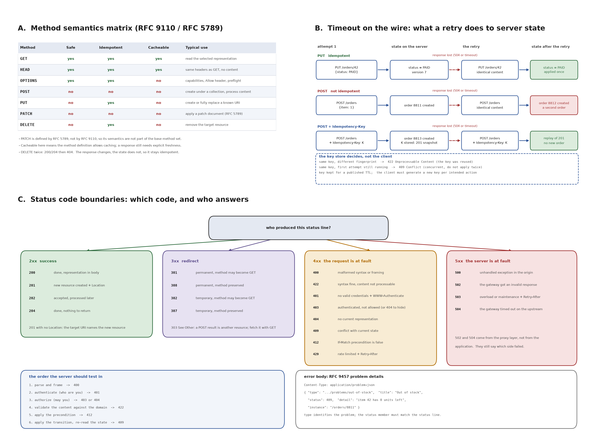

# [네트워크] REST API 설계와 멱등성 · HTTP 상태 코드

- 작성일: 2026-11-24
- 키워드: Network, REST, HTTP, Idempotency, Safe Methods, Idempotency-Key, Status Code, Problem Details, RFC 9110, Spring Boot

## 1. 핵심 요약 (What & Why)

지난 일곱 편은 모두 **연결 그 자체**를 다뤘다. 소켓 버퍼와 TCP/UDP의 차이(1편), 연결을 열고 닫는 왕복(2편), 그 위에서 HTTP가 진화한 과정(3편), 상대의 주소를 이름으로 찾는 일(4편), 늘어난 서버로 연결을 나누고 재사용하는 일(5편), 그 연결의 바이트를 암호화하는 일(6편), 마지막으로 브라우저가 응답을 스크립트에 건네줄지 판단하는 규칙(7편)이었다. 이번 편은 그 모든 층 위에 놓인 **메시지의 의미**다. 연결이 아무리 잘 맺어져도, 패킷이 유실되어 상대가 무엇을 했는지 알 수 없는 순간에 무엇을 다시 보내도 되는지는 HTTP가 정하지 않고 **메서드와 상태 코드가 정한다**. 네트워크 기초 트랙의 마지막 편은 그 계약을 다룬다.

**REST는 프로토콜이 아니라 제약의 묶음이다.** Fielding의 논문은 REST를 네트워크 기반 애플리케이션의 아키텍처 스타일로 정의하고, 여섯 개의 제약을 나열한다. 클라이언트-서버(관심사 분리), 무상태(각 요청이 스스로를 설명), 캐시(응답에 재사용 가능 여부를 표시), 일관된 인터페이스(리소스 식별, 표현을 통한 조작, 자기 서술적 메시지, 하이퍼미디어가 애플리케이션 상태의 엔진), 계층화(각 구성 요소가 바로 앞 계층만 본다), 그리고 선택적인 코드 온 디맨드다. 이 중 **무상태 제약**이 이번 편의 출발점이다. 서버가 요청 사이의 맥락을 들고 있지 않으므로, 클라이언트는 **직전 요청이 실제로 어떻게 끝났는지 모르는 상태에서** 다음 요청을 만들어야 한다.

**그래서 "멱등성(Idempotency)"이라는 말이 필요해진다.** RFC 9110은 멱등한 메서드를 이렇게 정의한다. *"같은 메서드로 한 요청을 여러 번 보냈을 때 서버에 의도된 효과가 한 번 보냈을 때의 효과와 같은 것."* 주목할 부분은 **효과(effect)** 이지 응답이 아니다. RFC 9110은 같은 절에서 멱등한 요청을 반복해도 *"응답은 다를 수 있다"*고 못 박는다. 이 구분이 실무에서 가장 자주 무너지는 지점이다. 멱등성은 "같은 응답을 돌려준다"가 아니라 **"서버의 자원 상태가 한 번 적용한 것과 같아진다"**는 뜻이다.

**왜 이것이 네트워크 문제와 직결되는가.** 클라이언트가 요청을 보내고 응답을 기다리다 시간 초과를 받았다고 하자. 이때 클라이언트가 아는 사실은 하나뿐이다. **응답을 못 받았다.** 요청이 서버에 닿지 않았을 수도 있고, 닿았지만 처리 전에 죽었을 수도 있고, 처리와 커밋을 모두 마쳤는데 응답만 돌아오는 길에 사라졌을 수도 있다. 세 경우는 클라이언트 입장에서 완전히 구별되지 않는다. 이 불확실성 앞에서 선택지는 두 가지다. **재시도하면 중복이 생기는 위험**을 감수하거나, **재시도하지 않고 사용자에게 실패를 보여 주는 위험**을 감수하거나. 멱등성은 이 딜레마를 없애는 설계다. 요청을 반복해도 상태가 한 번 적용한 것과 같다면, 클라이언트는 **망설이지 않고 다시 보낼 수 있다**. RFC 9110이 멱등한 메서드를 따로 구분하는 이유를 정확히 이렇게 적어 두었다. "*멱등한 메서드는 클라이언트가 서버의 응답을 읽기 전에 통신 장애가 발생하면 요청을 자동으로 반복할 수 있기 때문에 구별된다.*"

**상태 코드는 그 계약을 바깥으로 드러내는 언어다.** 클라이언트 라이브러리, 리버스 프록시, API 게이트웨이, 서킷 브레이커, 재시도 인터셉터는 응답 본문을 읽지 않는다. 그들은 상태 코드만 보고 분기한다. `503`에는 `Retry-After`만큼 기다렸다 다시 보내고, `409`나 `422`는 같은 요청을 그대로 다시 보내면 안 되는 신호로 읽고, `504`는 "업스트림이 응답하지 않았다"로 읽는다. 그래서 **틀린 상태 코드는 틀린 재시도 정책을 낳고**, 그것이 중복 주문과 중복 결제로 이어진다. 상태 코드를 고르는 일은 취향이 아니라 계약 작성이다.

정리하면 세 문장이다.

1. **REST의 무상태 제약은 클라이언트가 "직전 요청의 결과를 모르는 채" 다음 요청을 만들게 하고, 그 불확실성을 다루는 수단이 멱등성이다.** 멱등성은 응답의 동일성이 아니라 서버 자원 상태의 불변성이다.
2. **`GET`·`HEAD`·`OPTIONS`·`PUT`·`DELETE`는 멱등하고 `POST`·`PATCH`는 아니다.** `POST`를 재시도 가능하게 만들려면 애플리케이션이 `Idempotency-Key` 같은 별도의 장치를 얹어야 한다.
3. **상태 코드는 사람이 읽는 설명이 아니라 기계가 분기하는 계약이다.** `502`/`503`/`504`를 구분하지 않으면 프록시와 클라이언트가 엉뚱한 재시도를 하고, `409`와 `412`를 구분하지 않으면 충돌을 덮어쓴다.

## 2. 내부 메커니즘과 구조 (How it works)

### 2.1 리소스 모델링: URI는 명사고, 동사는 상태 전이다

Fielding은 리소스를 *"이름 붙일 수 있는 모든 정보"*로 정의하고, 리소스는 특정 시점의 개체가 아니라 **시간에 따라 변하는 매핑**이라고 설명한다. 그래서 URI는 "지금 이 데이터"가 아니라 **"이 개념"**을 가리킨다. `GET /orders/8811`이 몇 번을 호출되어도 같은 URI인 이유가 여기에 있다. 내용은 변해도 가리키는 개념은 변하지 않는다.

RESTful한 URI 설계 규칙은 이 정의에서 바로 따라온다. 계층은 소유 관계를 드러내고, 경로의 각 조각은 **자원**이지 동작이 아니다. 컬렉션 리소스는 목록을, 컬렉션 아래 단건 리소스는 그 항목을 나타낸다. 필터·정렬·페이지네이션은 자원의 하위 집합을 고르는 일이므로 **경로가 아니라 쿼리**에 둔다.

| 의도 | 나쁜 예 | 나은 예 | 이유 |
| --- | --- | --- | --- |
| 목록 조회 | `GET /getOrders` | `GET /orders` | 경로에 동작 이름이 들어갈 이유가 없음. 메서드가 이미 동작을 말함 |
| 단건 조회 | `GET /order?id=8811` | `GET /orders/8811` | 단건은 컬렉션의 구성원이므로 경로로 표현 |
| 생성 | `GET /orders/create?item=1` | `POST /orders` | `GET`으로 상태를 바꾸면 크롤러·프리페치가 부작용을 일으킴 |
| 전체 교체 | `POST /orders/8811/update` | `PUT /orders/8811` | 교체는 `PUT`의 정의 그 자체 |
| 삭제 | `POST /orders/8811/delete` | `DELETE /orders/8811` | 삭제는 `DELETE`가 이미 표현 |
| 필터 | `GET /orders/status/PAID/2026-11` | `GET /orders?status=PAID&month=2026-11` | 필터는 자원을 고르는 조건이지 자원의 계층이 아님 |

**동사가 정당한 경우가 있다.** 상태를 하나 더 만들 수 없고, 그 변경이 여러 자원에 걸쳐 단일 연산으로만 의미를 갖는 경우다. 주문 취소는 `orders` 행의 `status` 컬럼만 바꾸는 일이 아니라 재고 복원, 결제 취소 요청, 알림 발송을 함께 일으킨다. 이때는 **상태 전이 자체를 리소스로 모델링**한다. `POST /orders/8811/cancellation`처럼 "취소 요청"이라는 하위 리소스를 만들거나, `POST /orders/8811/cancel`처럼 동작을 경로에 두고 그 동작을 **비멱등한 생성**으로 취급한다. 전자가 더 REST에 가깝지만, 실무에서는 후자가 흔하고 문제되지 않는다. 중요한 것은 **동사 경로를 `POST`로만 쓴다**는 점이다. `GET /orders/8811/cancel`은 절대 만들면 안 된다.

RFC 9110은 이 금지를 리소스 소유자의 책임으로 못 박는다. 쿼리 파라미터로 동작을 고르는 리소스(`page?do=delete` 같은 형태)를 만들었다면, *"그 리소스의 목적이 안전하지 않은 동작을 수행하는 것일 때, 리소스 소유자는 안전한 요청 메서드로 접근될 경우 그 동작을 비활성화하거나 허용하지 않아야 한다(MUST)"*고 적는다. 이유도 함께 적혀 있다. 링크 유지 보수, 프리페치, 검색 인덱스 구축을 위해 **자동화된 프로세스가 모든 URI를 `GET`하기 때문**이다.

**페이지네이션의 위치.** `GET /orders?page=2&size=20`은 흔하지만, 정렬 기준이 바뀌면 페이지 경계가 밀려 항목이 중복되거나 누락된다. 커서 기반(`?after=<마지막 id>`)은 "이 항목 다음"을 가리키므로 그 문제가 없다. 어느 쪽이든 **조회이므로 `GET`이고 멱등**이라는 사실은 변하지 않는다. 데이터가 변하는 중이라 결과가 달라질 수는 있지만, 그 호출이 서버 상태를 바꾸지 않으므로 재시도가 안전하다.

### 2.2 Safe와 Idempotent는 다른 축이다

세 성질을 한 번에 구분해야 한다.

- **Safe(안전함)**: 요청한 의미가 본질적으로 읽기 전용이다. 클라이언트가 상태 변경을 요청하지도, 기대하지도 않는다.
- **Idempotent(멱등함)**: 같은 요청을 여러 번 보내도 서버에 의도된 효과가 한 번과 같다.
- **Cacheable(캐시 가능함)**: 그 메서드의 응답을 저장해 이후 요청에 재사용하는 것이 정의상 허용된다.

**안전한 메서드는 모두 멱등하다. 그러나 멱등한 메서드가 모두 안전한 것은 아니다.** `PUT`과 `DELETE`는 상태를 바꾸므로 안전하지 않지만, 반복해도 결과가 같으므로 멱등하다. 이 관계를 반대로 기억하면 `PUT`을 `GET`처럼 재시도해도 된다고 착각하게 된다.

RFC 9110의 판정은 다음과 같다. 안전한 메서드는 `GET`, `HEAD`, `OPTIONS`, `TRACE`이고, 멱등한 메서드는 *"`PUT`, `DELETE`, 그리고 안전한 요청 메서드"*다. 즉 `POST`와 `CONNECT`는 둘 다 아니다. `PATCH`는 RFC 9110이 정의하지 않으므로(별도 문서인 RFC 5789가 정의한다) 이 목록에 없고, RFC 5789가 직접 *"PATCH는 안전하지도 멱등하지도 않다"*고 적는다.

**안전한 메서드에도 부작용은 있다.** RFC 9110은 안전성의 정의가 *"구현이 잠재적으로 해로운 동작이나 읽기 전용이 아닌 동작, 부작용을 포함하는 것을 막지 않는다"*고 단서를 붙인다. 모든 응답마다 접근 로그를 남기는 일, 광고를 클릭해 광고 계정에 과금이 발생하는 일이 그 예다. 기준은 **클라이언트가 그 동작을 요청하지 않았고, 그에 대해 책임을 지지 않는다**는 점이다. 반대로 `GET` 요청 하나로 주문이 취소된다면 그것은 클라이언트가 요청한 효과이므로 안전성이 깨진다.

**같은 논리가 멱등성에도 적용된다.** RFC 9110은 멱등성은 *"사용자가 요청한 것에만 적용되며, 서버는 각 요청을 따로 로그에 남기거나 리비전 이력을 보관하거나 다른 비멱등적 부작용을 구현할 자유가 있다"*고 적는다. `DELETE`가 감사 로그에 두 줄을 남겨도, 두 번째 호출이 `404`를 반환해도 멱등한 이유가 여기에 있다. **자원의 상태**가 한 번 지운 것과 같으면 충분하다.

**`DELETE`의 응답이 달라지는 경우.** 첫 호출은 `200`(본문 포함)이나 `204`(본문 없음)를, 두 번째 호출은 `404`를 받는다. 응답 코드가 다르므로 "멱등이 아니다"라고 오해하기 쉽다. 그러나 첫 호출 뒤 자원은 이미 없고, 두 번째 호출 뒤에도 없다. 상태는 같다. RFC 9110이 "*원래 요청이 성공했더라도 반복하면 같은 의도된 효과를 갖는다는 것을 알며, **응답은 다를 수 있다**"*고 적은 문장이 정확히 이 장면을 가리킨다. 서버가 `404` 대신 `204`를 돌려주는 구현도 멱등성 관점에서는 똑같이 정당하다. 어느 쪽을 고를지는 **클라이언트가 "이미 없음"을 오류로 볼지 정보로 볼지**의 문제다.

**`PUT`은 전체 치환이다.** RFC 9110은 `PUT`을 *"대상 리소스의 상태를 요청 내용으로 정의된 상태로 생성하거나 교체해 달라는 요청"*으로 정의한다. 그러므로 본문에 빠진 필드는 "그대로 두라"가 아니라 "그 값을 갖지 않는 상태로 만들라"는 뜻이 된다. 부분 수정은 `PATCH`의 몫이다. RFC 9110은 `Content-Range`를 붙인 부분 `PUT`도 언급하지만, *"일관성이 없고 사용자 에이전트와의 사적 합의에 의존하며, 원래 `PUT` 정의와 하위 호환되지 않는다"*고 경고한다. 부분 갱신이 필요하면 `PATCH`를 쓰는 것이 맞다. `PUT`이 새로 만들었는지 교체했는지도 응답 코드로 갈린다. 새로 만들었으면 `201`, 기존 것을 수정했으면 `200` 또는 `204`다.

**`PATCH`가 기본적으로 비멱등인 이유.** `PATCH`는 *"리소스에 어떤 변경을 가할지"*를 담은 패치 문서를 보낸다(RFC 5789). 패치 문서의 형식에 따라 결과가 달라진다.

- **JSON Merge Patch(RFC 7396)**: 대상 문서와 같은 모양으로 변경을 서술한다. 값이 있으면 교체, `null`이면 삭제, 없던 구성원은 추가다. 모든 연산이 "값을 이렇게 만든다"는 의미이므로, 같은 패치를 두 번 적용해도 두 번째 적용 뒤의 문서는 첫 번째 적용 뒤와 같다. **즉 merge patch는 멱등하다.** RFC 7396이 그렇게 선언하지는 않지만 연산 의미에서 따라온다.
- **JSON Patch(RFC 6902)**: 연산 목록(`add`, `remove`, `replace`, `move`, `copy`, `test`)을 순서대로 적용한다. `add`는 배열의 지정 위치에 **삽입**하므로 두 번 적용하면 원소가 둘이 되고, `remove`는 두 번째에 실패한다. **그래서 JSON Patch는 기본적으로 멱등하지 않다.**

RFC 5789는 이 위험을 알고 *"클라이언트는 마지막으로 읽은 이후 리소스가 갱신되었으면 실패하도록 조건부 요청을 써야 한다"*고 권고한다. 그 장치가 `If-Match`다.

**조건부 요청으로 멱등성과 경쟁을 동시에 다루기.** RFC 9110은 `If-Match`를 *"여러 사용자 에이전트가 같은 리소스에 병렬로 작용할 때 의도치 않은 덮어쓰기를 막기 위해, 상태를 바꾸는 메서드(`POST`, `PUT`, `DELETE`)와 함께 가장 많이 쓰인다"*고 설명한다. 강한 비교(strong comparison)를 써야 하고, 조건이 거짓이면 메서드를 적용해서는 안 된다(MUST NOT). 이때 돌려주는 코드가 `412 Precondition Failed`다.

```http
GET /products/42 HTTP/1.1
Host: api.example.com

HTTP/1.1 200 OK
ETag: "v7"
Content-Type: application/json

{ "id": 42, "price": 12000, "stock": 30 }

PUT /products/42 HTTP/1.1
Host: api.example.com
If-Match: "v7"
Content-Type: application/json

{ "id": 42, "price": 12000, "stock": 20 }

HTTP/1.1 412 Precondition Failed
```

두 사람이 같은 `ETag`를 들고 동시에 `PUT`하면 한 명은 성공하고 다른 한 명은 `412`를 받는다. 덮어쓰기가 조용히 일어나지 않는다는 점에서 이 방식은 **낙관적 락**이다. 잠금을 미리 잡지 않으므로 처리량을 잃지 않고, 충돌은 드물다는 가정 위에서 동작한다. 대신 클라이언트가 `412`를 받으면 최신 상태를 다시 읽고 변경을 다시 계산해야 한다. 이 재시도는 **자동이 아니라 애플리케이션 로직**이어야 한다. 같은 요청을 그대로 다시 보내면 또 `412`가 날 뿐이다.

한 가지 더. `If-Match`가 붙은 요청은 **그 자체로 멱등해진다**는 표현은 부정확하다. `PUT`은 원래도 멱등하다. `If-Match`가 더하는 것은 멱등성이 아니라 **"내가 본 상태가 아니면 적용하지 마라"는 조건**이다. `PATCH`에 `If-Match`를 붙이면 두 번 적용되는 사고는 막을 수 있지만, 두 번째 요청은 `412`로 실패하므로 "반복해도 상태가 같다"는 의미의 멱등성과는 다르다. 조건부 요청은 충돌 감지이고, 멱등성은 반복 안전성이다. 두 개념을 섞으면 설계가 흐려진다.

### 2.3 `POST`를 재시도 가능하게 만들기: `Idempotency-Key`

`POST`는 새 자원을 만들거나 처리를 위임하는 메서드이므로, 반복하면 결과가 늘어난다. 주문 생성, 결제 승인, 쿠폰 발급, 메시지 발송이 모두 여기에 해당한다. 메서드 자체를 멱등하게 바꿀 수는 없으므로, **애플리케이션 계층이 "이 요청은 한 번만 수행되어야 한다"는 의도를 식별자로 전달**한다. 그 식별자가 IETF HTTPAPI 워킹그룹의 `Idempotency-Key` 헤더 필드다(현재 `draft-ietf-httpapi-idempotency-key-header`).

**문법과 생성 규칙.** 초안은 `Idempotency-Key`를 Item Structured Header로 정의하고, 값은 반드시 String이어야 한다고 요구한다. 키는 클라이언트가 만들고, **고유해야 하며 다른 요청 본문과 함께 재사용해서는 안 된다(MUST NOT)**. UUID 사용을 권고한다. 예시는 `Idempotency-Key: "8e03978e-40d5-43e8-bc93-6894a57f9324"` 형태다. 서버는 키를 불투명한 값으로 다루고, 만료 정책을 정했다면 문서에 공개해야 한다.

**서버 쪽 상태 기계.** 초안이 규정하는 판정은 세 갈래다.

| 상황 | 서버가 할 일 | 돌려줄 코드 |
| --- | --- | --- |
| 처음 보는 키(+지문) | 요청을 정상 처리 | 처리 결과에 맞는 코드 (예: `201`) |
| 같은 키 + 같은 지문, 원 요청 완료 후 재시도 | 사용자 의도대로 완료된 것과 일관된 응답을 돌려줌 | 원 응답의 재생 (예: `201`) |
| 같은 키 + 같은 지문, 원 요청이 아직 처리 중 | 충돌로 응답 | `409 Conflict` |
| 같은 키 + **다른** 지문 | 요청 실패, 원 요청 결과를 돌려주지 않음 | `422 Unprocessable Content` |
| 헤더 자체가 없음 (헤더를 요구하는 엔드포인트) | 요청 거부 | `400 Bad Request` |

**지문(fingerprint)이 왜 필요한가.** 키만 저장하면, 클라이언트가 실수로 같은 키에 다른 본문을 실어 보냈을 때 서버는 그것을 "재시도"로 오인하고 **원래 요청의 응답을 돌려준다**. 사용자는 10만 원 결제를 요청했는데 3만 원 결제의 성공 응답을 받게 된다. 초안은 그래서 키와 함께 **요청 본문의 지문을 저장**하고, 지문이 다르면 `422`로 거부하라고 권고한다. 지문 계산 방식은 서버 재량이고, 전체 본문 체크섬부터 선택 필드 비교까지 여러 방식이 가능하다. 주의할 점은 **지문이 일부만 덮으면 그 바깥만 다른 요청은 같은 요청으로 취급된다**는 것이다. 결제 요청이라면 금액과 통화는 반드시 지문에 포함해야 한다.

**동시 요청을 어떻게 막는가.** 같은 키가 거의 동시에 두 번 도착하는 경우가 실무에서 가장 위험하다. 두 스레드가 모두 "키 없음"을 읽고 각각 주문을 만들면 키 저장 자체가 무의미해진다. 그래서 조회와 선점이 **원자적**이어야 한다. 가장 단순하고 확실한 방법은 `idempotency_key` 컬럼에 **유니크 제약**을 걸고, 요청 처리 시작 시점에 `INSERT`를 시도하는 것이다. 성공한 쪽이 처리 권한을 갖고, 실패한 쪽은 기존 행의 상태를 읽어 `409`(처리 중) 또는 저장된 응답(완료)으로 분기한다. 유니크 제약은 DB가 원자성을 보장하므로, 애플리케이션의 락이나 분산 락 없이도 경쟁 조건이 사라진다.

```text
BEGIN
  INSERT INTO idempotency_key (key, fingerprint, state, created_at)
  VALUES (:key, :fingerprint, 'IN_PROGRESS', now());
  -- 유니크 위반이면 기존 행을 읽어 fingerprint 비교 후 409 / 422 / 저장 응답 재생
  ... 주문 생성, 결제 승인, 재고 차감 ...
  UPDATE idempotency_key
     SET state = 'COMPLETED', status_code = 201, response_body = :snapshot
   WHERE key = :key;
COMMIT
```

**트랜잭션 경계가 조용히 깨지는 지점.** 위 흐름은 "주문 생성과 키 완료 표시를 같은 트랜잭션에 넣는다"는 전제 위에 있다. 이 전제가 성립하려면 **응답 스냅샷을 커밋 전에 알 수 있어야** 한다. 그런데 결제 승인처럼 외부 시스템 호출이 끼면 사정이 달라진다.

- 외부 PG 승인은 우리 DB 트랜잭션에 참여하지 않는다. 우리 트랜잭션이 롤백되어도 **PG 쪽 승인은 남는다.**
- 반대로 PG 승인까지 성공했는데 우리 커밋이 실패하면, 클라이언트가 같은 키로 재시도했을 때 PG에 다시 승인을 요청하게 된다. PG가 멱등하지 않다면 이중 청구가 된다.

그래서 결제 연동에서는 **멱등 계층이 두 개**가 된다. 우리 쪽 `Idempotency-Key`와, PG가 제공하는 자체 멱등 수단(대개 주문번호나 별도 키)이다. 초안의 구현 현황에도 Stripe, Adyen, Dwolla, WorldPay 같은 결제 사업자가 같은 헤더 이름을 쓴다고 적혀 있다. 실무 순서는 보통 이렇게 잡는다. **① 우리 키 선점 → ② 주문 행을 `PENDING`으로 커밋 → ③ PG 승인(자체 멱등키 동봉) → ④ 승인 결과를 반영하고 키를 완료로 표시 → ⑤ 응답.** 중간에 죽으면 주문은 `PENDING`으로 남고, 같은 키의 재시도는 저장된 상태를 보고 **PG에 다시 묻지 않고** 결과를 확정하거나 재조회한다. 여기서 `202 Accepted`가 유용하다. "접수했고 아직 끝나지 않았다"를 정직하게 말할 수 있기 때문이다.

**키의 수명.** 키를 영원히 두면 저장소가 무한히 커지고, 짧게 두면 늦게 도착한 재시도가 중복을 만든다. 초안은 서버가 만료 정책을 정해 공개하라고 한다. 실무 감각으로는 **재시도가 일어날 수 있는 시간 창보다 넉넉히** 잡는다. 클라이언트의 재시도가 최대 24시간 안에 끝나는 구조라면 그보다 긴 보존이 필요하고, 결제 정산·환불이 며칠 뒤에 대사되면서 같은 키를 참조해야 한다면 더 길어야 한다. 만료 후 같은 키가 다시 오면 서버는 그것을 **새 요청으로 처리**한다. 그러므로 키 만료는 곧 중복 방지 보호의 종료다.

### 2.4 상태 코드: 체계와 경계

상태 코드는 세 자리 숫자이고 첫 자리가 분류다. 분류만으로도 클라이언트는 대략의 행동을 정할 수 있다. `1xx`는 정보, `2xx`는 성공, `3xx`는 리다이렉션, `4xx`는 클라이언트 오류, `5xx`는 서버 오류다. RFC 9110은 *"`5xx`는 서버가 스스로 오류를 냈거나 요청된 메서드를 수행할 수 없음을 아는 경우"*라고 정의한다. 즉 **`4xx`와 `5xx`의 경계는 "누가 고쳐야 하는가"**다.

**2xx: 무엇을 돌려줄 것인가.**

| 코드 | 의미 | 실무 판단 기준 |
| --- | --- | --- |
| `200 OK` | 요청이 성공했고 응답 본문에 표현이 있음 | 조회, 수정 후 최신 표현을 돌려줄 때 |
| `201 Created` | 새 리소스가 하나 이상 생김 | `POST`로 컬렉션 아래 자식을 만들었을 때. `Location`으로 새 리소스의 URI를 준다 |
| `202 Accepted` | 처리를 접수했으나 완료되지 않음 | 비동기 큐에 넣었을 때. 완료를 보장하지 않는다 |
| `204 No Content` | 성공했고 돌려줄 본문이 없음 | `PUT`/`DELETE` 성공. `204`에는 본문을 넣으면 안 된다 |

`201`에서 `Location`을 빠뜨리는 실수가 흔하다. RFC 9110은 새 리소스가 `Location` 헤더로 식별되고, **`Location`이 없으면 요청 대상 URI가 그 리소스를 식별한다**고 규정한다. 컬렉션(`POST /orders`)에 만들었다면 대상 URI는 컬렉션이므로, `Location: /orders/8811`을 주지 않는 순간 클라이언트는 새 자원의 주소를 모른다.

`202`는 "성공"이 아니라 "접수"다. RFC 9110은 이 코드가 *"의도적으로 약속하지 않는다"*고 표현하고, *"처리 시점에 허용되지 않아 결국 수행되지 않을 수도 있다"*고 덧붙인다. 그래서 `202`를 받은 클라이언트는 결과를 **다른 경로로 확인**해야 한다. 응답 본문에 상태 조회용 URI를 넣거나, 폴링 엔드포인트를 함께 설계해야 한다.

**3xx: 메서드가 보존되는가.**

| 코드 | 성격 | 메서드 | 캐시 |
| --- | --- | --- | --- |
| `301 Moved Permanently` | 영구 이동 | 클라이언트가 `POST`를 `GET`으로 바꿀 **수 있다** | 휴리스틱 캐시 가능 |
| `302 Found` | 일시 이동 | 클라이언트가 `POST`를 `GET`으로 바꿀 **수 있다** | 기본 캐시 불가 |
| `303 See Other` | 다른 리소스를 보라 | 항상 `GET`으로 조회 | 기본 캐시 불가 |
| `307 Temporary Redirect` | 일시 이동 | 메서드를 바꾸면 **안 된다(MUST NOT)** | 기본 캐시 불가 |
| `308 Permanent Redirect` | 영구 이동 | 메서드를 바꾸면 **안 된다(MUST NOT)** | 기본 캐시 가능 |

`301`과 `302`의 N+1 문제가 여기 있다. RFC 9110은 두 코드 모두에 *"역사적 이유로 사용자 에이전트는 후속 요청에서 `POST`를 `GET`으로 바꿀 수 있다"*는 주석을 달고, 그 동작이 바뀌지 않기를 원하면 `307`/`308`을 쓰라고 안내한다. `POST`로 주문을 보냈는데 `301`이 돌아오면, 클라이언트가 본문을 버리고 `GET`으로 따라가면서 **주문이 사라진 것처럼 보이는** 사고가 난다. API에서 `POST`·`PUT`·`PATCH`를 리다이렉트해야 한다면 `307`/`308`이 안전한 기본값이다. `303`은 반대로 "`POST`의 결과는 다른 리소스이니 `GET`으로 가져가라"는 의도를 명시적으로 표현하는 코드다. RFC 9110은 `POST` 처리 결과가 기존 리소스의 표현과 같을 때 `303`으로 안내하는 것을 권한다.

**4xx: 네 갈래의 경계.**

- **`400` vs `422`.** `400`은 *"잘못된 문법, 잘못된 메시지 프레이밍, 기만적인 라우팅처럼 클라이언트 오류로 인식되는 무언가 때문에 서버가 요청을 처리할 수 없거나 하지 않겠다"*는 뜻이다. `422`는 *"요청 내용의 미디어 타입을 이해하고 문법도 올바르지만, 담긴 지시를 처리할 수 없다"*는 뜻이다. 즉 **`400`은 "읽을 수 없다", `422`는 "읽었지만 말이 안 된다"**. JSON 문법이 깨졌으면 `400`, JSON은 멀쩡한데 `quantity: -3`이면 `422`다. `422`는 원래 WebDAV(RFC 4918)에서 왔고 RFC 9110이 `Unprocessable Content`로 정식 등록했다.
- **`401` vs `403`.** `401`은 *"대상 리소스에 대한 유효한 인증 자격 증명이 없어 요청이 적용되지 않았다"*이고, 이 응답을 보내는 서버는 **`WWW-Authenticate` 헤더를 반드시 보내야 한다(MUST)**. `403`은 *"서버가 요청을 이해했지만 수행을 거부한다"*이다. 인증은 됐는데 권한이 없는 상태다. 그래서 `401`은 "다시 로그인해 보라"는 신호이고, `403`은 같은 자격 증명으로 다시 보내도 소용없다는 신호다. RFC 9110은 `403`에서 *"클라이언트는 같은 자격 증명으로 요청을 자동 반복해서는 안 된다"*고 적는다.
- **`404` vs `409` vs `412`.** `404`는 대상 리소스의 현재 표현이 없다는 뜻이고, `409`는 *"대상 리소스의 현재 상태와 충돌해 요청을 완료할 수 없다"*는 뜻이며, `412`는 *"요청 헤더의 조건이 서버에서 거짓으로 평가되었다"*는 뜻이다. 구별법은 **무엇이 문제인가**다. 자원 자체가 없으면 `404`, 자원은 있는데 지금 상태에서 그 전이가 불가능하면 `409`(이미 취소된 주문을 다시 취소, 재고 0인 상품 주문), 클라이언트가 건 조건이 깨졌으면 `412`다. RFC 9110은 `409`가 *"대부분 `PUT`에 대한 응답으로 발생한다"*고 하고, 사용자가 충돌을 해결하고 다시 보낼 수 있는 상황에 쓴다고 설명한다.
- **`429`.** *"사용자가 주어진 시간 안에 너무 많은 요청을 보냈다(rate limiting)"*는 뜻이다(RFC 6585). 응답에 `Retry-After`를 넣어 얼마나 기다릴지 알려줄 수 있고, 이 응답은 캐시가 저장해서는 안 된다(MUST NOT).

**`Retry-After`의 두 형식.** RFC 9110은 값이 HTTP-date이거나 수신 후 지연 초(delay-seconds)일 수 있다고 정의한다. `Retry-After: 120`과 `Retry-After: Tue, 24 Nov 2026 03:35:00 GMT`가 같은 의미다. `503`과 함께 오면 *"서비스가 언제쯤 다시 가능한지"*를, `3xx`와 함께 오면 *"리다이렉트를 따라가기 전 최소 대기 시간"*을 뜻한다.

**5xx: 어디가 실패했는가.**

| 코드 | 실패 지점 | 재시도 |
| --- | --- | --- |
| `500 Internal Server Error` | 원 서버의 처리 중 예외 | 같은 요청 반복은 무의미. 원인 수정 필요 |
| `502 Bad Gateway` | 게이트웨이가 업스트림에서 **유효하지 않은 응답**을 받음 | 다른 인스턴스로 재시도하면 성공할 수 있음 |
| `503 Service Unavailable` | 과부하 또는 계획된 점검 | `Retry-After`만큼 기다린 뒤 재시도 |
| `504 Gateway Timeout` | 게이트웨이가 업스트림의 **제때 온 응답**을 받지 못함 | 결과를 모름. 멱등한 요청만 재시도 |

`502`와 `504`는 **애플리케이션이 아니라 그 앞의 프록시 계층이 만드는 코드**라는 점이 중요하다. 원 서버가 죽어 연결이 거부되면 게이트웨이는 `502`를, 원 서버가 살아 있지만 느리면 `504`를 돌려준다. 두 경우 모두 **원 서버가 요청을 처리했는지 알 수 없다.** `504`는 특히 위험하다. 프록시가 기다리다 포기한 것이지, 원 서버가 실패한 것이 아니다. 원 서버는 커밋을 마쳤을 수 있다.

**오류 본문의 표준: RFC 9457.** 상태 코드만으로는 오류의 내용을 전달할 수 없다. RFC 9457은 `application/problem+json` 미디어 타입과 다섯 개의 표준 구성원을 정의한다.

```http
HTTP/1.1 409 Conflict
Content-Type: application/problem+json

{
  "type": "https://api.example.com/problems/out-of-stock",
  "title": "Out of stock",
  "status": 409,
  "detail": "item 42 has 0 units left",
  "instance": "/orders/8811"
}
```

- **`type`**은 문제 유형의 **주 식별자**다. 소비자는 이 URI를 기준으로 분기해야 한다. 없으면 `about:blank`로 간주된다.
- **`title`**은 사람이 읽는 짧은 요약이고, 같은 유형에서는 발생마다 바뀌지 않아야 한다(로컬라이제이션 제외).
- **`status`**는 참고용이며, **실제 응답의 상태 코드와 같아야 한다(MUST)**. 본문과 상태 줄이 어긋나면 일반 HTTP 소프트웨어가 오작동한다.
- **`detail`**은 이번 발생에 특화된 설명이다. 디버깅 정보보다 **클라이언트가 문제를 고치는 데 도움**이 되는 내용이어야 하고, 소비자는 이 필드를 파싱해서는 안 된다.
- **`instance`**는 이번 발생을 가리키는 URI다.

확장 필드는 자유롭게 추가할 수 있다. 위 예시에 `"availableAt": "2026-11-25"` 같은 필드를 더해도 표준 구성원과 충돌하지 않는다. 이 표준의 가치는 **클라이언트가 상태 코드와 `type`만으로 분기하고, 사람에게 보여줄 문장은 `detail`에서 꺼내 쓸 수 있다**는 데 있다. 오류마다 제각각인 JSON을 만들면 클라이언트는 매번 새 파서를 써야 한다.

## 3. 구조 도식 (Architecture Diagram)



- **A 메서드 의미론 매트릭스 (왼쪽 위)**: 일곱 개 메서드를 세로로 두고 Safe, Idempotent, Cacheable 세 축을 나란히 표시했다. 초록은 `yes`, 빨강은 `no`다. `OPTIONS`가 안전하고 멱등하지만 캐시되지는 않는다는 점, `PUT`·`DELETE`가 안전하지는 않지만 멱등하다는 점이 한눈에 드러난다. 아래 세 줄의 주석은 표만 보고는 놓치기 쉬운 세 가지를 적어 두었다. `PATCH`는 RFC 9110이 아니라 RFC 5789가 정의한다는 것, Cacheable은 "메서드 정의가 캐싱을 허용한다"는 뜻이지 응답이 실제로 캐시된다는 뜻이 아니라는 것, `DELETE`를 두 번 부르면 `200/204` 다음에 `404`가 오지만 상태는 같다는 것이다.
- **B 타임아웃과 재시도가 서버 상태에 남기는 것 (오른쪽 위)**: 같은 사건을 세 줄로 반복해 비교했다. 열은 "첫 시도", "서버에 남은 상태", "재시도", "재시도 뒤 상태"다. 첫 줄(`PUT`)은 첫 시도가 이미 `PAID`를 커밋했고, 응답이 유실되어(빨간 점선) 같은 요청을 다시 보내도 `PAID`가 한 번 적용된 상태 그대로다. 둘째 줄(`POST`)은 같은 사건에서 주문이 하나 더 생긴다. 셋째 줄은 `Idempotency-Key`를 붙인 `POST`로, 서버가 키와 응답 스냅샷을 들고 있어 두 번째 요청에 **저장된 `201`을 재생**하고 새 주문을 만들지 않는다. 맨 아래 상자는 서버가 같은 키를 다시 만났을 때의 세 갈래 판정(지문 불일치 `422`, 처리 중 `409`, 완료 시 재생)과 키의 TTL을 적었다.
- **C 상태 코드의 경계와 판정 순서 (아래)**: 위쪽 질문 상자에서 2xx, 3xx, 4xx, 5xx 네 갈래로 갈라진다. `4xx` 묶음은 "읽을 수 없음(`400`) → 읽었지만 말이 안 됨(`422`) → 누구인지 모름(`401`) → 알아도 안 됨(`403`, 감출 때는 `404`) → 없음(`404`) → 상태 충돌(`409`) → 조건 불일치(`412`) → 너무 잦음(`429`)" 순으로 배열해 서로 헷갈리는 코드를 이웃에 두었다. `5xx` 묶음에는 `502`/`504`가 애플리케이션이 아니라 프록시 계층의 판정이라는 주석을 달았다. 왼쪽 아래 상자는 서버가 검사를 수행해야 하는 순서다. 문법 → 인증 → 인가 → 도메인 검증 → 사전 조건 → 상태 전이 순으로 통과시켜야 `400`과 `422`, `401`과 `403`이 섞이지 않는다. 오른쪽 아래 상자는 RFC 9457 `problem+json`의 실물이고, `status` 구성원이 상태 줄과 일치해야 한다는 규칙을 함께 적었다.

## 4. 비교 표 (Comparison)

### 4.1 HTTP 메서드 비교

| 항목 | `GET` | `HEAD` | `OPTIONS` | `POST` | `PUT` | `PATCH` | `DELETE` |
| --- | --- | --- | --- | --- | --- | --- | --- |
| Safe | 예 | 예 | 예 | 아니오 | 아니오 | 아니오 | 아니오 |
| Idempotent | 예 | 예 | 예 | 아니오 | 예 | 아니오 (기본) | 예 |
| Cacheable | 예 | 예 | 아니오 | 조건부 | 아니오 | 아니오 | 아니오 |
| 요청 본문 | 정의된 의미 없음 | 정의된 의미 없음 | 의미 없음 (미디어 타입만 필요) | 있음 | 있음 | 있음 (패치 문서) | 정의된 의미 없음 |
| 응답 본문 | 있음 | 없음 (MUST NOT) | 있을 수 있음 | 있음 | 있을 수 있음 | 있을 수 있음 | 있을 수 있음 |
| 정상 응답 코드 | `200` | `200` | `200`, `204` | `200`, `201`, `202`, `204` | `200`, `201`, `204` | `200`, `204` | `200`, `202`, `204` |
| 용도 | 표현 조회 | 메타데이터만 조회 | 지원 기능·`Allow` 확인 | 컬렉션에 생성, 처리 위임 | 알려진 URI에 생성·전체 교체 | 부분 변경 적용 | 자원 제거 |
| 재시도 안전성 | 안전 | 안전 | 안전 | 위험 (키 필요) | 안전 | 위험 (조건부로 완화) | 안전 |

`POST`의 Cacheable이 "조건부"인 이유는 RFC 9110이 `POST` 응답도 캐싱 의미를 정의하기 때문이다. 다만 *"명시적 신선도 정보와, `POST`의 대상 URI와 같은 값을 갖는 `Content-Location` 헤더"*를 둘 다 갖춰야 하고, 실제 구현 대부분은 `GET`과 `HEAD`만 지원한다. 그래서 실무에서 `POST` 응답 캐싱은 기대하지 않는 편이 맞다.

### 4.2 헷갈리는 상태 코드 경계

| 쌍 | 구분 기준 | 왼쪽을 쓸 때 | 오른쪽을 쓸 때 |
| --- | --- | --- | --- |
| `400` vs `422` | 문법을 읽을 수 있는가 | JSON 파싱 실패, 필수 헤더 누락, 프레이밍 오류 | 문법은 맞는데 값이 도메인 규칙 위반 (`수량 -3`, 존재하지 않는 상태 전이) |
| `401` vs `403` | 인증을 통과했는가 | 자격 증명 없음·만료·무효. `WWW-Authenticate` 필수 | 인증은 됐으나 권한 없음. 같은 자격 증명으로 재시도 무의미 |
| `403` vs `404` | 존재 자체를 숨길 것인가 | 권한 없음을 알려도 무방 | 타인 자원의 존재를 감추고 싶을 때 (`403` 대신 `404`) |
| `301`/`302` vs `307`/`308` | 메서드를 보존하는가 | 역사적 동작을 허용. `POST`가 `GET`으로 바뀔 수 있음 | 메서드와 본문을 그대로 유지 (MUST NOT 변경) |
| `301`/`308` vs `302`/`307` | 영구인가 일시인가 | 영구. 캐시·링크 갱신 대상 | 일시. 기존 URI를 계속 사용 |
| `409` vs `412` | 조건 헤더 때문인가 | 현재 상태와의 충돌 (중복 생성, 잘못된 전이) | `If-Match`/`If-Unmodified-Since` 조건이 거짓 |
| `404` vs `410` | 영구적인가 | 없음. 영구성 미상 | 영구히 사라졌고 링크를 지우길 원함 |
| `502` vs `503` vs `504` | 누가 무엇을 못 했는가 | 게이트웨이가 업스트림에서 잘못된 응답을 받음 | 원 서버가 과부하·점검 중 / 게이트웨이가 업스트림 응답을 기다리다 포기 |

### 4.3 멱등성 보장 방식 비교

| 방식 | 보장 대상 | 강점 | 약점 | 적합한 경우 |
| --- | --- | --- | --- | --- |
| `PUT` + 전체 치환 | 같은 URI에 대한 반복 | 프로토콜 수준에서 공짜로 얻음. 클라이언트 구현이 단순 | 부분 갱신 불가. 동시 수정 시 마지막 쓰기가 이김 | 상태를 통째로 아는 설정·문서 갱신 |
| 조건부 요청(`ETag` + `If-Match`) | 덮어쓰기 방지 | 잠금 없이 경쟁을 감지. `412`로 명확히 알림 | 클라이언트가 재조회·재계산을 해야 함. 왕복이 늘어남 | 재고·가격처럼 동시 수정이 잦은 자원 |
| DB 유니크 키 | 중복 생성 | DB가 원자성 보장. 추가 인프라 불필요 | 키 설계가 자연키에 묶임. 실패 시 예외 처리 필요 | 회원 가입, 쿠폰 1인 1매, 주문번호 |
| `Idempotency-Key` + 저장소(Redis) | 임의의 `POST` | 응답 스냅샷 재생으로 클라이언트 경험이 동일. TTL 관리가 쉬움 | 저장소가 상태를 들고 있어 무상태가 깨짐. Redis 장애 시 정책 필요 | 결제·주문처럼 외부 부작용이 큰 생성 |
| `Idempotency-Key` + DB 트랜잭션 | 임의의 `POST` | 키 선점과 업무 데이터 커밋이 한 원자 단위 | 응답 스냅샷을 커밋 전에 확정해야 함. 락 경합 | 정합성이 최우선인 금융성 처리 |
| 상태 머신 전이 검증 | 도메인 규칙 위반 | 중복 요청을 오류가 아니라 **현재 상태의 함수**로 처리 | 모든 전이를 명시해야 함. 상태가 늘면 복잡 | 주문·배송·정산 같은 워크플로 |

마지막 방식은 앞의 네 가지와 결이 다르다. "이미 `PAID`인 주문에 `PAY` 요청이 오면 성공으로 응답한다"처럼, **요청을 상태 전이로 해석**하면 자연히 멱등해진다. 응답이 `200`이든 `409`이든 서버 상태는 한 번 적용한 것과 같다. 다만 응답 코드가 달라지므로, 클라이언트가 "성공"으로 볼지 결정해 두어야 한다.

### 4.4 응답 코드별 클라이언트·프록시의 재시도 판단

| 코드 | 같은 요청 재시도 | 이유 |
| --- | --- | --- |
| `2xx` | 불필요 | 이미 성공 |
| `400`, `422` | 금지 | 같은 본문은 같은 오류를 낳음. 본문을 고쳐야 함 |
| `401`, `403` | 금지 (자격 증명을 바꾼 뒤에만) | 같은 자격 증명으로는 결과가 같음 |
| `404` | 금지 | 대상이 없음. 재시도로 생기지 않음 |
| `409` | 조건부 | 충돌 원인을 해결한 뒤 새 요청으로 보내야 함 |
| `412` | 조건부 | 최신 상태를 다시 읽고 변경을 재계산해야 함 |
| `429` | `Retry-After` 이후 | 속도 제한. 즉시 재시도는 제한을 연장함 |
| `500` | 금지 | 서버 결함. 같은 요청은 같은 실패 |
| `502`, `503` | 가능 (`Retry-After` 우선) | 다른 인스턴스나 회복 후 성공 가능. 멱등한 요청이어야 안전 |
| `504` | 멱등한 요청만 | 원 서버가 처리했는지 알 수 없음 |

## 5. 내가 깨달은 점 (My Insight)

- **멱등성은 "같은 응답"이 아니라 "같은 상태"다.** 처음에는 `DELETE`를 두 번 불렀을 때 `200` 다음 `404`가 오는 것을 보고 "응답이 다르니 멱등이 아니지 않나"라고 생각했다. RFC 9110의 문장 — *"원래 요청이 성공했더라도 반복하면 같은 의도된 효과를 갖는다는 것을 알며, 응답은 다를 수 있다"* — 을 읽고 관점이 바뀌었다. 멱등성은 **서버가 기억해야 하는 것**에 대한 약속이고, 응답은 그 상태를 클라이언트에게 알리는 수단일 뿐이다. 이 구분을 잡으면 `Idempotency-Key`가 왜 "응답 스냅샷"을 저장하는지도 자연스러워진다. 재생하는 것은 상태가 아니라 **상태를 알리던 응답**이기 때문이다. 상태는 DB가 들고 있고, 스냅샷은 같은 상태를 같은 방식으로 알리기 위한 캐시다.

- **네트워크 단절은 예외가 아니라 정상 경로다.** 5편에서 본 커넥션 풀과 로드 밸런서, 6편의 TLS, 7편의 프리플라이트는 모두 "연결이 끊길 수 있다"는 전제 위에 있다. 그런데 애플리케이션 계층에서는 여전히 "요청이 실패하면 아무 일도 없었다"고 가정하고 코드를 쓴다. 실제로는 **클라이언트가 `504`를 받은 순간에도 서버는 커밋을 마쳤을 수 있다.** `504`는 게이트웨이가 기다리다 포기했다는 뜻이지 원 서버가 실패했다는 뜻이 아니기 때문이다. 이 사실을 인정하면 설계가 바뀐다. 상태를 바꾸는 모든 `POST`에는 멱등키가 붙고, 클라이언트는 실패를 "실패"가 아니라 "모름"으로 다루고, 서버는 재시도 요청을 새 요청이 아니라 **같은 사건의 재조회**로 해석한다.

- **상태 코드는 문서가 아니라 실행되는 계약이다.** 상태 코드를 "대충 200과 400"으로 쓰면, 프록시의 재시도, 서킷 브레이커의 실패율 집계, 클라이언트의 토스트 메시지, 모니터링의 알림 규칙이 모두 엉뚱하게 동작한다. `503` 대신 `500`을 쓰면 로드 밸런서는 그 인스턴스를 장애로 보고 빼지 않고, `429` 대신 `403`을 쓰면 클라이언트는 영구 차단으로 오해하고, `409` 대신 `200`에 `{"success": false}`를 담으면 게이트웨이는 성공으로 집계한다. 4.4의 표는 결국 **내가 고른 코드가 다른 프로그램의 if 문을 결정한다**는 사실의 목록이다.

- **`412`와 `409`는 다른 문제를 푼다.** 둘 다 "지금은 안 된다"지만, `412`는 **클라이언트가 건 조건**이 깨진 것이고 `409`는 **자원의 현재 상태**가 요청과 맞지 않는 것이다. 이 구분이 실무에서 중요한 이유는 재시도 전략이 다르기 때문이다. `412`는 최신 상태를 다시 읽고 **변경 내용을 다시 계산**해야 하고, `409`는 충돌의 원인(이미 존재함, 잘못된 전이)을 해결해야 한다. 둘을 모두 `400`으로 뭉개면 클라이언트는 무엇을 고쳐야 하는지 알 수 없다.

- **이 트랙의 마무리: 네트워크의 불확실성을 애플리케이션의 계약으로 흡수한다.** 1편의 소켓 버퍼에서 시작해 8편의 상태 코드까지 오면서 본 것은 하나의 방향이다. 아래 계층은 **신뢰성을 보장하지 않는다**. TCP는 순서와 재전송을 보장하지만 연결이 끊기면 그 순간을 알려줄 뿐이고, TLS는 기밀성과 무결성을 보장하지만 요청이 처리되었는지는 말해 주지 않는다. 결국 **"이 요청을 두 번 보내도 되는가"라는 질문은 애플리케이션이 답해야 한다.** 멱등성과 상태 코드는 그 답을 프로토콜의 문법으로 표현한 장치다. 계층을 거슬러 올라가며 배운 것을 한 줄로 줄이면 이렇게 된다. **아래층이 해결하지 못한 불확실성은 위층이 계약으로 명시해야 한다.**

## 6. 실무 관점 및 트레이드오프 (Trade-offs & Best Practices)

### 6.1 Spring에서 상태 코드와 오류 본문 다루기

Spring MVC의 `@RestController`는 반환값을 응답 본문으로 쓰고, 상태 코드는 기본적으로 `200`이다. 상태를 명시하려면 `ResponseEntity`를 쓰거나 예외에 상태를 실어 던진다.

```java
@PostMapping("/orders")
public ResponseEntity<OrderResponse> create(@Valid @RequestBody CreateOrderRequest request) {
    Order order = orderService.create(request);
    return ResponseEntity
            .created(URI.create("/orders/" + order.getId()))   // 201 + Location
            .body(OrderResponse.from(order));
}

@DeleteMapping("/orders/{id}")
public ResponseEntity<Void> cancel(@PathVariable Long id) {
    orderService.cancel(id);
    return ResponseEntity.noContent().build();                 // 204
}
```

`ResponseEntity.created(URI)`가 `Location`을 붙인다는 점이 실무에서 자주 잊히는 부분이다. `ResponseEntity.status(201).body(...)`로 쓰면 `Location`이 빠진다.

오류 응답은 Spring Framework 6부터 RFC 9457을 직접 지원한다. `ProblemDetail`은 표준 다섯 구성원과 확장 필드를 담는 컨테이너이고, `@ExceptionHandler`나 `@RequestMapping` 메서드에서 그대로 반환하면 `application/problem+json`으로 직렬화된다. 이때 **`ProblemDetail`의 `status` 속성이 실제 HTTP 상태 코드를 결정**하므로, 본문과 상태 줄이 어긋날 일이 없다.

```java
@RestControllerAdvice
public class ApiExceptionHandler {

    @ExceptionHandler(OutOfStockException.class)
    public ProblemDetail handleOutOfStock(OutOfStockException e) {
        ProblemDetail detail = ProblemDetail.forStatusAndDetail(
                HttpStatus.CONFLICT, "item " + e.getItemId() + " has 0 units left");
        detail.setType(URI.create("https://api.example.com/problems/out-of-stock"));
        detail.setTitle("Out of stock");
        detail.setInstance(URI.create("/orders/" + e.getOrderId()));
        detail.setProperty("itemId", e.getItemId());
        return detail;
    }

    @ExceptionHandler(IdempotencyKeyMismatchException.class)
    public ProblemDetail handleKeyMismatch(IdempotencyKeyMismatchException e) {
        ProblemDetail detail = ProblemDetail.forStatus(422);
        detail.setType(URI.create("https://api.example.com/problems/idempotency"));
        detail.setTitle("Idempotency-Key is already used");
        detail.setDetail("the key must not be reused across different payloads");
        return detail;
    }
}
```

Spring MVC의 내장 예외(`MethodArgumentNotValidException`, `HttpRequestMethodNotSupportedException`, `HttpMediaTypeNotSupportedException` 등)까지 같은 형식으로 맞추려면 `ResponseEntityExceptionHandler`를 상속해 `@ControllerAdvice`로 등록한다. 이 클래스는 모든 `ErrorResponse` 예외를 처리하는 `@ExceptionHandler`를 갖고 있고, 메시지 코드를 `MessageSource`로 해석해 `type`·`title`·`detail`을 채운다.

> [!NOTE]
> Spring Boot에서는 `spring.mvc.problemdetails.enabled=true`로 내장 예외에 대한 problem details 응답을 자동 구성할 수 있다. 이때 자동 구성된 핸들러의 순서는 `0`이므로, 특정 예외만 직접 다루고 싶다면 `ResponseEntityExceptionHandler`를 상속하는 대신 별도의 `@ControllerAdvice`를 그보다 앞 순서로 등록하는 편이 낫다. 또한 Spring Framework 7.1부터는 `ProblemDetail`의 `instance` 필드에 요청 경로가 자동으로 채워지지 않는다. 명세가 `instance`를 "이번 발생의 고유 식별자"로 규정하기 때문이므로, 경로를 넣고 싶다면 직접 설정해야 한다.

> [!WARNING]
> `ResponseStatusException`이나 `@ResponseStatus`만으로는 오류 본문의 구조가 보장되지 않는다. 클라이언트가 `error.code` 같은 필드를 기대하도록 만들어 두었다면, `ProblemDetail`로 전환하는 순간 계약이 깨진다. 오류 형식을 바꾸는 일은 **API 계약 변경**이므로, 버전이나 전환 기간을 두고 진행해야 한다.

### 6.2 프록시·게이트웨이의 자동 재시도

재시도는 클라이언트 코드에만 있는 것이 아니다. Nginx의 `proxy_next_upstream`, 로드 밸런서의 헬스 체크 기반 재분배, 서비스 메시의 재시도 정책, HTTP 클라이언트 라이브러리의 인터셉터가 모두 같은 일을 한다. RFC 9110은 이 지점에 규칙을 하나 정해 둔다. **프록시는 비멱등 요청을 자동으로 재시도해서는 안 되고(MUST NOT), 클라이언트는 실패한 자동 재시도를 다시 자동 재시도해서는 안 된다(SHOULD NOT).**

이 규칙이 지켜지는지 확인하는 방법은 **게이트웨이가 메서드를 보고 재시도 여부를 판단하는지**다. 많은 구성에서 재시도 대상은 `GET`, `HEAD`, `OPTIONS`, `PUT`, `DELETE`로 제한되고 `POST`는 제외한다. 그런데 여기에 함정이 있다. `Idempotency-Key`를 붙인 `POST`는 **의미상 멱등해졌지만 메서드는 여전히 `POST`**다. 게이트웨이는 헤더를 해석하지 않으므로 그 요청을 재시도하지 않는다. 반대로 재시도하도록 설정하면 키가 없는 다른 `POST`까지 재시도 대상이 된다. 그래서 실무에서는 (1) 게이트웨이의 재시도는 멱등 메서드로 한정하고, (2) `POST`의 재시도는 **애플리케이션 클라이언트 코드**가 `Idempotency-Key`와 함께 명시적으로 수행하는 쪽이 안전하다.

```nginx
# 업스트림이 연결을 거부했거나 응답 전에 끊긴 경우에만 재시도한다.
# non_idempotent를 켜지 않는 한 POST·PATCH·LOCK은 재시도 대상이 아니다.
proxy_next_upstream error timeout http_502 http_503;
proxy_next_upstream_tries 2;
proxy_next_upstream_timeout 3s;
```

`504`를 재시도 대상에 넣을 때는 특히 조심해야 한다. 업스트림이 느려서 게이트웨이가 포기한 것이므로, **원 서버는 이미 처리를 마쳤을 수 있다.** 멱등한 요청이면 안전하고, `POST`라면 중복을 만든다.

> [!WARNING]
> `proxy_next_upstream`에 `http_500`을 넣어 서버 오류를 다른 인스턴스로 재시도하는 구성이 흔하다. 애플리케이션 버그로 인한 `500`은 어느 인스턴스에서나 같은 결과이므로 재시도가 부하만 두 배로 만든다. 반대로 재시도가 실제로 도움이 되는 것은 `502`(다른 인스턴스는 정상일 수 있음)와 연결 오류다. `503`은 `Retry-After`를 존중해야 하므로 즉시 재분배보다 대기가 맞다.

### 6.3 `404`와 `403`: 존재를 숨기는 비용

RFC 9110의 `403` 절에는 짧지만 중요한 문장이 있다. *"금지된 대상 리소스의 현재 존재를 숨기고자 하는 원 서버는 대신 `404`로 응답할 수 있다(MAY)."* 즉 `403`과 `404`의 선택은 기술 문제가 아니라 **정보 노출 정책**이다.

| 선택 | 클라이언트가 아는 것 | 위험 |
| --- | --- | --- |
| 권한 없는 타인 자원에 `403` | "그 ID의 자원은 존재한다. 다만 내 것이 아니다" | ID를 증가시키며 순회하면 **존재 여부를 수집**할 수 있음. 사용자 수·주문량 같은 정보가 샌다 |
| 권한 없는 타인 자원에 `404` | "없거나, 있지만 내 것이 아니다" | 정당한 사용자도 "내 주문이 사라졌다"고 오해. 지원 문의가 늘고 디버깅이 어려워짐 |
| 공개 자원에 `403` | "권한이 없다" | 문제 없음. 오히려 명확함 |

실무 기준은 **자원의 존재 자체가 민감한가**다. 남의 주문·메시지·계정은 존재 여부가 곧 정보다. 반면 공개 게시판의 비공개 글, 관리자 전용 페이지는 존재를 알아도 손해가 없으므로 `403`이 더 친절하다. 한 서비스 안에서도 자원 종류별로 다르게 정할 수 있고, 정했다면 문서에 남겨야 한다. 클라이언트가 `404`를 "없음"으로만 해석하고 재생성 로직을 태우는 구조라면, 숨김 정책이 **의도치 않은 중복 생성을 유발**할 수 있다는 점도 함께 봐야 한다.

### 6.4 `Idempotency-Key` 저장소: Redis 단독 vs DB 결합

| 항목 | Redis 단독 | DB 트랜잭션 결합 |
| --- | --- | --- |
| 원자성 | `SET NX`로 선점은 원자적. 다만 TTL 만료와 업무 커밋 시점이 어긋남 | 키 선점과 업무 데이터가 한 커밋 단위 |
| TTL 관리 | 네이티브. 만료 정책 구현이 거의 공짜 | 배치나 파티셔닝으로 직접 정리 |
| 처리량 | 높음. 애플리케이션 DB 부하 없음 | 키 테이블이 쓰기 경합 지점이 됨 |
| 장애 시 | Redis가 죽으면 보호가 사라짐. 재시도가 곧 중복 | DB가 죽으면 업무 자체가 멈춤. 보호는 유지 |
| 응답 스냅샷 | 문자열로 저장하기 쉬움. 크기 제한과 직렬화 비용 확인 필요 | 행 크기가 커짐. 큰 응답은 별도 저장 |
| 다중 인스턴스 | 공유 저장소이므로 자연히 일관 | 공유 DB이므로 자연히 일관 |
| 디버깅 | 만료되어 사라진 키의 흔적을 찾기 어려움 | 이력이 남아 추적 가능 (개인정보 보존 정책과 충돌) |

절충안이 흔히 쓰인다. **선점은 Redis `SET NX`로, 최종 결과와 감사 이력은 DB에.** 선점이 빠르고, 업무 커밋이 성공한 뒤에 Redis 값을 "완료"로 바꾸고 응답 스냅샷을 넣는다. 이 구조의 약점은 두 저장소 사이의 창이다. 업무 커밋은 성공했는데 Redis 갱신 전에 프로세스가 죽으면, 재시도는 "처리 중"으로 보여 `409`를 돌려주고 클라이언트는 영원히 기다리게 된다. 그래서 **`409`를 받은 클라이언트가 일정 시간 뒤 다시 조회할 수 있는 경로**(주문 조회, 상태 조회 API)를 반드시 함께 제공해야 한다. 반대로 정합성이 최우선이면 DB 한 곳에 모두 두고, 키 테이블의 경합을 감수하는 편이 낫다.

> [!NOTE]
> `Idempotency-Key`는 결제 API에서 널리 쓰이지만 HTTP 표준 RFC가 아니다. 현재 IETF HTTPAPI 워킹그룹의 인터넷 드래프트(`draft-ietf-httpapi-idempotency-key-header`)이며, 만료·지문·오류 코드 같은 세부는 구현마다 다를 수 있다. 다른 서비스와 연동할 때는 **상대의 문서에 적힌 규칙**을 따라야 한다. 같은 헤더 이름을 쓴다고 같은 동작이 보장되지는 않는다.

### 6.5 점검 순서

상태 코드와 멱등성 문제를 만났을 때 확인할 순서다.

1. **그 요청이 상태를 바꾸는가.** 바꾼다면 메서드가 `POST`/`PATCH`인지 확인한다. 그렇다면 재시도 경로 전체(클라이언트, 게이트웨이, 배치 재처리)에 멱등 장치가 있는지 본다.
2. **응답을 못 받은 요청이 실제로 처리되었는가.** 서버 로그와 DB의 `created_at`을 함께 본다. 로그가 없어도 처리되었을 수 있으므로, **업무 테이블의 유니크 제약**으로 확인하는 편이 확실하다.
3. **중복이 실제로 생겼는가.** 같은 사용자·같은 시각·같은 금액의 행이 둘 이상 있는지 조회한다. 생겼다면 재시도 주체가 둘인지(클라이언트 인터셉터 + 게이트웨이) 확인한다. **두 곳에서 재시도하면 재시도 횟수가 곱해진다.**
4. **상태 코드가 재시도 주체에게 옳은 신호를 주었는가.** `503`에 `Retry-After`가 있는지, `409`와 `422`를 `400`으로 뭉개지 않았는지, `502`/`504`를 구분했는지 확인한다.
5. **오류 본문이 기계가 읽을 수 있는가.** `type` URI가 안정적인지, `status`가 상태 줄과 같은지, `detail`이 사람이 읽을 문장인지 확인한다.

```bash
# 같은 키로 두 번 보내 실제로 하나만 만들어지는지 확인한다
curl -i -X POST https://api.example.com/orders \
  -H "Content-Type: application/json" \
  -H 'Idempotency-Key: "8e03978e-40d5-43e8-bc93-6894a57f9324"' \
  -d '{"itemId":42,"quantity":1}'

# 두 번째 호출: 201이 다시 오고 본문이 같아야 한다 (새 주문이 생기면 실패)
curl -i -X POST https://api.example.com/orders \
  -H "Content-Type: application/json" \
  -H 'Idempotency-Key: "8e03978e-40d5-43e8-bc93-6894a57f9324"' \
  -d '{"itemId":42,"quantity":1}'

# 같은 키에 다른 본문: 422가 와야 한다
curl -i -X POST https://api.example.com/orders \
  -H "Content-Type: application/json" \
  -H 'Idempotency-Key: "8e03978e-40d5-43e8-bc93-6894a57f9324"' \
  -d '{"itemId":42,"quantity":99}'
```

## 7. 참고 자료 (References)

- RFC 9110 (HTTP Semantics) - 9.2.1 안전한 메서드(`GET`, `HEAD`, `OPTIONS`, `TRACE`), 9.2.2 멱등한 메서드(`PUT`, `DELETE`와 안전한 메서드, "응답은 다를 수 있다", 프록시의 비멱등 재시도 금지), 9.2.3 메서드와 캐싱, 9.3 메서드 정의(`POST`, `PUT`, `DELETE`의 상태 코드 요구), 13.1.1 `If-Match`와 강한 비교, 14.5 부분 `PUT`, 15장 상태 코드 정의 전반(201/202/204/301/302/303/307/308/400/401/403/404/405/409/410/412/422/500/502/503/504), 10.2.3 `Retry-After`
- RFC 9457 (Problem Details for HTTP APIs) - `application/problem+json`, `type`/`status`/`title`/`detail`/`instance` 구성원의 의미와 제약, 확장 구성원, RFC 7807을 대체
- RFC 9111 (HTTP Caching) - `POST` 응답의 캐시 조건(명시적 신선도 + `Content-Location`)
- RFC 5789 (PATCH Method for HTTP) - "PATCH는 안전하지도 멱등하지도 않다", 조건부 요청 권고, 원자적 적용 요구
- RFC 7396 (JSON Merge Patch) - `application/merge-patch+json`, 병합 규칙과 `null`의 의미
- RFC 6902 (JSON Patch) - 연산 목록(`add`, `remove`, `replace`, `move`, `copy`, `test`), 배열 삽입의 의미
- RFC 6585 (Additional HTTP Status Codes) - `429 Too Many Requests`, `Retry-After`, 캐시 저장 금지
- RFC 7538 (The 308 Permanent Redirect Status Code) - `308`의 메서드 보존과 캐시 가능성
- IETF HTTPAPI, `draft-ietf-httpapi-idempotency-key-header` - 헤더 문법(String), 키의 고유성과 재사용 금지, UUID 권고, 지문(fingerprint), 만료 정책, 누락 시 `400`·불일치 시 `422`·처리 중 `409`, 구현 현황
- Roy T. Fielding, Architectural Styles and the Design of Network-based Software Architectures (2000) - 5.1.2 클라이언트-서버, 5.1.3 무상태, 5.1.4 캐시, 5.1.5 일관된 인터페이스의 네 제약, 5.1.6 계층화, 5.1.7 코드 온 디맨드, 5.2.1 리소스와 표현
- MDN, HTTP request methods - 각 메서드의 안전성·멱등성 요약
- MDN, HTTP response status codes - 코드별 의미와 사용 예
- Spring Framework Reference, Error Responses - `ProblemDetail`, `ErrorResponse`, `ErrorResponseException`, `ResponseEntityExceptionHandler`, `application/problem+json` 직렬화, 메시지 코드, `spring.mvc.problemdetails.enabled`, 7.1의 `instance` 변경
- Spring Framework Reference, Web MVC - `ResponseEntity`와 `@RestControllerAdvice`를 통한 상태 코드·헤더 제어
- NGINX, `ngx_http_proxy_module` - `proxy_next_upstream`, `proxy_next_upstream_tries`, `proxy_next_upstream_timeout`의 재시도 조건
