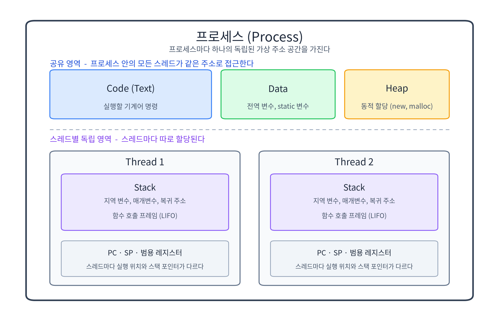

# [OS] 프로세스와 스레드의 개념과 메모리 구조

- 작성일: 2026-11-09
- 키워드: Operating System, Process, Thread, Virtual Memory, Code, Data, Heap, Stack, Thread-Safety

## 1. 핵심 요약 (What & Why)

프로세스는 실행 중인 프로그램으로, 운영체제가 메모리와 자원을 할당하는 독립된 단위입니다. 프로세스는 저마다 가상 주소 공간을 하나씩 받기 때문에 다른 프로세스의 메모리를 들여다볼 수 없습니다.

스레드는 그 프로세스 안에서 CPU를 실제로 할당받아 코드를 실행하는 흐름입니다. 같은 주소 공간을 공유하므로 생성과 전환이 가볍고, 데이터를 주고받는 데 별도의 통신 절차가 필요 없습니다.

두 개념을 나눠서 봐야 하는 이유는 분명합니다. 공유한다는 사실이 스레드가 빠른 이유이자, 동시성 버그가 생기는 이유이기 때문입니다.

## 2. 메모리 구조 (How it works)

### 2.1 네 개의 영역

프로그램이 실행되면 운영체제는 가상 주소 공간을 만들고 그 안에 용도가 다른 영역을 배치합니다.

| 영역 | 저장하는 것 | 특징 |
| --- | --- | --- |
| Code (Text) | 컴파일된 기계어 명령 | 읽기 전용이며 실행 중에 바뀌지 않는다. 모든 스레드가 같은 코드를 실행한다. |
| Data | 초기화된 전역 변수, `static` 변수 | 프로그램 시작 시 할당되어 종료까지 유지된다. 초기화하지 않은 전역 변수는 0으로 채워진 별도 영역(BSS)에 놓인다. |
| Heap | `new`, `malloc` 등으로 동적 할당한 객체 | 런타임에 크기가 변하며 낮은 주소에서 높은 주소로 자란다. 해제 시점을 프로그래머나 GC가 관리한다. |
| Stack | 지역 변수, 매개변수, 복귀 주소 | 함수 호출마다 프레임이 쌓이고 반환되면 사라진다(LIFO). 크기가 제한되어 있어 넘치면 StackOverflow가 발생한다. |

자바도 같은 구분을 가집니다. Heap과 클래스 메타데이터(Metaspace)는 프로세스에 하나만 있고, 각 스레드는 자신만의 JVM Stack과 PC Register를 따로 가집니다.

### 2.2 공유와 독립

프로세스는 주소 공간을 만들 때 Code, Data, Heap, Stack을 한 번에 배치합니다. 이 프로세스에서 스레드를 하나 더 만들면 운영체제는 Stack과 레지스터, PC만 새로 준비합니다. 나머지 영역은 기존 스레드와 같은 주소를 그대로 가리킵니다.

그래서 스레드 A가 Heap에 만든 객체를 스레드 B가 즉시 참조할 수 있습니다. 복사본을 넘겨받는 것이 아니라 같은 메모리를 함께 보는 것입니다. 반대로 지역 변수는 스레드마다 다른 Stack의 프레임에 있으므로 다른 스레드에서 보이지 않습니다.

## 3. 구조 도식 (Diagram)

- 위쪽 세 영역(Code, Data, Heap)은 프로세스 안의 모든 스레드가 같은 주소로 접근합니다.
- 아래쪽 Stack과 PC, 레지스터는 스레드마다 따로 할당됩니다.
- 스레드 수가 늘어나도 Code, Data, Heap은 하나이고, Stack만 개수만큼 늘어납니다.

## 4. 프로세스와 스레드 비교

| 비교 항목 | 프로세스 | 스레드 |
| --- | --- | --- |
| 자원 공유 | 독립 (가상 주소 공간이 분리됨) | Code, Data, Heap 공유, Stack만 독립 |
| 생성 및 전환 오버헤드 | 상대적으로 큼 (주소 공간과 페이지 테이블 준비) | 작음 (스택과 레지스터만 교체) |
| 통신 방식 | IPC (파이프, 소켓, 공유 메모리, 시그널) | 공유 메모리 직접 접근 (동기화 필요) |
| 장애 전파 여부 | 격리됨 (다른 프로세스는 계속 동작) | 전파됨 (스레드 하나의 실패로 프로세스 전체가 종료될 수 있음) |
| 동기화 부담 | IPC 수준의 비교적 단순한 규칙 | 락, 경쟁 조건, 가시성까지 직접 관리 |
| 디버깅 | 프로세스 단위로 추적하기 쉬움 | 타이밍에 의존해 재현이 어려움 |

## 5. 깨달은 점 (My Insight)

- Java에서 `new`로 만든 객체가 Heap에 놓이고, 모든 스레드가 그 참조를 공유한다는 점이 Thread-Safety 문제의 출발점이었습니다. 여러 스레드가 같은 객체의 필드를 동시에 바꾸면 값이 유실되거나 순서가 뒤집히는 것은 구조적으로 당연한 결과입니다.
- "지역 변수는 안전하다"는 말도 정확히는 "공유되지 않으면 안전하다"입니다. 지역 변수 자체는 각 스레드의 Stack에 있어 안전하지만, 그 변수가 가리키는 객체는 Heap에 있으므로 다른 스레드에 넘기는 순간 공유 상태가 됩니다.
- Spring의 싱글톤 빈이 무상태(stateless)로 설계되어야 하는 이유도 같은 맥락입니다. 컨테이너가 Heap에 빈을 하나만 만들고 모든 요청 스레드가 그것을 함께 쓰기 때문에, 필드에 요청별 상태를 두면 곧바로 동시성 버그가 됩니다.
- `ThreadLocal`이 왜 필요한지도 이해됐습니다. 공유되는 Heap 대신 스레드마다 따로 두어야 하는 값(트랜잭션 컨텍스트, 인증 정보)을 스레드에 묶어 두는 장치입니다.

## 6. 실무 관점 및 트레이드오프 (Trade-off)

어느 쪽을 고를지는 "무엇이 더 중요한가"로 결정됩니다.

- 장애 격리와 안정성이 중요하면 멀티 프로세스. 웹 서버 워커, 데이터베이스가 이 방식을 택합니다.
- 요청 처리량과 메모리 효율이 중요하면 멀티 스레드. 대부분의 Spring Boot 애플리케이션이 여기에 해당합니다.
- CPU를 꽉 채우는 병렬 연산은 코어 수에 맞춘 제한된 스레드가 유리합니다. 그 이상은 경쟁만 늘어납니다.

> [!NOTE]
> 스레드를 늘리면 Stack도 개수만큼 늘어납니다. JVM의 스레드 스택 기본 크기는 1MB(`-Xss`)이므로, 스레드 1,000개는 스택만으로 약 1GB를 예약합니다. 이 비용을 줄이려고 등장한 것이 Heap에 스택을 두는 가상 스레드(JDK 21, JEP 444)입니다.

> [!WARNING]
> 동시성 문제를 스레드나 락을 더 추가해서 해결하려 하면, 공유 상태가 늘어나 버그 확률과 컨텍스트 스위칭 비용을 함께 키우게 됩니다. 순서는 공유 상태를 줄이고(불변 객체, 지역 변수, 무상태 설계), 꼭 필요한 곳만 동기화하고, 마지막에 스레드 수를 조정하는 쪽이 맞습니다.

## 7. 참고 자료 (References)

- Remzi H. Arpaci-Dusseau, Operating Systems: Three Easy Pieces - 프로세스와 주소 공간
- Abraham Silberschatz, Operating System Concepts - 프로세스, 스레드, 동기화
- Linux man page: `clone(2)`, `pthreads(7)`, `pthread_create(3)`
- The Java Virtual Machine Specification, 2.5 런타임 데이터 영역
- JSR-133 Java Memory Model - 가시성과 happens-before
- OpenJDK JEP 444: Virtual Threads
