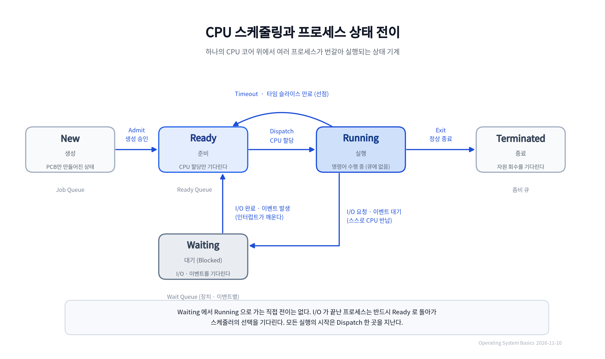

# [OS] CPU 스케줄링과 프로세스 상태 전이

- 작성일: 2026-11-10
- 키워드: Operating System, CPU Scheduler, Process State, Ready Queue, Wait Queue, PCB, Context Switching, Time Slice, Thread Pool

## 1. 핵심 요약 (What & Why)

CPU 코어 하나는 어느 한 순간에 명령어 한 줄씩만 실행합니다. 코어가 8개인 서버에서 프로그램을 수백 개 띄워 두어도 실제로 동시에 계산되는 것은 8개를 넘지 않습니다. 그런데도 우리는 창 수십 개를 띄워 놓고 아무 불편 없이 씁니다. 운영체제가 CPU 시간을 아주 잘게 쪼개어 프로세스들 사이를 빠르게 오가기 때문이고, 이 방식을 시분할(time-sharing)이라고 부릅니다.

CPU 스케줄러는 그 "다음에 누가 CPU를 쓸지"를 정하는 커널의 구성 요소입니다. 이 장치가 필요한 이유는 세 가지로 정리됩니다.

- CPU를 놀리지 않는다. 실행할 수 있는 프로세스가 있는데 코어가 쉬고 있으면 그만큼 손해입니다.
- 한 프로세스가 CPU를 독점하지 못하게 한다. 응답성과 공정성을 지키는 문제입니다.
- 짧은 작업이 오래 기다리지 않게 한다. 평균 대기 시간과 처리량을 결정합니다.

여기에 I/O 이야기가 반드시 붙습니다. 프로세스는 CPU를 쓰는 구간(CPU 버스트)과 입출력을 기다리는 구간(I/O 버스트)을 번갈아 지나갑니다. 실제 프로그램은 CPU 버스트가 짧고 I/O 대기가 긴 경우가 대부분입니다. I/O를 기다리는 동안 CPU를 붙잡고 있으면 코어가 통째로 낭비되므로, 운영체제는 기다려야 하는 프로세스에게 CPU를 반납하게 하고 대기열로 물러나게 합니다. 그 규칙이 상태 전이라는 형태로 구현된 것이 이 문서의 주제입니다.

## 2. 프로세스 상태와 전이 메커니즘 (How it works)

### 2.1 다섯 가지 상태

| 상태 | 의미 | CPU 점유 | 속해 있는 큐 |
| --- | --- | --- | --- |
| New (생성) | PCB는 만들어졌지만 아직 메모리에 적재되지 않은 상태. 승인을 기다린다. | 없음 | 없음 (잡 큐) |
| Ready (준비) | 메모리에 올라왔고 실행에 필요한 것도 다 갖췄다. CPU만 받으면 즉시 실행된다. | 없음 | Ready Queue |
| Running (실행) | CPU를 할당받아 명령어를 수행하고 있다. 코어 하나당 최대 하나. | 있음 | 없음 (current 포인터) |
| Waiting (대기, Blocked) | 디스크·네트워크 같은 I/O나 특정 이벤트를 기다린다. 스스로는 깨어날 수 없다. | 없음 | Wait Queue |
| Terminated (종료) | 실행이 끝났다. 자원을 회수하고 종료 코드를 남긴다. | 없음 | 없음 (좀비 큐) |

Ready와 Waiting은 둘 다 "CPU를 안 쓰고 기다리는" 상태라 헷갈리기 쉽습니다. 차이는 기다리는 대상입니다. Ready는 CPU를 기다리고, Waiting은 CPU가 아니라 바깥 세계(장치, 락, 다른 프로세스)를 기다립니다. Ready는 CPU가 비는 순간 스케줄러가 골라 줄 수 있지만, Waiting은 이벤트가 실제로 도착하기 전까지 아무도 실행시킬 수 없습니다.

### 2.2 상태를 바꾸는 다섯 가지 사건

1. **Admit (New → Ready)**: 장기 스케줄러(잡 스케줄러)가 메모리 여유를 보고 프로세스를 승인해 적재합니다. 이 승인 속도가 메모리에 동시에 올라가 있는 프로세스 수(다중 프로그래밍 정도)를 결정합니다.
2. **Dispatch (Ready → Running)**: 단기 스케줄러(CPU 스케줄러)가 Ready Queue에서 하나를 골라 CPU를 넘깁니다. 커널은 그 프로세스의 PCB에서 레지스터와 프로그램 카운터를 복원하고 실행을 재개합니다.
3. **Timeout / Timer Interrupt (Running → Ready)**: 하드웨어 타이머가 정해 둔 시간(타임 슬라이스)이 지나면 인터럽트를 겁니다. 커널이 개입해 실행 중이던 프로세스의 문맥을 PCB에 저장하고 Ready Queue 뒤로 보냅니다. 이 전이가 가능한 구조를 선점형(preemptive) 스케줄링이라고 합니다.
4. **I/O or Event Wait (Running → Waiting)**: `read()`, `write()`, 네트워크 수신, `sleep()`, 락 획득 실패 같은 상황입니다. 시스템 콜로 커널 모드에 들어가 장치 드라이버에 요청을 넘기고, 프로세스는 스스로 CPU를 반납합니다. 이 지점에서 다른 프로세스가 CPU를 쓰기 시작합니다.
5. **I/O or Event Complete (Waiting → Ready)**: 장치가 일을 마치고 인터럽트를 걸면, 커널이 해당 Wait Queue에서 PCB를 꺼내 Ready Queue에 넣습니다. 프로세스를 깨우는 것은 프로세스 자신이 아니라 커널과 인터럽트입니다.
6. **Exit (Running → Terminated)**: `exit()` 시스템 콜로 실행을 끝냅니다. 부모가 `wait()`로 거두어 갈 때까지 좀비 상태로 남는 경우가 있습니다.

여기서 꼭 기억할 규칙이 하나 있습니다. **Waiting에서 Running으로 직접 가는 전이는 없습니다.** I/O가 끝난 프로세스는 반드시 Ready로 돌아가 스케줄러의 선택을 기다립니다. I/O를 마친 순간 바로 CPU를 쥐여 주면, 방금 CPU를 쓰고 있던 프로세스가 준비도 없이 쫓겨나고 스케줄링 정책도 무시되기 때문입니다. 모든 실행 시작은 Dispatch 한 곳을 지나게 만드는 것이 상태 기계의 핵심입니다.

### 2.3 전이를 기록하고 줄 세우는 곳: PCB와 큐

상태 전이는 눈에 보이지 않습니다. 실제로는 커널 메모리 안의 자료구조를 고치는 일입니다.

- **PCB (Process Control Block)**: 프로세스마다 하나씩 있는 커널의 관리 대장입니다. PID, 상태 필드, 프로그램 카운터, 레지스터 값, 스택 포인터, 메모리 영역 정보, 열린 파일 목록, 스케줄링 우선순위가 들어 있습니다. 상태 전이는 곧 이 `state` 필드를 고치고 해당 PCB를 다른 큐로 옮기는 작업입니다.
- **Ready Queue**: 실행 대기 중인 PCB들의 집합입니다. 반드시 FIFO인 것은 아닙니다. 라운드 로빈은 도착 순서대로 꺼내면 되지만, 우선순위 스케줄링은 힙이나 레드-블랙 트리처럼 가장 급한 것을 빠르게 꺼낼 수 있는 구조를 씁니다. "큐"라는 이름보다 "스케줄러가 고르는 자료구조"로 이해하는 편이 정확합니다.
- **Wait Queue**: 장치나 이벤트마다 따로 존재합니다. 디스크 컨트롤러별, 소켓별, 세마포어별로 각각의 대기 목록이 있고, 인터럽트가 발생하면 해당 목록에서만 프로세스를 꺼냅니다.
- **실행 중인 프로세스는 큐에 없습니다.** Ready Queue에서 빠져나와 CPU 위에 올라가 있는 상태이고, 커널은 `current` 같은 포인터로만 가리킵니다. "Running 상태의 프로세스도 Ready Queue에 있다"고 착각하면 스케줄링 동작을 잘못 이해하게 됩니다.
- **문맥 교환(Context Switch)**: Running이 다른 상태로 빠질 때 커널은 레지스터와 PC를 PCB에 저장하고, 다음 프로세스의 PCB에서 값을 복원합니다. 이 저장·복원 자체는 계산이 아니라 순수한 오버헤드입니다. 그래서 전이가 잦을수록 CPU가 실제 일을 하는 비율이 떨어집니다.

### 2.4 어떤 정책이 이 전이를 만드는가

Dispatch와 Timeout이 얼마나 자주 일어나는지를 정하는 것이 스케줄링 정책입니다. 대표적인 다섯 가지만 짚습니다.

| 정책 | 동작 | 장점 | 한계 |
| --- | --- | --- | --- |
| FCFS (선입선출) | 도착한 순서대로 실행 | 구현이 단순하고 공정해 보인다 | 긴 작업 하나가 뒤를 전부 막는 호위 효과(convoy effect) |
| SJF / SRTF | 남은 실행 시간이 짧은 것 먼저 | 평균 대기 시간이 이론적으로 최소 | 실행 시간을 미리 알 수 없다, 긴 작업이 굶는다 |
| Round Robin | 타임 슬라이스만큼 돌아가며 실행 | 응답 시간이 균일하다 | 슬라이스가 짧으면 문맥 교환 비용이 커진다 |
| Priority | 우선순위가 높은 것 먼저 | 중요한 작업을 먼저 처리 | 낮은 우선순위가 무한정 밀린다(에이징으로 완화) |
| MLFQ (다단계 피드백 큐) | 짧게 끝내는 프로세스는 높은 큐, CPU를 오래 쓰면 낮은 큐로 강등 | 대화형 응답성과 처리량을 함께 노린다 | 우선순위 조작과 튜닝이 어렵다 |

리눅스는 오랫동안 CFS(Completely Fair Scheduler)를 썼습니다. 고정 타임 슬라이스를 나눠 주는 대신 `vruntime`(가중치로 보정한 실행 시간)이 가장 작은 프로세스를 고르고, 목표 지연 안에서 실행 시간을 비율로 나눕니다. 6.6 커널부터는 EEVDF가 그 자리를 이어받았습니다.

재미있는 점은 리눅스 커널의 태스크 상태 필드가 `TASK_RUNNING` 하나로 "지금 CPU에서 실행 중"과 "실행 가능하지만 차례를 기다림"을 함께 표현한다는 것입니다. Ready와 Running의 구분은 runqueue에 들어 있는지 여부로 판단합니다. 교과서의 5상태 모델은 이해를 위한 추상화이고, 실제 구현은 필요에 따라 더 뭉쳐 있거나 더 잘게 나뉘어 있다는 뜻입니다.

## 3. 구조 도식 (Diagram)

- 가운데 아래의 Waiting은 Ready와만 연결됩니다. I/O가 끝나면 Ready로 돌아가고, 다시 Dispatch를 거쳐야 Running이 됩니다.
- Running에서 나가는 화살표는 세 갈래입니다. Timeout이면 Ready, I/O 요청이면 Waiting, Exit면 Terminated입니다.
- 각 상태의 아래에 그 상태가 머무는 큐를 적어 두었습니다. Running만 큐에 없습니다.

## 4. 비교 표

### 4.1 Ready vs Running vs Waiting

| 비교 항목 | Ready | Running | Waiting |
| --- | --- | --- | --- |
| CPU 점유 | 하지 않음 | 함 | 하지 않음 |
| 메모리 적재 | 되어 있음 | 되어 있음 | 되어 있음 (스왑 아웃되면 Suspended) |
| 전이 계기 | Dispatch(할당), I/O 완료, Timeout | Timeout, I/O 요청, Exit | I/O 완료, 이벤트 발생 |
| 주 대기 큐 | Ready Queue | 없음 (current) | Wait Queue (장치·이벤트별) |
| 스스로 벗어날 수 있는가 | 아님. 스케줄러가 골라야 한다 | 가능. 스스로 I/O를 요청하거나 종료한다 | 아님. 커널이 깨워야 한다 |
| 늘리는 원인 | Dispatch 대기, 선점된 작업 | 코어 수 한계 | 느린 I/O, 락 경합, 커넥션 대기 |

### 4.2 선점형 vs 비선점형 스케줄링

| 비교 항목 | 선점형 (Preemptive) | 비선점형 (Non-preemptive) |
| --- | --- | --- |
| Running → Ready 전이 | 가능 (타이머 인터럽트로 회수) | 불가능 (스스로 반납할 때까지 유지) |
| 대표 정책 | Round Robin, SRTF, MLFQ, 리눅스 CFS/EEVDF | FCFS, SJF, 대부분의 배치 처리 |
| 장점 | 응답 시간이 균일하고 긴 작업이 CPU를 독점하지 못한다 | 문맥 교환이 적고 락 관리가 단순하다 |
| 단점 | 문맥 교환 비용, 공유 데이터 경합, 커널 설계 복잡도 | 한 작업이 오래 걸리면 전체 응답이 멈춘다 |
| 적합한 상황 | 대화형 서비스, 웹 서버, 모바일 | 배치 연산, 실시간 제약이 강한 임베디드 |

## 5. 깨달은 점 (My Insight)

- 프로세스가 I/O를 기다릴 때 CPU를 쥔 채 멍하니 기다리는 것이 아니라, 스스로 Waiting으로 빠져 CPU를 다른 프로세스에 양보한다는 점이 멀티태스킹 효율의 본질이었습니다. "동시에 실행된다"는 착각은 병렬성이라기보다 **대기 시간을 서로 겹쳐 쓰는 것**에 가깝습니다. 코어 수를 늘리지 않고도 체감 성능이 오르는 이유가 여기에 있습니다.
- 톰캣의 기본 스레드 풀이 200인데 서버 CPU 코어는 8개 남짓이라는 사실이 이상하게 느껴졌는데, 상태 모델을 알고 나니 자연스럽습니다. 웹 요청 스레드는 대부분의 시간을 DB 쿼리 응답이나 외부 API 응답을 기다리며 Waiting으로 보냅니다. 그동안 CPU는 다른 스레드를 실행합니다. 스레드 수를 코어 수에 맞추면 CPU가 놀게 되므로, 대기 시간을 덮을 만큼 넉넉히 잡는 것입니다.
- 반대로 순수 CPU 연산 작업에서 스레드를 무작정 늘리면 Ready Queue에 줄만 길어집니다. 코어는 여전히 8개인데 실행 대기자가 100개면, 문맥 교환과 캐시 오염만 늘고 처리량은 오히려 떨어집니다. 같은 "스레드 수"라도 작업이 I/O 바운드인지 CPU 바운드인지에 따라 최적값이 정반대가 됩니다.
- 상태 전이를 알면 스레드 덤프가 읽힙니다. `WAITING`, `TIMED_WAITING`으로 표시된 스레드는 CPU를 쓰지 않고 무언가를 기다리는 중이고, `RUNNABLE`이 잔뜩 쌓여 있다면 CPU를 기다리는 쪽이 병목입니다. 다만 Java의 `Thread.State`는 OS 상태와 1:1로 대응하지 않습니다. `RUNNABLE`은 실행 중과 실행 대기를 모두 포함하고, 소켓 읽기처럼 네이티브에서 블로킹된 상태도 `RUNNABLE`로 보일 수 있습니다. 그래서 덤프만으로는 "CPU를 쓰는 중"과 "CPU를 기다리는 중"을 구분하기 어렵고, CPU 사용률 지표를 함께 봐야 합니다.

## 6. 실무 관점 및 트레이드오프 (Trade-off)

스레드 풀 크기는 이 상태 모델의 실무적인 결론입니다. 기준은 두 가지입니다.

- 대기 시간 비율로 계산하기: `스레드 수 = 코어 수 × (1 + 대기 시간 / 계산 시간)`. 계산 시간 10ms, 대기 시간 40ms라면 코어 8개 기준으로 8 × 5 = 40개가 이론값입니다.
- 리틀의 법칙으로 검산하기: `동시 처리 수 = 초당 요청 수 × 평균 처리 시간`. 초당 1,000건, 평균 50ms라면 동시에 처리 중인 요청은 50건입니다. 이보다 스레드가 적으면 요청이 큐에서 기다립니다.

주의할 점은 스레드 풀이 유일한 병목이 아니라는 것입니다. 톰캣 스레드가 200개여도 HikariCP의 기본 풀 크기는 10개입니다. DB를 쓰는 요청 200개가 동시에 들어오면 10개만 커넥션을 잡고 나머지 190개는 커넥션을 기다리며 Waiting에 머뭅니다. 결국 전체 처리량은 가장 좁은 자원이 결정합니다. 톰캣 스레드를 늘리면 늘릴수록 커넥션 대기 줄만 길어지고, 타임아웃과 메모리 사용량이 함께 늘어납니다.

타임 슬라이스도 트레이드오프입니다. 슬라이스를 짧게 잡으면 응답성이 좋아지지만 문맥 교환과 캐시 무효화가 잦아져 처리량이 떨어집니다. 길게 잡으면 그 반대입니다. 서버에서는 처리량이, 대화형 서비스에서는 응답 시간이 우선이므로 같은 값을 쓸 이유가 없습니다.

> [!NOTE]
> JDK 21의 가상 스레드(JEP 444)는 이 구조를 바꾸는 시도입니다. 블로킹 I/O를 만나면 가상 스레드가 캐리어 스레드(플랫폼 스레드)를 양보하고 힙에 스택을 보관합니다. OS 입장에서는 스레드 수가 코어 수 근처로 유지되므로 문맥 교환 비용이 줄고, 애플리케이션 코드는 요청마다 스레드를 하나씩 만들어도 될 만큼 값싸집니다. 다만 `synchronized`나 JNI 안에서 블로킹되면 캐리어 스레드를 놓지 못하는 핀(pinning) 현상이 생기고, DB 커넥션 풀처럼 하위 자원의 한계는 그대로 남습니다.

> [!WARNING]
> "느리니까 스레드를 늘린다"는 대응은 대개 역효과입니다. 스레드는 기본 1MB 안팎의 스택을 예약하고, 늘어난 스레드는 Ready Queue에서 CPU를 기다리거나 커넥션을 기다립니다. 먼저 어느 상태에서 시간을 쓰는지(CPU 대기인지, I/O 대기인지, 락 대기인지)를 확인하고, 그 지점을 줄이는 쪽이 맞습니다. 대기 원인이 외부 API라면 타임아웃과 서킷 브레이커가, DB라면 쿼리와 인덱스가, 락 경합이라면 임계 영역 축소가 먼저입니다.

## 7. 참고 자료 (References)

- Abraham Silberschatz, Operating System Concepts - 프로세스 개념(3장), CPU 스케줄링(5장)
- Remzi H. Arpaci-Dusseau, Operating Systems: Three Easy Pieces - Scheduling: Introduction, Multi-level Feedback Queue
- Linux man page: `sched(7)`, `sched_setscheduler(2)`, `sched_yield(2)`
- Linux 커널 문서: Completely Fair Scheduler, EEVDF 스케줄러
- Java SE API 문서: `java.lang.Thread.State`
- Apache Tomcat 문서: HTTP Connector의 `maxThreads`, `acceptCount`
- HikariCP 문서: `maximumPoolSize`와 풀 크기 산정
- Brian Goetz 외, Java Concurrency in Practice - 스레드 풀 크기 산정(8.2절)
