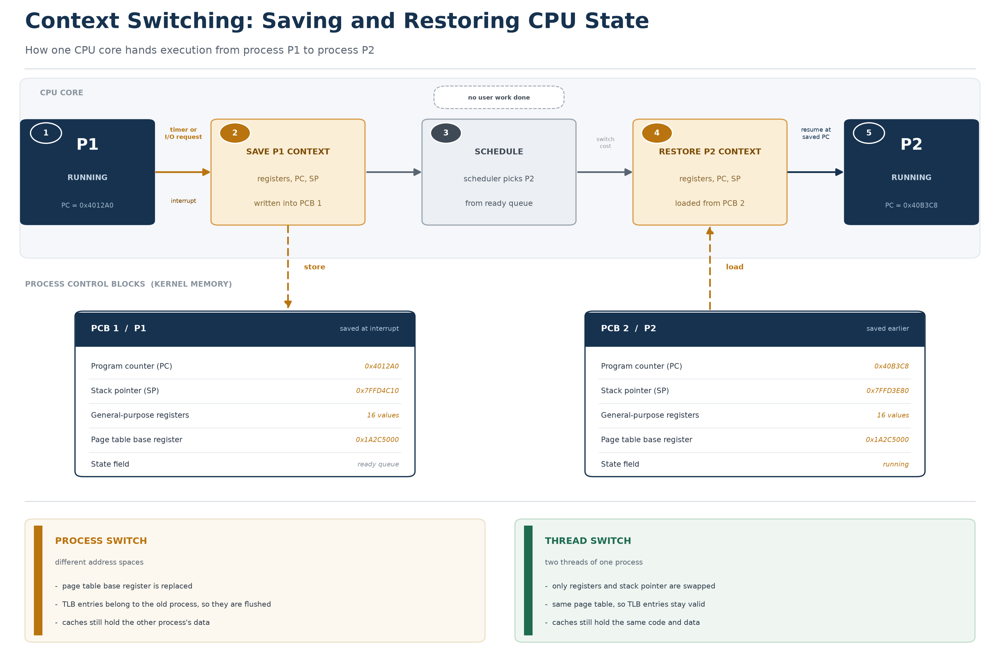

# [OS] 컨텍스트 스위칭 메커니즘과 상태 저장/복원

- 작성일: 2026-11-11
- 키워드: Operating System, Context Switching, PCB, TCB, Program Counter, Stack Pointer, Page Table Base Register, TLB, Cache Pollution, Thrashing, Virtual Thread

## 1. 핵심 요약 (What & Why)

CPU 코어 하나는 어느 한 순간에 명령어 흐름 하나만 실행합니다. 그런데 실행 중인 프로세스는 코어보다 훨씬 많고, 그중 상당수는 CPU를 쓰지 못한 채 I/O를 기다리고 있습니다. 운영체제는 이 간극을 메우기 위해 CPU를 아주 짧은 단위로 쪼개 여러 프로세스에 번갈아 넘깁니다. 시분할(time-sharing) 멀티태스킹이고, 그 "넘기는" 동작 자체의 이름이 **컨텍스트 스위칭(context switching)** 입니다.

정의를 조금 더 정확히 쓰면 이렇습니다. **지금 실행 중인 실행 단위의 실행 문맥(context)을 저장하고, 다음에 실행할 단위의 문맥을 복원해서 CPU를 넘기는 커널의 절차.** 여기서 문맥은 "CPU가 다음 명령을 실행하려면 반드시 알고 있어야 하는 상태 전부"입니다. 다음 명령의 주소, 스택의 위치, 계산에 쓰던 레지스터 값, 그리고 그 주소가 어느 주소 공간에 속하는지까지 포함됩니다.

왜 필요한지는 세 가지로 정리됩니다.

- **코어 수보다 많은 실행 단위를 동시에 살려 두기 위해서.** 8코어 서버에 프로세스를 수백 개 띄워도 각자는 자기 진행 상태를 잃지 않고 이어서 실행됩니다. 그 상태를 어딘가에 저장하고 다시 불러오는 장치가 없으면 불가능합니다.
- **기다리는 동안 CPU를 놀리지 않기 위해서.** I/O 요청을 보낸 프로세스는 수 밀리초 동안 아무 계산도 하지 않습니다. 그 시간에 다른 프로세스가 CPU를 쓰게 하려면 CPU를 회수해 넘겨야 합니다.
- **공정성과 응답성을 지키기 위해서.** 한 프로세스가 CPU를 독점하면 대화형 서비스의 응답 시간이 무너집니다. 타이머로 강제 회수하는 것이 선점형 스케줄링의 바탕이고, 회수의 실체가 컨텍스트 스위칭입니다.

중요한 성질이 하나 있습니다. 컨텍스트 스위칭은 **사용자 프로그램의 계산을 진전시키지 않습니다.** 저장하고 복원하는 일은 다음 계산을 이어 붙이기 위한 준비 작업이며, 그 자체로는 순수한 오버헤드입니다. 그래서 "얼마나 자주, 얼마나 싸게 하는가"가 곧 시스템 성능의 문제가 됩니다.

### 발생 조건

| 계기 | 설명 | 전이 |
| --- | --- | --- |
| 타임 슬라이스 만료 | 하드웨어 타이머가 정해 둔 시간이 지나 인터럽트를 건다. 선점형 스케줄링의 기본 장치다. | Running → Ready |
| I/O 요청, 이벤트 대기 | `read()`, `write()`, 네트워크 수신, `sleep()`, 락 획득 실패 등으로 스스로 CPU를 반납한다. | Running → Waiting |
| 하드웨어 인터럽트 | 디스크 완료, 네트워크 패킷 도착 등. 인터럽트 처리 후 스케줄러가 더 급한 태스크를 고를 수 있다. | 간접적 계기 |
| 소프트웨어 인터럽트, 시스템 콜 | 시스템 콜 처리 중 블로킹이 확인되거나, 커널이 선점 지점(preemption point)에서 스케줄을 결정한다. | 경우에 따라 |
| 우선순위 역전, 깨어난 상위 태스크 | 대기하던 높은 우선순위 태스크가 준비 상태가 되면 현재 태스크를 밀어낼 수 있다. | Running → Ready |
| 종료 | `exit()`으로 실행이 끝나면 다음 태스크를 골라야 한다. | Running → Terminated |

인터럽트가 **항상** 스위칭을 부르는 것은 아닙니다. 인터럽트는 커널이 개입할 기회를 만들 뿐이고, 실제로 다른 태스크로 넘길지는 스케줄러가 판단합니다. 반대로 인터럽트 없이도 시스템 콜 안에서 스스로 스케줄러를 호출하는 경로가 있습니다.

## 2. 내부 메커니즘과 상태 저장/복원 흐름 (How it works)

### 2.1 문맥(context)은 무엇으로 구성되는가

"레지스터를 저장한다"는 말로는 부족합니다. CPU가 이어서 실행하는 데 필요한 것은 크게 세 층입니다.

- **실행 위치**: 프로그램 카운터(PC, x86에서는 RIP). 다음에 실행할 명령어의 주소입니다.
- **작업 공간**: 스택 포인터(SP, x86에서는 RSP), 범용 레지스터, 상태 플래그, 부동소수점·SIMD 레지스터(XMM/YMM/ZMM). 함수 호출 규약상 살아 있어야 하는 값들이 여기에 담깁니다.
- **주소 공간**: 페이지 테이블 베이스 레지스터. x86-64에서는 CR3, ARM에서는 TTBR0/TTBR1입니다. 이 값이 바뀌면 같은 가상 주소가 가리키는 물리 메모리가 통째로 달라집니다.

여기에 커널이 관리하는 소프트웨어 상태가 붙습니다. 열린 파일 디스크립터, 시그널 처리 정보, 스케줄링 우선순위, 회계 정보 같은 것들입니다.

### 2.2 저장되는 곳: PCB와 TCB

문맥이 저장되는 장소는 사용자 메모리가 아니라 **커널 메모리**입니다.

- **PCB (Process Control Block)**: 프로세스마다 하나씩 있는 커널의 관리 구조체입니다. 리눅스에서는 `task_struct`이고, slab 캐시로 할당됩니다. 사용자 힙이나 스택이 아닙니다.
- **TCB (Thread Control Block)**: 스레드마다 하나씩 있는 구조체입니다. 스레드 ID, 레지스터, 스택 포인터, 스케줄링 상태가 들어 있습니다.

왜 커널 메모리여야 하는가. 첫째, 사용자 공간은 프로세스가 마음대로 덮어쓸 수 있는 곳이라 실행 상태를 맡길 수 없습니다. 둘째, 스위칭을 수행하는 코드 자체가 커널 모드에서 돌기 때문에 그 코드가 믿고 접근할 수 있는 영역이어야 합니다. 셋째, 문맥에는 페이지 테이블 주소처럼 사용자 코드가 알면 안 되는(또는 알아도 손댈 수 없어야 하는) 값이 들어갑니다.

리눅스 구현에서 눈여겨볼 점은 **커널 스택**입니다. 각 태스크는 커널 모드에서 쓸 전용 스택을 하나씩 가지고 있고, 태스크 구조체가 그 스택과 함께 관리됩니다. 시스템 콜이나 인터럽트로 커널에 진입하면 사용자 스택에서 커널 스택으로 갈아타는데, 이때 사용자 스택 포인터가 커널 스택 어딘가에 저장됩니다. 즉 **스위칭에 필요한 정보의 상당 부분이 이미 커널 스택에 쌓여 있고**, PCB는 그 스택의 위치를 가리키는 역할을 겸합니다.

### 2.3 다섯 단계 흐름

1. **P1이 실행 중이다.** 사용자 모드에서 명령어를 하나씩 처리하고 있고, PC는 다음 명령을 가리킵니다.
2. **계기가 발생한다.** 타이머 인터럽트가 오거나, P1이 시스템 콜로 커널에 들어와 I/O를 요청합니다. CPU는 커널 모드로 전환하고 커널 스택으로 옮겨 갑니다.
3. **P1의 문맥을 저장한다.** 지금 CPU에 들어 있는 레지스터 값과 복귀 지점을 P1의 커널 스택/PCB에 기록합니다. 이 시점에 P1의 상태는 "다음에 CPU를 받으면 정확히 이 지점부터 이어서 실행"이 됩니다.
4. **스케줄러가 P2를 고른다.** 준비 큐에서 다음 태스크를 선택합니다. 이 구간에서도 CPU는 커널 코드를 실행하고 있지만, **사용자 프로그램의 명령은 한 줄도 처리되지 않습니다.** 처리량 관점에서는 손실입니다.
5. **P2의 문맥을 복원한다.** P2의 PCB(정확히는 커널 스택)에서 레지스터와 SP를 꺼내 CPU에 넣고, 주소 공간이 다르면 페이지 테이블 베이스 레지스터를 교체합니다. 마지막으로 복귀 주소를 PC에 넣으면 P2가 예전에 멈춘 지점부터 실행을 재개합니다.

여기서 자주 생기는 오해를 정리해 둡니다.

- **"스위칭 중에는 CPU가 논다"는 정확하지 않습니다.** CPU는 스케줄러와 저장·복원 코드를 열심히 실행합니다. 정확한 표현은 **"사용자 작업이 진전되지 않는다"** 입니다. 그래서 이 구간의 시간은 `us`(사용자)가 아니라 `sy`(시스템)로 집계됩니다.
- **스위칭은 커널 안에서 일어납니다.** 사용자 코드가 직접 다른 프로세스로 넘어갈 수는 없습니다. 반드시 커널 모드를 거칩니다.
- **커널 스레드로 넘어가는 경우 주소 공간을 바꾸지 않습니다.** 페이지 테이블은 그대로 두고 레지스터만 갈아 끼웁니다. 리눅스에서 "프로세스 스위칭"은 결국 **커널 태스크 스위칭 + 주소 공간 교체** 로 분해됩니다.

### 2.4 실제로 무엇을 저장하는가

리눅스의 스위칭 경로는 `schedule()` → `context_switch()` → `switch_to()` 로 이어지고, 가장 아래층은 아키텍처별 어셈블리입니다. 이 코드가 저장하는 것은 **callee-saved 레지스터**(x86-64라면 RBX, RBP, R12~R15)와 스택 포인터, 그리고 복귀 주소입니다.

caller-saved 레지스터는 왜 저장하지 않는가. 함수 호출 규약상 호출하는 쪽이 필요하면 미리 스택에 넣어 두기 때문입니다. 스위칭 코드도 결국 함수 호출의 연장이므로, **문맥 저장은 "함수 호출 규약을 만족시키는 최소 집합"만 하면 됩니다.** 이 사실은 스위칭의 직접 비용이 왜 생각보다 작은지를 설명합니다. 저장해야 할 레지스터가 수십 개가 아니라 몇 개입니다.

부동소수점·SIMD 상태는 별개입니다. 초기 x86에서는 CR0.TS 플래그를 세워 두고 실제로 FPU를 쓰는 순간 트랩을 걸어 게으르게 저장(lazy)했습니다. 지금은 XSAVE 계열 명령으로 문맥 전환 시점에 함께 저장하는 방식이 기본입니다. 저장할 양이 많아 AVX-512 같은 넓은 레지스터를 쓰는 프로그램에서는 이 저장 비용이 무시할 수 없습니다.

### 2.5 프로세스 스위칭과 스레드 스위칭의 차이

여기가 이 문서의 핵심입니다. 두 스위칭은 **저장하는 절차는 거의 같고, 주소 공간을 건드리느냐가 다릅니다.**

**프로세스 스위칭**은 페이지 테이블 베이스 레지스터를 교체합니다. 그 순간 CPU 안의 주소 변환 캐시인 TLB(Translation Lookaside Buffer)에 들어 있던 항목들은 전부 다른 주소 공간의 것이 되어 쓸모없어집니다. 고전적으로는 여기서 TLB 전체를 비웠습니다. TLB는 64~수천 개 항목짜리 작은 캐시라서, 비우고 나면 이후의 모든 메모리 접근이 페이지 테이블을 몇 단계씩 걸어 올라가는 페이지 워크(page walk)를 동반합니다.

**스레드 스위칭**은 같은 프로세스 안의 두 스레드 사이에서 일어나므로 주소 공간이 같습니다. 페이지 테이블을 바꿀 이유가 없고 TLB도 그대로 유효합니다. 바뀌는 것은 레지스터 집합과 스택 포인터(즉 어느 스택을 쓰는지)뿐입니다.

현대 CPU는 이 비용을 더 줄였습니다. x86의 PCID(Process Context ID), ARM의 ASID는 TLB 항목에 주소 공간 식별자를 태그로 붙여, 문맥이 바뀌어도 다른 공간의 항목을 남겨 둘 수 있게 합니다. 리눅스도 PCID를 적극적으로 쓰고, 커널 스레드로 넘어갈 때는 이전 프로세스의 주소 공간을 lazy TLB 상태로 남겨 불필요한 교체를 피합니다. 다만 이것은 **비용을 줄이는 최적화이지 차이를 없애는 것은 아닙니다.** 주소 공간이 다르면 TLB 미스율과 캐시 재사용률에서 여전히 손해를 봅니다.

## 3. 구조 도식 (Diagram)

- 위쪽 띠가 CPU 코어에서 시간 순서대로 일어나는 일입니다. P1 실행 → 저장 → 스케줄 → 복원 → P2 실행.
- 가운데 회색 상자(스케줄)가 "사용자 작업 없이 지나가는 구간"입니다. 이 구간의 길이가 스케줄링 오버헤드입니다.
- 아래 두 상자는 저장 장소인 PCB를 펼쳐 본 것입니다. 같은 항목 구성이 프로세스마다 하나씩 존재하고, 값만 다릅니다. 두 PCB의 페이지 테이블 베이스 값이 같다면 그 둘은 같은 주소 공간을 쓰는 스레드입니다.
- 맨 아래 두 패널이 프로세스 스위칭과 스레드 스위칭의 차이입니다. 갈리는 지점은 페이지 테이블 교체 여부 하나이고, TLB와 캐시의 운명이 여기서 결정됩니다.

## 4. 비교 표

### 4.1 프로세스 컨텍스트 스위칭 vs 스레드 컨텍스트 스위칭

| 비교 항목 | 프로세스 스위칭 | 스레드 스위칭 |
| --- | --- | --- |
| 저장 단위 | PCB | TCB (리눅스에서는 태스크 구조체 하나) |
| 교체되는 자원 | 레지스터 집합, 스택 포인터, 커널 스택 + **주소 공간** | 레지스터 집합, 스택 포인터(사용자·커널) |
| 공유하는 것 | 없음 (코드·데이터·힙 모두 별도) | 코드, 데이터, 힙, 열린 파일, 페이지 테이블 |
| 페이지 테이블 | 교체 필요 (CR3/TTBR 갱신) | 교체 없음 |
| TLB 영향 | 원칙적으로 무효화. PCID/ASID로 완화하지만 미스율은 상승 | 그대로 유효. 영향 없음 |
| 캐시 영향 | 새 주소 공간의 데이터를 다시 채워야 함 (콜드 스타트) | 같은 코드·데이터를 계속 쓰므로 캐시가 데워져 있음 |
| 상대적 비용 | 큼 | 작음 (직접 비용은 거의 비슷하고, 간접 비용이 갈린다) |
| 대표적 발생 원인 | 프로세스 간 시분할, 셸 명령 실행, 다른 서비스로의 전환 | 같은 애플리케이션 안의 요청 처리 스레드 교체, 워커 풀 |

### 4.2 오버헤드는 어디에 쓰이는가

| 구분 | 내용 | 특징 |
| --- | --- | --- |
| 직접 비용 | 레지스터 저장·복원, 스택 전환, 주소 공간 교체 명령, 스케줄러의 다음 태스크 선택 | 코드상으로 명확하고 짧다. 마이크로초 단위 |
| 간접 비용: TLB | 무효화 후 페이지 워크 증가. 페이지 테이블 단계마다 메모리 접근이 붙는다 | 주소 공간이 바뀔 때만 |
| 간접 비용: 캐시 | L1/L2/L3에 남은 상대의 데이터가 밀려나고, 새 데이터를 메모리에서 끌어와야 한다 | 스위칭이 잦을수록 누적 |
| 간접 비용: 프런트엔드 | 분기 예측기, 명령어 캐시, 프리페처 상태가 다른 코드에 맞춰져 있어 예측 실패가 늘어난다 | 측정이 어렵지만 체감이 크다 |

직접 비용과 간접 비용의 크기 차이가 이 주제의 핵심입니다. lmbench 같은 도구로 재면 같은 코어 안에서의 스위칭 직접 비용은 대략 마이크로초 단위(1~3 마이크로초 수준)로 보고됩니다. 반면 캐시와 TLB가 식은 뒤 원래 성능으로 돌아오는 데는 그보다 훨씬 긴 시간이 걸립니다. 기기와 커널 설정에 따라 값이 크게 달라지므로 **절대값을 외우기보다 "직접 비용은 작고 간접 비용이 크다"는 구조를 기억하는 편이 낫습니다.**

## 5. 깨달은 점 (My Insight)

- **스레드를 늘려도 처리량이 무한정 늘지 않는 이유는 결국 코어 수와 간접 비용입니다.** 코어가 8개인데 실행 가능한 스레드가 100개면, 코어는 여전히 8개입니다. 스레드를 늘리면 준비 큐가 길어지고 스위칭이 잦아지는데, 스위칭은 처리량을 늘리지 않으면서 캐시와 TLB를 계속 식힙니다. 어느 지점을 넘으면 늘린 스레드가 만든 일이 늘린 스레드가 하는 일보다 커집니다.
- **진짜 병목은 레지스터 복사가 아니라 캐시 오염(cache pollution)입니다.** P1이 열심히 계산하며 L1·L2를 자기 데이터로 채워 둔 상태에서 P2로 넘어가면, P2의 첫 명령부터 캐시 미스입니다. L1 히트가 몇 사이클인데 DRAM까지 내려가면 수백 사이클이 걸립니다. 게다가 P2가 캐시를 채우는 동안 P1의 데이터는 밀려나므로, 다시 P1으로 돌아왔을 때도 콜드 스타트입니다. **스위칭이 잦다는 것은 같은 코드를 매번 처음 실행하는 것과 비슷합니다.**
- **TLB도 같은 원리로 손해를 봅니다.** 주소 변환은 모든 메모리 접근의 앞단에 붙는 관문입니다. TLB가 비면 접근마다 페이지 테이블을 단계별로 읽어야 하고, 그 페이지 테이블조차 캐시에서 밀려나 있으면 지연이 겹칩니다. PCID가 이 비용을 줄여 주지만 "미스가 안 난다"는 뜻은 아닙니다.
- **스래싱(thrashing)의 본질은 "준비가 일보다 비싸진 상태"입니다.** 메모리 스래싱은 페이지 폴트와 스왑이 실제 계산을 압도하는 상태이고, 컨텍스트 스위칭 스래싱은 저장·복원과 캐시 재적재가 실제 작업을 압도하는 상태입니다. 이름은 같지만 현상은 다르고, 구조는 같습니다. 어느 쪽이든 임계점을 넘으면 처리량이 완만히 줄지 않고 급격히 무너집니다(절벽처럼 떨어집니다).
- **스케줄러는 이 붕괴를 막으려고 일부러 스위칭을 줄입니다.** 리눅스 CFS 계열은 태스크가 아주 많아져도 한 번에 실행하는 최소 시간(granularity)을 지키도록 스케줄 지연을 조정합니다. 응답성을 조금 포기하고 스위칭 빈도를 억제하는 쪽을 택한 것입니다. 스위칭이 무조건 많을수록 좋은 것이 아니라는 것을 커널 스스로도 전제하고 있습니다.
- **지난 문서(CPU 스케줄링)에서 본 상태 전이가 여기서 물리적 동작으로 이어집니다.** Ready → Running 전이의 실체가 바로 이 저장·복원이고, Running → Waiting 전이가 "다른 프로세스에게 CPU를 넘기는 계기"였습니다. 상태 기계는 관념이고, 컨텍스트 스위칭은 그 관념이 실제로 값을 옮기는 장면입니다.

## 6. 실무 관점 및 트레이드오프 (Trade-off)

### 6.1 톰캣 스레드 풀은 왜 코어 수보다 큰가

톰캣의 기본 `maxThreads`는 200입니다. 코어 수가 8~16인 서버에서 이 값이 이상해 보이지만, 요청 처리 스레드는 대부분의 시간을 DB 응답이나 외부 API 응답을 기다리며 Waiting으로 보냅니다. 그 사이 CPU는 다른 스레드를 실행하므로, 스레드 수를 코어 수에 맞추면 오히려 CPU가 놉니다.

기준은 두 가지로 잡습니다.

- 대기 비율로 계산: `스레드 수 = 코어 수 × (1 + 대기 시간 / 계산 시간)`
- 리틀의 법칙으로 검산: `동시 처리 수 = 초당 요청 수 x 평균 처리 시간`

다만 스레드를 늘리는 것이 항상 답은 아닙니다. 스레드가 늘면 준비 큐와 스위칭이 늘고, 각 스레드의 스택 메모리도 늘어납니다. 그리고 하위 자원이 더 좁으면(커넥션 풀 등) 그 앞에서 줄만 길어집니다. 스레드 수 조정은 **가장 좁은 자원을 확인한 다음**의 일입니다.

### 6.2 스위칭을 아예 줄이려는 시도: 이벤트 루프

Node.js와 Netty는 다른 방향을 택했습니다. 스레드를 여러 개 두고 커널이 번갈아 실행하게 하는 대신, **스레드 하나(또는 코어 수만큼)가 논블로킹 I/O를 걸어 두고 준비된 작업만 처리**합니다. 처리할 일이 없으면 스레드가 커널에 대기 상태로 들어가고, I/O가 완료되면 깨어나 콜백을 실행합니다. 스위칭이 일어나더라도 애플리케이션 수준의 문맥 전환이 아니라 이벤트 루프 안의 함수 호출이라 훨씬 쌉니다.

대가는 규율입니다. 이벤트 루프를 오래 붙잡는 코드(무거운 연산, 블로킹 호출)가 하나 들어가면 그 뒤의 모든 요청이 멈춥니다. Node.js가 CPU 연산을 `worker_threads`나 별도 프로세스로 밀어내고, Netty가 이벤트 루프에서 블로킹하지 말라고 강조하는 이유입니다.

> [!NOTE]
> JDK 21의 가상 스레드(JEP 444)는 "스레드는 많이, 스위칭은 싸게"를 노린 제3의 접근입니다. 가상 스레드는 OS 스레드가 아니라 JVM이 관리하는 사용자 영역의 실행 단위입니다. 블로킹 I/O를 만나면 캐리어 스레드(플랫폼 스레드)에서 스스로 내려와(unmount) 힙에 스택을 보관하고, 다른 가상 스레드가 같은 캐리어를 씁니다. OS 입장에서 실행 중인 스레드 수는 코어 수 근처로 유지되므로 커널 수준 스위칭과 캐시 오염이 줄고, 애플리케이션은 요청마다 스레드를 하나씩 만들어도 될 만큼 값싸집니다. 다만 `synchronized` 블록이나 JNI 안에서 블로킹되면 캐리어를 놓지 못하는 핀(pinning) 현상이 있었고(이후 JDK에서 개선), DB 커넥션 풀처럼 하위 자원의 한계는 그대로 남습니다. **가상 스레드가 없애는 것은 스위칭 비용이지 동시성 자원의 한계가 아닙니다.**

> [!WARNING]
> "스레드 수를 늘렸더니 처리량이 늘었다"는 관찰은 그 지점이 아직 한계 아래라는 뜻일 뿐입니다. 컨텍스트 스위칭 수치(`vmstat`의 `cs`)만 보고 "스위칭이 많으니 문제"라고 단정하는 것도 위험합니다. 스위칭이 많은데 CPU 사용률이 낮다면 진짜 원인은 대개 락 경합, 커넥션 대기, 느린 외부 호출입니다. **먼저 스레드가 어디서 시간을 보내는지(실행 중인지, CPU를 기다리는지, I/O를 기다리는지)를 확인하고, 그 다음에 스위칭을 줄이는 방향으로 손대야 합니다.**

### 6.3 계측은 이렇게 본다

- `vmstat 1`의 `cs`는 초당 컨텍스트 스위칭 횟수, `r`은 실행 대기 중인 태스크 수, `b`는 I/O 대기 수, `us`와 `sy`는 사용자·시스템 시간 비율입니다. `r`이 코어 수를 크게 넘고 `sy`가 높다면 스케줄링 부담을 의심할 근거가 됩니다.
- `/proc/<pid>/status`의 `voluntary_ctxt_switches`(스스로 양보한 횟수)와 `nonvoluntary_ctxt_switches`(강제로 밀려난 횟수)를 나눠 보면 성격이 갈립니다. 전자가 많으면 I/O·락 대기, 후자가 많으면 CPU 경쟁입니다.
- `pidstat -w`, `perf sched`, JFR의 스레드 이벤트로 어느 지점에서 얼마나 멈추는지 볼 수 있습니다.

중요한 원칙은 **숫자를 지어내지 않는 것**입니다. 같은 `cs` 값도 코어 수, 요청량, 커널 설정에 따라 의미가 달라지므로 절대 기준선을 외우기보다 추세와 비율로 판단해야 합니다.

## 7. 참고 자료 (References)

- Abraham Silberschatz, Peter B. Galvin, Greg Gagne. Operating System Concepts (10th ed.), Chapter 3 Processes - PCB, 문맥 교환
- Remzi H. Arpaci-Dusseau, Andrea C. Arpaci-Dusseau. Operating Systems: Three Easy Pieces, Chapter 6 Mechanism: Limited Direct Execution - 문맥 교환의 비용과 협조적/비협조적 전환
- Linux Kernel Documentation: Scheduler - `schedule()`, `context_switch()`, `switch_mm()` 흐름
- Linux man page: `sched(7)`, `proc(5)` - `vmstat`, `sched` 관련 항목
- Ulrich Drepper. What Every Programmer Should Know About Memory - 캐시 계층 지연과 TLB 비용
- Intel 64 and IA-32 Architectures Software Developer's Manual, Vol. 3A - CR3, PCID, INVPCID
- JEP 444: Virtual Threads, JEP 491: Synchronize Virtual Threads without Pinning
- Apache Tomcat 문서: HTTP Connector의 `maxThreads`, `acceptCount`
- Netty 문서: EventLoop와 스레드 모델
- Node.js 문서: Event Loop, Worker Threads, `UV_THREADPOOL_SIZE`
