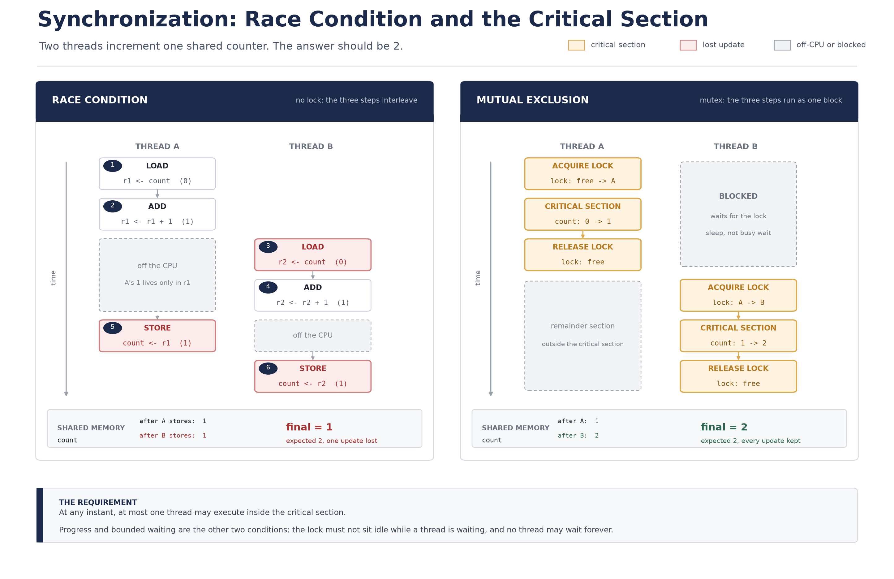

# [OS] 동기화와 임계 영역 (상호 배제와 락 메커니즘)

- 작성일: 2026-11-12
- 키워드: Operating System, Synchronization, Critical Section, Race Condition, Mutual Exclusion, Progress, Bounded Waiting, Mutex, Semaphore, Spinlock, Test-and-Set, Compare-and-Swap, Memory Barrier, Deadlock, Spring Singleton

## 1. 핵심 요약 (What & Why)

지금까지 본 것은 실행 단위가 어떻게 만들어지고(프로세스와 스레드), CPU를 어떻게 나눠 받고(스케줄링), 그 사이에 무엇을 저장하고 복원하는지(컨텍스트 스위칭)였다. 세 편 모두 **실행 단위를 서로 격리하고 번갈아 돌리는** 이야기였다. 그런데 스레드는 격리되어 있지 않다. 같은 프로세스의 스레드는 코드, 데이터, 힙을 공유하고, 그 공유 영역에 여러 스레드가 거의 같은 시각에 접근한다. 이 문서는 그 지점에서 시작한다.

**동기화(synchronization)** 는 여러 실행 단위가 공유 자원에 접근하는 순서와 시점을 조정해서, 실행 순서가 어떻게 뒤섞여도 결과가 하나로 정해지도록 만드는 작업이다. "느리게 만드는 일"이 아니라 **"결과를 예측 가능하게 만드는 일"** 이다.

용어를 먼저 정리한다.

- **공유 자원(shared resource)**: 여러 스레드가 함께 읽고 쓰는 대상. 힙의 객체 필드, 정적 변수, 파일, DB의 한 행, 외부 API의 쿼터 같은 것.
- **임계 영역(critical section)**: 공유 자원에 접근하는 코드 구간. 그 구간이 실행되는 동안 **오직 한 스레드만** 들어와야 한다. 코드의 물리적 범위를 가리키는 말이지, 특별한 문법이 있는 것이 아니다.
- **경쟁 상태(race condition)**: 둘 이상의 스레드가 공유 자원에 동시에 접근하고, 그 실행 순서와 타이밍에 따라 결과가 달라지는 상태. 같은 입력으로 여러 번 실행했는데 결과가 달라지면 경쟁 상태를 먼저 의심해야 한다.

가장 작은 예가 `count++` 다. 1,000번씩 증가시키는 스레드 두 개를 돌리면 결과는 2,000이 아니라 그보다 작은 수가 나오고, 실행할 때마다 그 수도 달라진다. 이 한 줄이 왜 원자적이지 않은지는 5장에서 기계어 수준으로 다시 본다.

왜 이것이 문제인가. 경쟁 상태는 **"가끔" 틀린다.** 테스트에서는 통과하고 운영에서 하루에 몇 번씩 틀린다. 재현이 안 되니 원인을 찾기도 어렵고, 데이터가 이미 오염된 뒤에 발견된다. 그래서 동기화는 성능 최적화가 아니라 **정확성의 문제**로 다뤄야 한다.

### 동기화가 필요한 전형적인 모양

| 모양 | 예 | 깨지는 방식 |
| --- | --- | --- |
| 읽고-고치고-쓰기 (read-modify-write) | `count++`, 재고 차감, 포인트 적립 | 갱신 하나가 유실된다 (lost update) |
| 확인하고-행동 (check-then-act) | "재고 있나?" 확인 후 주문, "이미 가입했나?" 확인 후 생성 | 확인과 행동 사이에 상태가 바뀐다 (TOCTOU) |
| 초기화 지연 (lazy init) | 싱글톤 생성, 캐시 채우기 | 객체가 두 번 만들어지거나, 절반만 초기화된 객체가 노출된다 |
| 순서 보장 | 생산자가 넣고 소비자가 꺼내는 큐 | 빈 큐에서 꺼내거나, 가득 찬 큐에 넣는다 |

## 2. 내부 메커니즘과 3대 해결 요건 (How it works)

### 2.1 `count++` 는 한 동작이 아니다

CPU는 메모리와 직접 계산하지 않는다. 메모리의 값을 레지스터로 가져와 계산하고, 결과를 다시 메모리에 쓴다. 그래서 `count++` 는 최소 세 동작이다.

1. **LOAD**: `count` 를 메모리(또는 캐시)에서 레지스터로 읽는다.
2. **ADD**: 레지스터 값을 1 증가시킨다.
3. **STORE**: 레지스터 값을 `count` 에 다시 쓴다.

자바 바이트코드로 봐도 한 명령이 아니다.

```java
// count++;  에 해당하는 바이트코드
aload_0
getfield  #count        // 필드 값을 스택으로 읽는다
iconst_1
iadd                    // 1을 더한다
putfield  #count        // 다시 필드에 쓴다
```

`getfield` 와 `putfield` 사이에는 언제든지 다른 스레드가 끼어들 수 있다. 그 사이에 컨텍스트 스위칭이 일어나면 두 스레드 모두 0을 읽고, 둘 다 1을 써서 결과는 1이 된다. **증가 두 번이 증가 한 번으로 접힌다.**

여기에 두 가지가 더 붙는다. 첫째, **가시성(visibility)**. 한 코어가 쓴 값이 다른 코어의 캐시에 즉시 보인다는 보장이 없다. x86은 캐시 일관성 프로토콜(MESI 계열) 덕분에 대체로 빨리 보이지만, ARM 같은 약한 메모리 모델에서는 스토어 버퍼에 잠시 머문다. 둘째, **재배열(reordering)**. 컴파일러와 JIT, CPU가 서로 관련 없는 메모리 접근의 순서를 바꿔 실행할 수 있다. 그래서 동기화는 "명령 사이에 끼어들지 못하게 막는 일"과 "쓴 값이 다른 스레드에 보이게 하는 일"을 함께 해야 한다.

### 2.2 임계 영역 문제의 구조

임계 영역 문제는 코드를 네 구간으로 나눠 정의한다.

| 구간 | 하는 일 |
| --- | --- |
| 진입 구간(entry section) | 들어가도 되는지 확인하고 허가를 받는다. 락 획득이 여기다. |
| 임계 영역(critical section) | 공유 자원을 읽고 쓴다. |
| 이탈 구간(exit section) | 허가를 반납한다. 락 해제가 여기다. |
| 나머지 구간(remainder section) | 공유 자원과 무관한 나머지 작업. |

해결책은 결국 **진입 구간에서 무엇을 확인하고, 이탈 구간에서 무엇을 되돌리는가**의 설계다. 그리고 그 설계가 만족해야 하는 조건이 아래 세 가지다.

### 2.3 3대 필수 조건

1. **상호 배제(mutual exclusion)**: 한 스레드가 임계 영역을 실행 중이면 다른 스레드는 들어올 수 없다. 이것이 없으면 애초에 동기화가 아니다.
2. **진행(progress)**: 임계 영역이 비어 있는데 진입하려는 스레드가 있다면, 그중 하나는 지연 없이 들어가야 한다. 아무도 들어가지 않은 채 모두가 서로를 기다리는 상태(데드락)를 금지하는 조건이다. 임계 영역 밖의 스레드가 진입을 막고 있어도 안 된다.
3. **한계 대기(bounded waiting)**: 어떤 스레드가 진입을 요청한 뒤, 다른 스레드가 몇 번까지 새치기할 수 있는지에 상한이 있어야 한다. 상한이 없으면 운이 나쁜 스레드가 영원히 들어가지 못한다(기아, starvation).

세 조건은 서로 다른 것을 막는다는 점이 중요하다. 상호 배제는 **동시 실행**을, 진행은 **아무도 못 들어가는 정지**를, 한계 대기는 **특정 스레드의 무한 대기**를 막는다. 그래서 "락을 걸었다"는 사실만으로는 안전하다고 말할 수 없다.

> [!NOTE]
> 대표적인 스핀락(2.5)은 상호 배제와 진행은 만족하지만 한계 대기를 보장하지 않는다. 락을 놓는 순간 여러 스레드가 동시에 달려들고, 그중 하나가 계속 이기면 나머지는 계속 진다. 공정성(fairness)을 보장하려면 대기 큐를 두고 도착 순서대로 넘겨줘야 하는데, 이것이 뒤에 나올 세마포어와 공정 모드 락의 존재 이유다.

### 2.4 하드웨어의 도움

소프트웨어만으로 상호 배제를 만드는 것은 이론적으로 가능하지만(데커 알고리즘, 피터슨 알고리즘), 실제로는 쓰이지 않는다. 바쁜 대기를 하면서도 모든 스레드가 같은 변수를 같은 방식으로 읽는다는 가정에 기대기 때문이고, 요즘 CPU의 재배열 앞에서는 그 가정이 깨진다. 그래서 **"읽으면서 동시에 쓰기"를 한 명령으로 처리하는 하드웨어 지원**을 바탕으로 만든다.

| 방식 | 동작 | 특징 |
| --- | --- | --- |
| 인터럽트 금지 | 임계 영역 동안 타이머 인터럽트를 막는다 | 단일 CPU에서만 유효. 멀티코어에서는 다른 코어가 그대로 실행하므로 소용없다. 사용자 프로그램이 쓸 수 없고, 오래 막으면 시스템이 멈춘다. |
| Test-and-Set (TAS) | 메모리 값을 읽어 오고, 그 자리에 `true` 를 쓰는 것을 한 번에 한다. 반환값은 이전 값 | "내가 처음이면 false를 받는다"는 성질로 락을 구현한다. x86의 `xchg`(lock 접두) |
| Compare-and-Swap (CAS) | 기대값과 같으면 새 값으로 바꾸고, 아니면 아무것도 하지 않는다. 반환값은 이전 값 | 조건부 교체. 실패하면 다시 시도하는 CAS 루프로 락과 카운터를 모두 만든다. x86의 `lock cmpxchg` |
| Load-Link / Store-Conditional (LL/SC) | 값을 읽고(ll), 그 사이에 아무도 건드리지 않았을 때만 저장(sc) | 저장 성공 여부를 돌려주므로 ABA 문제가 없다. ARM의 `ldxr/stxr`, RISC-V의 `lr.w/sc.w` |
| 메모리 배리어(펜스) | 앞뒤 메모리 접근의 순서를 강제한다 | 재배열을 막는다. x86 `mfence`, ARM `dmb`. 자바 `volatile` 이 이 명령을 끼워 넣는다 |

현대 CPU에서 원자적 명령이 성립하는 이유는 **캐시 일관성** 덕분이다. `lock` 접두가 붙은 명령은 해당 캐시 라인을 독점 상태로 끌어오고, 그동안 다른 코어의 같은 라인 접근은 막힌다. 버스를 통째로 잠그는 것이 아니라 캐시 라인 단위로 잠그기 때문에, 경합이 없을 때 비용은 일반 명령과 크게 다르지 않다. 경합이 있을 때 비용이 뛴다.

CAS에는 함정이 있다. 값이 A에서 B로 갔다가 다시 A로 돌아온 경우, CAS는 "그대로다"라고 판단하지만 그 사이에 다른 일이 있었을 수 있다(ABA 문제). 포인터를 CAS로 바꾸는 자료구조에서 노드가 해제되고 재사용되면 이 문제가 실제 사고가 된다. LL/SC나 버전 태그(스탬프)를 붙이는 이유다.

### 2.5 소프트웨어 동기화 도구

하드웨어 원자 명령 위에 세 가지 도구가 세워진다.

**뮤텍스(mutex)** 는 상호 배제(mutual exclusion)의 준말이다. 락을 쥔 스레드만 임계 영역에 들어가고, **쥔 스레드만 놓을 수 있다(소유권이 있다)**. 1인용 화장실의 잠금장치와 같다. 들어갈 때 잠그고, 나올 때 자기가 푼다. 소유권이 있기 때문에 "락을 놓치고 나왔다"는 상황 자체가 오류이고, 재진입(같은 스레드가 다시 잠그기)을 허용할지도 설계 문제가 된다.

리눅스에서 뮤텍스는 대개 **futex**(fast userspace mutex)로 구현된다. 경합이 없으면 커널을 부르지 않고 사용자 공간의 CAS 한 번으로 끝난다. 경합이 있으면 커널에 "이 주소에서 기다리겠다"고 알리고(futex_wait) 재우며, 해제하는 쪽이 깨운다(futex_wake). 즉 뮤텍스의 실제 비용은 **경합이 있을 때만** 시스템 콜과 스케줄링으로 나타난다.

**세마포어(semaphore)** 는 허용 인원수를 가진 신호기다. 정수 카운터와 두 연산으로 이루어진다.

- `wait()` (P 연산): 카운터가 1 이상이면 감소시키고 통과, 0이면 대기한다.
- `signal()` (V 연산): 카운터를 증가시키고 대기자를 깨운다.

카운터가 1인 이진 세마포어는 뮤텍스처럼 쓸 수 있지만 **소유권이 없다.** 다른 스레드가 대신 signal할 수 있다. 이 성질이 쓸모 있을 때가 있다. 생산자-소비자 문제에서 "버퍼에 물건이 있다"를 알리는 신호는 소비자가 아니라 생산자가 보내야 하기 때문이다. 뮤텍스는 상호 배제를 위해, 세마포어는 **자원 개수 제한과 신호 전달**을 위해 쓴다. 커넥션 풀의 최대 개수, 동시에 호출 가능한 외부 API 수처럼 "N개까지"를 표현하는 것이 세마포어의 자연스러운 자리다.

**스핀락(spinlock)** 은 대기할 때 잠들지 않고 락이 풀렸는지 계속 확인하며 CPU를 태운다(바쁜 대기, busy waiting). 반대로 **블로킹 락(blocking lock)** 은 잠들었다가 깨어난다.

| 구분 | 스핀락 | 블로킹 락 (뮤텍스) |
| --- | --- | --- |
| 대기 방식 | 루프를 돌며 재시도 | 커널에 등록하고 슬립, 해제 시 깨어남 |
| 대기 비용 | CPU 사이클 소모. 경합이 길면 낭비 | 컨텍스트 스위칭 2회(잠들 때, 깰 때) |
| 유리한 경우 | 임계 영역이 컨텍스트 스위칭 2회보다 짧을 때 | 임계 영역이 길거나 I/O를 기다릴 때 |
| 전제 조건 | 멀티코어. 단일 코어에서는 대기자가 CPU를 잡고 있어 영원히 풀리지 않는다 | 없음 |
| 주 사용처 | 커널 내부의 아주 짧은 보호 구간 | 애플리케이션 수준의 일반적인 락 |

판단 기준은 **"기다리는 시간"과 "스위칭 2회 비용"의 비교**다. 아주 짧은 구간을 지키려고 컨텍스트 스위칭을 두 번 하는 것은 손해이므로 스핀하고, 밀리초 이상 기다릴 것 같으면 재우는 편이 낫다. 리눅스 커널은 두 방식을 섞은 adaptive mutex를 쓰고, 자바의 `synchronized` 도 짧은 경합에서는 스핀하다가 길어지면 재우는 식으로 동작한다.

세 도구만으로는 표현할 수 없는 것이 하나 남는다. **"조건이 만족될 때까지 기다렸다가 다시 락을 잡는"** 동작이다. 락만으로 이걸 하면 "놓고, 잠깐 자고, 다시 잡고, 확인"을 반복하게 되고, 확인과 대기 사이에 조건이 바뀌는 문제가 생긴다. 이 간극을 메우는 것이 **조건 변수(condition variable)** 이고, 락과 조건 변수를 묶어 언어 차원에서 감싼 것이 **모니터(monitor)** 다. 자바의 `synchronized` 블록이 모니터이고, `wait()/notify()` 가 그 위의 조건 변수다.

## 3. 구조 도식 (Diagram)



- 두 패널 모두 스레드 A와 B가 공유 카운터를 1씩 증가시키는 같은 일을 한다. 세로축이 시간이고, 번호는 실제 실행 순서다.
- 왼쪽은 락이 없을 때다. 2번(ADD)과 5번(STORE) 사이에 A가 CPU를 빼앗겼고, 그 사이 B가 **아직 메모리에 반영되지 않은 0을 읽는다**(3번). 이후 A가 1을 쓰고(5번), B도 자기가 들고 있던 1을 쓴다(6번). 값은 1이 되고, A의 증가는 사라진다.
- 오른쪽은 같은 세 동작을 뮤텍스로 감싼 경우다. A가 락을 잡는 순간 B는 **잠들어 기다리고**, A가 놓은 뒤에야 들어온다. 임계 영역이 겹치지 않으므로 읽는 값이 항상 최신이고, 결과는 2가 된다.
- 두 그림의 차이는 코드가 아니라 **"겹칠 수 있는가"** 하나다. 경쟁 상태는 코드를 잘못 짜서 생기는 것이 아니라, 겹침을 막지 않아서 생긴다.

## 4. 비교 표

### 4.1 뮤텍스 vs 세마포어 vs 스핀락

| 비교 항목 | 뮤텍스 (Mutex) | 세마포어 (Semaphore) | 스핀락 (Spinlock) |
| --- | --- | --- | --- |
| 핵심 개념 | 소유권이 있는 1인용 락 | 개수를 세는 신호기 (N개 허용) | 락이 빌 때까지 재시도하는 락 |
| 동시 접근 허용 수 | 1 | 카운터 값 N (이진 세마포어는 1) | 1 |
| 소유권 | 있음. 잡은 스레드만 해제 가능 | 없음. 다른 스레드가 signal 가능 | 있음(구현에 따라 다름) |
| 대기 방식과 비용 | 경합 시 슬립. 스위칭 2회 + 시스템 콜 | 경합 시 슬립. 스위칭 2회 + 시스템 콜 | 바쁜 대기. CPU 사이클 소모, 스위칭 없음 |
| 재진입 | 구현에 따라 허용(자바는 허용) | 해당 없음. 같은 스레드가 두 번 wait하면 교착 가능 | 일반적으로 비재진입 |
| 주 사용 환경 | 임계 영역 보호 전반. 애플리케이션 코드 | 자원 개수 제한, 생산자-소비자 신호. 커넥션 풀, 쿼터 | 커널 내부, 아주 짧은 보호 구간, 멀티코어 전제 |
| 대표 구현 | `pthread_mutex`, 자바 `ReentrantLock`, `synchronized` | POSIX `sem_t`, 자바 `Semaphore` | 리눅스 `spinlock_t`, `AtomicInteger` 의 CAS 루프 |

### 4.2 같은 문제를 푸는 다른 방법들

| 도구 | 무엇을 보장하는가 | 한계 |
| --- | --- | --- |
| 락 (뮤텍스) | 상호 배제 + 가시성 | 경합 시 대기, 교착 위험, 락을 오래 쥐면 병목 |
| 원자적 변수 (CAS) | 단일 변수의 원자적 갱신 + 가시성 | 여러 변수를 한꺼번에 바꾸는 불변식은 보호 못함. 경합 시 재시도 낭비 |
| 불변 객체 · 무상태 설계 | 공유 상태를 애초에 없앤다 | 상태가 정말 필요하면 쓸 수 없음 |
| 스레드 간 메시지 전달 | 공유를 하지 않고 복사해서 넘긴다 | 복사 비용, 설계 변경 |
| DB 트랜잭션 · 유니크 제약 | 여러 서버에 걸친 원자성과 격리 | 성능, 락 대기, 격리 수준에 따른 이상 현상 |

마지막 줄이 중요한 방향을 가리킨다. 동기화의 가장 좋은 해법은 **락을 잘 거는 것이 아니라, 공유 상태를 없애는 것**인 경우가 많다. 이 문서의 5장과 6장이 그 이야기로 이어진다.

## 5. 깨달은 점 (My Insight)

- **`count++` 가 위험한 이유는 "한 줄"이기 때문이 아니라 "세 줄"이기 때문이다.** CPU 레지스터로 복사(LOAD), 계산(ADD), 메모리에 저장(STORE) 사이에 컨텍스트 스위칭이 일어날 수 있고, 그 사이 상대는 아직 갱신되지 않은 값을 읽는다. 지난 문서에서 본 저장·복원 절차가 여기서는 **버그의 통로**가 된다. 스위칭이 공정하고 빠를수록 오히려 더 자주 겹친다.

| 시각 | 스레드 A | 스레드 B | 메모리의 count |
| --- | --- | --- | --- |
| t1 | LOAD: r1 = 0 | - | 0 |
| t2 | ADD: r1 = 1 | - | 0 |
| t3 | CPU를 빼앗김 | LOAD: r2 = 0 | 0 |
| t4 | - | ADD: r2 = 1 | 0 |
| t5 | STORE: count = 1 | - | 1 |
| t6 | - | STORE: count = 1 | 1 (기대값 2) |

- **읽는 쪽과 쓰는 쪽이 각자 자기 값을 들고 있다는 것이 본질이다.** 레지스터 r1, r2는 스레드마다 따로 있고, 메모리의 count는 하나다. 두 사람이 각자 종이에 적어 둔 값을 나중에 하나의 장부에 옮겨 적는 셈이라, 나중에 적는 사람이 앞사람의 기록을 덮어쓴다.

- **`volatile` 로는 이 문제가 해결되지 않는다.** `volatile` 은 가시성과 재배열 금지를 보장할 뿐, 세 동작을 하나로 묶어 주지 않는다. `volatile int count` 에 대한 `count++` 도 여전히 경쟁 상태다. "보이게 하는 것"과 "겹치지 않게 하는 것"은 다른 문제라는 것을 이번에 확실히 갈랐다.
- **락은 정확성을 사고 성능을 지불하는 거래다.** 그래서 "일단 락부터"가 위험하다. 락을 잡은 구간에는 다른 스레드가 못 들어오므로, 그 구간이 길면 병목이 되고 경합(lock contention)이 커진다. 경합이 심해지면 스레드들이 재우고 깨우기를 반복하며 컨텍스트 스위칭이 폭증하고, 처리량이 완만히 줄지 않고 절벽처럼 떨어진다. 락을 잡은 채 I/O를 하거나 외부 API를 부르는 코드가 대표적인 실수다.
- **락을 잘못 쥐면 교착 상태(deadlock)가 된다.** 두 스레드가 서로 상대가 쥔 락을 기다리면 영원히 멈춘다. 성립 조건은 네 가지이고(상호 배제, 점유 후 대기, 선점 불가, 순환 대기), 하나만 깨도 교착은 사라진다. 실무에서 가장 현실적인 방법은 **락 획득 순서를 정하는 것**이다. 계좌 이체처럼 두 자원을 함께 잡아야 할 때는 항상 작은 ID부터 잡는 식으로 전역 규칙을 두면 순환 대기가 만들어지지 않는다. 여기에 더해 예외가 나도 반드시 풀리도록 try-finally(자바는 try-with-resources 형태의 `Lock`)로 감싸는 것이 기본이다.
- **기아(starvation)는 교착과 다르다.** 교착은 아무도 진행하지 못하고, 기아는 시스템은 돌아가는데 특정 스레드만 계속 밀린다. 공정성 옵션이 없는 락에서는 이론상 가능하고, 우선순위가 다른 스레드가 섞이면 실제로 나타난다. 우선순위가 낮은 스레드가 락을 쥐고 있는데 높은 쪽이 그 락을 기다리면, 중간 우선순위 스레드가 CPU를 계속 가져가 낮은 쪽이 락을 놓지 못하는 **우선순위 역전(priority inversion)** 도 같은 뿌리다.
- **스프링 싱글톤 빈을 무상태로 설계해야 하는 이유가 여기 있다.** 스프링 컨테이너는 빈을 기본으로 싱글톤으로 만든다. 즉 요청 스레드 수십 개가 **같은 객체 하나**를 공유한다. 빈에 요청별 데이터를 필드로 두면 그 필드가 곧 임계 영역이고, 락 없이는 경쟁 상태가 된다. 그래서 요청 데이터는 파라미터와 지역 변수로 흘려보내고, 빈은 상태를 갖지 않게 만든다. 무상태 빈은 공유 상태가 없으니 락도 필요 없다. **락을 잘 거는 것보다 공유를 없애는 쪽이 먼저다.**

## 6. 실무 관점 및 트레이드오프 (Trade-off)

### 6.1 자바가 제공하는 세 가지 층

| 도구 | 성격 | 특징과 주의점 |
| --- | --- | --- |
| `synchronized` | JVM 모니터 기반의 암묵적 락 | 블록을 나가면 자동 해제된다. 재진입 가능. 경합이 없을 때는 매우 싸다. 대신 타임아웃·중단·공정성 같은 제어가 없다. |
| `ReentrantLock` | 명시적 락 | `tryLock(timeout)` 으로 기다리지 않고 포기할 수 있고, `lockInterruptibly()` 로 대기 중 인터럽트에 반응할 수 있고, 생성자에 `fair=true` 로 공정 모드를 켤 수 있다. `Condition` 으로 조건 변수도 만든다. 대신 `finally` 에서 직접 해제해야 한다. |
| `AtomicInteger` / `LongAdder` | CAS 기반 무잠금(non-blocking) | 단일 변수의 증가·교체는 락 없이 처리된다. 짧은 연산에서 압도적으로 빠르다. 경합이 심하면 CAS 재시도가 낭비되므로 `LongAdder` 처럼 셀을 쪼개 합산하는 구현을 쓴다. 여러 변수의 불변식은 보장하지 못한다. |

선택 기준은 "무엇을 보호하는가"다. **단일 변수의 갱신**이면 원자적 변수, **여러 변수에 걸친 불변식**이면 락이다. `AtomicInteger` 두 개로 재고와 예약 수를 각각 관리하면 그 둘 사이의 일관성은 아무도 보장하지 않는다.

> [!NOTE]
> 락의 비용은 "락을 거는 행위"가 아니라 "경합"에서 나온다. 경합이 없는 락은 CAS 한 번 수준이고, JIT는 재진입 락을 빠른 경로로 처리한다. 그래서 "락은 느리다"는 말은 절반만 맞다. 느린 것은 **경합하는 락**이고, 경합은 임계 영역이 길거나 접근이 몰릴 때 생긴다. 락을 없애는 최적화보다 임계 영역을 짧게 만드는 일이 먼저다.

### 6.2 JVM 락의 경계: 서버가 여러 대가 되는 순간

`synchronized` 도 `ReentrantLock` 도 **같은 JVM 안에서만** 유효하다. 서버를 두 대로 늘리면(scale-out) 각 JVM이 자기 락을 따로 관리하므로, 두 요청이 서로 다른 서버에서 동시에 들어오면 아무것도 막지 못한다. 재고 1개에 주문 2건이 성공하는 사고가 여기서 난다.

해결 방향은 세 갈래다.

- **분산 락(distributed lock)**: Redis나 ZooKeeper 같은 외부 저장소에 락을 둔다. Redis라면 `SET key token NX PX 3000` 으로 "없을 때만, 만료 시간과 함께" 잡고, 해제는 **내 토큰일 때만** 지우는 Lua 스크립트로 한다. 그냥 `DEL` 하면 내 락이 만료된 뒤 다른 사람의 락을 지워 버린다. Redisson은 만료 자동 연장(watchdog), pub/sub 기반 대기, 재진입까지 감싸 준다.
- **DB를 이용한 직렬화**: `SELECT ... FOR UPDATE` 로 행을 잠그거나, 유니크 제약으로 중복 자체를 막거나, `@Version` 기반 낙관적 락으로 충돌을 감지한다. 이미 트랜잭션이 있는 자리라면 가장 단순하고 확실한 선택인 경우가 많다.
- **설계로 회피**: 사용자별·주문별로 처리 주체를 나누거나(파티셔닝), 중복 처리를 허용하고 나중에 정리(idempotent)한다.

> [!WARNING]
> 분산 락은 만능이 아니다. Redis가 마스터-레플리카로 구성된 경우, 락을 잡은 직후 마스터가 죽고 복제가 아직 반영되지 않으면 새 마스터에는 락이 없다. 다른 서버가 같은 락을 잡아 상호 배제가 깨진다(이 한계는 Redlock 논쟁에서 지적된 지점이다). 그래서 **돈이 걸린 중복 처리에는 분산 락 하나에 기대지 말고 DB의 유니크 제약이나 트랜잭션을 마지막 방어선으로 함께 두는 편이 안전하다.** 분산 락은 성능을 위한 1차 방어이고, 정합성의 최종 보증은 저장소에 두는 것이 좋다.

### 6.3 무엇을 먼저 확인할 것인가

- 공유 상태가 정말 있는가. 싱글톤 빈의 필드, 정적 변수, 캐시 맵이 대표적인 후보다. 대부분은 지역 변수와 파라미터로 바꾸는 것만으로 사라진다.
- 임계 영역이 I/O를 포함하는가. 포함하면 락을 잡은 채 네트워크를 기다리는 것이므로, 조회와 갱신을 분리하거나 락 밖으로 빼낸다.
- 락을 잡는 순서가 일정한가. 여러 락을 중첩해서 잡는 코드가 있다면 순서 규칙을 문서로 남긴다.
- 수치로 확인할 때는 스레드 덤프와 락 대기 시간을 본다. 자바라면 JFR의 `jdk.JavaMonitorEnter`, `jdk.ThreadPark` 이벤트로 어느 락에서 얼마나 기다리는지 볼 수 있고, `ThreadMXBean.findDeadlockedThreads()` 로 교착을 탐지할 수 있다. 여기서도 원칙은 같다. **수를 지어내지 않고, 도구가 실제로 보여주는 것만 읽는다.**

## 7. 참고 자료 (References)

- Abraham Silberschatz, Peter B. Galvin, Greg Gagne. Operating System Concepts (10th ed.), Chapter 6 Synchronization Tools, Chapter 7 Synchronization Examples
- Remzi H. Arpaci-Dusseau, Andrea C. Arpaci-Dusseau. Operating Systems: Three Easy Pieces, Chapter 28 Locks, Chapter 29 Lock-based Concurrent Data Structures, Chapter 31 Semaphores
- Brian Goetz et al. Java Concurrency in Practice, Chapter 2 Thread Safety, Chapter 4 Composing Objects
- JSR-133 Java Memory Model FAQ - happens-before, 가시성, `volatile` 의 의미
- Linux man page: `futex(2)`, `pthread_mutex_lock(3)`, `sem_wait(3)`
- Intel 64 and IA-32 Architectures Software Developer's Manual, Vol. 3A - `LOCK` 접두, `XCHG`, `CMPXCHG`, 메모리 순서
- ARM Architecture Reference Manual - `LDXR/STXR`, `DMB`
- JEP 374: Deprecate and Disable Biased Locking, JEP 444: Virtual Threads
- Redisson 문서: 분산 락과 watchdog
- Martin Kleppmann. How to do distributed locking (2016) - Redis 기반 분산 락의 한계
