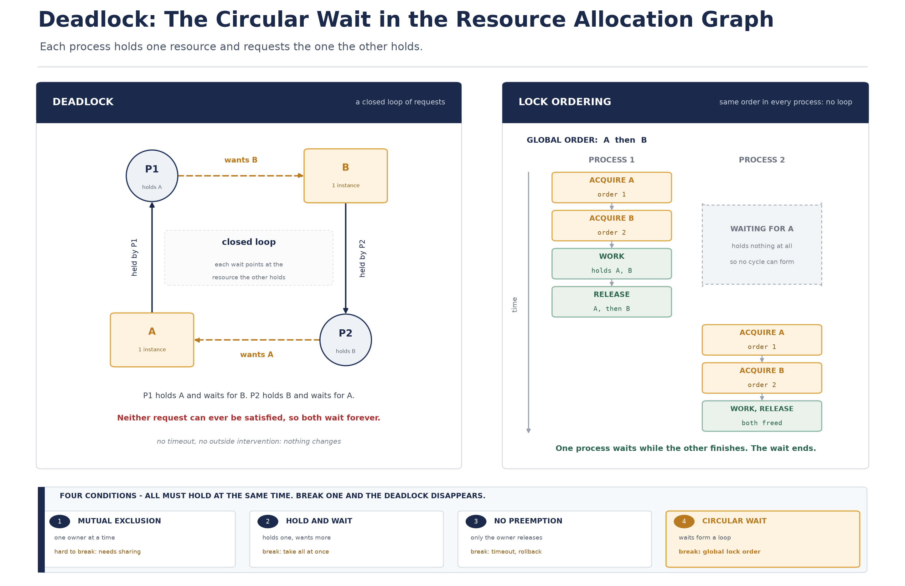

# [OS] 교착 상태(Deadlock)의 원인과 4대 조건

- 작성일: 2026-11-13
- 키워드: Operating System, Deadlock, Starvation, Coffman Conditions, Resource Allocation Graph, Wait-for Graph, Circular Wait, Lock Ordering, Prevention, Avoidance, Banker's Algorithm, Detection and Recovery, Ostrich Algorithm, InnoDB Deadlock, Distributed Lock, tryLock

## 1. 핵심 요약 (What & Why)

네 편에서 락으로 임계 영역을 감쌌다. 락을 걸면 경쟁 상태는 사라지지만, **대기**가 생긴다. 대기는 대개 짧고 스스로 풀리지만, 가끔 풀리지 않는 대기가 생긴다. 이번 문서의 주제인 **교착 상태(deadlock)** 다.

**교착 상태**는 둘 이상의 프로세스나 스레드가 **서로가 점유한 자원을 기다리며** 더 이상 다음 단계로 진행하지 못하고 영구히 멈춰 있는 상태다. 핵심은 "멈춰 있다"가 아니라 **"아무도 양보할 수 없어서 멈춰 있다"** 는 점이다. 각자는 상대가 가진 것을 기다리고 있고, 상대도 마찬가지이므로, 외부에서 개입하지 않으면 상태가 바뀔 이유가 없다.

정의에서 자주 빠지는 것이 **기아(starvation)** 와의 구분이다. 둘 다 "오래 기다린다"는 겉모습이 같아서 섞여 쓰이지만 원인이 다르고 대응도 다르다.

| 구분 | 교착 상태 (Deadlock) | 기아 상태 (Starvation) |
| --- | --- | --- |
| 원인 | 서로가 서로의 자원을 기다리는 순환 구조 | 우선순위·스케줄링 정책에서 계속 밀림 |
| 시스템 전체 | 관련된 실행 단위들이 모두 멈춘다 | 시스템은 정상 동작하고 다른 작업은 진행된다 |
| 시간이 지나면 | 절대 풀리지 않는다. 외부 개입(종료, 선점, 재시작)이 필요하다 | 정책이 바뀌거나 경쟁자가 줄면 언젠가 실행될 수 있다 |
| 대표 사례 | 스레드 A가 락1을 쥐고 락2를 기다리고, B가 락2를 쥐고 락1을 기다림 | 공정성 없는 락에서 계속 새치기를 당하는 스레드, 낮은 우선순위 작업 |
| 관측 단서 | 대기 사슬이 닫혀 있다. 대기 그래프에 사이클이 있다 | 대기 시간만 비정상적으로 길고 사슬은 닫히지 않는다 |

교착 상태가 성립하는 데 필요한 최소 조건은 생각보다 작다. **스레드 두 개와 자원 두 개**면 충분하고, 자원이 하나여도 **비재진입(non-reentrant) 락을 같은 스레드가 두 번 잡으면** 자기 자신을 기다리는 교착이 된다. 즉 "여러 스레드가 복잡하게 얽힌 큰 시스템"이 아니어도, 락을 중첩해 잡는 순간부터 교착은 가능해진다.

위험한 이유는 증상이 **"느려짐"으로 시작**한다는 점이다. 예외가 터지지 않고, CPU도 놀지 않는다. 몇 개 스레드가 조용히 멈추고, 요청은 큐에 쌓이고, 응답 시간이 조금씩 늘어난다. 그러다 그 락을 지나가야 하는 요청이 전부 막히면 그때서야 장애로 드러난다. 즉 **교착은 발생 시점과 장애 시점이 다르고**, 원인이 남아 있는 동안 재시작해도 반복된다.

### 어디서 자주 만나는가

| 계층 | 자원 | 교착이 되는 모양 |
| --- | --- | --- |
| 애플리케이션 코드 | 락, 모니터 | 두 락을 서로 다른 순서로 중첩 획득 |
| 스레드 풀 | 워커 스레드 | 작업이 다른 풀의 결과를 기다리는데, 그 풀의 스레드도 이쪽 결과를 기다림 |
| DB | 행 락, 갭 락, 테이블 락 | 두 트랜잭션이 같은 두 행을 반대 순서로 갱신 |
| 분산 시스템 | Redis 락, DB 행 | 서비스 A가 B의 응답을 기다리고 B가 A의 응답을 기다림 |
| 커널 | 파일 락, 세마포어 | 커널 내부 경로 두 개가 반대 순서로 같은 락을 잡음 (커널은 락 순서 규칙으로 예방) |

## 2. 내부 메커니즘과 코프만(Coffman) 4대 조건 (How it works)

### 2.1 자원 할당 그래프 (Resource Allocation Graph)

교착 상태를 그림으로 다루려고 만든 도구가 **자원 할당 그래프(RAG)** 다. 노드는 두 종류이고, 엣지는 두 종류다.

| 요소 | 표기 | 의미 |
| --- | --- | --- |
| 프로세스 | 원 | 실행 단위. 프로세스, 스레드, 트랜잭션 모두 여기에 해당한다 |
| 자원 | 사각형 (인스턴스 수만큼 점) | 자원 타입. 점 하나가 인스턴스 하나다 |
| 할당 엣지 | 자원 → 프로세스 | 이 인스턴스는 지금 이 프로세스가 쥐고 있다 |
| 요청 엣지 | 프로세스 → 자원 | 이 프로세스가 이 자원을 기다리고 있다 |

엣지의 방향이 곧 소유와 대기의 방향이라는 점이 중요하다. 화살표를 따라가다 보면 **"누가 누구를 기다리는가"** 가 그대로 드러난다.

### 2.2 대기 그래프 (Wait-for Graph)

자원 노드를 없애고 프로세스만 남긴 그래프가 **대기 그래프**다. "P1이 R을 기다리는데 R은 P2가 쥐고 있다"를 "P1이 P2를 기다린다"로 접은 것이다. 자원 타입마다 인스턴스가 **하나뿐**이라면 다음이 성립한다.

- 교착 상태이면 대기 그래프에 반드시 **사이클**이 있다.
- 대기 그래프에 사이클이 있으면 반드시 **교착 상태**다.

즉 단일 인스턴스에서는 **사이클이 교착의 필요충분조건**이다. 그래서 운영체제는 대기 그래프에서 사이클을 찾는 것만으로 교착을 탐지할 수 있다(주기적 탐지, 또는 자원 요청이 들어올 때마다).

주의할 점은 **인스턴스가 여러 개일 때**다. 자원 타입 R에 인스턴스가 3개 있고 P1이 1개, P2가 1개를 쥔 상태에서 둘 다 1개씩 더 요청하면 그래프에는 사이클이 생기지만, 남은 1개를 어느 쪽에 주느냐에 따라 교착이 될 수도 되지 않을 수도 있다. 그래서 다중 인스턴스에서는 **사이클이 필요조건일 뿐 충분조건이 아니다.** 이 구분이 뒤에 나올 회피(avoidance) 알고리즘의 출발점이다.

### 2.3 락을 기다리는 스레드에게 실제로 일어나는 일

교착을 이해하려면 "기다린다"가 무엇인지 정확히 봐야 한다. 락을 잡지 못한 스레드는 다음 순서를 밟는다.

1. 진입 구간에서 원자 명령(CAS 등)으로 락 상태를 확인한다. 이미 잡혀 있으면 소유자 정보(스레드 ID, 재진입 횟수)를 읽는다.
2. 경합이 짧을 것 같으면 잠깐 스핀하고, 길어지면 커널에 "이 락 주소에서 기다리겠다"고 등록한다(`futex_wait`). 이때 스레드는 **실행 큐에서 빠지고** `WAITING`(또는 `BLOCKED`) 상태가 된다. CPU를 쓰지 않는다.
3. 락을 쥔 스레드가 해제하면서 대기자를 깨운다(`futex_wake`). 깨어난 스레드는 다시 실행 큐에 서고, 스케줄러가 고르면 소유권을 넘겨받는다.

여기서 두 가지가 따라온다. 첫째, **대기 중인 스레드는 아무 일도 하지 않으므로** 교착은 CPU 사용률을 올리지 않는다(스핀락이면 예외다. 스핀락끼리 교착이면 CPU 100%로 나타난다). 둘째, **대기 지점이 커널/런타임에 기록으로 남는다.** 자바라면 스레드 덤프의 `waiting to lock <0x...>`(모니터), `parking to wait for <0x...>`(AQS 기반 락) 줄이 그것이고, 이것이 사후 분석의 단서가 된다.

### 2.4 코프만(Coffman) 4대 조건

1971년 코프만이 정리한, 교착 상태가 성립하기 위해 **동시에** 만족되어야 하는 네 가지 조건이다.

**1) 상호 배제 (Mutual Exclusion)**
매 순간 하나의 프로세스만 자원을 독점해서 쓸 수 있다. 프린터, 파일 쓰기, DB의 한 행 갱신, 락 자체가 여기에 해당한다. 읽기 전용 공유가 가능한 자원이라면 이 조건이 성립하지 않으므로 교착도 없다.

**2) 점유 대기 (Hold and Wait)**
최소 하나의 자원을 **쥔 채로** 다른 자원을 추가로 요청하며 기다린다. "아무것도 안 쥐고 기다리는" 스레드는 교착 사슬에 낄 수 없다. 뒤의 순서 규칙이 효과를 내는 이유가 바로 이 조건과 연결된다.

**3) 비선점 (No Preemption)**
이미 쥐고 있는 자원을 다른 주체가 강제로 빼앗을 수 없다. 락은 **쥔 쪽이 자발적으로 놓을 때만** 풀린다. 선점이 가능한 자원(CPU, 메모리 페이지)에서는 교착이 성립하기 어렵다.

**4) 순환 대기 (Circular Wait)**
대기 관계가 닫힌 사슬을 이룬다. P1은 P2가 쥔 자원을, P2는 P1이 쥔 자원을 기다린다. 스레드가 셋, 넷이어도 같은 원리로 원형이 만들어진다.

네 조건은 **필요조건**이다. 하나라도 성립하지 않으면 교착은 만들어질 수 없다. 반대로 넷이 모두 성립한다고 해서 반드시 교착인 것은 아니다(2.2의 다중 인스턴스 경우). 그래서 실무의 해법은 "교착을 계산해서 피한다"보다 **"넷 중 하나를 구조적으로 깨 버린다"** 쪽으로 잡는 경우가 많다.

> [!NOTE]
> 네 조건은 "각각 존재"가 아니라 **"동시에 성립"** 이어야 한다. 예를 들어 상호 배제와 점유 대기는 어느 시스템에나 있고, 비선점도 대부분 그렇다. 그래서 실제로 교착을 만드는 마지막 한 조각은 대개 **순환 대기**이고, 여기에 손을 대는 것이 애플리케이션 개발자가 할 수 있는 일 중 가장 확실하다.

### 2.5 교착과 경쟁 상태는 다른 문제다

4편에서 본 경쟁 상태는 **같은 순간에 겹쳐서** 생겼고, 락으로 해결했다. 교착은 **락을 걸었기 때문에** 생긴다. 즉 락은 경쟁 상태를 막고 교착이라는 새로운 실패 모드를 연다. 둘은 대체 관계가 아니라 **비용의 이동**이다.

| 구분 | 경쟁 상태 | 교착 상태 |
| --- | --- | --- |
| 원인 | 보호하지 않아서 | 보호를 잘못 조합해서 |
| 증상 | 결과가 조금씩 틀림 (데이터 오염) | 아무 결과도 나오지 않음 (정지) |
| 재현 | 간헐적, 타이밍 의존 | 조건이 맞으면 결정적으로 반복 |
| 해결 방향 | 락, 원자 연산, 불변·무상태 설계 | 락 순서, 타임아웃, 탐지와 복구 |

## 3. 구조 도식 (Diagram)



- 왼쪽은 자원 할당 그래프다. 원은 프로세스, 사각형은 자원(인스턴스 1개)이다. 실선은 할당(자원 → 프로세스), 점선은 요청(프로세스 → 자원)이다.
- 화살표를 따라가면 **P1 → B → P2 → A → P1** 로 닫힌 고리가 만들어진다. P1은 A를 쥐고 B를 기다리고, B는 P2가 쥐고 있다. P2는 B를 쥐고 A를 기다리고, A는 P1이 쥐고 있다. 각자의 요구가 상대의 점유를 향하고 있어서, 누구도 다음 단계로 갈 수 없다.
- 오른쪽은 같은 두 프로세스에 **전역 순서(A를 먼저, B를 나중에)** 를 강제한 경우다. P2는 A를 잡으려다 P1이 쥐고 있어 대기하지만, **아무것도 쥐지 않은 채로** 기다린다. 그래서 P2는 교착 사슬에 낄 수 없고, P1이 끝나 자원을 놓으면 P2가 진행한다. 대기는 있지만 영구적이지 않다.
- 두 그림의 차이는 코드가 아니라 **획득 순서** 하나다. 같은 자원, 같은 개수, 같은 동시성인데 고리가 생기느냐 마느냐가 갈린다.
- 아래 띠는 4대 조건을 정리한 것이다. 하나라도 깨지면 사이클이 성립할 수 없다는 것이 이 문서의 결론이고, 그중 네 번째(순환 대기)가 애플리케이션 코드에서 가장 직접적으로 통제 가능한 지점이다.

## 4. 비교 표

### 4.1 교착 상태를 다루는 네 가지 기법

| 기법 | 원리 | 언제 비용을 치르는가 | 전제 조건 | 실제 채택 |
| --- | --- | --- | --- | --- |
| 예방 (Prevention) | 4대 조건 중 하나를 **구조적으로** 성립 불가능하게 만든다 | 설계·상시. 자원 활용률이 떨어진다 | 자원 요구를 코드 규칙으로 통제할 수 있어야 한다 | 애플리케이션 코드의 락 순서 규칙, 커널의 락 계층 규칙 |
| 회피 (Avoidance) | 요청마다 할당 후에도 **안전 상태(safe state)** 인지 동적으로 검사한다 | 요청이 들어올 때마다 계산 | 각 프로세스의 **최대 자원 요구량을 미리** 알아야 한다 | 은행원 알고리즘, 단일 인스턴스의 자원 할당 그래프 알고리즘. 실제 범용 OS에서는 거의 쓰지 않는다 |
| 탐지 및 복구 (Detection & Recovery) | 교착이 생기도록 두고, **주기적으로 탐지**해 깨뜨린다 | 교착이 발생한 뒤. 탐지 오버헤드와 복구 손실 | 사이클 탐지가 가능한 자료구조(대기 그래프, 락 테이블) | DB 엔진(InnoDB, Oracle), 분산 락 라이브러리 일부 |
| 무시 (Ignorance) | 교착을 **없는 것으로 가정**한다. 타조 알고리즘(Ostrich Algorithm) | 장애가 났을 때 사용자가 감당한다 | 교착 빈도가 낮고, 탐지·예방 비용이 더 클 때 | UNIX/Linux/Windows 같은 범용 OS의 기본 철학 |

비교의 핵심은 **"언제 비용을 치르는가"** 다. 예방은 항상 조금씩(활용률 저하), 회피는 요청마다(계산), 탐지는 사고가 났을 때(복구 손실), 무시는 나중에 사용자가(재시작). 현대 시스템은 보통 **예방을 코드 규칙으로, 탐지·복구를 DB에 맡기고, 나머지는 무시**하는 조합을 쓴다.

### 4.2 예방은 어느 조건을 어떻게 깨는가

| 깨는 조건 | 방법 | 대가 |
| --- | --- | --- |
| 상호 배제 | 자원을 공유 가능하게 만든다 (읽기 전용화, 스풀링, 복사본 제공) | 애초에 배타가 필요한 자원에는 쓸 수 없다. 프린터를 스풀러로 바꾸는 것 같은 발상 |
| 점유 대기 | 필요한 자원을 **한꺼번에** 요청하거나, 하나도 안 쥔 상태에서만 요청한다 | 필요한 자원을 미리 알아야 하고, 다 모을 때까지 아무것도 못 한다. 활용률 급락, 기아 위험 |
| 비선점 | 쥔 자원을 강제로 회수한다 (선점 후 롤백, 타임아웃 시 포기) | 회수당한 쪽의 작업을 되돌려야 한다. 상태를 되돌릴 수 있는 자원(트랜잭션, 체크포인트)에만 가능 |
| 순환 대기 | 자원에 **전역 순서**를 부여하고, 항상 그 순서대로만 획득한다 | 순서 규칙을 코드 전체가 지켜야 한다. 규칙이 암묵적이면 쉽게 깨진다 |

네 가지 중 **실무에서 실제로 쓰이는 것은 사실상 마지막 줄**이다. 앞의 셋은 자원 활용률이나 구현 자유도를 크게 훼손한다. 그리고 순서 규칙은 "자원에 번호를 매긴다"는 발상만으로 대부분의 교착을 막는다. 이유는 단순하다. **모두가 같은 방향으로만 화살표를 그리면 닫힌 고리를 만들 수 없다.**

## 5. 깨달은 점 (My Insight)

- **교착은 "복잡한 시스템"의 문제가 아니라 "락 두 개"의 문제다.** 락 하나만 쓰는 코드에서는 (비재진입 자기 재획득을 빼면) 교착이 성립하지 않는다. 즉 위험은 락을 **중첩**하는 순간 시작되고, 중첩은 대개 한 함수 안에서 드러나지 않는다. A 메서드가 락1을 잡고 B를 호출하고, B가 락2를 잡는 식으로 **호출 경로를 따라 흩어진다.** 그래서 코드를 읽을 때 "이 메서드가 어떤 락을 잡는가"보다 **"이 요청이 지나가는 경로 전체가 어떤 순서로 락을 잡는가"** 를 봐야 한다.
- **순환 대기가 유일하게 손댈 수 있는 지점이다.** 상호 배제는 자원의 성질이라 못 바꾸고, 점유 대기는 "필요한 걸 미리 다 알기"가 현실적으로 어렵고, 비선점은 락의 정의를 바꾸는 일이다. 반면 순서는 **규칙 하나를 정하면 끝**이다. 4대 조건을 외우는 것보다 "우리 시스템에서 순서를 강제할 수 있는 자원은 무엇인가"를 찾는 것이 실전에서는 더 쓸모 있다.

- **PK 오름차순 정렬 하나로 순환 대기 사슬이 통째로 사라진다.** 송금처럼 두 계좌를 함께 갱신하는 트랜잭션이 동시에 반대 방향으로 들어오면, A→B 송금은 A행을 먼저 잠그고 B→A 송금은 B행을 먼저 잠근다. 이때 두 트랜잭션이 서로의 행을 기다리면 그대로 교착이다. 그런데 잠그기 전에 **두 계좌 ID를 오름차순으로 정렬해서 작은 쪽부터 잠그면**, 모든 트랜잭션이 같은 방향으로만 화살표를 그리게 되므로 고리가 닫힐 수 없다. 자원의 개수가 몇 개든, 트랜잭션이 몇 개든 규칙은 하나다. "항상 작은 ID부터."

- **순서 규칙은 자원 종류를 넘어설 때 진짜로 깨진다.** 같은 DB 안에서는 PK 순서로 정리되지만, JVM 락과 DB 락과 Redis 락이 한 요청 안에서 섞이면 순서가 암묵적이 된다. "분산 락을 잡고 → DB 트랜잭션을 열고 → JVM 캐시 락을 잡는다"는 식의 규칙을 문서로 정해 두지 않으면, 다른 경로에서 반대 순서로 잡는 코드가 반드시 생긴다. **락 순서는 자원 종류 전체에 걸친 하나의 목록이어야 한다.**

- **교착 하나가 스레드 풀 전체를 멈출 수 있다.** 교착에 참여한 스레드는 둘뿐인데, 그 둘이 쥔 락을 지나가야 하는 요청이 전부 같은 풀의 스레드를 점유한다. 톰캣 스레드 200개 중 2개가 멈추는 것은 문제가 아니지만, 그 락이 모든 요청이 지나는 공통 경로에 있으면 나머지 198개가 차례로 그 뒤에 줄을 서고, 결국 풀 전체가 고갈된다. **교착의 피해 범위는 참여자 수가 아니라 그 락의 인기도로 결정된다.** 그래서 공통 경로에 있는 락일수록 중첩을 피해야 한다.
- **자기 자신과의 교착도 있다.** 비재진입 락을 같은 스레드가 두 번 잡으면 그 스레드는 자기가 쥔 락을 자기가 기다린다. 재진입 가능한 락(`synchronized`, `ReentrantLock`)이 기본값인 이유가 이것이고, 반대로 재진입 불가 락을 쓸 때는 같은 스레드 안에서 두 번 잡는 경로가 없는지 확인해야 한다.
- **DB가 교착을 "감지해서 하나를 죽이는" 방식은 무시가 아니라 탐지·복구다.** 4대 조건을 코드로 완벽히 막는 대신, 엔진이 사이클을 찾아 한쪽 트랜잭션을 롤백하고 애플리케이션에 재시도를 요구한다. 이 설계를 보면 교착은 **"없애야 하는 버그"가 아니라 "확률적으로 발생하는 이벤트"** 로 다뤄진다는 것을 알 수 있다. 그래서 재시도 가능한 트랜잭션 설계가 교착 예방만큼 중요하다.

## 6. 실무 관점 및 트레이드오프 (Trade-off)

### 6.1 DB 트랜잭션 데드락

가장 자주 만나는 실제 사례다. 두 트랜잭션이 **같은 두 행을 반대 순서로** 갱신하면 교착이 된다.

```sql
-- 트랜잭션 1: A에서 B로 송금
START TRANSACTION;
UPDATE account SET balance = balance - 10000 WHERE id = 1;   -- 계좌 1 잠금
UPDATE account SET balance = balance + 10000 WHERE id = 2;   -- 계좌 2 대기
COMMIT;

-- 트랜잭션 2: B에서 A로 송금 (거의 동시에)
START TRANSACTION;
UPDATE account SET balance = balance - 10000 WHERE id = 2;   -- 계좌 2 잠금
UPDATE account SET balance = balance + 10000 WHERE id = 1;   -- 계좌 1 대기
COMMIT;
```

해결은 순서 통일이다. 갱신 대상을 ID 오름차순으로 정렬해서 잠그면 두 트랜잭션 모두 1번을 먼저 잠그려 하고, 뒤에 온 쪽은 **아무것도 쥐지 않은 채** 기다린다.

```java
public void transfer(long fromId, long toId, long amount) {
    long first = Math.min(fromId, toId);
    long second = Math.max(fromId, toId);

    // 항상 작은 ID부터 잠근다. 어떤 송금 조합이 와도 획득 순서가 같다.
    Account firstAccount = accountRepository.findByIdForUpdate(first)
            .orElseThrow(() -> new IllegalArgumentException("계좌 없음"));
    Account secondAccount = accountRepository.findByIdForUpdate(second)
            .orElseThrow(() -> new IllegalArgumentException("계좌 없음"));

    firstAccount.withdrawIfFrom(fromId, amount);
    secondAccount.depositIfTo(toId, amount);
}
```

정렬을 코드 한 곳에 두지 않고 여러 서비스가 각자 잠그면 규칙이 다시 깨진다. 그래서 **"두 행 이상을 잠글 때는 항상 PK 오름차순"** 을 팀 규칙으로 두고, 가능하면 잠금 로직을 한 메서드로 모으는 편이 안전하다.

> [!NOTE]
> MySQL InnoDB는 교착을 **감지하면** 두 트랜잭션 중 롤백 비용이 작은 쪽(잠근 행이 적고 변경이 적은 쪽)을 희생자로 골라 롤백하고, 남은 쪽에 `Deadlock found when trying to get lock; try restarting transaction` 오류를 돌려준다. 감지가 아니라 **대기 시간 초과**로 끝나는 경우도 있는데, 이때는 `innodb_lock_wait_timeout`(기본 50초)이 지나서 `Lock wait timeout exceeded`가 난다. 두 오류는 원인이 같아도 증상이 다르다. 전자는 "순서가 꼬였다"는 신호이고, 후자는 "누군가 락을 오래 쥐고 있다"는 신호다. 전자는 순서 규칙으로, 후자는 트랜잭션 길이와 인덱스로 고친다.

> [!WARNING]
> 교착 오류는 **재시도해야 하는 오류**로 분류해야 한다. 예외를 그대로 사용자에게 던지면 같은 요청이 다시 와도 같은 순서로 다시 부딪힌다. 다만 재시도를 붙이면 **멱등성**이 전제가 된다(같은 송금이 두 번 반영되면 안 된다). 재시도 횟수 상한과 백오프를 두고, 상한을 넘으면 실패로 남겨 원인을 볼 수 있게 해야 한다.

### 6.2 애플리케이션 코드에서의 교착

자바에서 락 중첩은 흔하고, 교착은 대개 아래 세 모양으로 나타난다.

| 모양 | 예 | 대응 |
| --- | --- | --- |
| 두 락의 반대 순서 | `lockA` 잡고 `lockB` 요청 / `lockB` 잡고 `lockA` 요청 | 전역 순서 규칙. 락마다 순번을 상수로 두고 항상 작은 순번부터 |
| 락을 잡은 채 다른 락을 부르는 콜백 | 락 안에서 리스너 호출, 리스너가 다른 락 획득 | 락 안에서 외부 콜백을 부르지 않는다. 락 밖으로 빼낸다 |
| 풀 안에서 다른 풀 대기 | 워커가 다른 스레드 풀의 작업 결과를 `Future.get()`으로 기다림 | 풀을 분리하거나 비동기 조합(`CompletableFuture`)으로 바꾼다. 두 풀의 작업이 서로를 기다리면 풀 크기와 무관하게 멈춘다 |

여기에 **기다리지 않을 권리**를 주는 것이 실용적인 방어다. `ReentrantLock.tryLock(timeout)` 은 정해진 시간만 기다리고 포기할 수 있어서, 무한 대기를 유한 대기로 바꾼다. 교착을 없애지는 않지만 **장애의 모양을 "영구 정지"에서 "느린 실패"로** 바꾼다.

```java
// 순서 규칙 + 타임아웃: 둘 중 하나만으로도 교착의 피해가 크게 줄어든다.
boolean firstLocked = false;
boolean secondLocked = false;
try {
    firstLocked = firstLock.tryLock(300, TimeUnit.MILLISECONDS);
    if (!firstLocked) {
        throw new IllegalStateException("첫 번째 락 획득 실패");
    }
    secondLocked = secondLock.tryLock(300, TimeUnit.MILLISECONDS);
    if (!secondLocked) {
        throw new IllegalStateException("두 번째 락 획득 실패");
    }
    // 임계 영역
} catch (InterruptedException e) {
    Thread.currentThread().interrupt();
    throw new IllegalStateException("락 대기 중 인터럽트", e);
} finally {
    if (secondLocked) {
        secondLock.unlock();
    }
    if (firstLocked) {
        firstLock.unlock();
    }
}
```

`tryLock` 은 **재진입 여부와 무관하게** 남용하면 다른 문제를 만든다. 대기 시간 동안 다른 스레드가 락을 잡았다 놓았다를 반복하면 계속 실패할 수 있고(라이브락), 상위에서 재시도 정책이 없으면 정상 경합도 실패로 처리된다. 타임아웃은 **교착의 안전망**이지 정상 경로의 대체물이 아니다.

### 6.3 분산 락에서의 교착

서버가 여러 대가 되면 JVM 락이 무력해진다(4편 6.2). 그래서 Redis 같은 외부 저장소에 락을 두는데, 여기서 교착은 다른 모양으로 온다.

- **대기 시간(wait time)이 없는 락**: 락을 못 잡으면 영원히 기다린다. 반드시 "얼마나 기다릴지"를 정하고, 실패를 정상적인 결과로 처리한다.
- **만료 시간(lease time)이 너무 긴 락**: 락을 쥔 서버가 죽으면 그 시간 동안 아무도 못 잡는다. 사실상의 정지다. 반대로 너무 짧으면 작업 도중 락이 풀려 다른 주체가 들어온다.
- **만료 뒤에도 작업이 계속되는 경우**: 락은 풀렸는데 이전 소유자가 아직 쓰고 있다. 이때는 상호 배제가 이미 깨진 상태이므로, 순번이 증가하는 **펜싱 토큰(fencing token)** 을 저장소가 검사해서 늦게 도착한 쓰기를 거부하는 방식으로 막는다.

> [!WARNING]
> 분산 락에서 **순서 규칙은 더 어렵다.** 서로 다른 서비스가 서로 다른 목록의 락을 잡으면 전체 순서를 강제할 방법이 없다. 그래서 분산 환경에서는 순서 규칙에 기대기보다 (1) 락을 최대한 적게, 짧게, (2) 타임아웃과 재시도, (3) **최종 방어선으로 DB의 유니크 제약이나 트랜잭션**을 두는 조합이 현실적이다. 교착을 없애는 것보다 **교착이 나도 정합성이 깨지지 않게** 만드는 쪽이 비용이 싸다.

### 6.4 교착을 확인하는 순서

- **증상 확인**: 요청이 응답 없이 쌓이는가, 특정 API만 멈추는가. CPU는 놀고 있는데 처리량이 0이면 교착을 먼저 의심한다(스핀락 교착이면 반대로 CPU가 찬다).
- **스레드 덤프**: 자바라면 `jstack <pid>` 를 두세 번 간격을 두고 떠서 같은 스레드가 같은 락에서 계속 `waiting to lock` / `parking to wait for` 인지 본다. JVM은 모니터 교착을 만나면 덤프 끝에 `Found one Java-level deadlock:` 블록을 스스로 찍어 준다.
- **프로그램적 탐지**: `ThreadMXBean.findDeadlockedThreads()` 로 교착에 참여한 스레드 ID를 얻을 수 있다. 이 값을 지표로 내보내 두면 알림을 걸 수 있다.
- **JFR**: `jdk.JavaMonitorEnter`, `jdk.ThreadPark` 이벤트로 어느 락에서 얼마나 기다렸는지 시간 분포를 본다. 교착이 아니어도 락 경합 지점을 찾는 데 같은 도구를 쓴다.
- **DB**: 엔진이 남기는 교착 로그(`SHOW ENGINE INNODB STATUS`의 `LATEST DETECTED DEADLOCK`)에서 두 트랜잭션이 어떤 순서로 어떤 인덱스 레코드를 잠갔는지 확인한다. 여기서 "순서가 반대"라는 사실이 보이면 코드의 잠금 순서를 고친다.
- 수치를 해석할 때는 원칙이 같다. **도구가 실제로 보여주는 것만 읽는다.** 대기 시간, 참여 스레드, 잠긴 레코드가 확인되기 전에 "교착 같다"고 단정하면 엉뚱한 곳을 고치게 된다.

## 7. 참고 자료 (References)

- Abraham Silberschatz, Peter B. Galvin, Greg Gagne. Operating System Concepts (10th ed.), Chapter 8 Deadlocks
- Remzi H. Arpaci-Dusseau, Andrea C. Arpaci-Dusseau. Operating Systems: Three Easy Pieces, Chapter 32 Concurrency Bugs (Deadlock), Chapter 31 Semaphores
- E. G. Coffman, M. J. Elphick, A. Shoshani. System Deadlocks, ACM Computing Surveys (1971) - 4대 조건의 원전
- Brian Goetz et al. Java Concurrency in Practice, Chapter 10 Avoiding Liveness Hazards
- Java Platform Documentation: `java.lang.management.ThreadMXBean.findDeadlockedThreads()`, `java.util.concurrent.locks.ReentrantLock`
- Oracle JDK Tools Reference: `jstack`, JDK Flight Recorder 이벤트 레퍼런스(`jdk.JavaMonitorEnter`, `jdk.ThreadPark`)
- MySQL Reference Manual: Deadlocks in InnoDB, `innodb_deadlock_detect`, `innodb_lock_wait_timeout`, `SHOW ENGINE INNODB STATUS`
- PostgreSQL Documentation: Explicit Locking, Deadlocks
- Martin Kleppmann. How to do distributed locking (2016) - 펜싱 토큰과 분산 락의 한계
- Redisson 문서: `tryLock(waitTime, leaseTime, unit)` 과 watchdog
