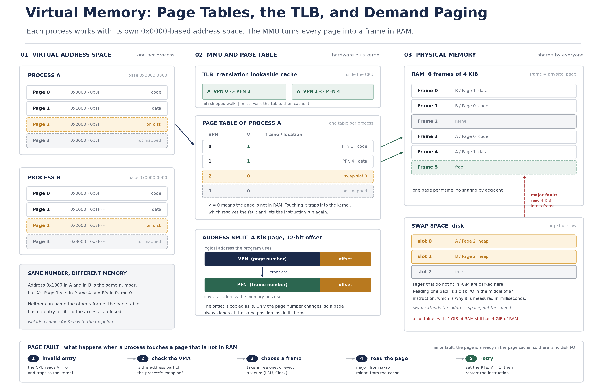

# [OS] 가상 메모리와 페이징: 주소 변환과 요구 페이징

- 작성일: 2026-11-14
- 키워드: Operating System, Virtual Memory, Paging, Page, Frame, MMU, Page Table, Multi-level Page Table, TLB, Demand Paging, Page Fault, Minor Fault, Major Fault, Swap, Page Replacement, LRU, Clock, Thrashing, Working Set, Copy-on-Write, RSS, VSZ, cgroup, OOM Killer, HugePages

## 1. 핵심 요약 (What & Why)

앞의 다섯 편은 CPU가 무엇을 실행하고(프로세스·스레드), 그 실행을 어떤 순서로 넘기고(스케줄링·컨텍스트 스위칭), 동시에 실행될 때 무엇이 깨지는지(동기화·교착)를 다뤘다. 이번 편은 그 실행 단위들이 딛고 서 있는 **메모리**를 다룬다. 정확히는 **가상 메모리(virtual memory)** 와 그 구현 방식인 **페이징(paging)** 이다.

**가상 메모리**는 프로세스에게 **자기만 쓰는 것처럼 보이는 주소 공간**을 주고, 그 주소를 실제 물리 메모리 주소로 **하드웨어(MMU)가 실행 시점에 변환**하는 기법이다. 프로그램은 물리 주소를 한 번도 보지 못한다. 항상 `0x0000...` 근처에서 시작하는 자기 주소 공간만 본다.

"왜 이런 우회를 하는가"에 답이 세 가지 있다. 이 셋이 가상 메모리의 존재 이유 전부라고 봐도 된다.

| 문제 | 물리 주소를 직접 쓰면 | 가상 메모리를 쓰면 |
| --- | --- | --- |
| 물리 RAM의 한계 | 프로그램 전체가 RAM에 있어야 한다. RAM보다 큰 프로그램은 실행할 수 없다 | 필요한 페이지만 RAM에 올린다. 나머지는 디스크에 두고 접근하는 순간 가져온다 |
| 프로세스 간 격리 | 다른 프로세스의 주소를 그대로 읽고 쓸 수 있다. 한 줄의 잘못된 포인터가 남의 메모리를 덮는다 | 각자 자기 표만 갖는다. 표에 없는 주소는 하드웨어가 거부한다 |
| 단편화 | 프로그램마다 연속된 덩어리가 필요하다. 조각은 남는데 연속 공간이 없어 못 올리는 일이 생긴다 | 4KB 같은 고정 크기 블록 단위로 아무 프레임에나 흩어 놓을 수 있다 |

세 번째가 실무에서 특히 중요하다. 물리 메모리를 **고정 크기 블록으로 잘라 놓으면**, 남는 공간은 "연속이 아니어서 못 쓰는 공간"이 아니라 그냥 "빈 블록"이 된다. 즉 **외부 단편화가 사라진다.** 대신 블록 끝의 자투리(내부 단편화)가 남는데, 그건 계산이 가능하고 크기가 예측된다.

정리하면 가상 메모리는 **"메모리를 더 크게 보이게 하는 기술"이라기보다, 주소라는 인터페이스를 물리 배치에서 분리하는 기술**이다. 이 분리 덕분에 RAM 한계, 격리, 단편화라는 세 문제가 한꺼번에 풀린다. 나머지 절반(디스크로 밀어내기)은 그 분리가 가능하기 때문에 얻어지는 덤이다.

## 2. 내부 메커니즘과 주소 변환 구조 (How it works)

### 2.1 페이지와 프레임

| 용어 | 의미 |
| --- | --- |
| 페이지 (page) | 가상 주소 공간을 자른 **고정 크기 블록**. 전형적으로 4KB |
| 프레임 (frame) | 물리 메모리(RAM)를 같은 크기로 자른 블록. 페이지와 1:1로 대응한다 |
| 페이지 번호 (VPN) | 논리 주소에서 페이지를 가리키는 상위 비트 |
| 프레임 번호 (PFN) | 물리 주소에서 프레임을 가리키는 상위 비트 |
| 오프셋 (offset) | 페이지(프레임) 안에서의 위치. 하위 12비트(4KB 기준) |

크기가 **양쪽이 같아야** 한다는 점이 핵심이다. 같기 때문에 오프셋을 **그대로 복사**할 수 있고, 변환은 "상위 비트만 바꾸는 일"이 된다. 4KB면 오프셋이 12비트이므로 2^12 = 4096바이트를 페이지 안에서 표현한다.

4KB가 관행이 된 이유는 절충이다. 페이지가 작으면 내부 단편화와 낭비가 줄지만, 같은 메모리를 덮는 데 필요한 **페이지 테이블 엔트리 수와 TLB 부담이 커진다**. 크면 반대다. 하드웨어가 지원하는 대용량 페이지(2MB, 1GB)는 이 절충의 반대쪽 끝이다(6.4).

### 2.2 논리 주소가 물리 주소가 되는 과정

프로그램이 `mov eax, [0x7f2a1000]` 같은 명령을 실행하면 다음이 일어난다.

1. **분해**: CPU가 논리 주소를 `[페이지 번호 | 오프셋]`으로 나눈다. 4KB 페이지라면 하위 12비트가 오프셋, 나머지가 페이지 번호다.
2. **변환 요청**: **MMU(Memory Management Unit)** 가 페이지 번호를 들고 **페이지 테이블**을 찾는다. 페이지 테이블의 기준 주소는 프로세스마다 다르고, 전환될 때 CPU 레지스터(CR3 같은 것)에 적재된다. 이것이 **"프로세스마다 다른 주소 공간"의 실체**다. 스위칭은 표 기준 주소를 바꾸는 일에 가깝다.
3. **엔트리 확인**: 해당 페이지 번호의 엔트리(PTE)에서 **유효 비트(valid/present)** 와 프레임 번호를 읽는다. 유효하면 프레임 번호를 얻는다.
4. **결합**: `[프레임 번호 | 오프셋]`으로 **물리 주소**를 만들고 메모리에 접근한다.
5. **무효라면**: 유효 비트가 0이면 변환을 완료할 수 없다. CPU는 **페이지 폴트(page fault)** 라는 예외를 일으키고 커널로 넘어간다(2.4).

여기서 중요한 사실이 하나 있다. **페이지 테이블 자체도 메모리에 있다.** 그래서 변환 한 번에 메모리를 한 번 더 읽어야 한다. 64비트에서는 테이블이 한 단계로 끝나지 않는다.

**왜 다단계인가.** 48비트 가상 주소, 4KB 페이지, PTE 8바이트라고 하면 한 단계 테이블은 `2^36 × 8B = 512GB`다. 프로세스마다 그만큼 잡을 수 없다. 그래서 테이블을 **페이지 단위로 쪼개 트리로** 만든다. x86-64는 4단계(9비트 × 4 + 12비트 오프셋)를 쓴다. 대부분의 프로그램은 주소 공간의 극히 일부만 쓰므로, 실제로 존재하는 테이블 페이지만 잡으면 된다. 대신 변환 비용은 **최대 4번의 메모리 접근**이 된다.

이 비용을 줄이는 장치가 다음 절의 TLB이고, 이 구조 덕분에 "sparse한 주소 공간"이 싸진다는 점이 뒤의 `VSZ`(6.3)를 이해하는 열쇠다.

### 2.3 TLB: 변환 결과를 캐시한다

**TLB(Translation Lookaside Buffer)** 는 MMU 안에 있는 **주소 변환 캐시**다. `(페이지 번호 → 프레임 번호)` 결과를 최근 것만 담는다.

- **TLB 히트**: 페이지 테이블을 읽지 않고 바로 물리 주소를 만든다.
- **TLB 미스**: 페이지 테이블을 걷는다(page table walk). 그 결과를 TLB에 채운다.

TLB는 엔트리 수가 수십~수천 개 수준이라, 전체 메모리를 덮지 못한다. 그래서 **접근 패턴이 지역성을 가지면 히트율이 높고, 넓게 흩어지면 미스가 는다.** 미스 한 번은 메모리 접근 여러 번으로 증폭되므로, 처리량이 중요한 워크로드에서 TLB 미스는 조용한 비용이 된다(6.4).

주의할 점이 있다. TLB는 **프로세스가 바뀌면 무효**다. 표 기준 주소가 바뀌면 이전 프로세스의 변환 결과는 의미가 없다. 그래서 컨텍스트 스위칭(3편)에는 TLB 무효화(flush)가 따라오고, 이 비용이 스위칭 비용의 큰 부분을 차지한다. 일부 CPU는 프로세스 식별자를 태그로 붙여(PCID) 무효화를 줄인다.

### 2.4 요구 페이징과 페이지 폴트

**요구 페이징(demand paging)** 은 "**접근하는 순간에 올린다**"는 정책이다. 프로그램을 실행할 때 전체를 RAM에 올리지 않고, 첫 접근에서 폴트를 내고 그때 해당 페이지만 올린다. 이 정책 덕분에 RAM보다 큰 프로그램이 실행되고, 한 프로세스가 쓰지 않는 코드·데이터는 RAM을 차지하지 않는다.

페이지 폴트는 **오류가 아니라 정상 경로의 일부**다. 프로세스가 새 힙을 처음 건드릴 때도, `mmap`한 파일을 처음 읽을 때도 폴트가 난다. 다만 **폴트를 처리하는 비용은 원인에 따라 수백 배 차이**가 난다. 그래서 둘을 구분한다.

| 구분 | Minor (soft) fault | Major (hard) fault |
| --- | --- | --- |
| 무슨 일이 | 페이지가 이미 메모리에 있고, 지금 프로세스의 표에 매핑만 없다 | 페이지가 메모리에 없다. 디스크에서 읽어야 한다 |
| 대표 원인 | 요구 페이징 첫 접근, `fork` 직후의 copy-on-write, 페이지 캐시에 있는 `mmap` 파일 | 스왑에서 다시 올리기, 캐시에 없는 파일 읽기 |
| 비용 | 커널 진입과 표 갱신. 페이지 프레임을 이미 알고 있다 | 디스크 I/O가 끼어든다. 밀리초 단위 지연 |
| 관측 지표 | `min_flt` | `maj_flt`, `/proc/vmstat`의 `pgmajfault` |
| 실무 해석 | 수가 많아도 대개 정상. 다만 과하면 커널 진입 오버헤드 | 조금만 늘어도 지연이 튄다. 원인은 대부분 메모리 부족 |

폴트 처리 순서는 다음과 같다.

1. CPU가 유효하지 않은 엔트리를 만나 **트랩**을 건다. 폴트가 난 주소(fault address)와 접근 종류(읽기/쓰기/실행)가 커널에 전달된다.
2. 커널이 그 주소가 **이 프로세스에 허용된 영역인지** 확인한다(VMA). 허용되지 않으면 SIGSEGV다. 즉 "폴트"와 "세그멘테이션 오류"는 같은 지점에서 갈린다.
3. 페이지를 어디서 가져올지 정한다. 이미 캐시에 있으면(minor) 바로 매핑하고, 없으면(major) I/O를 예약한다.
4. **빈 프레임을 확보**한다. 없으면 희생자(victim)를 골라 내보낸다(2.5).
5. 표를 갱신하고(프레임 번호, 유효 비트 1) **폴트를 낸 명령을 다시 실행**한다. 프로세스는 폴트가 났다는 사실조차 모른다.

`fork` 직후의 **copy-on-write**도 여기에 속한다. 부모의 페이지를 자식 표에 **읽기 전용으로 같이 매핑**해 두고, 어느 쪽이 쓰는 순간 폴트를 내서 그때 복사한다. 그래서 `fork`는 메모리를 즉시 복제하지 않는다. 대신 자식이 처음 쓰는 페이지마다 minor fault가 난다.

### 2.5 페이지 교체: 무엇을 내보낼 것인가

빈 프레임이 없을 때 희생자를 고르는 문제다. 정답에 가까운 기준은 **"가장 오래 쓰이지 않을 페이지"** 다. 미래를 알 수 없으므로 과거로 근사한다.

| 알고리즘 | 고르는 기준 | 장점 | 단점 |
| --- | --- | --- | --- |
| OPT (Belady) | 앞으로 가장 늦게 쓰일 페이지 | 이론적 최소 폴트 수. 비교 기준으로만 쓴다 | 미래를 알아야 하므로 구현 불가 |
| FIFO | 가장 먼저 들어온 페이지 | 구현이 가장 단순 | 오래된 것이 곧 안 쓰는 것은 아니다. 자주 쓰는 페이지가 밀려나는 **Belady의 이상**이 생긴다 |
| LRU | 가장 오래 **참조되지 않은** 페이지 | 지역성에 잘 맞는다. OPT에 가까운 성능 | 참조 시각을 정확히 유지하려면 접근마다 갱신이 필요해 하드웨어만으로는 비싸다 |
| Clock (Second chance) | LRU 근사. 참조 비트를 보고 1이면 0으로 지우며 한 바퀴 돈다 | 참조 비트 하나로 LRU에 가까운 효과. 실제 OS가 쓰는 방식 | 근사이므로 LRU보다 조금 더 폴트가 난다 |

**스래싱(thrashing)** 은 교체가 교체를 부르는 상태다. 프로세스들의 작업 집합(working set, 일정 시간 동안 실제로 쓰는 페이지 집합)의 합이 물리 RAM보다 커지면, 페이지를 올리자마자 다른 페이지를 밀어내고, 밀려난 것은 곧 다시 필요해진다. 그러면 **CPU는 명령을 거의 실행하지 않고 폴트 처리와 I/O만 한다.** 처리량이 급감하고 응답 시간이 폭발한다.

스래싱의 신호는 명확하다. **CPU 사용률이 낮은데 대기 시간이 길고, 디스크(스왑) I/O가 높다.** 그리고 이때 "동시성을 조금 늘리면 나아질 것"이라는 판단은 정확히 반대다. 프로세스를 더 돌리면 작업 집합이 더 커져 상황이 악화된다. 해법은 **메모리를 늘리거나, 동시에 도는 일의 양을 줄이는 것**이다.

### 2.6 보호와 공유는 표의 부산물이다

페이지 테이블 엔트리에는 프레임 번호와 유효 비트 외에 **권한 비트(읽기/쓰기/실행)** 가 들어 있다. 그래서 "코드 영역은 읽기 전용", "힙은 실행 불가"를 하드웨어가 강제한다(이것이 실행 가능 영역 보호의 바탕이다). 격리도 같은 원리다. 표에 없으면 접근 자체가 불가능하다.

공유는 반대로 **같은 프레임 번호를 여러 프로세스의 표에 적는 것**으로 이뤄진다. 공유 라이브러리(예: libc)의 코드 페이지가 그렇다. 프로세스 수십 개가 같은 물리 페이지 하나를 읽는다. `fork`의 copy-on-write도 "같은 프레임을 읽기 전용으로 공유"의 특수한 경우다.

## 3. 구조 도식 (Diagram)



- **왼쪽**은 프로세스 A와 B의 가상 주소 공간이다. 둘 다 `0x0000`에서 시작하고, 페이지 0~3의 주소 범위도 똑같이 적혀 있다. 프로세스 입장에서 상대의 존재는 보이지 않는다.
- **가운데**가 변환 장치다. 위쪽 TLB에는 최근 변환 두 건이 캐시되어 있고, 아래 페이지 테이블에는 A의 네 페이지에 대한 엔트리가 있다. `V`(유효 비트)가 1인 줄만 프레임 번호를 갖는다. A의 Page 2는 `V=0`이고 위치가 `swap slot 0`으로 적혀 있다. **"지금 RAM에 없다"는 사실을 표가 들고 있다**는 점이 중요하다. 그래서 커널은 폴트를 받았을 때 어디서 가져올지 이미 알고 있다.
- **오른쪽**은 물리 메모리다. Frame 3과 Frame 4가 A의 Page 0, Page 1이다. 같은 페이지 번호를 가진 **B의 Page 0은 Frame 1**에 있다. 같은 논리 주소 `0x1000`이 A에서는 Frame 4, B에서는 Frame 0을 가리킨다. 주소의 의미는 **표에 의해서만** 정해진다.
- 가운데에서 오른쪽으로 가는 화살표는 `PFN 3`, `PFN 4`로 이어진다. 표의 한 줄이 프레임 하나로 대응되는 것이 변환의 전부다.
- 아래 점선 화살표는 **major fault의 경로**다. A가 Page 2를 건드리면 표에서 `V=0`을 보고 폴트가 나고, 커널이 swap slot 0에서 4KB를 읽어 빈 Frame 5에 넣은 뒤 표를 고친다.
- 맨 아래 띠는 폴트 처리의 다섯 단계다. 어느 지점에서 실패하는지에 따라 SIGSEGV, major fault, 교체가 갈린다.

## 4. 비교 표

### 4.1 연속 할당·세그멘테이션 vs 페이징

| 항목 | 연속 할당 / 세그멘테이션 | 페이징 |
| --- | --- | --- |
| 할당 단위 | 프로세스 전체 또는 논리 단위(코드, 스택 등)를 **가변 크기**로 | **고정 크기** 페이지/프레임(4KB 등) |
| 외부 단편화 | 생긴다. 남는 공간이 흩어져 연속 공간이 없으면 못 쓴다. 압축(compaction)이 필요하다 | **없다.** 빈 프레임은 어디에 있든 쓸 수 있다 |
| 내부 단편화 | 거의 없다(가변 크기라 딱 맞춘다) | 생긴다. 5KB를 쓰면 3KB는 버려진다. 크기가 예측 가능하고 작다 |
| 주소 변환 | 세그먼트 기준 + 오프셋. 변환이 단순하다 | 페이지 테이블 조회. 다단계 + TLB가 필요하다 |
| 하드웨어 비용 | 낮다 | 높다(MMU, TLB, 표 저장 공간) |
| 보호·공유 | 단위가 논리적이라 권한 설정이 쉽지만 단위가 크다 | 페이지 단위로 세밀하다. 공유 라이브러리, copy-on-write가 자연스럽다 |
| 메모리 낭비 | 조각이 커서 크게 낭비될 수 있다 | 조각이 페이지당 수 KB 이하로 제한된다 |
| 현대 OS | 순수 형태로는 거의 쓰지 않는다 | 기본 방식. 세그멘테이션은 권한·영역 구분용으로 일부 남아 있다 |

두 방식은 대립이라기보다 **"논리적 경계"와 "물리적 운반 단위"의 분리**로 정리된다. 지금의 OS는 영역은 논리적으로 나누고(그래서 코드/힙/스택이 따로 보호된다), 실제 운반은 페이지 단위로 한다.

### 4.2 Minor Page Fault vs Major Page Fault

| 항목 | Minor (soft) | Major (hard) |
| --- | --- | --- |
| 페이지 위치 | 메모리(페이지 캐시, 다른 매핑) | 디스크(스왑, 파일) |
| 디스크 I/O | 없다 | 있다 |
| 지연 규모 | 마이크로초 수준. 커널 진입과 표 갱신이 대부분 | 밀리초 수준. I/O 대기가 지배한다 |
| 흔한 원인 | 요구 페이징 첫 접근, copy-on-write, 캐시에 있는 파일의 `mmap` | 스왑에서 다시 올리기, 콜드 파일 읽기 |
| 지표 | `min_flt` | `maj_flt`, `pgmajfault` |
| 정상 여부 | 다수는 정상. 스레드·힙이 늘면 함께 는다 | 정상 상태에서는 드물어야 한다. 늘면 메모리 부족을 의심한다 |
| 대응 | 폴트가 몰리는 지점(큰 힙의 첫 접근, 잦은 `fork`)을 줄인다 | 메모리 증설, 동시 처리량 축소, 스왑 억제, working set 축소 |

### 4.3 페이지 교체 알고리즘 비교

| 항목 | OPT | FIFO | LRU | Clock |
| --- | --- | --- | --- | --- |
| 구현 가능성 | 불가(미래 필요) | 가장 쉬움 | 정확 구현은 비쌈 | 쉬움(참조 비트 하나) |
| 성능 | 최선(기준) | 나쁨. 이상 현상 있음 | 좋음 | LRU에 근접 |
| 필요 정보 | 미래 참조열 | 삽입 순서 | 접근 시각 | 참조 비트 + 포인터 |
| 실제 사용 | 비교용 | 거의 없음 | 개념 기준, 하드웨어 보조(OHP) | 리눅스 등 실제 커널 |

## 5. 깨달은 점 (My Insight)

- **`0x0000` 착시가 곧 격리다.** 모든 프로세스가 같은 시작 주소를 갖는데도 서로의 메모리를 못 건드린다. 이유는 단순하다. **주소는 그 자체로 의미가 없고, 표에 의해서만 의미가 생긴다.** 그래서 포인터 값을 다른 프로세스에 그대로 보내는 것은 아무 의미가 없다. 프로세스 경계를 넘어 무언가를 전달할 때 주소가 아니라 값이나 식별자를 직렬화해서 보내는 이유가 여기에 있다. 격리는 보안 기능이기 전에 **주소라는 개념의 정의**다.

- **`-Xmx4g`를 4GB 컨테이너에 넣으면 왜 죽는가.** `-Xmx`는 **자바 힙의 상한**일 뿐, 프로세스의 메모리 총량 상한이 아니다. 실제 프로세스는 힙 외에도 메타스페이스(클래스 메타데이터), 스레드 스택(스레드당 예약), 코드 캐시, GC 구조체, 직접 버퍼(`DirectByteBuffer`, 네트워크·파일 I/O), JVM 자체와 네이티브 라이브러리를 함께 쓴다. 컨테이너의 limit은 **이 모두의 합**에 걸린다. 그래서 "힙은 여유 있는데 컨테이너가 OOM으로 죽는" 일이 흔하다. 힙 상한을 정할 때는 **컨테이너 limit에서 힙 외 몫을 먼저 빼야** 한다.

- **VSZ는 겁낼 숫자가 아니다.** `VSZ`(가상 메모리 크기)는 프로세스가 **매핑한 주소 공간의 총합**이다. 실제로 상주하지 않은 것도 포함된다. 스레드 스택은 예약만 되고 거의 안 쓰이며, 큰 파일을 `mmap`하면 그 크기가 그대로 잡힌다. 그래서 VSZ가 수십 GB여도 정상인 경우가 많다. 반면 **`RSS`(상주 집합 크기)는 지금 실제 RAM을 점유한 양**이다. 컨테이너 limit에 부딪히는 것은 RSS(+ 커널이 세는 캐시 몫)다. **"메모리를 많이 쓴다"는 판단은 RSS로 하고, VSZ는 매핑 구조를 볼 때만 본다.**

- **페이지 폴트 수는 "많다/적다"로 읽으면 안 된다.** 요구 페이징에서 첫 접근은 정의상 폴트다. 그래서 minor fault가 수만 건인 것은 정상일 수 있다. 판단 기준은 (1) **major fault가 늘고 있는가**, (2) 폴트 처리에 쓰는 시간이 사용자 코드 시간을 잡아먹는가, (3) 스왑 I/O가 함께 늘고 있는가다. 앞의 두 개가 함께 보이면 그것이 스래싱의 시작이다.

- **`fork`는 메모리를 복사하지 않는다.** copy-on-write 덕분에 `fork` 직후 자식의 RSS는 부모와 거의 겹친다. 대신 자식이 쓰기 시작하면 그때마다 minor fault가 난다. 그래서 "메모리를 많이 쓰는 프로세스를 `fork`하면 메모리가 두 배가 된다"는 걱정은 절반만 맞다. **쓰는 양만큼** 늘어난다. 반대로 무거운 프로세스가 계속 쓰면서 `fork`하면 그때부터 실제로 두 배가 된다.

- **스래싱에서 동시성을 올리면 더 나빠진다.** 처리량이 떨어질 때 스레드를 늘리는 습관은 CPU가 병목일 때만 통한다. 메모리가 병목이면 스레드마다 작업 집합이 늘어나 스래싱을 악화시킨다. **CPU 사용률이 낮고 대기가 길면 스레드를 늘리지 말고 메모리와 동시 처리량을 봐야 한다.**

- **TLB 미스는 "공짜로 숨는 비용"이 아니다.** 변환 한 번이 메모리 접근 여러 번으로 증폭되므로, 접근 패턴이 넓게 흩어지면(대용량 배열을 무작위로 훑는 작업) 변환 비용만으로 처리량이 떨어진다. 같은 코드가 데이터 크기에 따라 갑자기 느려지는 구간이 있다면 캐시뿐 아니라 **TLB 용량**도 함께 의심해야 한다.

## 6. 실무 관점 및 트레이드오프 (Trade-off)

### 6.1 컨테이너 limit과 JVM

자바 서버에서 가장 자주 만나는 함정이다. 원리는 하나다. **컨테이너 limit은 프로세스 전체에 걸리고, `-Xmx`는 힙에만 걸린다.**

```text
컨테이너 limit 4 GiB
├─ 자바 힙 (-Xmx)              2.5 GiB   <- 여기만 상한이 있다
├─ 메타스페이스                200~400 MiB (클래스 수에 비례)
├─ 스레드 스택                 스레드 수 x 1 MiB (예약)
├─ 코드 캐시 + GC 구조체       수십~수백 MiB
├─ 직접 버퍼                   netty, 파일 I/O 등 사용량에 비례
└─ JVM 자체 + 네이티브 라이브러리  수십 MiB
```

> [!NOTE]
> 최신 JVM은 컨테이너 limit을 인식해서 `-Xmx`를 정하지 않으면 limit의 일정 비율을 기본 힙으로 잡는다(`MaxRAMPercentage`). 편하지만 **비율이 곧 안전을 뜻하지는 않는다.** 스레드 수와 직접 버퍼가 많으면 기본 비율로도 초과한다. 운영에서는 힙 상한을 명시하고, 힙 외 사용량을 관측 가능하게 두는 편이 낫다.

> [!WARNING]
> 컨테이너 메모리 limit을 넘으면 리눅스 **OOM Killer**가 프로세스를 종료한다. 이때 자바 예외나 힙 덤프가 남지 않고, 프로세스가 갑자기 사라진 것처럼 보인다(`Killed`, 종료 코드 137). 원인은 애플리케이션 로그가 아니라 **커널 로그(`dmesg`)와 컨테이너 상태**에서 찾아야 한다. 힙 덤프만 보고 "힙은 여유로웠다"고 결론 내리면 원인을 영원히 못 찾는다.

### 6.2 스왑과 `vm.swappiness`

스왑은 RAM이 부족할 때 **익명 페이지**(힙, 스택처럼 파일에 대응이 없는 페이지)를 디스크로 내보내는 공간이다. 위험한 이유는 **비용이 지연 시간에 그대로 나타난다**는 점이다. RAM 접근은 나노초, 디스크는 밀리초 단위다. 한 번의 major fault가 요청 하나의 응답 시간을 수백 배로 만들 수 있다.

`vm.swappiness`(0~100)는 커널이 **익명 페이지를 회수하는 성향**을 조절한다. 값이 높으면 메모리가 남아도 익명 페이지를 스왑으로 밀어 페이지 캐시를 넓게 유지하고, 낮으면 꼭 필요할 때까지 익명 페이지를 건드리지 않는다.

> [!WARNING]
> `vm.swappiness=0`은 "스왑 끄기"가 아니다. 메모리가 정말 부족하면 커널은 여전히 스왑을 쓴다. 스왑을 완전히 끄는 것은 스왑 영역을 비활성화하는 별개의 조치다. 그리고 스왑을 끄면 그 상황에서 할 수 있는 일이 **프로세스 종료**로 바뀐다.

DB나 Redis 같은 서버가 스왑을 싫어하는 이유도 같다. 이들은 **응답 시간이 예측 가능해야 하는데**, 스왑은 예측 불가능한 밀리초 지연을 끼워 넣는다. 그래서 스왑을 억제하거나(낮은 swappiness), 아예 두지 않고 메모리 여유를 확보하는 쪽을 택한다. 반대로 스왑이 없는 상태에서 메모리 사용량이 limit에 닿으면 OOM Killer가 즉시 온다. **스왑은 "느려지면서 버티기"와 "즉시 죽기" 사이의 선택**이고, 어느 쪽이 나은지는 서비스 성격이 정한다.

### 6.3 무엇을 어떤 명령으로 보는가

수치를 지어내지 않고 **보는 법만** 정리한다. 어떤 도구든 "지금 이 순간의 값"이므로, 같은 값을 시간축으로 두 번 이상 봐야 의미가 생긴다.

| 확인 대상 | 명령 | 읽는 법 |
| --- | --- | --- |
| 시스템 전체 여유 | `free -h` | `free`(완전히 빈 양)보다 **`available`**(회수 가능한 캐시 포함)을 본다. 리눅스는 남는 메모리를 캐시로 쓰기 때문이다 |
| 스왑 사용 | `free -h`, `/proc/swaps` | `used`가 늘고 `si/so`(스왑 입출력)가 움직이면 압박 신호다 |
| 프로세스 메모리 | `ps -o pid,rss,vsz,cmd`, `top`의 `RES`/`VIRT` | **RSS(=RES)가 limit 판단의 기준**이다. VSZ(=VIRT)는 매핑 총합이다 |
| 프로세스 상세 | `/proc/<pid>/status`의 `VmSize`(VSZ), `VmRSS`(RSS), `VmSwap`(스왑된 양) | `VmSwap`이 0이 아니면 이미 스왑을 쓰고 있다 |
| 영역별 분해 | `/proc/<pid>/smaps_rollup` | 어느 매핑이 RSS를 차지하는지 본다 |
| 폴트 수 | `ps -o min_flt,maj_flt`, `/proc/<pid>/stat` | **`maj_flt`가 늘면** 문제다. `min_flt`는 정상적으로 는다 |
| 시스템 폴트 | `/proc/vmstat`의 `pgmajfault`, `pgfault`, `pswpin`, `pswpout` | 두 시점의 차이를 초로 나눠 **비율**로 본다 |
| 컨테이너 | cgroup v2 `memory.current`, `memory.max`, `memory.stat`, `memory.events` | `memory.events`의 `oom`/`oom_kill` 카운터가 종료 이력이다 |
| OOM 흔적 | `dmesg`, 컨테이너 종료 코드(137) | 어떤 프로세스가 limit 때문에 죽었는지 남는다 |
| JVM 네이티브 | `-XX:NativeMemoryTracking=summary` 후 `jcmd <pid> VM.native_memory summary` | 힙 외 몫(스레드, 코드 캐시, 직접 버퍼)을 확인한다 |

읽는 순서를 하나로 정하면 이렇게 된다. **major fault와 스왑 I/O가 늘고 있는가 → RSS가 limit에 얼마나 가까운가 → 힙 외 몫은 무엇인가.** 이 순서를 지키면 "메모리를 늘려야 한다"와 "설정을 고쳐야 한다"를 구분할 수 있다.

### 6.4 대용량 페이지와 TLB

TLB 엔트리가 수천 개라 해도 4KB 페이지로는 수백 MB~수 GB의 작업 집합을 덮지 못한다. **대용량 페이지(2MB, 1GB)** 는 엔트리 하나로 훨씬 넓은 범위를 덮어 TLB 미스를 줄인다. 리눅스의 투명 대용량 페이지(THP)는 이를 자동으로 적용한다.

| 선택 | 장점 | 대가 |
| --- | --- | --- |
| 기본 4KB 페이지 | 낭비가 적고, 세밀한 교체·공유가 가능하다 | TLB 미스가 잦다(넓은 작업 집합) |
| 대용량 페이지(THP, 명시적 HugePages) | TLB 미스 감소, 변환 단계 감소 | 내부 단편화가 커진다(2MB 단위), 회수·압축 시 **지연 스파이크**가 생길 수 있다 |

JVM에서 대용량 페이지를 쓸 때는 힙을 미리 확보하는 방식(`-XX:+UseLargePages`)이 흔하고, 이 경우 `-Xms`를 `-Xmx`와 같게 두는 운용이 함께 쓰인다. 대가는 "메모리를 미리 잡아 두므로 다른 프로세스가 못 쓴다"는 점이다. **TLB 이득과 메모리 유연성의 교환**이다.

### 6.5 판단 기준 정리

- **힙 상한 ≠ 프로세스 상한.** 컨테이너 limit을 기준으로 힙 외 몫을 먼저 계산한다.
- **RSS로 판단하고 VSZ로 놀라지 않는다.** VSZ는 구조, RSS는 압박이다.
- **major fault와 스왑 I/O를 지표로 삼는다.** minor fault 수는 정상 변동이 크다.
- **스왑은 속도가 아니라 생존의 문제로 다룬다.** 지연에 민감한 서비스는 억제하고, 억제하면 OOM을 감시한다.
- **OOM은 애플리케이션 로그가 아니라 커널 로그에서 찾는다.** 예외가 없는 종료는 대개 커널이 한 일이다.
- **동시성을 늘리기 전에 working set을 본다.** 메모리 병목에서 스레드 증가는 악화 요인이다.

## 7. 참고 자료 (References)

- Remzi H. Arpaci-Dusseau, Andrea C. Arpaci-Dusseau. Operating Systems: Three Easy Pieces, Chapter 18 Paging: Introduction, Chapter 19 TLB, Chapter 21 Beyond Physical Memory: Mechanisms, Chapter 22 Beyond Physical Memory: Policies
- Abraham Silberschatz, Peter B. Galvin, Greg Gagne. Operating System Concepts (10th ed.), Chapter 9 Virtual Memory, Chapter 10 Mass-Storage Structure
- Intel 64 and IA-32 Architectures Software Developer's Manual, Volume 3A, Chapter 4 Paging
- AMD64 Architecture Programmer's Manual, Volume 2, Chapter 5 Page Translation and Protection
- Linux Kernel Documentation: `Documentation/admin-guide/mm/` (concepts, transhuge, hugetlbpage), `Documentation/admin-guide/sysctl/vm.rst`
- Linux `man` pages: `proc(5)`(VmSize, VmRSS, VmSwap), `mmap(2)`, `madvise(2)`, `proc_pid_smaps(5)`
- cgroup v2 Documentation: `Documentation/admin-guide/cgroup-v2.rst` (memory controller: `memory.current`, `memory.max`, `memory.events`)
- Oracle Java SE HotSpot Virtual Machine Garbage Collection Tuning Guide: heap sizing, `MaxRAMPercentage`, `NativeMemoryTracking`
- Java Platform Documentation: `java.lang.management.MemoryMXBean`, HotSpot 옵션 `-XX:+UseLargePages`, `-XX:LargePageSizeInBytes`, `-Xss`(스레드 스택 크기)
- Mel Gorman. Understanding the Linux Virtual Memory Manager (2004) - 리눅스 페이지 회수와 교체 정책
