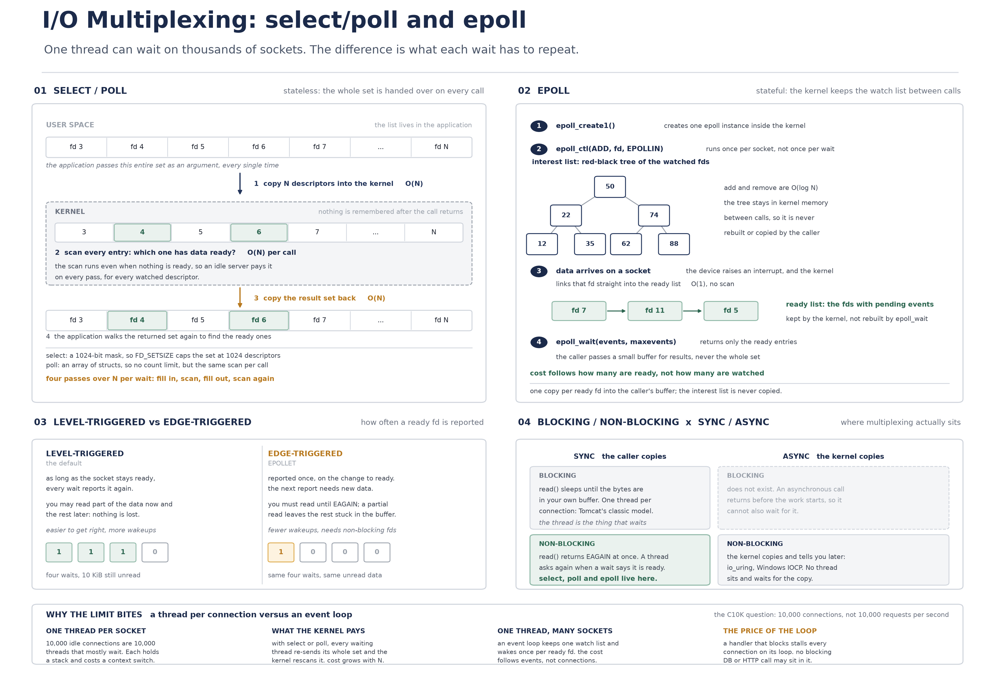

# [OS] I/O 모델과 I/O 멀티플렉싱: select, poll, epoll

- 작성일: 2026-11-15
- 키워드: Operating System, I/O Model, Blocking, Non-Blocking, Synchronous, Asynchronous, I/O Multiplexing, select, poll, epoll, epoll_create, epoll_ctl, epoll_wait, File Descriptor, fd_set, Red-Black Tree, Ready List, Level-Triggered, Edge-Triggered, EPOLLET, C10K, Thread-per-Request, Event Loop, Java NIO, Selector, Netty, Spring WebFlux, Tomcat, io_uring

## 1. 핵심 요약 (What & Why)

앞의 여섯 편은 CPU 안쪽을 다뤘다. 무엇이 실행되고(프로세스·스레드), 어떤 순서로 넘어가고(스케줄링·컨텍스트 스위칭), 여럿이 동시에 실행될 때 무엇이 깨지고(동기화·교착), 그 실행이 딛고 서는 메모리가 어떻게 생겼는지(가상 메모리)다. 이번 편부터는 **그 프로세스가 바깥 세상과 데이터를 주고받는 방식**으로 나간다. 그 첫 주제가 **I/O 모델**과 **I/O 멀티플렉싱(file descriptor 다중화)** 이다.

서버가 요청 하나를 처리하는 동안 CPU가 실제로 명령을 실행하는 시간은 짧다. 대부분은 **기다린다**. 클라이언트의 요청 바이트가 도착하기를, 디스크가 응답하기를, 내가 보낸 응답이 소켓 버퍼로 나가기를. 문제는 이 대기가 **연결마다 따로** 일어난다는 점이다. 연결이 10개면 10번, 1만 개면 1만 번.

전통적인 해법은 단순했다. **연결마다 스레드 하나**를 붙이고, 그 스레드가 `read()`에서 잠들게 두는 것(Thread-per-Request). 연결이 수백 개일 때는 잘 돌아간다. 그런데 1999년 Dan Kegel이 "The C10K problem"으로 정리한 지점에서 이 모델이 무너진다. **동시에 1만 개의 연결**을 감당해야 하는데, 스레드 1만 개는 다음을 요구한다.

| 자원 | 스레드 1만 개가 요구하는 것 | 결과 |
| --- | --- | --- |
| 메모리 | 스레드마다 스택(자바 기본 `-Xss` 기준 1MB 수준)을 예약한다. 실제로 쓰지 않아도 가상 공간과 일부 상주 페이지를 잡는다 | 대기만 하는 연결이 메모리를 점유한다. 스택을 줄이면 재귀·프레임 크기에 제약이 생긴다 |
| 커널 스케줄러 | 실행 가능한 스레드가 늘면 런 큐가 길어지고, 스위칭 비용과 캐시 오염이 함께 는다 | 대부분이 `sleep` 상태인데도 스케줄러가 계속 관리한다 |
| 컨텍스트 스위칭 | 데이터가 도착할 때마다 스레드를 깨우고 다시 재운다 | 처리량보다 스위칭이 많아지는 구간이 온다 |
| 락 경합 | 공유 자료구조(커넥션 풀, 카운터)에 스레드가 몰린다 | 대기 시간이 늘고 예측이 어려워진다 |

여기서 흔한 오해를 하나 정리해야 한다. **C10K는 하드웨어 문제가 아니라 소프트웨어 구조 문제였다.** 커널은 이미 1만 개의 소켓을 문제없이 들고 있었다. 무너진 것은 "대기 하나에 스레드 하나"라는 **1:1 대응**이었다.

**I/O 멀티플렉싱**은 그 1:1 대응을 깨는 기법이다. 이름 그대로 **여러 개의 I/O를 하나의 대기 지점으로 다중화**한다. 스레드 하나가 커널에 "이 소켓들 중 하나라도 준비되면 알려 달라"고 맡기고, 준비된 것만 골라 처리한다. 스레드는 연결 수가 아니라 **준비된 이벤트 수**에 비례해서 일한다.

```text
Thread-per-Request        I/O 멀티플렉싱
연결 1 : 스레드 1    ->   연결 N : 감시자 1
스레드 N개가 각자 대기      스레드 1개가 한 번에 대기
비용 = 연결 수             비용 = 준비된 이벤트 수
```

그런데 여기에 함정이 있다. "한 번에 대기"를 구현하는 방법이 여러 가지이고, **그 방법들의 비용 차이가 연결 수에 따라 극적으로 벌어진다.** `select`는 매 호출마다 감시 대상 전체를 커널에 복사하고 전체를 훑는다. `epoll`은 등록을 한 번만 하고, 준비된 것만 받아 온다. 이번 편의 중심은 그 차이가 어디서 오는지, 그리고 그것이 자바 생태계의 `Selector`·Netty·WebFlux·Tomcat에 어떻게 대응하는지다.

## 2. 내부 메커니즘과 구조 (How it works)

### 2.1 블로킹 `read()` 한 번에 무슨 일이 일어나는가

먼저 기준점이 되는 경로를 정확히 보자. 블로킹 소켓에서 `read(fd, buf, n)`을 호출하면 다음 순서로 진행된다.

1. **시스템 콜 진입**: 사용자 코드가 커널로 넘어간다. 이 시점에 이미 모드 전환 비용이 든다.
2. **데이터 확인**: 커널이 해당 소켓의 **수신 버퍼**를 본다. 데이터가 있으면 5번으로 간다.
3. **잠들기**: 없으면 현재 프로세스를 **인터럽트 불가능/가능 대기열(sleep queue)** 에 넣고 스케줄러에게 CPU를 넘긴다. 이 스레드는 이제 "실행 중"이 아니라 "대기 중"이다.
4. **깨어나기**: NIC가 패킷을 받아 커널 네트워크 스택이 소켓 버퍼에 데이터를 채우면, 커널이 그 소켓의 대기열에 매달린 프로세스를 **깨운다**(wake up).
5. **복사**: 깨어난 스레드가 커널 버퍼의 데이터를 **사용자 버퍼(`buf`)로 복사**한다.
6. **반환**: 읽은 바이트 수를 돌려주고 사용자 모드로 돌아간다.

여기서 **두 개의 서로 다른 대기**가 있다는 점이 이번 편 전체의 열쇠다.

- **데이터가 도착할 때까지의 대기** (3번): "준비될 때까지 기다리는 일".
- **데이터를 내 버퍼로 옮기는 일** (5번): "실제로 복사하는 일".

블로킹/논블로킹은 **첫 번째 대기**를 어떻게 처리하는가의 문제이고, 동기/비동기는 **두 번째 복사를 누가 하는가**의 문제다. 둘을 섞으면 "epoll은 비동기"라는 잘못된 결론이 나온다(2.2).

### 2.2 Blocking/Non-Blocking과 Sync/Async의 2x2

| | 블로킹 (Blocking) | 논블로킹 (Non-blocking) |
| --- | --- | --- |
| **동기 (Synchronous)** | 호출이 결과가 준비될 때까지 **제어권을 돌려주지 않는다**. 그리고 결과를 **호출자가 가져간다**. 전통적 소켓 I/O, 파일 I/O, JDBC | 호출이 **즉시 반환**한다(데이터가 없으면 `EAGAIN`). 준비 여부는 호출자가 물어봐야 하고, **복사는 여전히 호출자 스레드가** 한다. `select`, `poll`, `epoll`이 여기 있다 |
| **비동기 (Asynchronous)** | 정의상 성립하지 않는다. 호출이 즉시 반환한다면 그것은 결과를 기다리고 있지 않은 것이다 | 커널이 **복사까지 끝내고 완료를 통지**한다. 호출자는 완료 알림만 받는다. `io_uring`, Windows IOCP, POSIX AIO |

핵심 구분은 하나다. **"언제 돌아오는가"가 블로킹/논블로킹이고, "누가 복사하고 누가 완료를 확인하는가"가 동기/비동기다.**

이 기준으로 보면 `select`/`poll`/`epoll`은 **동기 논블로킹**이다. `epoll_wait`는 준비된 FD 목록을 즉시 돌려주지만, 데이터는 아직 **커널 소켓 버퍼**에 있다. `recv()`를 호출해 내 버퍼로 복사하는 일은 내 스레드가 한다. 실제로 `recv()`는 논블로킹이므로 복사 중에는 잠들지 않지만, **복사가 끝나기를 내가 기다린다**는 점에서 동기다.

> [!NOTE]
> 리눅스에는 `man 7 aio`나 `io_uring`처럼 진짜 비동기 I/O도 있다. 다만 소켓 I/O에서 일반적으로 쓰이는 것은 여전히 "논블로킹 + 이벤트 통지" 조합이고, 우리가 `epoll`을 "비동기 처리"라고 부를 때는 **대기 방식을 비동기로 바꿨다**는 뜻이지, I/O 자체가 비동기가 되었다는 뜻이 아니다. 이 구분이 뒤의 5절(이벤트 루프에서 블로킹하면 안 되는 이유)로 이어진다.

### 2.3 `select`: 상태가 없는 감시자

`select`는 가장 오래된 방식이고, 그 구조적 한계가 가장 분명하다.

```c
fd_set readfds;
FD_ZERO(&readfds);
FD_SET(fd_a, &readfds);   /* 감시할 fd를 비트마스크에 표시 */
FD_SET(fd_b, &readfds);

int n = select(max_fd + 1, &readfds, NULL, NULL, &timeout);
if (n > 0 && FD_ISSET(fd_a, &readfds)) { /* fd_a가 준비됨 */ }
```

동작을 분해하면 비용이 그대로 드러난다.

1. **복사(유저 → 커널)**: `fd_set`은 비트마스크다. `select`는 호출될 때마다 이 마스크 전체를 커널로 넘긴다. 감시 대상이 1개든 1만 개든 **마스크 크기만큼** 복사한다. `O(N)`.
2. **스캔(커널)**: 커널은 `0`번부터 `nfds-1`번까지 **모든 FD를 순서대로** 확인하며 준비 여부를 본다. 준비된 것이 하나도 없어도 전부 훑는다. `O(N)`.
3. **복사(커널 → 유저)**: 결과를 **비트마스크에 덮어써서** 돌려준다. 원래 넘긴 마스크가 파괴되므로, 다음 호출을 위해 사용자는 마스크를 **다시 만들어야 한다**.
4. **재스캔(유저)**: 반환된 마스크에서 어떤 비트가 켜졌는지 애플리케이션이 다시 순회한다. `O(N)`.

즉 **대기 한 번에 N을 네 번 훑는다**(채우기, 커널 스캔, 결과 복사, 결과 재스캔). 그리고 이 모든 것이 **매 호출마다** 반복된다. `select`는 상태를 갖지 않기 때문이다. 커널은 이전 호출에서 무엇을 감시했는지 기억하지 않는다.

구조적 한계도 여기서 나온다. `fd_set`이 **고정 크기 비트마스크**이므로 감시 가능한 FD 수가 `FD_SETSIZE`(기본 1024)로 잘린다. 이 숫자는 성능 문제가 아니라 **API 설계의 흔적**이다. 1024번이 넘는 FD를 감시하려면 라이브러리를 다시 컴파일하거나 `select`를 포기해야 한다.

### 2.4 `poll`: 배열로 바꾼 것, 남은 것은 그대로

`poll`은 `select`의 가장 불편한 두 가지(비트마스크 파괴, 1024 제한)를 고쳤다.

```c
struct pollfd fds[2];
fds[0].fd = fd_a; fds[0].events = POLLIN;   /* 관심 이벤트 */
fds[1].fd = fd_b; fds[1].events = POLLIN;

int n = poll(fds, 2, timeout_ms);
if (fds[0].revents & POLLIN) { /* 준비됨 */ }
```

| 개선점 | 내용 |
| --- | --- |
| 개수 제한 없음 | 비트마스크가 아니라 **배열**이므로 FD 수에 상한이 없다(메모리가 허락하는 만큼) |
| 입력/출력 분리 | `events`(관심)와 `revents`(결과)가 따로 있어 요청 내용이 보존된다 |
| 이벤트 세분화 | `POLLIN`, `POLLOUT`, `POLLERR`, `POLLHUP`, `POLLRDHUP` 등 상태 구분이 가능하다 |

그런데 **비용 구조는 그대로다.** 매 호출마다 배열 전체를 커널로 복사하고(`O(N)`), 커널이 전부 훑고(`O(N)`), 결과 배열을 다시 순회한다(`O(N)`). 바뀐 것은 인터페이스이지 알고리즘이 아니다. 그래서 FD가 1만 개쯤 되면 감시 자체가 병목이 된다.

### 2.5 `epoll`: 등록은 한 번, 통지는 준비된 것만

`epoll`의 발상은 다르다. **"감시 목록을 커널에 두고, 상태를 유지한다."** 그래서 시스템 콜이 세 개로 나뉜다.

| 콜 | 역할 | 비용 |
| --- | --- | --- |
| `epoll_create1(0)` | 커널에 **epoll 인스턴스**를 만든다. 반환값은 그 인스턴스를 가리키는 FD다 | 한 번 |
| `epoll_ctl(epfd, op, fd, &event)` | 관심 목록에 FD를 **등록/수정/삭제**한다(`EPOLL_CTL_ADD`/`MOD`/`DEL`). 소켓당 한 번 | `O(log N)` |
| `epoll_wait(epfd, events, maxevents, timeout)` | **준비된 것만** 꺼내 온다 | 준비된 개수에 비례 |

커널 안에서 벌어지는 일은 이렇다.

1. **`epoll_ctl(ADD)`**: epoll 인스턴스는 **관심 목록(interest list)** 을 **레드-블랙 트리**로 유지한다. 트리 노드에는 FD, 관심 이벤트, 그리고 **콜백 함수**가 들어 있다. 등록 시점에 커널은 그 소켓의 대기열에 이 콜백을 건다. 즉 **"이 소켓에 데이터가 오면 나를 불러라"** 를 커널에 심어 두는 것이다. 트리이므로 추가·삭제가 `O(log N)`이고, 무엇보다 **이 구조가 호출 사이에 살아 있다.**
2. **이벤트 도착**: NIC가 패킷을 받으면 커널 네트워크 스택이 소켓 버퍼를 채우고, 그 소켓의 대기열을 깨운다. 그러면 아까 심어 둔 **콜백이 호출**된다.
3. **`ready list`에 연결**: 콜백은 그 FD를 **준비 목록(`rdllist`, 이중 연결 리스트)** 에 넣는다. 이미 들어 있으면 다시 넣지 않는다. 리스트 삽입이므로 `O(1)`이다. 여기서 스캔은 없다.
4. **`epoll_wait`**: 준비 목록이 비어 있으면 잠들고, 항목이 있으면 **그 항목들만** 꺼내 사용자 버퍼에 복사한다. 반환 비용은 **준비된 개수**에 비례한다. 감시 대상이 10만 개여도 준비된 것이 3개면 3개만 본다.

정리하면 `select`/`poll`이 **"매번 물어보는 방식(polling)"** 이라면, `epoll`은 **"이벤트가 생기면 불러 주는 방식(notification)"** 이다. 여기에 두 가지가 더해진다.

- **복사가 사라진다.** 관심 목록은 커널에 있으므로 매 호출마다 넘길 필요가 없다. 사용자는 결과를 받을 **작은 버퍼**만 준다.
- **순회가 사라진다.** 커널도, 애플리케이션도 전체를 훑지 않는다.

> [!NOTE]
> `epoll`의 빠름은 "감시를 빠르게 해서"가 아니라 **"감시를 반복하지 않아서"** 다. 이 차이는 확장성의 모양을 바꾼다. `select`는 연결이 늘면 **모든 연결의 비용이 함께** 늘지만, `epoll`은 연결이 늘어도 **이벤트가 없는 한 비용이 늘지 않는다.** 유휴 연결이 많은 서버(대부분의 웹 서버)에 결정적이다.

한 가지 주의할 점이 있다. `epoll_wait`가 반환할 때 커널은 준비 목록의 항목에 대해 **정말 아직 준비 상태인지 한 번 더 확인**한다(사용자 코드가 이미 읽어 버렸을 수 있으므로). 이 확인은 준비된 항목 수만큼만 일어나므로 전체 비용은 여전히 준비 개수에 비례한다.

### 2.6 Level-Triggered vs Edge-Triggered: 알림을 언제 다시 줄 것인가

`epoll`에는 알림 정책이 두 가지 있다. 이 차이는 성능보다 **정확성**에 가깝다.

| | Level-Triggered (기본) | Edge-Triggered (`EPOLLET`) |
| --- | --- | --- |
| 통지 조건 | FD가 **준비 상태인 동안 계속** 통지한다 | **상태가 준비로 바뀌는 순간** 한 번만 통지한다 |
| 읽기를 덜 했을 때 | 다음 `epoll_wait`에서 **또 알려 준다**. 데이터가 남아 있으니 안전하다 | **알려 주지 않는다.** 남은 데이터는 내가 다시 읽기 전까지 그대로 멈춰 있다 |
| 요구 사항 | 없음 | **논블로킹 FD** + **`EAGAIN`까지 읽는 루프**가 필수 |
| 대표 사고 | 없음. 대신 준비된 FD가 많으면 깨어나는 횟수가 늘어난다 | 드레인 루프를 빠뜨리면 **연결이 조용히 멈춘다**(half-dead connection) |
| 적합한 경우 | 대부분의 서버. 특히 처리 로직이 여러 단계인 경우 | 이벤트 수가 많고, 한 번에 끝까지 읽는 단순한 파이프라인 |

ET는 논리적으로 이렇게 동작한다.

```c
/* ET에서 올바른 읽기 루프: EAGAIN을 만날 때까지 계속 읽는다 */
for (;;) {
    ssize_t n = recv(fd, buf, sizeof(buf), 0);
    if (n > 0)      { handle(buf, n); continue; }
    if (n == 0)     { close(fd); break; }          /* 상대가 닫음 */
    if (errno == EAGAIN) break;                     /* 여기서 멈춰야 안전 */
    if (errno == EINTR)  continue;                  /* 시그널로 중단됨 */
    /* 그 밖의 오류 */
}
```

`EAGAIN`을 만나기 전에 루프를 빠져나가면, 커널은 "이미 알려 줬다"고 생각하므로 다시 알려 주지 않는다. 데이터는 버퍼에 남아 있고, 애플리케이션은 그 연결을 **영원히 기다린다.** 이것이 ET에서 가장 흔한 장애 원인이다.

`epoll`에는 이 밖에도 실무에서 쓰이는 플래그가 있다.

| 플래그 | 용도 |
| --- | --- |
| `EPOLLONESHOT` | 한 번 통지 후 감시를 자동 해제한다. 여러 스레드가 같은 FD를 처리할 때 중복 처리를 막고, 처리가 끝나면 `EPOLL_CTL_MOD`로 재등록한다 |
| `EPOLLRDHUP` | 상대의 half-close(읽기 방향 종료)를 감지한다. `recv`가 0을 반환하기 전에 알 수 있다 |
| `EPOLLEXCLUSIVE` | 여러 프로세스/스레드가 같은 FD를 감시할 때 **하나만** 깨운다(thundering herd 완화) |

### 2.7 자바에서의 대응: Selector, Netty, WebFlux, Tomcat

지금까지의 개념은 자바에서 이름만 바꿔 그대로 나타난다. 이 대응을 잡아 두면 "라이브러리를 외우는 일"이 "원리를 확인하는 일"로 바뀐다.

| 커널 개념 | 자바 대응 |
| --- | --- |
| `epoll_create` | `Selector.open()` - 내부에서 플랫폼별 구현을 고른다(리눅스면 epoll, macOS면 kqueue) |
| `epoll_ctl(ADD)` | `channel.register(selector, ops)` / `SelectionKey.interestOps(ops)` |
| 관심 이벤트 | `SelectionKey.OP_ACCEPT`, `OP_CONNECT`, `OP_READ`, `OP_WRITE` |
| 준비된 이벤트 | `SelectionKey.readyOps()`, `key.isReadable()` |
| `epoll_wait` | `selector.select()` / `select(timeout)` |
| 준비 목록 | `selector.selectedKeys()` |

**Java NIO `Selector`** 는 이 구조를 거의 그대로 노출한다. 하나의 `Selector`에 여러 `SocketChannel`을 등록하고, `select()`가 반환하면 준비된 키만 순회해 처리한다. 여기서 실무에서 가장 자주 나오는 버그가 있다. **처리한 키를 `selectedKeys()`에서 지우지 않으면** 같은 키가 계속 남아 루프가 헛돈다.

```java
while (true) {
    selector.select();
    Iterator<SelectionKey> it = selector.selectedKeys().iterator();
    while (it.hasNext()) {
        SelectionKey key = it.next();
        it.remove();                       /* 이 줄이 없으면 busy loop */
        if (key.isAcceptable())      accept(key);
        else if (key.isReadable())   read(key);
    }
}
```

**Netty**는 이 위에 구조를 얹는다. `EventLoop` 하나가 `Selector` 하나를 들고, 그 루프에 **다수 채널**이 묶인다. 채널은 생성될 때 특정 `EventLoop`에 배정되고 **수명 동안 바뀌지 않는다.** 그래서 한 채널의 이벤트가 항상 같은 스레드에서 처리되고, 이것이 락 없이 순서를 보장하는 근거가 된다. `Boss` 그룹이 `OP_ACCEPT`를, `Worker` 그룹이 읽기·쓰기를 맡는 구조도 같은 원리다. 이벤트는 `ChannelPipeline`을 따라 핸들러 체인으로 흐른다.

**Spring WebFlux**는 Reactor Netty(위의 Netty 이벤트 루프) 위에서 동작한다. 기본 작업자 스레드 수는 CPU 코어 수를 기준으로 잡히고, 그 소수의 스레드가 다수 요청을 번갈아 처리한다. 이 모델이 성립하는 조건이 바로 **"이벤트 루프 스레드를 절대 블로킹하지 않는다"** 이다.

**Tomcat은 다르다.** 톰캣도 NIO 커넥터에서는 내부적으로 `Selector`를 쓴다. 하지만 그 역할은 **연결을 받고 데이터가 도착했는지 확인하는 데까지**다. 데이터가 준비되면 요청 처리를 **워커 스레드 풀**로 넘기고, 애플리케이션 코드는 여전히 블로킹 서블릿 API를 본다.

```text
Tomcat  Http11NioProtocol:  Acceptor -> Poller(Selector) -> Worker Thread Pool -> Servlet
                            (커넥터 수준 멀티플렉싱)          (애플리케이션 수준 스레드 1:1)
Netty / WebFlux:            EventLoop(Selector) -> Pipeline/Handler   (처리까지 같은 스레드)
```

즉 **둘 다 `epoll`을 쓰지만, 어느 계층까지 이벤트 루프로 처리하는지가 다르다.** 이 차이가 6절의 선택 기준이 된다.

## 3. 구조 도식 (Diagram)



- **01 select/poll (왼쪽 위)**: 같은 FD 집합이 **세 번** 등장한다. 애플리케이션이 가진 집합, 커널로 복사된 집합, 결과로 돌아온 집합이다. 화살표마다 `O(N)`이 붙어 있는 것이 핵심이다. 커널 상자 안의 문장 **"nothing is remembered after the call returns"** 가 `select`/`poll`의 정체다. 상태가 없으니 매번 전부 다시 보내고 전부 다시 훑는다. 결과 집합에서 초록으로 표시된 두 개가 준비된 FD이고, 애플리케이션은 그 둘을 찾기 위해 **다시 한 번 전체를 훑는다.** 아래 요약대로 대기 한 번에 N을 네 번 지나간다.
- **02 epoll (오른쪽 위)**: 구조가 다르다. `epoll_create1`이 커널에 인스턴스를 만들고, `epoll_ctl`이 **소켓당 한 번** 관심 목록(레드-블랙 트리)에 등록한다. 트리는 `epoll_wait`가 반환해도 **그대로 남는다.** 데이터가 도착하면 커널이 그 FD를 준비 목록에 `O(1)`로 연결하고, `epoll_wait`는 **준비된 세 개만** 돌려준다. 감시 대상이 몇 개든 반환 비용은 준비된 개수를 따른다.
- **03 Level vs Edge (왼쪽 아래)**: 같은 상황(10 KiB가 남아 있고 한 번도 읽지 않음)에서 네 번의 `epoll_wait`가 무엇을 돌려주는지 비교한다. LT는 `1, 1, 1`로 계속 알려 주고 데이터를 다 읽으면 `0`이 된다. ET는 첫 `1` 이후 `0, 0, 0`이다. **알림이 줄어든 대신, 남은 데이터를 확인할 책임이 애플리케이션으로 넘어왔다.**
- **04 2x2 (오른쪽 아래)**: `select`/`poll`/`epoll`은 초록 칸(동기 + 논블로킹)에 있다. 대기는 논블로킹으로 바뀌었지만 **복사는 여전히 호출자 스레드의 몫**이다. 커널이 복사까지 해 주는 칸(비동기)은 `io_uring`, IOCP 같은 별개의 계층이다.
- **맨 아래 띠**: 이 모든 것이 왜 문제였는지다. 연결마다 스레드를 두면 유휴 연결도 스택과 스위칭을 차지하고, `select`/`poll`은 그 스레드마다 전체 집합을 다시 보낸다. 이벤트 루프는 감시를 하나로 모으지만, 대신 **루프 안의 블로킹 하나가 루프 전체를 멈춘다.**

## 4. 비교 표

### 4.1 Blocking/Non-Blocking vs Sync/Async

| 항목 | 블로킹 + 동기 | 논블로킹 + 동기 | 논블로킹 + 비동기 |
| --- | --- | --- | --- |
| 대표 API | `read()`, `recv()`, JDBC, `FileInputStream` | `select`, `poll`, `epoll`, Java NIO `Selector` | `io_uring`, IOCP, POSIX AIO |
| 호출 반환 시점 | 데이터가 준비되고 **복사까지 끝난 뒤** | **즉시**(준비 안 됐으면 `EAGAIN`) | **즉시**(작업만 등록) |
| 준비 대기를 누가 | 커널이 스레드를 재운다 | 커널이 알려 주고, 스레드는 다른 일을 한다 | 커널이 알아서 처리 |
| 복사를 누가 | 호출한 스레드 | **호출한 스레드** | 커널(DMA 등) |
| 완료를 누가 확인 | 반환값 | 반환값(준비 여부) + 내가 읽은 양 | 완료 통지(이벤트/콜백) |
| 스레드 낭비 | 연결 수만큼 | 준비된 이벤트 수만큼 | 거의 없음 |
| 코드 복잡도 | 낮다(읽기 순서대로) | 중간(상태 머신이 필요) | 높다(버퍼 수명, 완료 순서) |

### 4.2 select vs poll vs epoll

| 항목 | `select` | `poll` | `epoll` |
| --- | --- | --- | --- |
| 감시 자료구조 | 고정 크기 비트마스크(`fd_set`) | 구조체 배열 | 커널 내부 **레드-블랙 트리** |
| FD 수 제한 | `FD_SETSIZE`(기본 1024) | 사실상 없음(메모리 한계) | 사실상 없음(커널 한도 `max_user_watches`) |
| 매 호출 복사 | **전체 집합**(`O(N)`) | **전체 배열**(`O(N)`) | **없음**(등록은 최초 1회) |
| 커널의 준비 탐색 | 전체 순회(`O(N)`) | 전체 순회(`O(N)`) | 준비 목록만(`O(준비 개수)`) |
| 등록 비용 | 없음(매번 넘김) | 없음(매번 넘김) | `epoll_ctl`당 `O(log N)` |
| 결과 형태 | 비트마스크(원본 파괴) | `revents` 필드 | 준비된 이벤트 배열 |
| 사용자 재스캔 | 필요(`O(N)`) | 필요(`O(N)`) | 불필요(준비된 것만 옴) |
| 트리거 모드 | 레벨만 | 레벨만 | 레벨 / 엣지 선택 |
| 유휴 연결이 많을 때 | 연결 수에 비례해 느려진다 | 같다 | **거의 영향 없음** |
| 이식성 | 어디에나 있다 | 거의 어디에나 있다 | 리눅스 전용(BSD는 kqueue, 윈도우는 IOCP) |

### 4.3 Level-Triggered vs Edge-Triggered

| 항목 | Level-Triggered | Edge-Triggered |
| --- | --- | --- |
| 통지 시점 | 준비 상태가 **유지되는 동안 계속** | 준비로 **바뀌는 순간 한 번** |
| 읽기를 덜 했을 때 | 다음 호출에서 다시 알려 준다 | 더 이상 알려 주지 않는다 |
| FD 모드 | 블로킹도 가능 | **논블로킹 필수** |
| 필수 구현 | 없음 | `EAGAIN`까지 읽는 **드레인 루프** |
| 흔한 버그 | 준비된 키를 지우지 않아 busy loop | 드레인 누락으로 연결이 조용히 멈춤 |
| 깨어나는 횟수 | 많다(준비된 FD마다) | 적다(상태 변화마다) |
| 디버깅 난이도 | 낮다 | 높다(증상이 "느려짐"이 아니라 "멈춤"으로 나타난다) |
| 추천 상황 | 일반 서버, 처리 단계가 여러 개인 경우 | 이벤트 폭주가 많고 한 번에 끝까지 읽는 구조 |

## 5. 깨달은 점 (My Insight)

- **`select`의 1024는 성능 한계가 아니라 설계의 흔적이다.** `fd_set`이 고정 크기 비트마스크라는 사실 하나에서 "왜 1024인가"가 바로 설명된다. 그래서 "`select`를 튜닝해서 더 많은 연결을"이라는 접근은 성립하지 않는다. **자료구조가 상한을 정한다.** `epoll`이 무제한인 것도 튜닝 덕이 아니라 비트마스크 대신 트리를 썼기 때문이다. 어떤 시스템의 한계를 만나면 그 한계가 **알고리즘에서 오는지, 표현 방식에서 오는지**를 먼저 구분해야 한다. 표현에서 온 한계는 최적화로 넘을 수 없다.

- **`epoll`이 빠른 것은 감시가 빨라서가 아니라 감시를 반복하지 않아서다.** `select`는 연결이 1만 개면 **매 초 수천 번** 1만 개를 훑는다. `epoll`은 1만 개를 트리에 한 번 넣고, 이벤트가 온 것만 꺼낸다. 같은 일을 더 빠르게 한 것이 아니라 **같은 일을 하지 않는다.** 성능 문제를 볼 때 "이 연산을 어떻게 빠르게 할까"보다 "이 연산을 **왜 매번** 하고 있는가"를 먼저 물어야 한다는 것이 이번 편의 가장 큰 교훈이다. 상태를 어디에 둘 것인가가 성능과 버그를 동시에 결정한다.

- **이벤트 루프의 실패 단위는 요청이 아니라 루프 전체다.** 스레드 풀이 200개인 서버에서 한 요청이 5초 걸리면 나머지 199개 스레드는 계속 돈다. 실패의 단위는 **요청 하나**다. 그런데 이벤트 루프는 스레드 하나가 수천 개 연결을 맡는다. 그 루프 안에서 블로킹 호출 하나가 5초를 잡으면, 그 루프에 묶인 **모든 연결이 5초 동안 멈춘다.** 실패의 단위가 **루프 전체**, 즉 동시에 수천 개다. 그래서 "이벤트 루프가 더 빠르다"는 말과 "이벤트 루프가 더 위험하다"는 말은 같은 구조에서 나온다. 처리량을 얻은 대가로 **고장의 반경**을 키운 것이다.

- **`epoll`은 비동기가 아니다. 그래서 블로킹 지점은 사라지지 않고 옮겨 다닌다.** `epoll_wait`는 준비된 FD를 알려 줄 뿐이고, `recv()`의 복사는 내 스레드가 한다. 그래서 "논블로킹으로 바꿨다"고 해서 `recv()`가 블로킹이 아니게 되는 것이 아니다. 소켓은 **논블로킹 모드로 설정**해야 하고, 파일 I/O나 JDBC처럼 소켓이 아닌 호출은 여전히 스레드를 잡는다. 논블로킹 전환은 **대기 지점을 없애는 일이 아니라, 대기 지점을 한 곳으로 모으는 일**이다. 그 한 곳(이벤트 루프)을 지키는 것이 전체 성능을 지키는 일이 된다.

- **ET는 "푸시에서 풀로"의 전환이고, 그 대가는 정확성 책임이다.** LT는 커널이 "아직 준비됐어"라고 계속 말해 준다. ET는 "방금 준비됐어"라고 한 번만 말하고 침묵한다. 알림을 줄인 대신 **남은 데이터를 확인할 책임이 애플리케이션으로 넘어온다.** 이 거래는 다른 곳에서도 반복된다. 캐시 무효화 통지를 받는 대신 TTL을 포기하고, 웹훅을 받는 대신 폴링을 포기하는 것과 같은 구조다. **통지 기반 설계는 항상 "놓쳤을 때 어떻게 복구하는가"를 함께 설계해야 한다.** ET에서 `EAGAIN`까지 읽는 루프는 그 복구 장치이고, 이걸 빠뜨리면 시스템은 오류를 내지 않고 **조용히 멈춘다.** 오류를 내지 않는 장애가 가장 찾기 어렵다.

- **블로킹/논블로킹과 동기/비동기를 섞으면 설계가 어긋난다.** "`epoll`을 쓰니까 비동기다"라고 생각하면, "그럼 콜백으로 결과를 받겠지"라는 기대가 생긴다. 하지만 `epoll_wait`가 돌아온 시점에 데이터는 **커널 버퍼에 있고**, 내가 읽어야 내 것이 된다. 이 구분이 흐려지면 스레드 모델과 상태 관리가 어긋나고, 결국 "논블로킹인데 왜 느리지"라는 상황을 만난다.

- **무상태 경계가 스레드 모델보다 먼저다.** 이벤트 루프에서는 한 요청이 여러 스레드를 거칠 수 있다. 그런데 `ThreadLocal`에 트랜잭션 컨텍스트나 인증 정보를 담는 코드는 **"한 요청은 한 스레드"** 를 전제한다. 이 전제가 깨지면 값이 사라지거나 다른 요청에 붙는다. 그래서 리액티브 스택은 컨텍스트를 `ThreadLocal`이 아니라 **명시적 컨텍스트(Reactor Context)** 로 옮긴다. 스레드 모델을 바꾸는 일은 라이브러리를 바꾸는 일이 아니라 **암묵적 상태를 걷어내는 일**이다.

## 6. 실무 관점 및 트레이드오프 (Trade-off)

### 6.1 Tomcat vs Netty/WebFlux: 무엇을 고를 것인가

두 모델 중 "더 좋은" 것은 없다. **대기 시간이 전체 시간에서 차지하는 비중**과 **연결 수**가 기준을 정한다.

| 조건 | Thread-per-Request (Tomcat) | Event Loop (Netty/WebFlux) |
| --- | --- | --- |
| 연결 수 | 수백~수천. 스레드 풀 크기로 조절 가능한 범위 | 수만. 유휴 연결이 많을수록 유리 |
| 작업 성격 | CPU 중심, 또는 짧은 DB 조회 | I/O 대기 중심, 외부 API 다수 호출(팬아웃) |
| 코드 | 순차적. 읽기 쉽고 디버깅이 쉽다 | 상태 머신/체인. 익숙해지는 비용이 있다 |
| 생태계 | 서블릿 필터, 시큐리티, JPA, 트랜잭션 | 리액티브 지원 라이브러리 필요. JDBC는 블로킹 |
| 장애 반경 | 요청 1건(스레드 1개) | 이벤트 루프에 묶인 연결 전체 |
| 확장 방식 | 스레드 풀 증설, 인스턴스 증설 | 인스턴스 증설(스레드는 이미 코어 수) |
| 지연 시간 예측 | 스레드 대기열에서 밀리면 선형으로 늘어난다 | 이벤트 처리 순서가 섞여 꼬리 지연이 생길 수 있다 |

> [!WARNING]
> WebFlux로 바꾸면서 JDBC를 그대로 호출하는 것은 가장 흔한 실수다. JDBC는 **블로킹**이므로, 이벤트 루프 스레드에서 호출하면 그 루프의 모든 연결이 DB 응답을 기다린다. 얻으려던 확장성이 그 자리에서 사라지고, 증상은 "리액티브인데 톰캣보다 느리다"로 나타난다. 선택지는 셋이다. R2DBC 같은 논블로킹 드라이버를 쓰거나, `subscribeOn(Schedulers.boundedElastic())`으로 **별도 스레드 풀에 위임**하거나, 아예 MVC를 유지하는 것이다. 어느 쪽이든 **블로킹 경계를 의식적으로 그어야** 한다.

> [!NOTE]
> "동시 연결 수"와 "초당 요청 수"는 다른 문제다. C10K는 **동시에 열려 있는 연결** 1만 개였고, 유휴 연결이 대부분이었다. 초당 요청 수가 높고 처리 시간이 짧은 워크로드라면 스레드 풀 + 큐가 더 단순하고 예측 가능하다. 반대로 요청마다 외부 API를 여러 번 호출하는 구조(대기가 대부분)라면 이벤트 루프의 이득이 크다.

### 6.2 무엇을 어떤 명령으로 보는가

수치를 지어내지 않고 **보는 법과 해석 기준만** 정리한다. 어느 지표든 한 시점의 값이 아니라 **시간축에서 두 번 이상** 봐야 의미가 생긴다.

| 확인 대상 | 명령 | 읽는 법 |
| --- | --- | --- |
| 연결 수와 상태 | `ss -tan`, `ss -s` | `ESTAB` 개수가 실제 동시 연결 수다. `TIME-WAIT`가 비정상적으로 많으면 닫는 쪽 설계를 본다 |
| 수신 버퍼 적체 | `ss -tan`의 `Recv-Q` | 0이 아닌 값이 계속 쌓이면 **읽는 쪽이 밀린 것**이다. 애플리케이션이 느린지, 이벤트 루프가 막혔는지의 첫 단서 |
| accept 큐 포화 | `ss -lnt`의 `Recv-Q`(현재 큐)와 `Send-Q`(백로그 한도), `netstat -s`의 listen overflow | LISTEN 행에서 `Recv-Q`가 `Send-Q`에 근접하면 accept가 밀리는 것이다. ET에서는 accept 루프가 부족하거나 워커가 바쁜 경우 |
| 프로세스 FD 수 | `ls /proc/<pid>/fd \| wc -l` | 연결 1개당 FD 1개(+파일·파이프). 상한은 `/proc/<pid>/limits`의 `Max open files` |
| 시스템 FD | `/proc/sys/fs/file-nr` | 할당/미사용/최대. 상한은 `fs.file-max`. FD 누수가 있으면 할당 수가 단조 증가한다 |
| epoll 감시 한도 | `/proc/sys/fs/epoll/max_user_watches` | 사용자당 등록 가능한 감시 총량. 연결이 매우 많으면 `epoll_ctl`이 `ENOSPC`로 실패할 수 있다 |
| 스레드 모델 확인 | `jcmd <pid> Thread.print` | 스레드 이름이 모델을 말해 준다. `http-nio-<port>-exec-*`면 톰캣 워커, `nioEventLoopGroup-*`면 이벤트 루프 |
| 소켓에서 대기 중인 스레드 | 스레드 덤프에서 `socketRead0`/`socketRead` 프레임 | **자바 스택에서 소켓 대기는 `RUNNABLE`로 보인다**(네이티브 `read` 안에 있으므로). 그러니 "RUNNABLE이 많다 = CPU를 쓴다"로 읽으면 틀린다. 스택을 봐야 한다 |
| 컨텍스트 스위칭 | `vmstat 1`의 `cs`, `pidstat -w -p <pid> 1` | 초당 스위칭이 연결 수와 함께 오르면 스레드 모델의 비용이 드러난 것 |
| 이벤트 루프 블로킹 | BlockHound(`BlockHound.install()`) | 논블로킹 스레드에서 블로킹 호출이 감지되면 예외로 알려 준다. 개발 단계에서 이벤트 루프 오염을 잡는 가장 직접적인 수단 |
| 대기 지점 분해 | 비동기 프로파일러의 **wall-clock** 모드 | CPU 프로파일과 비교해 wall-clock에서만 보이는 프레임이 곧 "대기하고 있던 곳"이다 |

읽는 순서를 하나로 정하면 이렇게 된다. **`Recv-Q`가 쌓이는가 → 스레드 덤프에서 그 일을 하는 스레드가 무엇인가 → 이벤트 루프 스레드가 블로킹 호출에 걸려 있는가.** 이 순서를 지키면 "연결이 많아서 느리다"와 "한 곳이 막혀서 느리다"를 구분할 수 있다.

### 6.3 판단 기준 정리

- **연결 수가 문제인지, 대기 비율이 문제인지 먼저 정한다.** 둘은 다른 해법을 부른다.
- **스레드를 늘리기 전에 스레드가 무엇을 기다리는지 본다.** 소켓 대기라면 늘려도 같은 대기가 늘어난다.
- **이벤트 루프 안에는 블로킹을 두지 않는다.** JDBC, 동기 HTTP, 큰 파일 I/O는 경계를 그어 밖으로 내보낸다.
- **블로킹 경계를 코드에 드러낸다.** "여기서 스레드가 바뀐다"를 숨기면 무상태 가정이 깨진다.
- **ET를 쓸 때는 드레인 루프와 에러 경로를 한 쌍으로 검토한다.** `EAGAIN` 처리와 `EPOLLRDHUP` 처리가 없으면 조용한 멈춤이 생긴다.
- **`select`/`poll`은 없애야 할 유산이 아니다.** 연결 수가 적고 이식성이 중요한 곳(예: 여러 플랫폼을 한 코드로)에서는 여전히 합리적이다. 문제는 1만 연결에서 그것을 쓰는 것이다.
- **측정 없이 "논블로킹이 빠르다"고 결론 내지 않는다.** 대기가 대부분이면 크게 이기고, CPU가 병목이면 오히려 진다.

## 7. 참고 자료 (References)

- Linux `man` pages: `epoll(7)` (Level-Triggered and Edge-Triggered, `EPOLLONESHOT`, `EPOLLEXCLUSIVE`, `epoll_wait` 반환 의미), `epoll_create(2)`, `epoll_ctl(2)`, `epoll_wait(2)`, `select(2)`, `poll(2)`, `select_tut(2)`, `socket(7)` (non-blocking 동작과 `EAGAIN`), `signal(7)` (`EINTR`)
- Michael Kerrisk. The Linux Programming Interface (2010), Chapter 63 Alternative I/O Models (select, poll, epoll), Chapter 56 Sockets
- W. Richard Stevens, Bill Fenner, Andrew M. Rudoff. UNIX Network Programming, Volume 1: The Sockets Networking API (3rd ed.), Chapter 6 I/O Multiplexing: The select and poll Functions
- W. Richard Stevens. UNIX Network Programming (2nd ed.), Chapter 15/16 - non-blocking I/O와 `select` 기반 서버 구조의 고전적 서술
- Dan Kegel. "The C10K problem" (1999, 갱신 유지) - 동시 1만 연결 문제의 원 정리
- Linux kernel documentation: `Documentation/filesystems/epoll.rst`, `Documentation/networking/`
- Linux kernel source: `fs/eventpoll.c` (`struct eventpoll`, `struct epitem`, `ep_poll_callback`, `ep_send_events`) - 관심 목록 트리와 준비 목록의 실제 구현
- `/proc/sys/fs/epoll/max_user_watches`, `/proc/sys/fs/file-max` 관련 커널 문서(`Documentation/admin-guide/sysctl/fs.rst`)
- Java Platform Documentation: `java.nio.channels.Selector`, `SelectionKey`, `java.nio.channels.spi.SelectorProvider` - `select`, `selectedKeys`, `interestOps`/`readyOps` 의미
- OpenJDK: `sun.nio.ch.EPollSelectorImpl`, `sun.nio.ch.KQueueSelectorImpl` - 리눅스/macOS에서의 플랫폼별 구현
- Netty Project Documentation: `EventLoop`, `Channel`, `ChannelPipeline` - 이벤트 루프와 채널의 수명 관계
- Spring Framework Documentation: Web on Reactive Stack (Reactor Netty, 이벤트 루프 스레드 모델)
- Apache Tomcat Documentation: HTTP Connector (NIO/NIO2), `maxThreads`, `acceptCount` - 커넥터의 Selector와 워커 풀 구조
- Reactor BlockHound 문서 - 논블로킹 스레드에서의 블로킹 호출 감지
- `io_uring` 관련: `man 2 io_uring_setup`, `io_uring_enter`, Linux kernel `Documentation/io_uring/` - 진짜 비동기 I/O와 epoll의 차이
