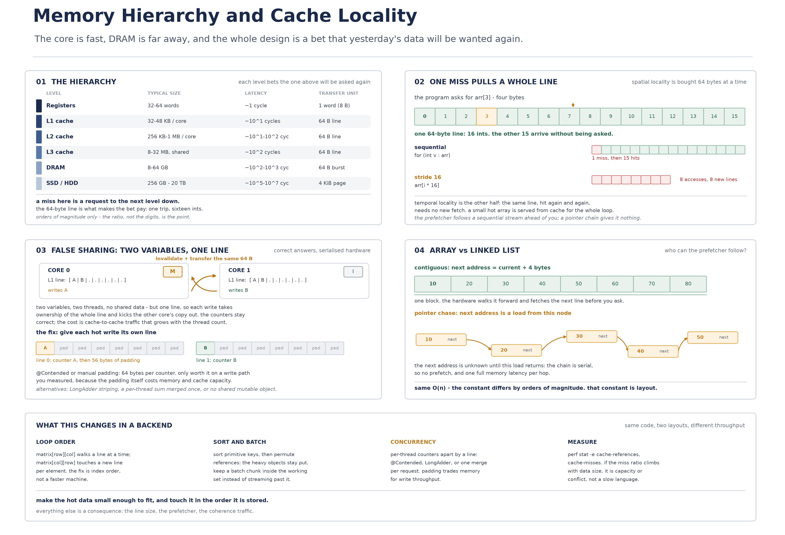

# [OS] 메모리 계층 구조와 CPU 캐시 지역성

- 작성일: 2026-11-16
- 키워드: Operating System, Memory Hierarchy, Memory Wall, Cache, Cache Line, Cache Hit/Miss, Temporal Locality, Spatial Locality, Prefetching, Set Associativity, Cache Coherence, MESI, False Sharing, Cache Padding, Java Memory Model, ArrayList, LinkedList, Working Set, TLB, Page Cache, perf, JMH

## 1. 핵심 요약 (What & Why)

운영체제 기초 트랙의 마지막 편이다. 앞의 일곱 편은 "무엇이 실행되는가"에서 "그 실행이 무엇에 딛고 서는가"까지 내려왔다. 프로세스와 스레드(1편), CPU 스케줄링(2편), 컨텍스트 스위칭(3편), 동기화(4편), 교착 상태(5편), 가상 메모리(6편), I/O 멀티플렉싱(7편). 6편에서는 페이지 테이블이 가상 주소를 물리 주소로 바꾸는 과정을 봤고, 7편에서는 프로세스가 바깥 세상과 데이터를 주고받는 방식을 봤다. 이번 편은 그 사이에 남아 있던 질문 하나를 다룬다. **CPU가 메모리에서 값을 꺼내 올 때, 실제로는 무슨 일이 일어나는가.**

출발점은 격차다. 코어는 한 사이클에 명령 하나를 처리한다. 그런데 그 명령이 필요로 하는 값이 DRAM에 있으면, 값을 받아 오는 데는 그 사이클이 수백 번 지나갈 만큼의 시간이 걸린다. CPU 세대마다 숫자는 다르지만 **비율**은 비슷하다. 코어가 한 번 숨 쉬는 동안 메모리는 몇백 걸음 떨어져 있는 셈이다.

> [!NOTE]
> 이 격차를 1995년 Wulf와 McKee가 "메모리 벽(Memory Wall)"이라고 불렀다. 코어 성능은 매년 빠르게 올랐지만 DRAM의 지연은 그 속도로 줄지 않았기 때문에, 언젠가 "코어 속도를 올려도 메모리가 따라오지 못해 이득이 사라지는 벽"에 부딪힌다는 예측이다. 오늘날 그 벽은 사라지지 않았고, 대신 **벽을 우회하는 구조**가 코어 안에 들어앉았다.

그 구조가 **메모리 계층(memory hierarchy)** 이다. 코어 바로 옆에 아주 작고 아주 빠른 메모리(SRAM)를 두고, 자주 쓰는 데이터를 거기 복사해 둔다. 아래로 내려갈수록 크고 느리고 싸다. 레지스터, L1, L2, L3, DRAM, SSD, HDD가 그 사다리다.

이 구조가 성립하는 근거는 하드웨어가 아니라 **프로그램의 습관**이다.

- **시간 지역성(temporal locality)**: 방금 쓴 데이터는 곧 다시 쓴다. 반복문의 카운터, 계속 참조되는 설정 값, 같은 행을 여러 번 읽는 조인 결과.
- **공간 지역성(spatial locality)**: 방금 쓴 데이터의 **옆**에 있는 데이터를 곧 쓴다. 배열 순회, 구조체의 연속된 필드, 명령어의 다음 줄.

이 두 습관에 돈을 건 장치가 캐시다. 그래서 캐시는 "한 번에 한 바이트"를 가져오지 않는다. **64바이트라는 한 덩어리(캐시 라인)** 를 통째로 가져온다. 옆의 데이터가 곧 필요할 것이라고 이미 걸었기 때문이다.

그런데 여기서 두 가지가 따라온다. 이 두 가지가 이번 편의 절반이다.

1. **캐시의 단위는 변수가 아니라 라인이다.** 서로 다른 두 변수가 한 라인에 있으면, 하드웨어는 그 둘을 한 덩어리로 취급한다. 두 스레드가 각자 다른 변수를 쓰는데도 서로의 캐시를 무효화하며 줄을 서는 일이 생긴다(False Sharing).
2. **캐시는 주소의 연속을 예측할 수 있지만, 포인터의 목적지는 예측할 수 없다.** 배열 순회는 미리 다음 라인을 당겨 올 수 있지만, 연결 리스트는 앞 노드를 읽어야 다음 주소를 안다. 같은 O(n) 순회가 자릿수만큼 차이 나는 이유가 여기에 있다.

정리하면 이번 편은 세 가지를 본다. **왜 계층이 필요한가(2.1-2.2), 캐시가 무엇을 단위로 사고하는가(2.3-2.5), 그 단위가 코드의 모양을 어떻게 바꾸는가(2.6-2.8).** 마지막에 계층이 CPU 밖에도 있다는 것(2.9)으로 6편과 7편을 다시 잇는다.

## 2. 내부 메커니즘과 구조 (How it works)

### 2.1 한 번의 로드가 기다리는 시간

`sum += a[i]` 한 줄을 분해해 보자. 컴파일러는 대략 이렇게 만든다.

```text
LOAD  r1, [a + i*4]    ; a[i]를 레지스터로
ADD   r2, r2, r1       ; sum에 더한다
```

`ADD`는 1사이클이다. 문제는 `LOAD`다. 코어는 주소를 계산해 L1 캐시에 물어본다. 값이 있으면(히트) 몇 사이클 안에 끝난다. 없으면(미스) L2로, L3로, 결국 DRAM으로 내려간다. 이때 코어는 그 로드가 끝날 때까지 `ADD`를 실행할 수 없다. **데이터 의존(dependency)** 이 있기 때문이다.

이 대기를 그냥 세워 두면 코어는 낭비된다. 그래서 두 가지를 한다.

- **캐시로 대기 자체를 줄인다.** 대부분의 로드를 L1/L2에서 끝낸다.
- **대기를 겹친다.** 앞의 로드가 기다리는 동안 뒤의 **독립적인** 명령을 먼저 실행한다(비순차 실행). 서로 의존하지 않는 로드 여러 개를 동시에 진행하는 능력을 **메모리 수준 병렬성(MLP)** 이라고 한다.

2.5에서 보겠지만, 이 두 번째 성질이 배열과 연결 리스트를 갈라놓는다. 캐시 히트율이 같아도 **의존 사슬이 길면** 대기를 겹칠 수 없다.

### 2.2 계층의 모양: SRAM, DRAM, 그리고 단위

계층이 이런 모양인 이유는 소자의 성질 때문이다.

| 소자 | 저장 방식 | 속도 | 집적도 | 전원 끊으면 | 쓰이는 곳 |
| --- | --- | --- | --- | --- | --- |
| SRAM | 트랜지스터 6개로 1비트(플립플롭) | 매우 빠름 | 낮음(면적 큼) | 사라짐 | 레지스터, L1/L2/L3 |
| DRAM | 커패시터 1개 + 트랜지스터 1개 | 느림(충전·방전, 주기적 refresh) | 높음 | 사라짐 | 메인 메모리 |
| NAND 플래시 | 전하 트랩 | 매우 느림(페이지 단위) | 매우 높음 | 유지 | SSD |
| 자기 디스크 | 자화 | 가장 느림(기계적 탐색) | 매우 높음 | 유지 | HDD |

SRAM은 빠르지만 비싸고 면적을 많이 먹는다. 그래서 **아주 조금만** 둔다. DRAM은 느리지만 조밀해서 **크게** 둘 수 있다. 이 상충 관계가 사다리의 모양을 결정한다. 위로 갈수록 작고 빠르고 비싸고, 아래로 갈수록 크고 느리고 싸다.

책상 비유가 정확히 이 구조다. 손(레지스터)에는 지금 계산 중인 것만, 책상(L1/L2)에는 오늘 볼 자료, 책장(DRAM)에는 이번 주 자료, 창고(SSD)에는 나머지가 있다. 책상이 좁으면 자꾸 책장까지 걸어가야 하고, 그 왕복이 곧 미스다.

층마다 **옮기는 단위**가 다른 것도 같은 이유다. 한 번 옮기는 데 드는 비용(탐색, 전기적 지연, 프로토콜)이 크면, 단위를 키워서 그 비용을 여러 바이트에 나눠야 한다.

| 경계 | 이동 단위 | 왜 그 단위인가 |
| --- | --- | --- |
| 레지스터 - L1 | word (8바이트) | 명령어가 다루는 단위 |
| L1/L2/L3 - DRAM | **64바이트 라인** | 공간 지역성. 옆 바이트가 곧 필요하다는 베팅 |
| DRAM - SSD/HDD | 4KiB 페이지 | 가상 메모리 편의 페이지, DMA와 TLB의 단위 |
| SSD 내부 | 4KiB 이상 페이지, 소거는 수 MB 블록 | 쓰기는 페이지, 지우기는 블록(쓰기 증폭의 원인) |

> [!NOTE]
> 캐시 라인 크기는 하드웨어마다 다르다. x86-64는 64바이트가 표준이고, 일부 ARM 코어는 128바이트를 쓴다. 코드를 짤 때 라인 크기를 상수로 박아 넣었다면 `getconf LEVEL1_DCACHE_LINESIZE`로 실제 값을 확인해야 한다. 그리고 이 글에서 "64바이트"라고 쓸 때마다 "이 플랫폼의 라인 크기"로 읽으면 된다.

### 2.3 캐시 라인: 주소를 세 토막으로 나눈다

캐시는 데이터를 아무 데나 두지 않는다. 주소를 비트 단위로 잘라 **어디에 둘지**를 결정한다.

```text
64비트 가상 주소 (물리 주소로 변환된 뒤)
+-------------------+----------------+--------------+
|       tag         |   set index    | block offset |
+-------------------+----------------+--------------+
                                     \ 6비트 = 64바이트
```

- **block offset(6비트)**: 라인 안에서 몇 번째 바이트인가. 64바이트 = 2^6이므로 6비트다.
- **set index**: 어느 세트(슬롯 그룹)에 들어갈 수 있는가. 세트 수가 2^n이면 n비트.
- **tag**: 그 세트에 들어 있는 라인이 정말 내가 찾는 주소인지 확인하는 꼬리표.

세트 하나에 라인을 몇 개 둘 수 있는지를 **연관도(associativity)** 라고 한다.

| 구조 | 세트당 라인 | 장점 | 단점 | 비유 |
| --- | --- | --- | --- | --- |
| 직접 사상(direct mapped) | 1 | 가장 단순, 가장 빠름, 전력 적음 | 서로 같은 세트로 몰리는 주소끼리 계속 밀어냄(conflict miss) | 지정석 하나 |
| N-way 집합 연관 | N (2, 4, 8, 16...) | 충돌이 줄어든다 | 비교 회로가 늘고 느려진다 | N개의 좌석 중 아무 데나 |
| 완전 연관(fully associative) | 전부 | 충돌 없음(교체 정책만 남음) | 큰 캐시에는 불가능(TLB처럼 작은 곳에만) | 자유석 |

L1은 보통 8-way, L2/L3는 16-way 안팎이다. **연관도는 "충돌 미스"와 "속도" 사이의 거래**다. 세트 수가 적으면 서로 다른 주소가 같은 세트를 두고 싸우고, 연관도를 올리면 그 싸움이 줄지만 매 접근마다 더 많은 tag를 비교해야 한다.

미스가 나면 일어나는 일은 정해져 있다.

1. 그 세트에서 **희생자(victim)** 를 고른다(대략 LRU, 실제로는 의사 LRU나 무작위).
2. 희생자가 **더러우면(dirty)** 아래 층으로 되쓴다(write-back). 깨끗하면 그냥 버린다.
3. 아래 층에서 **라인 전체**를 가져온다. 필요한 4바이트만이 아니라 64바이트 전부다.
4. 코어에 값을 돌려준다.

쓰기 정책도 두 가지다. **write-through**는 쓸 때마다 아래 층에도 쓰고, **write-back**은 캐시에만 표시(dirty)해 두었다가 내보낼 때 쓴다. 요즘 코어는 write-back을 쓴다. 아래 층으로 나가는 트래픽이 훨씬 적기 때문이다. 대신 "이 라인은 다른 코어와 다르다"는 상태를 관리해야 하고, 그것이 2.6의 일관성 문제로 이어진다.

### 2.4 지역성 두 가지: 무엇을 재사용하는가

| | 시간 지역성 | 공간 지역성 |
| --- | --- | --- |
| 재사용 대상 | **같은 주소** | **가까운 주소** |
| 전형적인 코드 | 반복문 카운터, 누적 합, 캐시된 설정 값, 같은 행 재조회 | 배열 순회, 구조체 필드 연속 접근, 다음 명령어 |
| 캐시가 하는 일 | 라인을 오래 붙잡는다 | **라인을 통째로** 가져와 옆 바이트까지 채운다 |
| 깨지는 코드 | 한 번 쓰고 버리는 데이터를 크게 순회 | 열 우선(column-major)으로 행렬을 훑기, 64바이트보다 큰 간격으로 건너뛰기 |
| 대응 | 반복 줄이기, 중간 결과 재사용, 청크 처리 | 접근 순서를 저장 순서에 맞추기, 데이터를 붙여 두기 |

시간 지역성은 "얼마나 오래 붙잡을 것인가"의 문제이고, 공간 지역성은 "얼마나 크게 가져올 것인가"의 문제다. 캐시의 용량과 라인 크기가 각각 이 둘에 대응한다.

두 지역성이 코드에서 어떻게 나타나는지 보자.

```java
int[] a = new int[1_000_000];
int sum = 0;

/* 1. 순차 접근: a[0]에서 미스 1번, 그 라인의 나머지 15개 int는 히트 */
for (int i = 0; i < a.length; i++) sum += a[i];

/* 2. 같은 데이터, 다른 순서: int 하나가 4바이트이므로 16칸씩 건너뛰면 매번 새 라인 */
for (int i = 0; i < a.length; i += 16) sum += a[i];
```

1번은 라인 하나로 int 16개를 처리한다. 2번은 int 하나마다 라인을 새로 가져온다. **같은 배열, 같은 개수의 덧셈인데 메모리 트래픽이 16배**다. 알고리즘은 같고 접근 패턴만 다르다.

여기서 흔한 오해를 하나 정리하자. "배열이 빠르다"는 말은 배열이 **자료구조로서** 빠르다는 뜻이 아니다. 배열이 **주소를 연속으로 배치하기 때문에** 프리페처와 캐시가 일을 할 수 있다는 뜻이다. 연속성은 배열만의 성질이 아니고, 배열이 항상 연속인 것도 아니다(객체 배열은 참조만 연속이다. 2.8).

### 2.5 프리페칭과 의존 사슬: 예측할 수 있는 것과 없는 것

캐시 미스가 비싼 이유는 **기다려야 하기 때문**이다. 그런데 기다릴 필요가 없는 미스가 있다. 미리 가져오면 되는 미스다. 하드웨어 **프리페처(prefetcher)** 가 그 일을 한다.

프리페처는 접근 주소의 흐름을 관찰한다. 같은 방향으로 일정 간격(stride)으로 주소가 올라가면, "다음에도 그 간격으로 올 것"이라고 추론해 미리 라인을 요청한다. 그래서 순차 순회는 첫 미스 이후로는 거의 기다리지 않는다. 대기 시간이 **첫 라인 하나로 상각**된다.

반대로 예측할 수 없는 접근이 있다.

```java
class Node {
    int value;
    Node next;
}

int sum = 0;
for (Node n = head; n != null; n = n.next) sum += n.value;
```

`n.next`의 주소는 **현재 노드를 읽어야** 알 수 있다. 프리페처는 다음 주소를 모르니 미리 가져올 수 없고, 코어는 매 노드마다 전체 지연을 기다린다. 게다가 이 사슬은 **데이터 의존**이므로 MLP로 겹칠 수도 없다. 10개의 독립적인 배열 접근은 동시에 10개를 진행할 수 있지만, 10칸짜리 연결 리스트는 1개씩 순서대로다.

> [!NOTE]
> 그래서 성능은 "히트율" 하나로 설명되지 않는다. 히트율이 같아도 **미스가 몇 개나 동시에 진행 중인가(MLP)** 가 다르면 처리량이 다르다. 비순차 코어는 미결 미스를 MSHR(Miss Status Holding Register)이라는 표에 기록하며 여러 개를 동시에 추적한다. 이 표가 차면 뒤의 로드는 앞의 미스가 끝나기를 기다린다. 포인터 추적은 이 표를 한 번에 하나씩만 쓰는 셈이다.

소프트웨어 프리페치 명령(`__builtin_prefetch`, x86의 `prefetcht0`)도 있다. 다만 자바에서는 직접 내리기 어렵고, JIT가 도와주는 범위도 제한적이다. 자바에서 할 수 있는 일은 **프리페처가 따라갈 수 있는 모양으로 데이터를 배치하는 것**이다.

### 2.6 캐시 일관성: 여러 코어가 같은 라인을 볼 때

지금까지는 코어 하나를 가정했다. 실제 서버는 코어가 여러 개이고, 각 코어는 자기 L1/L2를 가진다. 같은 주소를 두 코어가 동시에 캐시하면 어느 쪽이 진짜인가?

하드웨어가 이 문제를 푸는 방식을 **캐시 일관성 프로토콜(cache coherence)** 이라고 한다. 널리 쓰이는 것이 **MESI**다. 라인마다 네 가지 상태 중 하나를 붙인다.

| 상태 | 의미 | 이 코어의 복사본 | 다른 코어의 복사본 | 이 상태에서 쓰면 |
| --- | --- | --- | --- | --- |
| **M** (Modified) | 내가 고쳐서 아래 층과 다르다 | 유일하고 최신 | 없다 | 그냥 쓴다(이미 독점) |
| **E** (Exclusive) | 아래 층과 같고, 나만 가지고 있다 | 유일 | 없다 | 독점을 얻은 상태이므로 바로 M으로 |
| **S** (Shared) | 아래 층과 같고, 여럿이 가지고 있다 | 있음 | 있을 수 있다 | 다른 복사본을 무효화해야 M으로 |
| **I** (Invalid) | 유효하지 않다 | 없다 | - | 먼저 라인을 가져와야 한다 |

전이는 네 가지 사건으로 일어난다.

- **읽기 미스**: 다른 코어에 복사본이 없으면 E로, 있으면 S로 들어온다.
- **쓰기 히트**: E면 M으로 올라간다. S면 **다른 코어에 무효화(invalidation)를 보내고** M이 된다.
- **남의 쓰기 엿보기(snoop)**: 내 라인이 M인데 다른 코어가 그 라인을 읽으려 하면, 내가 최신 값을 내주고 M에서 S로 내려간다. 내 라인이 S인데 다른 코어가 쓰려 하면 I가 된다.
- **내보내기(eviction)**: M인 채로 밀려나면 아래 층에 되쓴다.

핵심은 **쓰기는 독점을 요구한다**는 것이다. 값을 바꾸려면 다른 코어의 복사본을 먼저 무효화해야 한다. 그래서 "여러 코어가 같은 라인을 자주 쓰는" 상황은 하드웨어적으로 직렬화된다. 이것이 2.7의 False Sharing이다.

> [!NOTE]
> 일관성(coherence)과 일관된 순서(consistency)는 다른 문제다. MESI는 **한 라인**의 값이 모든 코어에게 같아 보이게 만든다. 하지만 **서로 다른 라인**에 쓴 값이 다른 코어에게 어떤 순서로 보이는지는 보장하지 않는다. 그 순서를 정하는 것이 메모리 모델(x86의 TSO, ARM의 약한 모델, 자바의 JMM)이다. `volatile`과 `synchronized`가 다루는 것은 후자다. **False Sharing은 정확성 문제가 아니라 성능 문제이고, `volatile`로 고칠 수 없다.** 오히려 `volatile`은 컴파일러 최적화를 막아 더 자주 메모리에 닿게 만들 수 있다.

### 2.7 False Sharing: 변수는 다른데 라인은 같다

두 스레드가 각자 자기 카운터를 올린다고 하자. 데이터 경쟁은 없다. 각 스레드는 자기 변수만 건드린다.

```java
final class CounterPair {
    volatile long left;    // 8바이트
    volatile long right;   // 바로 옆. 64바이트 라인 하나에 함께 들어간다
}
```

그런데 `left`와 `right`는 **같은 라인**에 있다. 하드웨어의 단위는 변수가 아니라 라인이다. 그래서 일어나는 일은 이렇다.

1. 코어 0이 `left`를 쓴다. 그 라인을 독점(M)한다. 코어 1의 복사본은 무효(I)가 된다.
2. 코어 1이 `right`를 쓰려 한다. 자기 복사본이 무효라서 라인을 다시 가져와야 한다. 코어 0에서 라인을 받아 독점한다. 코어 0의 복사본은 무효가 된다.
3. 코어 0이 다시 `left`를 쓴다. 또 라인을 가져와야 한다.

변수는 두 개, 스레드는 둘, 공유하는 데이터는 없는데 **라인 하나가 두 코어 사이를 왕복**한다. 이것이 **거짓 공유(false sharing)** 다. 결과값은 항상 옳다. 느려질 뿐이다. 그리고 느려지는 폭이 커서, 스레드를 늘렸는데 처리량이 오르지 않거나 오히려 떨어지는 모양으로 나타난다.

고치는 방법은 단순하다. **각자 다른 라인을 쓰게** 하면 된다.

```java
final class PaddedCounter {
    volatile long value;
    long p1, p2, p3, p4, p5, p6, p7;   // 56바이트. 합쳐서 64바이트 = 라인 하나
}
```

JDK는 이 패턴을 언어 차원에서 지원한다.

```java
@jdk.internal.vm.annotation.Contended   // JDK 9+. JDK 8은 sun.misc.Contended
static final class Cell {
    volatile long value;
}
```

`@Contended`는 필드나 클래스에 붙이면 JVM이 앞뒤에 패딩을 넣어 다른 데이터와 같은 라인에 놓이지 않게 한다. `java.util.concurrent.atomic.LongAdder`가 내부적으로 이 애노테이션을 쓴 `Cell` 배열을 두고, 스레드별로 다른 셀에 더한 뒤 `sum()`에서 합치는 이유가 이것이다. 하나의 카운터를 두고 싸우는 대신, **여러 셀로 흩어 놓아 라인 경합을 없앤다.**

> [!WARNING]
> `@Contended`는 사용자 클래스에 기본으로 적용되지 않는다. JDK 내부 패키지(`jdk.internal.vm.annotation`)를 쓰려면 `--add-exports`가 필요하고, JDK 8의 `sun.misc.Contended`는 `-XX:-RestrictContended`를 켜야 한다. 그리고 이 기능은 **패딩만큼 메모리를 더 쓴다.** 카운터 100만 개를 배열로 두고 전부 패딩하면 64MB가 패딩으로 사라진다. 캐시 용량도 그만큼 줄어든다. **측정으로 핫한 쓰기 지점을 확인한 뒤에만** 적용해야 한다.

### 2.8 자바와 스프링에서의 모양

지금까지의 개념은 자바에서 이름만 바꿔 그대로 나타난다.

**기본형 배열은 가장 캐시 친화적인 구조다.** `int[]`는 4바이트 값이 연속으로 놓인다. 64바이트 라인 하나에 16개가 들어간다. 반면 `Integer[]`나 `ArrayList<Integer>`는 **참조**가 연속으로 놓이고, 실제 객체는 힙 곳곳에 흩어져 있다. 원소 하나를 읽으려면 참조 배열에서 포인터를 얻고(1차 접근), 그 포인터를 따라 객체로 가야 한다(2차 접근, 다른 라인). 박싱은 값 하나에 객체 헤더를 붙이므로, 원소당 메모리도 몇 배가 된다.

```java
int[] primitive = new int[n];          // 연속된 4바이트 값
Integer[] boxed = new Integer[n];      // 연속된 참조 + 흩어진 Integer 객체
```

**`LinkedList`는 순회의 관점에서 거의 최악이다.** 원소마다 `Node` 객체가 따로 있고, 그 안에 `prev`/`next` 참조가 있다. 다음 노드는 현재 노드를 읽어야 알 수 있으므로 포인터 추적이 되고, 프리페치가 듣지 않는다. 원소당 메모리도 `Node` 헤더와 참조 두 개 때문에 커진다. `ArrayList`의 순회가 인덱스 산술로 연속 주소를 훑는 것과 비교하면, 같은 O(n)이지만 상수가 다르다.

| | `ArrayList` | `LinkedList` |
| --- | --- | --- |
| 원소 저장 | 참조 배열(연속) + 힙의 객체 | 노드 객체(흩어짐) |
| 순회 | 배열을 앞으로 훑는다 | 포인터를 따라간다 |
| 프리페치 | 가능 | 불가능(주소를 미리 모른다) |
| 중간 삽입 | 뒤를 밀어야 한다(배열 복사) | 참조 두 개만 바꾼다 |
| 원소당 추가 메모리 | 참조 1개 | 노드 헤더 + 참조 3개 |

**해시맵도 배치의 문제다.** 자바의 `HashMap`은 버킷 배열과 연결된 `Node`들로 이루어진다(체이닝). 해시가 잘 퍼지면 버킷 배열 접근 한 번으로 끝나지만, 충돌이 나면 `Node` 사슬을 따라가야 한다. 개방 주소법(open addressing)을 쓰는 구현은 충돌 시 **같은 배열의 옆 칸**을 보므로, 포인터를 따라가지 않고도 다음 후보를 찾는다. 같은 해시 테이블이라도 배치가 다르면 상수가 달라진다.

**정렬**에서도 갈린다. `Arrays.sort(int[])`는 기본형 배열을 제자리에서 움직인다(dual-pivot quicksort). `Arrays.sort(Object[])`는 참조를 움직이는 안정 정렬(TimSort)이고, 비교할 때마다 참조를 따라 객체로 간다. 그래서 "키만 기본형 배열로 뽑아 정렬하고, 그 순서대로 인덱스를 재배열"하는 방식이 자주 쓰인다. **무거운 객체는 제자리에 두고, 가벼운 키만 조밀하게 모아 정렬하는 것**이다.

**GC도 포인터 추적이다.** 살아 있는 객체를 찾는 marking은 객체 그래프를 따라가므로 포인터 추적의 연속이다. 압축(compaction)하는 수집기는 살아남은 객체를 한곳으로 모은다. 이는 단편화 해소뿐 아니라 **살아남은 객체들의 지역성을 좋게 만든다**는 효과가 있다.

> [!NOTE]
> `-XX:+UseCompressedOops`(힙이 작을 때 기본)는 객체 참조를 8바이트에서 4바이트로 줄인다. 참조 배열이 라인 하나에 두 배로 들어가고, 객체 크기도 줄어든다. 이것도 "데이터를 조밀하게 만든다"는 같은 원리의 JVM 판이다.

### 2.9 계층은 CPU 밖에도 있다

6편에서 페이지 테이블을 봤다. 주소 변환도 매번 하기에는 비싸므로, 최근 변환 결과를 **TLB**라는 작은 캐시에 담아 둔다. TLB는 사실 "페이지 테이블의 캐시"이고, 여기서도 같은 수학이 적용된다. 4KiB 페이지 512개면 2MiB밖에 덮지 못하므로, 작업 집합이 그보다 크면 TLB 미스가 나고 페이지 테이블을 여러 단계 걸어 내려가야 한다(page walk). 순차 접근은 TLB 미스도 상각되지만, 넓게 흩어진 임의 접근은 TLB를 계속 비운다. huge page가 도움이 되는 이유가 여기 있다.

7편의 I/O도 마찬가지다. **페이지 캐시**는 디스크 페이지를 DRAM에 담아 두는 캐시다. 파일을 읽을 때 커널이 페이지 캐시에 있으면 디스크를 건드리지 않는다. 데이터베이스의 **버퍼 풀**도 같은 구조다. 캐시 크기보다 큰 작업 집합을 순차로 훑으면 아무것도 재사용되지 않고, 작은 핫 셋을 반복하면 대부분 메모리에서 끝난다.

즉 이번 편의 원리는 CPU에만 국한되지 않는다. **"재사용 거리(reuse distance)가 용량보다 짧은가"** 라는 질문이 캐시, TLB, 페이지 캐시, 버퍼 풀, HTTP 캐시에서 전부 반복된다.

## 3. 구조 도식 (Diagram)



- **01 계층 사다리 (왼쪽 위)**: 위에서 아래로 레지스터, L1, L2, L3, DRAM, SSD/HDD. 각 층의 용량 규모, 지연(사이클 규모), 이동 단위를 나란히 두었다. 아래로 갈수록 **용량과 지연이 함께 커지고, 이동 단위도 커진다.** 지연 값은 자릿수만 표시했다. 코어와 세대마다 다르므로 절대값이 아니라 **층 사이의 비율**을 봐야 한다. 맨 아래 문장이 사다리의 목적이다. 한 층의 미스는 다음 층에 대한 요청이고, 64바이트 라인이 그 요청의 단위다.
- **02 한 번의 미스, 한 라인 (오른쪽 위)**: 16칸짜리 라인 하나를 그렸다. 프로그램은 `arr[3]` 하나(4바이트)를 요청했지만 돌아오는 것은 **16개 int 전체**다. 그 아래 두 줄이 같은 배열을 다르게 도는 두 코드다. 순차 순회는 첫 칸만 빨간색(미스)이고 나머지 15칸은 초록색(히트)이다. 16칸씩 건너뛰는 순회는 **매번 새 라인**이라 전부 빨간색이다. 같은 데이터, 같은 연산 횟수, 다른 트래픽.
- **03 False Sharing (왼쪽 아래)**: 코어 0과 코어 1이 **같은 라인**을 들고 있다. 코어 0은 그 라인을 독점(M)하고 있고, 코어 1의 복사본은 무효(I)다. 코어 1이 자기 변수를 쓰려면 라인 전체를 다시 받아 와야 하고, 그러면 코어 0의 복사본이 무효가 된다. 화살표가 그 왕복이다. 변수는 다르지만 라인이 같아서 생기는 일이다. 아래쪽은 해결책이다. 카운터 A 뒤에 56바이트 패딩을 붙여 라인 하나를 혼자 쓰게 하고, 카운터 B는 다음 라인에 둔다. **대가는 카운터 하나당 64바이트**다.
- **04 배열 vs 연결 리스트 (오른쪽 아래)**: 위쪽 배열은 칸이 붙어 있어 다음 주소가 `현재 + 4`다. 하드웨어가 앞을 내다볼 수 있다. 아래쪽 연결 리스트는 노드가 흩어져 있고, 다음 주소는 **현재 노드의 필드를 읽어야** 알 수 있다. 그래서 사슬이 직렬이 되고, 노드마다 전체 지연을 낸다. 같은 O(n)인데 상수가 자릿수로 갈리는 지점이다.
- **맨 아래 띠**: 이 구조가 백엔드 코드에서 나타나는 네 곳이다. 반복문의 순서(행 우선 vs 열 우선), 정렬과 배치 처리의 청크 크기, 동시성 카운터의 패딩, 그리고 측정. 마지막 줄이 이번 편의 요약이다. **핫 데이터를 한 층에 들어갈 만큼 작게 만들고, 저장된 순서대로 건드린다.** 나머지는 그 결과다.

## 4. 비교 표

### 4.1 메모리 계층별 비교

| 계층 | 구현 | 용량 규모 | 접근 지연(사이클 규모) | 이동 단위 | 관리 주체 | 미스 시 다음 |
| --- | --- | --- | --- | --- | --- | --- |
| 레지스터 | 플립플롭 | 수십 word | 1 | word (8 B) | 컴파일러, 코어 | 스택으로 스필(L1) |
| L1 (I/D) | SRAM | 32-48 KB / 코어 | 10^1 | 64 B 라인 | 코어 하드웨어 | L2 |
| L2 | SRAM | 256 KB - 1 MB / 코어 | 10^1-10^2 | 64 B 라인 | 코어 하드웨어 | L3 |
| L3 | SRAM | 8-32 MB (공유) | 10^2 | 64 B 라인 | 코어 하드웨어 | DRAM |
| DRAM | 커패시터 | 8-64 GB | 10^2-10^3 | 64 B 버스트 | 메모리 컨트롤러 | SSD(페이지 폴트) |
| SSD | NAND | 256 GB - 4 TB | 10^5 | 4 KiB 페이지 | OS 페이지 캐시, 장치 | HDD |
| HDD | 자기 디스크 | 1-20 TB | 10^7 | 4 KiB 블록 | OS, 장치 | - |

### 4.2 시간 지역성 vs 공간 지역성

| 항목 | 시간 지역성 | 공간 지역성 |
| --- | --- | --- |
| 정의 | 최근에 접근한 주소를 곧 다시 접근한다 | 최근에 접근한 주소의 **이웃**을 곧 접근한다 |
| 캐시가 대응하는 방식 | 라인을 오래 유지(교체 정책) | 라인을 크게 가져온다(64바이트) |
| 전형적인 예 | 반복문 카운터, 누적 합, 같은 행 재조회, 설정 값 | 배열 순회, 구조체 필드, 순차 명령어 |
| 깨지는 코드 | 한 번만 쓰는 큰 데이터를 반복 순회 | 열 우선 행렬 순회, 큰 간격으로 건너뛰기 |
| 하드웨어 지원 | 교체 정책, 캐시 용량 | 라인 크기, **프리페처** |
| 개선 방법 | 반복 줄이기, 중간 결과 재사용, 지역 변수로 끌어올리기 | 접근 순서를 저장 순서에 맞추기, 데이터를 붙여 두기 |
| 대표 지표 | 히트율 | 미스율과 **미스당 트래픽** |

### 4.3 순차 배열 vs 연결 리스트

| 항목 | 순차 배열 (`int[]`, `ArrayList`) | 연결 리스트 (`LinkedList`) |
| --- | --- | --- |
| 원소 배치 | 한 블록에 연속 | 노드마다 따로, 힙에 흩어짐 |
| 원소 하나 접근 | 같은 라인의 이웃이 함께 온다 | 노드마다 라인을 새로 가져올 수 있다 |
| 다음 주소를 아는 시점 | 즉시(`현재 + 원소 크기`) | **현재 노드를 읽은 뒤** |
| 프리페치 | 가능(순차 스트림) | 사실상 불가능 |
| MLP(미스 겹치기) | 독립 접근이면 여러 개 동시 진행 | 사슬이라 1개씩(의존) |
| 중간 삽입/삭제 | 뒤를 밀거나 당긴다 | 참조 두 개만 바꾼다 |
| 원소당 추가 메모리 | 없음(기본형) 또는 참조 1개 | 노드 헤더 + 참조 2-3개 |
| 순회 비용의 모양 | O(n), 상수가 작다 | O(n), 상수가 크고 예측이 어렵다 |
| 적합한 곳 | 순회, 인덱스 접근, 정렬 | 앞뒤 삽입/삭제가 잦고 순회가 드문 곳 |

### 4.4 캐시 미스의 세 종류

| 종류 | 원인 | 줄이는 방법 | 판별 단서 |
| --- | --- | --- | --- |
| 강제 미스(compulsory) | 그 주소를 처음 접근한다 | 프리페치, 접근 순서 개선 | 데이터 크기와 무관하게 고정적으로 발생 |
| 용량 미스(capacity) | 작업 집합이 캐시보다 크다 | 작업 집합 줄이기, 청크 처리, 데이터 압축 | 데이터 크기를 키우면 미스율이 계단식으로 오른다 |
| 충돌 미스(conflict) | 서로 다른 주소가 같은 세트에 몰린다 | 패딩, 배열 크기 조정, 접근 순서 변경 | 같은 크기의 데이터인데 **배치만** 바꿔도 달라진다 |

## 5. 깨달은 점 (My Insight)

- **빅오는 상수를 숨기고, 캐시는 그 상수를 결정한다.** `ArrayList` 순회와 `LinkedList` 순회는 둘 다 O(n)이다. 교과서에서는 같은 줄에 적히지만, 실제 기계에서는 자릿수가 다르다. 그래서 "자료구조를 안다"는 것이 "각 연산의 복잡도를 안다"에서 끝나면 절반이다. **그 연산이 메모리를 어떤 순서로 건드리는지**까지 알아야 코드의 속도가 보인다. 그리고 이 차이는 n이 커질수록 커지므로, 작은 테스트에서는 보이지 않는다.

- **성능을 가르는 것은 히트율이 아니라 의존 사슬일 때가 많다.** 배열 두 개를 더하는 코드는 미스가 나도 여러 개를 동시에 기다릴 수 있다. 연결 리스트는 미스가 하나뿐이어도 그 하나가 끝나야 다음 주소를 안다. **"얼마나 많이 기다리는가"보다 "기다림을 겹칠 수 있는가"** 가 처리량을 정한다. 프리페처는 이 겹침을 공짜로 해 주는 장치이고, 포인터 추적은 그 장치를 무력화한다. 그래서 성능 문제를 볼 때 "캐시에 들어가는가" 다음에 "주소를 미리 알 수 있는가"를 물어야 한다.

- **64바이트는 경계가 아니라 소유권의 단위다.** False Sharing을 겪기 전까지는 변수 하나가 메모리의 독립된 단위라고 생각한다. 하지만 하드웨어가 관리하는 단위는 라인이고, 쓰기에는 **그 라인 전체의 독점**이 필요하다. 내가 만든 자료구조의 단위(필드, 객체)와 하드웨어의 단위(라인)가 어긋나면, 코드는 정확한데 성능만 무너진다. **데이터를 설계할 때 하드웨어가 쓰는 단위로 생각해야 한다**는 것이 이번 편에서 가장 실용적인 교훈이다.

- **일관성은 정확성, 메모리 모델은 순서다.** MESI가 "한 라인의 값이 모두에게 같다"를 보장해도, 서로 다른 라인에 쓴 값의 순서는 보장하지 않는다. 이 둘을 섞으면 "캐시가 코히런트하니까 동기화는 필요 없다"는 잘못된 결론에 이른다. 반대로 `volatile`을 붙이면 "캐시 문제도 해결된다"는 것도 틀렸다. `volatile`은 순서와 가시성을 다루고, False Sharing은 배치를 다룬다. **도구가 어느 문제를 푸는지 구분하지 않으면, 고쳤는데 왜 느린지 모르는 상태가 된다.**

- **계층은 CPU 안에서 끝나지 않는다.** 페이지 테이블의 캐시가 TLB이고, 디스크의 캐시가 페이지 캐시이고, 데이터베이스의 캐시가 버퍼 풀이다. 이름만 다를 뿐 질문은 같다. **작업 집합이 용량보다 작은가, 재사용 거리가 짧은가, 교체 정책이 워크로드와 맞는가.** DB 튜닝에서 버퍼 풀 크기를 키우라는 조언과, 배열을 캐시에 들어가게 줄이라는 조언은 같은 말이다. 하나의 원리를 여러 층에서 다시 만나면, 외울 것이 줄어든다.

- **측정 없이 "캐시 친화적"이라고 말하지 않는다.** 캐시 최적화는 컴파일러와 하드웨어가 이미 많이 해 두었고, 손으로 한 최적화가 오히려 프리페처를 방해하는 경우도 많다. 특히 마이크로벤치마크는 실제 데이터 크기와 접근 순서를 재현하지 못하면 거짓말을 한다. **하드웨어 카운터로 미스의 종류를 확인하고, 실제 크기의 데이터로 A/B를 하고, 그다음에 바꾼다.** 이 순서를 지키지 않으면 "최적화했는데 왜 그대로인가"를 반복하게 된다.

## 6. 실무 관점 및 트레이드오프 (Trade-off)

### 6.1 False Sharing 완화: 무엇을 언제 쓰는가

| 기법 | 효과 | 비용 | 적용 시점 |
| --- | --- | --- | --- |
| 수동 패딩 필드 | 라인 분리 | 객체당 최대 56바이트 | 라이브러리 수준의 핫 카운터 |
| `@Contended` | JVM이 패딩 삽입 | 위와 같고, 플래그·exports 필요 | JDK 내부 또는 통제된 핫 클래스 |
| `LongAdder` | 셀 분산으로 경합 제거 | `sum()`이 여러 셀을 읽어 최종값이 약간 늦을 수 있다 | 다수 스레드의 카운터 증가 |
| 스레드 로컬 집계 후 병합 | 경합 자체를 제거 | 병합 지점과 메모리 사용 | 요청 단위 집계, 배치 통계 |
| 공유 객체를 없애기 | 근본 해결 | 설계 변경 | 대부분의 경우 여기서 답이 나온다 |

> [!WARNING]
> 패딩은 **메모리를 쓰는 해결책**이다. 카운터가 배열로 수백만 개 있고 각각이 쓰기 핫스팟이라면, 패딩으로 수십 MB가 사라지고 그만큼 캐시와 힙이 줄어 다른 미스가 늘 수 있다. 게다가 대부분의 카운터는 경합이 없어서 패딩이 아무 도움이 되지 않는다. **`perf c2c`로 HITM(다른 코어의 수정된 라인을 가져온 횟수)이 실제로 높은 지점을 찾은 뒤에만** 손대야 한다. 그리고 False Sharing은 **논리적 경쟁이 없는 곳**에서 생기는 문제이므로, 먼저 "정말 공유해야 하는 상태인가"를 물어야 한다. 공유를 없애면 패딩도 필요 없다.

> [!NOTE]
> "카운터를 한 라인에 모으면 빠르다"는 말도 조건부다. 한 스레드만 쓰는 카운터라면 한 라인에 모으는 것이 유리하다(라인 수를 아낀다). 여러 스레드가 각자 쓰는 카운터라면 나누는 것이 유리하다. **누가 쓰는지에 따라 최적 배치가 반대가 된다.** 그래서 배치는 알고리즘의 성질이 아니라 **접근 주체의 성질**로 결정해야 한다.

### 6.2 대용량 배치, 정렬, 직렬화에서의 판단

| 작업 | 캐시 관점의 문제 | 판단 기준 | 대응 |
| --- | --- | --- | --- |
| 대량 배치 처리 | 한 번에 읽는 양이 캐시를 넘으면 재사용이 사라진다 | 배치 크기 x 행 크기가 L2/L3에 들어가는가 | 청크로 나눠 처리, 스트리밍 |
| 행렬/그리드 연산 | 열 우선 순회는 매 원소마다 새 라인 | 메모리 저장 순서(행 우선)와 루프 순서가 같은가 | 루프 순서를 저장 순서에 맞춘다 |
| 정렬 | 객체 정렬은 비교마다 포인터 추적 | 키가 기본형인가, 비교가 비싼가 | 키 배열 정렬 + 인덱스 재배열 |
| 직렬화/역직렬화 | 객체 그래프를 따라가며 필드 접근 | DTO가 깊게 중첩됐는가 | 평평한 DTO, 스트리밍 파서, 컬럼형 포맷 |
| 캐시/맵 조회 | 체이닝은 충돌 시 포인터 추적 | 히트율과 충돌률 | 초기 용량 설정, 개방 주소법 구조 검토 |
| 로그/통계 집계 | 다수 스레드가 같은 카운터를 만진다 | 경합이 측정되는가 | `LongAdder`, 스레드 로컬 집계 |

여기서 하나 강조할 것이 있다. **"캐시에 들어가게 만들라"는 말은 "데이터를 줄이라"는 말과 같다.** 필드를 줄이고, 박싱을 없애고, 중첩을 펴고, 필요한 컬럼만 읽는 것이 전부 같은 방향이다. 반대로 "일단 객체로 감싸 두자"는 습관은 원소마다 포인터를 하나씩 더 붙이는 일이다.

### 6.3 무엇을 어떤 명령으로 보는가

수치를 지어내지 않고 **보는 법과 해석 기준만** 정리한다. 어떤 지표든 한 번의 값이 아니라 **데이터 크기를 바꿔 가며** 봐야 의미가 생긴다.

| 확인 대상 | 명령 | 읽는 법 |
| --- | --- | --- |
| 캐시 라인 크기 | `getconf LEVEL1_DCACHE_LINESIZE` | 플랫폼의 실제 라인 크기. 64라고 가정하지 않는다 |
| 캐시 계층 크기 | `lscpu`, `getconf -a \| grep CACHE`, `/sys/devices/system/cpu/cpu0/cache/` | L1d/L2/L3의 크기와 연관도. 작업 집합의 기준선 |
| 전체 미스율 | `perf stat -e cache-references,cache-misses <cmd>` | 미스/참조 비율. 워크로드마다 기준이 다르므로 절대값보다 **변화**를 본다 |
| 마지막 단계 미스 | `perf stat -e LLC-loads,LLC-load-misses` | L3에서도 빗나간 수. 여기가 크면 DRAM까지 간다 |
| 데이터 크기에 따른 변화 | 같은 벤치마크를 1KB, 1MB, 100MB로 | 미스율이 **계단식으로 꺾이는 지점**이 캐시 크기다. 용량 미스의 신호 |
| False Sharing | `perf c2c record` / `perf c2c report` (HITM) | 다른 코어가 수정한 라인을 가져온 횟수. 특정 주소에 몰리면 그 필드가 범인 |
| 접근 패턴 | `perf mem record` / `perf mem report` | 어떤 로드가 미스를 내는지, 주소와 명령어 단위로 본다 |
| TLB | `perf stat -e dTLB-loads,dTLB-load-misses` | 작업 집합이 페이지 단위로도 크다는 신호 |
| 자바 마이크로벤치 | JMH(`@Fork`, `@Warmup`, `@BenchmarkMode(AverageTime)`) | 워밍업과 포크 없이 잰 값은 JIT 상태를 잰 것이다. **실제 크기의 데이터**를 써야 캐시 효과가 드러난다 |
| 힙과 객체 배치 | `jcmd <pid> GC.class_histogram`, `-XX:+PrintFlagsFinal` | 박싱 객체 수, 압축 참조 여부. 배치를 바꿀 근거 |

읽는 순서를 하나로 정하면 이렇게 된다. **데이터 크기를 바꿔 가며 미스율이 꺾이는지 본다 → 꺾이면 용량/충돌 문제이므로 배치나 청크를 손본다 → 꺾이지 않고 미스가 계속 높으면 접근 패턴(포인터 추적, 임의 접근)을 본다 → 다중 스레드에서만 느리면 `perf c2c`로 라인 경합을 본다.** 이 순서를 지키면 "느리다"를 "어느 층에서, 왜"로 바꿀 수 있다.

### 6.4 판단 기준 정리

- **먼저 작업 집합의 크기를 잰다.** 캐시 크기와 비교하지 않으면 어떤 조언도 적용할 수 없다.
- **접근 순서를 저장 순서에 맞춘다.** 대부분의 경우 이것만으로 충분하고, 코드도 단순해진다.
- **포인터 추적을 줄인다.** 객체 그래프가 깊으면 직렬화·GC·순회가 모두 느려진다. 평평한 구조가 여러 문제를 동시에 줄인다.
- **공유 상태를 먼저 의심한다.** False Sharing은 공유를 없애면 사라진다. 패딩은 그다음 수단이다.
- **박싱과 중첩을 줄인다.** 원소마다 포인터가 하나씩 붙는 것을 반복하면 캐시에 들어갈 것이 안 들어간다.
- **최적화는 측정 뒤에 한다.** 캐시 최적화는 실패해도 티가 안 나고, 성공해도 유지보수를 어렵게 만들 수 있다. 근거를 남긴다.

## 7. 참고 자료 (References)

- Wm. A. Wulf, Sally A. McKee. "Hitting the Memory Wall: Implications of the Obvious." ACM SIGARCH Computer Architecture News, 1995 - 메모리 벽의 원 제기
- John L. Hennessy, David A. Patterson. Computer Architecture: A Quantitative Approach (6th ed.), Chapter 2 Memory Hierarchy Design - 계층, 연관도, 교체 정책, 미스 비용
- David A. Patterson, John L. Hennessy. Computer Organization and Design, Chapter 5 Large and Fast: Exploiting Memory Hierarchy - 캐시 기본 구조와 지역성
- Ulrich Drepper. "What Every Programmer Should Know About Memory" (2007) - 소프트웨어 관점에서 본 캐시, TLB, NUMA, 프리페치
- Intel 64 and IA-32 Architectures Software Developer's Manual, Volume 3A, Chapter 11 Memory Cache Control - MESI/MESIF, 캐시 라인, 무효화 규칙
- AMD64 Architecture Programmer's Manual, Volume 2: System Programming - 캐시 일관성과 메모리 모델
- Maurice Herlihy, Nir Shavit. The Art of Multiprocessor Programming - 일관성 프로토콜과 경합, 패딩
- JEP 142: Reduce Cache Contention on Specified Fields - `@Contended`의 설계 배경
- OpenJDK: `java.util.concurrent.atomic.LongAdder` (셀 분산), `jdk.internal.vm.annotation.Contended`, `java.util.HashMap` - 자바 표준 라이브러리의 실제 구현
- Java Language Specification, Chapter 17 Threads and Locks (17.4 Memory Model) - 일관성과 순서의 구분
- Brian Goetz et al. Java Concurrency in Practice - 가시성과 안전한 공개, 동기화의 의미
- Linux `man` pages: `perf-stat(1)`, `perf-c2c(1)`, `perf-mem(1)`, `getconf(1)`
- Linux kernel documentation: `Documentation/admin-guide/perf-security.rst`, `Documentation/vm/transhuge.rst` - 하드웨어 카운터와 huge page
- Agner Fog. Instruction Tables / Microarchitecture manuals - 프리페치와 캐시 동작의 세부
- Doug Lea 외. "The Java Memory Model" (JSR-133 문서) - `volatile`과 happens-before의 실제 정의
