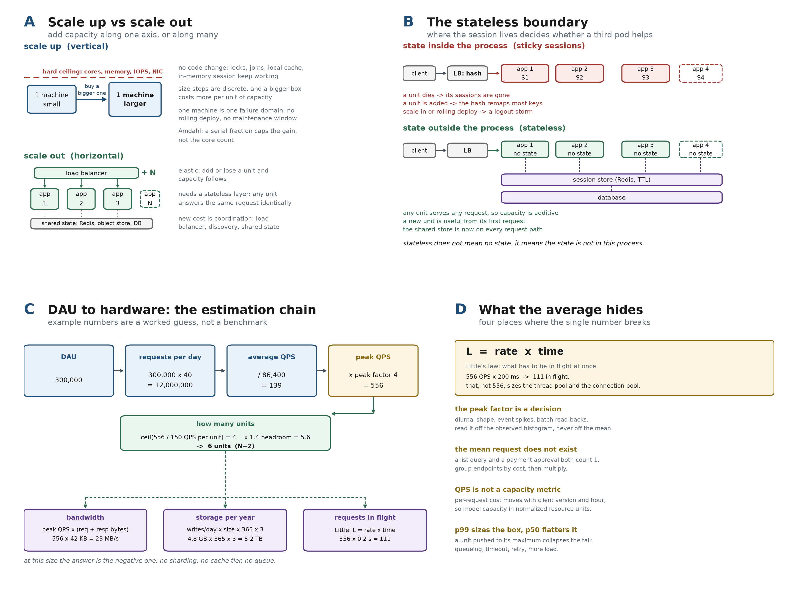

# [시스템 설계] 확장성 기초와 트래픽 추정 (Scale-Up/Out · QPS 산정)

- 작성일: 2026-11-25
- 키워드: System Design, Scalability, Scale-Up, Scale-Out, Stateless, Session Externalization, Back-of-the-Envelope, QPS, Peak Factor, Little's Law, Capacity Planning

## 1. 핵심 요약 (What & Why)

지난 여덟 편은 모두 **연결**을 다뤘다. 소켓 버퍼와 TCP/UDP(1편), 연결을 열고 닫는 왕복(2편), 그 위에서 HTTP가 진화한 과정(3편), 이름을 주소로 바꾸는 일(4편), 늘어난 서버로 연결을 나누는 일(5편), 그 바이트를 암호화하는 일(6편), 브라우저가 응답을 스크립트에 넘길지 판단하는 규칙(7편), 그리고 요청을 두 번 보내도 되는지에 대한 계약(8편). 그 여정이 남긴 것은 하나의 질문이다. **연결 하나가 잘 오가는 것과, 그 연결이 하루에 수천만 번 몰려와도 견디는 것은 다른 문제다.** 네트워크 트랙이 "한 번의 요청이 어떻게 오가는가"를 다뤘다면, 시스템 설계 트랙은 "그 요청이 초당 수백 개씩 밀려올 때 무엇이 먼저 무너지는가"를 다룬다. 첫 편은 그 질문에 답하기 위한 **어휘와 산수**다.

**확장성은 형용사가 아니라 질문이다.** Kleppmann은 *Designing Data-Intensive Applications* 1장에서 이렇게 못 박는다. *"확장성(scalability)은 증가한 부하에 대처하는 시스템의 능력을 서술하는 용어다. 이것은 시스템에 붙일 수 있는 1차원적인 꼬리표가 아니다. 'X는 확장된다'거나 'Y는 확장되지 않는다'고 말하는 것은 의미가 없다. 오히려 확장성을 논한다는 것은 다음 질문을 논하는 것이다. 시스템이 특정한 방식으로 커진다면, 그 성장에 대처할 우리의 선택지는 무엇인가. 추가 부하를 처리하기 위해 컴퓨팅 자원을 어떻게 더할 수 있는가."* 그래서 확장성은 등급이 아니라 **부하 파라미터와 대응 전략의 짝**이다. 같은 시스템이 쓰기 폭주에는 취약하고 읽기 폭주에는 강할 수 있다. "이 서비스는 확장 가능한가"는 답할 수 없는 질문이고, "이 서비스는 DAU가 10배가 되면 무엇이 먼저 무너지는가"는 답할 수 있는 질문이다.

**부하를 늘리는 방법은 두 가지뿐이고, 그 둘은 서로 다른 공학을 요구한다.** 수직 확장(scale-up)은 **같은 프로그램을 더 큰 기계 한 대**에서 돌린다. 코드를 바꾸지 않아도 되고, 상태를 옮기지 않아도 되고, 분산의 복잡성이 없다. 대신 기계 한 대의 물리적 상한에 부딪히고, 그 한 대가 죽으면 전부 죽는다. 수평 확장(scale-out)은 **같은 프로그램을 여러 기계**에서 돌린다. 상한이 사실상 없고 한 대의 죽음이 "장애"가 아니라 "용량 감소"가 되지만, 대신 **프로그램이 어느 기계에서 돌아도 같은 답을 줘야 한다**는 조건이 붙는다.

**그 조건이 무상태(stateless)다.** 요청을 처리하는 데 필요한 맥락이 요청 자체(헤더·토큰·본문)와 공유 저장소에 있고, 프로세스의 로컬 메모리에는 없어야 한다. The Twelve-Factor App은 이를 VI번 팩터로 규정한다. *"Twelve-factor 프로세스는 무상태이고 아무것도 공유하지 않는다. 영속되어야 하는 데이터는 상태를 가진 백킹 서비스, 보통 데이터베이스에 저장해야 한다."* 그리고 같은 문서가 스티키 세션에 대해 단호하다. *"일부 웹 시스템은 '스티키 세션'에 의존한다. 즉 사용자 세션 데이터를 앱 프로세스의 메모리에 캐싱하고, 같은 방문자의 이후 요청이 같은 프로세스로 라우팅되기를 기대한다. 스티키 세션은 twelve-factor의 위반이며 절대 사용하거나 의존해서는 안 된다."* 이 문장이 이번 편의 중심이다. **수평 확장은 기계를 늘리는 일이 아니라, 상태를 프로세스 밖으로 밀어내는 일이다.**

**트래픽 추정(back-of-the-envelope estimation)은 그 확장이 필요한지 판단하는 도구다.** 흔히 면접용 암산으로 알려져 있지만 실무에서의 쓰임은 다르다. 정확한 숫자를 맞히려는 것이 아니라 **자릿수를 가르는 일**이다. 초당 수십 건이면 단일 인스턴스와 단일 관계형 DB로 충분하고, 초당 수만 건이면 캐시·샤딩·큐가 설계의 뼈대가 되고, 초당 수십만 건이면 애플리케이션 코드보다 인프라가 먼저 설계된다. 추정치는 이 세 구간의 경계선을 그어 준다. 실제로 가장 자주 쓰이는 결론은 "무엇을 만들어야 한다"가 아니라 **"무엇을 만들지 않아도 된다"** 다. 그래서 추정의 목적은 **정답이 아니라 순서**다. 무엇을 먼저 최적화하고 무엇을 미뤄도 되는지를 정하는 것.

정리하면 세 문장이다.

1. **확장성은 형용사가 아니라 조건부 질문이다.** "성장하면 무엇이 먼저 무너지는가"로 물어야 답이 나오고, 그 답은 부하 파라미터에 종속된다.
2. **수평 확장의 전제 조건은 무상태이고, 무상태는 상태를 없애는 것이 아니라 프로세스 밖으로 옮기는 것이다.** 옮겨 간 자리가 새로운 병목이자 단일 장애점이 된다.
3. **트래픽 추정은 숫자를 맞히는 일이 아니라 설계의 우선순위를 정하는 일이다.** DAU에서 출발해 평균 QPS, 피크 QPS, 자원량 순으로 내려가며 가정을 명시한다.

## 2. 내부 메커니즘과 구조 (How it works)

### 2.1 수직 확장: 코드를 바꾸지 않는 대신 천장을 산다

수직 확장이 매력적인 이유는 **아무것도 바꾸지 않아도 되기 때문**이다. 트랜잭션, 락, 조인, 로컬 캐시, `synchronized`, `ConcurrentHashMap`에 담아 둔 세션, 인메모리 카운터가 전부 그대로 동작한다. 분산 합의도, 네트워크 파티션도, 부분 실패도 없다. 소규모 시스템에서 가장 먼저 시도해야 할 선택지이고, 실제로 대부분의 서비스는 이걸로 끝난다. 수평 확장은 무료가 아니며, 필요하기 전에 하는 것은 대개 손해다.

그러나 네 개의 벽이 있다.

**(1) 크기 단위가 이산적이다.** CPU를 1.3배로 늘린 장비는 없다. 8코어에서 16코어로, 64GB에서 128GB로 건너뛴다. 부하가 그 중간에 있으면 다음 단계를 사야 하고, 그 순간 남는 자원만큼 비용을 낭비한다. 수평 확장은 1대 단위로 늘릴 수 있어 이 이산성이 훨씬 작다.

**(2) 성능당 가격이 선형이 아니다.** 서버 가격은 코어 수와 메모리 크기에 정비례하지 않는다. 상위 모델로 갈수록 같은 성능을 얻는 데 드는 비용이 커진다. 즉 **같은 총량을 큰 장비 한 대로 사는 것보다 작은 장비 여러 대로 사는 편이 싼 구간**이 존재하고, 그 지점을 넘으면 수직 확장은 경제적으로도 합리적이지 않다.

**(3) 단일 장애점이 된다.** 기계가 하나면 그 기계의 디스크, 메모리, 전원, 커널, 그리고 그 위의 JVM이 모두 전체 서비스의 장애점이다. 패치 한 번, 커널 업그레이드 한 번에 서비스가 멈춘다. 무중단 배포는 불가능하고, 유지보수 창이 곧 서비스 중단이다. 반면 수평 확장에서는 한 대가 빠져도 나머지가 부하를 나눠 받으므로 이것이 **"장애"가 아니라 "용량 감소"** 가 된다. 이 차이가 운영 비용의 대부분을 가른다.

**(4) 애플리케이션의 직렬 구간이 상한을 정한다.** 코어를 두 배로 늘려도 처리량이 두 배가 되지 않는 이유는 Amdahl의 법칙이 설명한다. 전체 작업 중 직렬화되어야 하는 비율이 s라면, 프로세서 수 n에 대한 최대 속도 향상은 `1 / (s + (1-s)/n)`이다. s가 5%라면 n을 아무리 늘려도 최대 20배다. 실무에서 이 직렬 구간은 **락 경합, 단일 커넥션 풀, 단일 디스크, 커널의 파일 디스크립터 테이블, GC 정지** 같은 형태로 나타난다. 코어를 늘리는 일은 직렬 구간을 늘리는 일이 아니다. 오히려 코어가 늘면 같은 락에 더 많은 스레드가 몰려 경합이 심해지기도 한다.

JVM 위에서는 네 번째 벽이 한 번 더 두꺼워진다. 힙이 커지면 GC가 한 번에 회수해야 할 객체 수가 늘고 정지 시간이 길어진다. 처리량은 늘어도 **꼬리 지연(tail latency)** 은 나빠질 수 있다. 평균 응답 시간은 좋아 보이는데 p99가 몇 초가 되는 상황이고, 이 상태는 평균 지표로는 잡히지 않는다.

수직 확장이 옳은 구간은 **"천장이 보이고, 그 천장까지의 거리가 짧고, 그동안 단순함의 이익이 큰"** 경우다. 구체적으로는 단일 노드 데이터베이스, 사내 시스템, 트래픽이 예측 가능한 서비스, 그리고 조직에 분산 운영 역량이 아직 없을 때다. 그 구간을 지나면 수평 확장으로 넘어간다.

### 2.2 수평 확장: 무상태 계층과 상태의 외부화

수평 확장의 첫 문장은 "기계를 늘린다"가 아니라 **"어느 인스턴스가 이 요청을 받아도 같은 결과를 내야 한다"** 다. 이 조건이 깨지면 기계를 늘릴수록 이상해진다. 사용자가 로그인했는데 다음 요청에서 로그인이 풀리고, 장바구니가 사라지고, 새로 추가한 인스턴스가 아무 일도 하지 않는다.

**로드 밸런서는 그 조건 위에서만 의미가 있다.** L4/L7의 차이는 지난 트랙 5편에서 다뤘다. 여기서 중요한 것은 **분배 알고리즘의 선택이 무상태 여부에 종속된다**는 점이다.

| 분배 방식 | 전제 | 무상태일 때 | 상태가 프로세스에 있을 때 |
| --- | --- | --- | --- |
| 라운드 로빈 | 모든 인스턴스가 동등 | 균등 분배. 가장 단순하고 예측 가능 | 세션 불일치 |
| 최소 연결 | 인스턴스별 동시 연결 수를 앎 | 느린 인스턴스를 자연히 회피 | 세션 불일치 |
| IP/쿠키 해시 | 같은 키는 같은 인스턴스로 | 불필요한 제약. 증감 시 재매핑 | 동작은 하지만 확장 시 대량 세션 유실 |
| 가중치 | 인스턴스 성능이 다름 | 이종 인스턴스 혼용 가능 | 세션 불일치 |

**스티키 세션이 매력적으로 보이는 이유와 그것이 깨지는 이유.** 상태가 프로세스 메모리에 있으면 그 상태를 가진 인스턴스로 요청을 보내야 한다. 해시 기반 분배는 이 문제를 "해결"한 것처럼 보인다. 그러나 세 가지가 무너진다.

- **인스턴스가 늘거나 줄면 해시가 재매핑된다.** modulo 해시에서 서버를 하나 추가하면 키의 대부분이 다른 서버로 간다. 오토스케일링으로 한 대를 늘리는 순간 **재로그인 폭풍**이 온다. 일관성 해싱(consistent hashing)은 이동량을 1/N 수준으로 줄이지만 0으로 만들지 않는다.
- **부하가 고르지 않다.** 해시는 사용자 단위로는 균등하지만 사용자마다 요청량이 다르므로 특정 인스턴스에 부하가 몰린다. 이 편향은 요청 단위 균등 분배보다 항상 나쁘다.
- **배포와 오토스케일링이 정면으로 충돌한다.** 롤링 배포에서 인스턴스를 교체하려면 그 인스턴스가 들고 있던 세션을 넘겨야 한다. 세션 드레인 로직이 없으면 배포가 곧 사용자 이탈이다. 스케일 인(scaling in)은 더 나쁘다. 줄어드는 인스턴스의 세션이 그냥 사라진다.

**그래서 상태를 프로세스 밖으로 옮긴다.** 옮겨야 할 대상은 세션만이 아니다. 무상태를 "세션이 없다"로 이해하면 절반만 이해한 것이다. 실무에서 무상태를 깨는 범인은 대개 세션이 아니라 그 밖의 로컬 상태다.

| 프로세스 로컬에 있던 것 | 왜 문제인가 | 옮겨 갈 곳 |
| --- | --- | --- |
| HTTP 세션 | 다른 인스턴스가 모른다 | Redis, DB (TTL 기반) |
| 업로드 파일 | 그 인스턴스의 디스크에만 존재 | 오브젝트 스토리지 |
| 로컬 캐시 (`Caffeine`, `Ehcache`) | 인스턴스마다 다른 값을 본다 | 공유 캐시(Redis), 또는 TTL을 짧게 두고 불일치 감수 |
| 스케줄러·배치 락 | 모든 인스턴스가 같은 배치를 실행한다 | DB 유니크·조건부 UPDATE, 분산 락 |
| 인메모리 카운터 (rate limit, 순번) | 인스턴스 수만큼 한도가 늘어난다 | Redis `INCR` 같은 원자 연산 |
| 로그인 실패 횟수 같은 임시 상태 | 인스턴스별로 따로 세어진다 | 공유 저장소 |
| WebSocket 연결 | 연결이 특정 인스턴스에 묶인다 | 세션 저장소 + 인스턴스 간 메시지 브로커 |

**여기서 놓치기 쉬운 반전이 있다. 무상태는 상태를 없애는 것이 아니라 옮기는 것이다.** 옮긴 자리가 이제 **모든 요청이 거치는 공통 경로**가 된다. 세션을 Redis로 옮기면 Redis가 단일 장애점이 되고, 모든 요청이 Redis를 한 번 더 왕복하므로 지연이 늘고, Redis의 처리량이 전체의 상한이 된다. 무상태 웹 계층은 **확장 가능해진 대신, 확장 불가능한 계층에 의존하게 된다.** 이 구조를 이해하지 못하면 "무상태로 바꿨는데 왜 더 느리고 왜 Redis가 터지는가"를 반복하게 된다. 그래서 세션 저장소는 대개 복제 구성으로 두고, 세션 조회 실패 시의 폴백(재로그인 유도)을 정책으로 정해 둔다.

**그래서 계층마다 확장 전략이 다르다.** 웹 계층은 무상태이므로 수평 확장이 쉽다. 그러나 **데이터 계층은 무상태가 될 수 없다.** 데이터는 본질적으로 상태이고, 그것을 여러 기계에 나누는 일은 복제와 일관성이라는 완전히 다른 문제다. 그래서 실무의 확장은 항상 **"웹 계층을 먼저 늘리고, 데이터 계층이 병목이 되면 그때 데이터 계층을 다룬다"** 는 순서를 밟는다. 데이터 계층의 확장(읽기 복제, 파티셔닝, 샤딩)은 3편의 주제로 미룬다.

**캐시도 같은 함정을 만든다.** 로컬 캐시는 무상태를 깨는 가장 조용한 방법이다. 코드만 보면 아무 상태도 없는 것처럼 보이는데, 인스턴스마다 다른 값을 들고 있으면 사용자는 새로고침할 때마다 다른 화면을 본다. 공유 캐시로 옮기면 무상태는 회복되지만 이번엔 캐시가 공통 경로가 된다.

### 2.3 백오브더엔벨로프: DAU에서 자원까지 내려가는 절차

추정은 **가정을 먼저 적고, 그 위에서 곱하고 나누는 일**이다. 순서를 고정하면 실수를 줄일 수 있고, 검토받기도 쉬워진다.

**0단계: 가정을 적는다.** 숫자보다 중요한 것이 가정이다.

| 가정 | 의미 | 어디서 오는가 |
| --- | --- | --- |
| DAU | 하루 활성 사용자 수 | 제품 목표, 현재 지표 |
| 사용자당 일 요청 수 | 한 사용자가 하루에 API를 몇 번 부르는가 | 화면 수 x 화면당 호출 수 |
| 읽기/쓰기 비율 | 조회와 변경의 비중 | 도메인 특성 (피드는 읽기 편중, 결제는 1:1에 가까움) |
| 피크 계수 | 최대 트래픽 / 평균 트래픽 | 일간 주기, 이벤트 캘린더 |
| 요청·응답 크기 | 평균 바이트 | API 스키마 |
| 객체 크기·보존 기간 | 저장해야 하는 데이터량 | 정책·규제 |
| 인스턴스당 처리량 | 한 대가 지연 목표를 지키며 내는 초당 건수 | 부하 테스트 |

이 표의 각 줄이 틀리면 최종 숫자도 틀린다. 그래서 추정치를 보고할 때는 **최종 숫자보다 가정을 먼저 검토받아야 한다.** 최종 숫자는 가정의 함수일 뿐이므로, 숫자가 이상하면 고칠 곳은 계산이 아니라 가정이다.

**1~3단계: DAU를 초당으로 바꾼다.**

```text
일 요청 수   = DAU x 사용자당 일 요청 수
평균 QPS     = 일 요청 수 / 86,400          (하루의 초 수)
피크 QPS     = 평균 QPS x 피크 계수
```

86,400으로 나누는 것은 **하루 종일 부하가 고르다는 가정**이다. 실제로는 그렇지 않으므로 피크 계수를 곱한다.

**피크 계수는 상수가 아니라 결정이다.** 하루 중 트래픽이 몰리는 시간대의 비율에서 나온다. 전체 트래픽의 절반이 4시간에 몰리면 그 4시간의 평균은 하루 평균의 3배다. 여기에 짧은 스파이크(이벤트 오픈, 알림 발송, 배치 결과 조회)를 더 고려한다. 업무용 시스템은 오전과 점심, 소비자 서비스는 저녁에 몰린다. **관측 데이터가 있으면 반드시 실측 히스토그램에서 뽑는다.** 없으면 2~5 사이에서 시작하고, 왜 그 값을 골랐는지 함께 적는다. 나중에 실측과 어긋날 때 비교할 기준이 남기 위해서다.

**4단계: 인스턴스 수와 여유율.**

```text
필요 인스턴스 = ceil(피크 QPS / 인스턴스당 처리량)
              x (1 + 여유율)
              + 가용성 여유 (N+2)
```

인스턴스당 처리량은 **p99 지연 목표를 만족하는 처리량**이어야 한다. 한 대가 최대로 짜내면 초당 1,000건을 처리할 수 있어도 그 지점에서는 지연이 폭발한다. 큐가 쌓이고, 큐에 쌓인 요청의 대기 시간이 지연에 더해지고, 클라이언트가 타임아웃으로 재시도하면서 부하가 다시 늘어난다. 그래서 "한 대가 낼 수 있는 최대 QPS"가 아니라 **"지연 목표를 지키면서 낼 수 있는 QPS"** 로 나눈다. 이 값을 모르면 부하 테스트가 먼저다.

여유율과 N+2는 다른 것을 위한 장치다. 여유율은 **예측 오차와 버스트**를 흡수하고, N+2는 **계획된 정비와 계획되지 않은 장애를 동시에 견디기** 위한 것이다. Google SRE는 용량 계획 원칙으로 이렇게 적는다. *"계획된 장애와 계획되지 않은 장애를 동시에 견디도록 프로비저닝하라. 그 결과가 'N+2' 구성이다. 피크 트래픽을 N개의 인스턴스가 (필요하면 성능 저하 모드로) 처리하는 동안 가장 큰 2개의 인스턴스를 사용할 수 없어도 되는 구성이다."* 두 값을 하나로 뭉뚱그리면 "왜 여유율 40%인데도 장애 때 죽는가"를 설명할 수 없다.

**5단계: 대역폭.**

```text
대역폭 = 피크 QPS x (평균 요청 바이트 + 평균 응답 바이트)
```

이 값은 **네트워크 카드의 한계**와 **비용**을 동시에 정한다. 클라우드에서는 아웃바운드 트래픽이 청구 대상이고, 온프레미스에서는 NIC의 대역폭이 병목이 된다. 응답이 큰 API(목록 조회, 이미지)는 QPS가 낮아도 대역폭이 먼저 병목이 된다. QPS만 보고 산정하면 이 경우를 놓친다.

**6단계: 스토리지.**

```text
일 쓰기량  = 일 신규 객체 수 x 객체당 평균 바이트
스토리지   = 일 쓰기량 x 보존 기간 x 복제 계수 x (1 + 인덱스·WAL 오버헤드)
```

복제 계수를 빼먹는 실수가 흔하다. 3중 복제면 저장량은 3배다. 인덱스는 데이터 크기의 상당 부분을 차지하고, WAL·binlog는 별도 공간과 쓰기 부하를 만든다. 삭제 정책(TTL, 아카이빙)이 없다면 스토리지는 선형으로 무한히 는다.

**7단계: 동시성.** 큐잉 이론의 Little's Law가 여기서 쓰인다.

```text
L = λ x W
L: 시스템 안에 동시에 존재하는 요청 수
λ: 도착률 (QPS)
W: 시스템 안에서 보내는 평균 시간 (초)
```

이 식이 정하는 것은 **스레드 풀과 커넥션 풀의 크기**다. 피크 QPS가 556이고 평균 지연이 200ms라면 동시에 처리 중인 요청은 `556 x 0.2 ≈ 111`건이다. 톰캣 스레드가 111개보다 적으면 처리량이 아니라 **대기**가 병목이 된다. 반대로 556건이라고 생각해 스레드를 556개로 잡으면, 지연이 늘어날 때 필요한 스레드가 더 늘어나고 컨텍스트 스위칭과 스택 메모리가 늘어 지연이 더 늘어나는 악순환이 된다. **스레드 수는 QPS가 아니라 QPS x 지연으로 정한다.** 커넥션 풀도 같은 식으로 유도한다. 요청이 커넥션을 40ms 붙잡는다면 풀 10개로는 초당 250건이 상한이다.

**산정 예시 (아래 수치는 가정을 명시한 추정 계산 예시이며, 어떤 시스템의 실측 벤치마크도 아니다).**

```text
가정
  DAU                          300,000
  사용자당 일 요청 수           40
  피크 계수                     4
  평균 요청 + 응답 크기         42 KB (요청 2 KB + 응답 40 KB)
  인스턴스당 처리량 (p99 기준)  150 QPS
  여유율                        40%
  평균 지연                     200 ms

계산
  일 요청 수    = 300,000 x 40          = 12,000,000
  평균 QPS      = 12,000,000 / 86,400   = 138.9   -> 약 139
  피크 QPS      = 139 x 4               = 556
  필요 인스턴스 = ceil(556 / 150)       = 4
                = 4 x 1.4               = 5.6  -> 6대 (N+2 포함)
  대역폭        = 556 x 42 KB           = 23,352 KB/s -> 약 23 MB/s
  동시 요청     = 556 x 0.2             = 111
```

같은 가정으로 스토리지를 본다. 쓰기가 일 요청의 5%(12,000,000 x 0.05 = 600,000건)이고 건당 8KB라면 하루 4.8GB, 1년 보존에 3중 복제면 `4.8 GB x 365 x 3 ≈ 5.2TB`, 인덱스·WAL 1.5배를 더하면 약 7.8TB다.

**여기서 나온 숫자들이 말하는 것.** 인스턴스 6대, 대역폭 23MB/s, 동시 111건은 **모두 작은 규모**다. 이 서비스에 필요한 것은 샤딩도, 전용 캐시 계층도, 메시지 큐도 아니다. 단일 관계형 DB와 6대의 무상태 인스턴스로 충분하다. 즉 추정의 결론이 **"무엇을 만들지 않아도 되는가"** 로 나왔다. 이것이 추정의 가장 큰 실용적 가치다. 반대로 DAU가 3,000만이면 같은 비율에서 피크 QPS가 55,600, 인스턴스가 600대가 되고, 그 순간 설계의 뼈대가 바뀐다. **같은 절차가 다른 결론을 내는 지점이 어디인지 아는 것이 추정의 목적이다.**

### 2.4 병목은 이동한다

추정으로 병목을 찾았다면, 그 병목을 고친 뒤 다음 병목을 다시 찾아야 한다. 이동 경로는 대체로 정해져 있다.

| 단계 | 병목 | 해소 수단 | 해소 후 새 병목 |
| --- | --- | --- | --- |
| 1 | 애플리케이션 스레드 | 스레드 증설, 무상태화로 인스턴스 증설 | DB 커넥션 풀 |
| 2 | DB 커넥션 풀 | 풀 크기 증설 | DB CPU, 락 경합 |
| 3 | DB CPU (읽기) | 읽기 복제, 캐시 | 복제 지연, 캐시 무효화 |
| 4 | DB CPU (쓰기) | 배치, 비동기화, 파티셔닝 | 큐 적체, 순서 보장 |
| 5 | 단일 DB 노드 | 샤딩 | 크로스 샤드 조인·트랜잭션 |
| 6 | 네트워크 대역폭 | CDN, 압축, 응답 축소 | 캐시 일관성 |

이 표의 의미는 **한 단계 고치면 다음 단계가 드러난다**는 것이다. 확장은 한 번의 결정이 아니라 연쇄이고, 각 단계마다 비용과 복잡도가 올라간다. 그래서 "지금 어느 단계에 있는가"를 아는 것이 "무엇을 살 것인가"보다 중요하다.

**여기서 Google SRE의 경고를 반드시 기억해야 한다.** *Site Reliability Engineering* 21장 "Handling Overload"는 절 하나를 통째로 QPS의 함정에 할애한다. 요지는 이렇다. 쿼리마다 필요한 자원이 크게 다르고, 그 비율은 클라이언트 코드나 시간대에 따라 바뀐다. 그래서 **용량을 "초당 쿼리 수"로 모델링하거나, 자원 소모의 대리 지표로 요청의 정적인 속성을 쓰는 것은 좋지 않은 지표가 되는 경우가 많다. 어느 시점에는 잘 맞더라도 비율이 변하기 때문이다.** 대신 **정규화된 자원 소모(예: CPU 초)** 로 측정하라고 권한다. 같은 장의 예가 실무 감각을 잘 보여준다. *"데이터센터가 백엔드 태스크 100개를 돌리고 각 태스크가 초당 500 요청까지 처리할 수 있다면, 로드 밸런싱 알고리즘은 그 데이터센터로 초당 50,000 쿼리 이상을 보내지 않을 것이다."* 이 계산이 성립하려면 **모든 요청의 비용이 같아야** 한다. 실제로는 그렇지 않으므로 50,000은 상한일 뿐 보장이 아니다.

이 경고는 추정 전체에 적용된다. **평균 QPS는 평균적인 요청의 비용을 가정한다.** 목록 조회 한 번과 결제 승인 한 번을 같은 1로 세는 순간 추정치는 낙관적으로 치우친다. 실무에서는 엔드포인트를 몇 개의 비용 등급으로 나누고, 각각의 QPS와 비용을 따로 곱한다. 등급을 나누는 기준은 CPU 시간, DB가 읽은 행 수, 외부 API 호출 횟수처럼 **돈과 지연을 실제로 쓰는 자원**이다.

## 3. 구조 도식 (Architecture Diagram)



- **A 수직 확장과 수평 확장 (왼쪽 위)**: 두 방법을 같은 무게로 나란히 두었다. 위쪽은 기계 한 대를 더 큰 기계로 바꾸는 그림이고, 점선으로 그은 빨간 선이 그 방향의 천장(코어·메모리·IOPS·NIC)을 표시한다. 옆의 네 줄은 수직 확장의 성질이다. 코드를 바꾸지 않아도 된다는 이점, 크기 단계가 이산적이라 중간을 살 수 없다는 비용, 한 대가 곧 하나의 장애 영역이라는 위험, 그리고 Amdahl의 직렬 구간이 코어 수와 무관하게 상한을 정한다는 사실. 아래쪽은 로드 밸런서 아래에 app 1~3과 점선으로 표시한 app N을 두고, 그 밑에 공유 상태(Redis·오브젝트 스토리지·DB)를 한 줄로 깔았다. 옆의 세 줄은 수평 확장의 성질이다. 탄력성, 무상태 계층이라는 전제 조건, 그리고 새로 생기는 조정 비용.
- **B 무상태 경계 (오른쪽 위)**: 같은 요청 흐름을 두 번 그렸고, 차이는 세션이 어디에 있느냐 하나다. 위쪽은 세션이 각 인스턴스 안에 있는 경우다. 인스턴스마다 S1·S2·S3를 들고 있고, 그 아래 세 줄이 이 구조가 깨지는 방식이다. 한 대가 죽으면 그 세션이 사라지고, 한 대를 추가하면 해시가 대부분 재매핑되고, 스케일 인이나 롤링 배포가 곧 로그아웃 폭풍이 된다. 아래쪽은 같은 인스턴스들이 로컬 상태를 갖지 않고 모두 세션 저장소와 DB를 보는 경우다. 점선은 각 인스턴스에서 공유 저장소로 내려가는 경로이고, 이 구조에서 비로소 "어느 유닛이든 어떤 요청이든" 처리할 수 있게 된다. 맨 아래 문장이 이 패널의 결론이다. 무상태는 상태가 없는 것이 아니라 **상태가 이 프로세스 안에 없는** 것이다.
- **C DAU에서 하드웨어까지 (왼쪽 아래)**: 추정 사슬을 한 줄로 펼쳤다. DAU 300,000에서 출발해 `x 40`으로 일 요청 수를, `/ 86,400`으로 평균 QPS를, `x 4`로 피크 QPS를 얻는다. 그 아래 초록 상자가 인스턴스 수 계산이고, 여기서 `ceil(556/150) = 4`에 여유율 1.4를 곱해 6대(N+2 포함)가 나온다. 아래 세 보라 상자는 같은 피크 QPS에서 파생되는 다른 자원이다. 대역폭(응답 크기를 곱한다), 연간 스토리지(쓰기 수 x 크기 x 보존일 x 복제), 그리고 동시 요청 수(Little's Law). 맨 아래 문장은 이 예시의 결론이 **부정형**이라는 점을 남겼다. 샤딩도, 캐시 계층도, 큐도 필요 없다는 답.
- **D 평균이 감추는 것 (오른쪽 아래)**: 숫자 하나로 요약할 때 사라지는 네 가지다. 맨 위 상자의 Little's Law는 스레드·커넥션 풀을 QPS가 아니라 `QPS x 지연`으로 정해야 한다는 것을 111이라는 숫자로 보여준다. 이어지는 네 항목은 각각 피크 계수(관측 히스토그램에서 뽑아야 하는 결정), 평균 요청의 부재(엔드포인트별 비용 등급), QPS의 부적합성(정규화된 자원 단위로 모델링), 그리고 꼬리 지연(최대치로 조인 유닛은 큐·타임아웃·재시도로 무너진다)이다.

## 4. 비교 표 (Comparison)

### 4.1 Scale-Up vs Scale-Out

| 항목 | 수직 확장 (Scale-Up) | 수평 확장 (Scale-Out) |
| --- | --- | --- |
| 방법 | 더 큰 기계 한 대 | 같은 크기 여러 대 + 로드 밸런서 |
| 코드 변경 | 없음 | 무상태화 필요 (세션·파일·캐시·락 외부화) |
| 확장 단위 | 장비 모델 단위 (이산적) | 1대 단위 (연속적) |
| 상한 | 코어·메모리·IOPS·NIC의 물리적 한계 | 사실상 없음, 조정 비용이 상한 |
| 장애 영향 | 그 한 대가 죽으면 전체 중단 | 한 대 손실은 용량 감소로 흡수 |
| 배포 | 중단 배포 (또는 무중단 불가) | 롤링·블루그린 배포 가능 |
| 비용 곡선 | 성능당 단가가 비선형으로 상승 | 대수에 비례, 단 선형에 가까움 |
| 운영 복잡도 | 낮음 | 높음 (분산 추적, 공유 상태, 부분 실패) |
| 상태 정합성 | 한 프로세스 안이라 자명 | 프로세스 밖 저장소의 일관성을 직접 다뤄야 함 |
| 먼저 시도할 상황 | 소규모, 단일 노드 DB, 예측 가능한 트래픽 | 인스턴스 하나로 p99를 못 맞출 때, 피크 편차가 클 때 |
| 대표적 실패 | 천장에 부딪혀 다음 단계가 없음 | 무상태를 덜 만들어서 늘린 만큼 안 빨라짐 |

마지막 줄이 실무에서 가장 흔한 실패다. 인스턴스를 3대에서 6대로 늘렸는데 처리량이 2배가 되지 않는다면, 남은 병목은 대개 **공유 저장소(세션·캐시·DB)** 이거나 **로컬 상태에 묶인 트래픽**이다. 대수를 늘리기 전에 무상태가 실제로 달성되었는지 확인해야 한다.

### 4.2 Stateful vs Stateless 웹 계층

| 항목 | 상태가 프로세스에 있음 | 무상태 |
| --- | --- | --- |
| 로드 밸런싱 | 해시·스티키 필요 | 라운드 로빈·최소 연결 자유 |
| 인스턴스 추가 | 해시 재매핑, 세션 유실 | 즉시 유효 |
| 인스턴스 제거 | 세션 드레인 필요 | 그냥 빼면 됨 |
| 롤링 배포 | 세션 이관 로직 필요 | 자연히 동작 |
| 오토스케일링 | 사실상 불가 | 전제 조건이 충족됨 |
| 장애 복구 | 해당 인스턴스 사용자만 이탈 | 다음 요청이 다른 인스턴스로 |
| 지연 | 로컬 조회라 가장 빠름 | 공유 저장소 왕복만큼 증가 |
| 새 병목 | 없음 | 공유 저장소가 단일 장애점·상한 |
| 적합한 경우 | 단일 인스턴스, WebSocket처럼 연결 자체가 상태 | 대부분의 HTTP API 서버 |

`WebSocket`은 예외로 다뤄야 한다. 연결 자체가 상태이므로 완전한 무상태가 불가능하다. 실무의 타협은 **연결은 특정 인스턴스에 두되, 그 연결에 딸린 사용자 상태는 공유 저장소에 두고, 인스턴스 간 전달이 필요하면 메시지 브로커를 두는 것**이다.

### 4.3 상태를 두는 위치

| 위치 | 조회 지연 | 확장성 | 일관성 | 잃었을 때 |
| --- | --- | --- | --- | --- |
| 프로세스 메모리 | 가장 빠름 | 나쁨 (인스턴스에 묶임) | 그 인스턴스 안에서만 자명 | 그 사용자 세션 소실 |
| 스티키 세션 | 빠름 | 나쁨 (해시 재매핑) | 인스턴스 안에서만 자명 | 해당 사용자 세션 소실 |
| 공유 캐시 (Redis) | 빠름 (왕복 1회) | 좋음 | TTL 기반 최종 일관성 | 보호 상실, 재로그인 |
| DB | 느림 | 전략 필요 (복제·샤딩) | 트랜잭션으로 보장 | 없음 (내구성) |
| 클라이언트 토큰 (JWT) | 왕복 없음 | 가장 좋음 | 발급 시점 고정 | 폐기 불가 (블랙리스트가 다시 상태가 됨) |

마지막 줄의 역설이 중요하다. JWT는 서버에 상태를 두지 않으므로 무상태에 가장 가깝지만, **로그아웃·강제 만료를 구현하는 순간 블랙리스트라는 상태가 생긴다.** 상태는 사라지지 않고 위치만 바뀐다. 그래서 "JWT를 쓰니 무상태다"라는 말은 토큰 수명이 짧고 폐기가 필요 없다는 전제가 붙을 때만 참이다.

### 4.4 추정 방법의 비교

| 방법 | 얻는 것 | 비용 | 한계 |
| --- | --- | --- | --- |
| 경험 법칙 (rule of thumb) | 자릿수, 설계 구간 판정 | 거의 없음 | 가정이 틀리면 통째로 틀림 |
| 백오브더엔벨로프 계산 | 자원 항목별 상한, 병목 후보 | 분 단위 | 요청 비용이 균질하다고 가정 |
| 큐잉 이론 (Little's Law 등) | 동시성, 대기 시간, 포화점 | 시간 단위 | 분포 가정(포아송 등)이 필요 |
| 부하 테스트 | 인스턴스당 실제 처리량, p99 곡선 | 시간·환경 비용 | 프로덕션과 트래픽 모양이 다름 |
| 프로덕션 관측 | 실제 피크 계수, 실제 비용 분포 | 이미 지불됨 | 이미 서비스가 있어야 함 |

실무 순서는 **경험 법칙 → 계산 → 부하 테스트 → 관측으로 보정**이다. 추정은 부하 테스트를 대체하지 않는다. 추정은 **무엇을 측정해야 하는지** 정하고, 측정은 추정의 가정을 교체한다. 이 순환이 한 바퀴 돌면 그때부터 피크 계수와 인스턴스당 처리량은 추측이 아니라 사실이 된다.

## 5. 내가 깨달은 점 (My Insight)

- **무상태는 "상태가 없다"가 아니라 "상태가 여기 없다"다.** 처음에는 무상태를 세션을 안 쓰는 것으로 이해했다. 그런데 코드에서 세션을 지워도 로컬 캐시, 인메모리 카운터, 스케줄러 락, 업로드 파일이 남아 있으면 인스턴스를 늘리는 순간 조용히 깨진다. 무상태는 **프로세스가 재시작해도, 다른 인스턴스로 가도, 결과가 같다**는 성질이고, 그 성질을 만족시키는 유일한 방법은 로컬에 아무것도 두지 않는 것이다. 그리고 그 대가로 **모든 요청이 지나가는 공통 경로**가 하나 생긴다. 무상태를 얻는 것과 단일 장애점을 만드는 것이 같은 동작이라는 점이 처음에는 모순처럼 느껴졌다.

- **스티키 세션은 문제를 해결하는 것이 아니라 미루는 것이다.** 로컬 세션 + 해시 분배는 단일 인스턴스에서 여러 대로 넘어가는 가장 빠른 길처럼 보인다. 하지만 그 구조는 **인스턴스 집합이 고정되어 있을 때만** 동작한다. 오토스케일링, 롤링 배포, 장애 복구 — 확장이 필요해서 도입한 바로 그 기능들이 전부 이 구조를 깨뜨린다. 즉 스티키 세션은 확장을 가능하게 하는 장치가 아니라, 확장을 **불가능하게 만드는** 장치다. Twelve-Factor가 "절대 사용하거나 의존해서는 안 된다"고 단정한 이유를 이제는 이해한다.

- **평균은 설계 도구로 쓸 수 없고, 피크는 쓸 수 있다.** DAU에서 평균 QPS를 구하는 계산은 쉬워서 그것이 답이라고 착각하기 쉽다. 그런데 시스템이 죽는 순간은 평균이 아니라 피크다. 피크 계수를 1로 두는 것은 "하루 종일 같은 트래픽이 온다"는 가정이고, 그 가정은 거의 항상 틀린다. 그래서 추정에서 가장 중요한 결정은 곱셈이 아니라 **피크 계수를 몇으로 둘 것인가**다. 이 값을 관측에서 뽑지 않고 감으로 정하면, 그 뒤의 모든 계산이 정밀해 보이지만 실제로는 한 개의 추측 위에 세워진다.

- **동시성은 처리량과 다른 축이다.** "초당 556건"과 "동시에 111건"은 같은 트래픽을 다르게 센 것이다. 스레드 풀과 커넥션 풀은 후자로 정해지는데, 둘을 섞으면 풀을 5배로 잡는다. 풀을 크게 잡는 것은 안전해 보이지만 실제로는 **지연이 늘 때 필요한 스레드가 더 늘어나는** 양의 되먹임을 만든다. 작게 잡는 것이 오히려 시스템을 예측 가능하게 만든다. 이 감각은 Little's Law 한 줄에서 나왔고, 그 전에는 "많으면 좋다"는 직관에 기대고 있었다.

- **추정의 가장 좋은 결과는 "안 만들어도 된다"는 답이다.** 계산을 해 보니 필요한 것이 인스턴스 6대와 단일 DB였다. 그 순간 샤딩 설계, 캐시 계층, 메시지 큐에 쓰려던 시간이 통째로 사라졌다. 반대로 이 계산을 하지 않으면, 필요하지 않은 복잡도를 미리 만들어 두고 그 복잡도를 계속 운영해야 한다. 시스템 설계에서 가장 비싼 것은 잘못된 확장이 아니라 **필요 없는 확장**이다. 확장은 나중에 할 수 있지만, 잘못 만든 분산 구조는 되돌리기 어렵다.

## 6. 실무 관점 및 트레이드오프 (Trade-offs & Best Practices)

### 6.1 추정을 문서로 남기는 형식

추정은 한 번 계산하고 버리는 것이 아니라, 트래픽이 변할 때 다시 꺼내 쓰는 문서여야 한다. 그래서 계산 결과만이 아니라 **가정과 그 근거**를 함께 남긴다.

```text
## 트래픽 추정 (2026-11-25, 초안)

가정
- DAU 300,000        : 제품 목표 (출시 6개월 시점)
- 1인당 40 요청      : 화면 8개 x 평균 5회 호출
- 피크 계수 4        : 관측 데이터 없음. 유사 서비스의 저녁 피크 기준 추정 -> 실측 시 교체
- 인스턴스당 150 QPS : 부하 테스트 전. p99 200ms 가정 -> 미검증
- 응답 40 KB         : 목록 API 스키마 기준

결과
- 평균 QPS 139 / 피크 QPS 556
- 인스턴스 6대 (여유율 40%, N+2)
- 대역폭 23 MB/s / 연 스토리지 약 7.8 TB

검증 필요
- 피크 계수: 출시 후 2주 관측으로 교체
- 인스턴스당 처리량: 부하 테스트로 확정
- 응답 크기: 압축 적용 후 재측정
```

이 형식의 핵심은 마지막 절이다. **"검증 필요"가 비어 있는 추정은 완성된 것이 아니다.** 추정은 가정 목록이고, 가정은 관측으로 하나씩 교체된다.

### 6.2 스프링에서 무상태 만들기

**세션 외부화.** Spring Session은 `HttpSession`을 저장소로 옮긴다. `spring-session-data-redis`를 넣고 저장소를 지정하면 톰캣의 인메모리 세션이 Redis로 바뀌고, 코드의 `HttpSession` 사용은 그대로 둘 수 있다.

```yaml
spring:
  session:
    store-type: redis
    timeout: 30m
  data:
    redis:
      host: ${REDIS_HOST}
      port: 6379
```

**파일 업로드는 로컬 디스크에 두면 안 된다.** 인스턴스가 여러 대가 되는 순간 업로드한 파일은 한 대에만 존재한다. 오브젝트 스토리지에 쓰고 DB에는 키만 남긴다. 다운로드도 애플리케이션을 거치지 않고 서명된 URL로 넘기는 편이 대역폭 면에서 유리하다.

**스케줄러는 중복 실행을 전제로 막아야 한다.** `@Scheduled`는 모든 인스턴스에서 실행된다. 인스턴스가 6대면 배치가 6번 돈다. 해결책은 (1) 스케줄러를 별도 인스턴스 한 대로 분리하거나, (2) 실행 시점에 DB에서 락을 잡거나, (3) ShedLock 같은 라이브러리로 공유 락을 쓰는 것이다. 어느 쪽이든 **"배치는 한 번만 돈다"를 코드가 아니라 인프라가 보장**하게 만들어야 한다.

> [!WARNING]
> 세션 저장소로 Redis를 쓰면 Redis 장애가 곧 전체 로그아웃이다. 복제·센티널·클러스터 구성으로 가용성을 올리는 것과 별개로, **세션 조회 실패 시의 동작을 정해 두어야 한다.** 예외를 던져 500을 내는 것보다, 세션이 없는 것으로 취급해 재로그인으로 유도하는 편이 사용자 경험이 낫다. 그리고 세션에는 최소한의 식별자만 담는다. 사용자 프로필 전체를 세션에 넣으면 Redis 메모리와 직렬화 비용이 함께 커진다.

### 6.3 풀 크기: 기본값이 정답이 아닌 이유

스프링 부트가 기본으로 쓰는 HikariCP의 최대 풀 크기는 10이고, 내장 톰캣의 최대 요청 스레드는 200이다. 즉 기본 설정에서는 **스레드 200개가 커넥션 10개를 나눠 쓴다.** 요청이 커넥션을 40ms 붙잡는다면 Little's Law에 따라 이 구성의 DB 처리 상한은 `10 / 0.04 = 250` QPS다. 인스턴스가 6대면 이론상 1,500 QPS지만, DB의 `max_connections`가 그만큼 허용되는지는 별개 문제다. **인스턴스 수 x 풀 크기가 DB의 동시 연결 한도를 넘으면, 늘린 인스턴스가 서로의 커넥션을 굶긴다.**

| 항목 | 기본값 | 산정 근거 |
| --- | --- | --- |
| `server.tomcat.threads.max` | 200 | 피크 QPS x 평균 지연(초). 이보다 작으면 대기가 병목 |
| `spring.datasource.hikari.maximum-pool-size` | 10 | DB가 감당하는 동시 쿼리 수 / 인스턴스 수 |
| `server.tomcat.accept-count` | 100 | 대기 큐. 넘치면 연결이 거부되므로 과도하게 키우지 않음 |
| 인스턴스 수 | - | 피크 QPS / 인스턴스당 처리량, 여유율과 N+2 포함 |

> [!NOTE]
> 스레드를 늘리는 것과 커넥션을 늘리는 것은 다른 일이다. 스레드는 힙과 컨텍스트 스위칭을 쓰고, 커넥션은 DB 프로세스·메모리를 쓴다. 스레드만 늘리면 커넥션을 기다리는 스레드가 늘어나 지연만 나빠진다. 반대로 커넥션만 늘리면 DB가 락 경합과 컨텍스트 스위칭으로 느려진다. **둘을 같은 비율로 늘리는 것이 아니라, 각각의 상한을 따로 계산해야 한다.** 커넥션 풀은 고정 크기로 두는 편이 예측 가능하다. HikariCP 문서도 스파이크 대응을 위해 `minimumIdle`을 지정하지 말고 고정 크기 풀로 쓰기를 권한다.

### 6.4 여유율과 오토스케일링의 트레이드오프

| 전략 | 피크 대응 | 비용 | 약점 |
| --- | --- | --- | --- |
| 고정 용량 + 큰 여유율 | 즉시 | 항상 최대 비용 지불 | 유휴 자원 |
| 고정 용량 + 작은 여유율 | 버스트에 취약 | 낮음 | 피크에 장애 |
| 오토스케일링 (지표 기반) | 수 분 지연 | 사용한 만큼 | 지표가 반응하기 전에 이미 느려짐 |
| 오토스케일링 (예약 기반) | 정시에 대응 | 중간 | 예측이 틀리면 무용 |
| 로드 셰딩·큐 | 초과분을 거절·지연 | 낮음 | 사용자 경험 저하 |

오토스케일링은 만능이 아니다. 지표(CPU, 요청 수)가 임계값을 넘은 뒤 인스턴스가 준비되기까지의 시간 동안 시스템은 **이미 느려진 상태**다. 그래서 실무에서는 **기저 용량은 고정으로 두고, 그 위에 오토스케일링을 얹는** 구성이 흔하다. 기저 용량은 평균 트래픽과 N+2로 정하고, 오토스케일링은 피크 계수를 흡수한다.

> [!WARNING]
> 오토스케일링은 무상태가 전제다. 세션이 인스턴스에 있으면 스케일 아웃은 해시 재매핑을, 스케일 인은 세션 유실을 부른다. 또한 스케일 인 시 종료되는 인스턴스가 처리 중인 요청을 마칠 시간(graceful shutdown)을 주지 않으면, 사용자는 원인을 알 수 없는 5xx를 본다. `server.shutdown=graceful`과 종료 유예 시간을 함께 설정해야 한다.

### 6.5 점검 순서

확장 문제를 만났을 때 확인할 순서다.

1. **지금 어느 지표가 목표를 못 맞추는가.** 평균 지연인지 p99인지, 에러율인지 처리량인지 먼저 정한다. 목표가 없으면 확장의 성공도 판정할 수 없다.
2. **피크 계수를 실측으로 확인한다.** 관측된 시간대별 QPS 히스토그램에서 최대/평균을 뽑는다. 추정에 쓴 값과 다르면 추정부터 고친다.
3. **인스턴스를 늘렸을 때 처리량이 비례하는가.** 늘리기 전에 확인한다. 비례하지 않으면 무상태가 덜 달성되었거나(로컬 상태), 공유 계층이 상한이다.
4. **공유 계층의 포화도를 본다.** 커넥션 풀 대기 수, Redis 지연, DB의 활성 세션과 락 대기. 애플리케이션 지표보다 이쪽이 먼저 차는 경우가 많다.
5. **스레드와 커넥션을 Little's Law로 다시 계산한다.** `동시 요청 = QPS x 지연`. 지연이 변했으면 풀 크기도 다시 봐야 한다.
6. **요청 비용이 균질한지 확인한다.** 엔드포인트별 CPU·DB 사용량을 본다. 한 종류의 요청이 전체 자원의 큰 부분을 쓰고 있다면, 대수를 늘리는 대신 그 요청을 먼저 고쳐야 한다.

```text
# 인스턴스를 늘리기 전에 확인할 것
1. 무상태 여부      : 인스턴스 하나를 재시작해도 사용자 세션이 유지되는가
2. 비례 여부        : 3대 -> 6대로 늘렸을 때 처리량이 약 2배가 되는가
3. 공유 계층 포화   : hikaricp.connections.pending, redis latency, db active sessions
4. 꼬리 지연        : p99가 목표 안에 있는가 (평균이 아니라)
5. 비용 분포        : 어떤 엔드포인트가 전체 자원의 몇 %를 쓰는가
```

## 7. 참고 자료 (References)

- Martin Kleppmann, *Designing Data-Intensive Applications* (O'Reilly, 2017) - 1장 "Reliable, Scalable, and Maintainable Applications", 특히 "Scalability"와 "Describing Load"(확장성은 1차원 꼬리표가 아니라 조건부 질문이라는 정의, 부하 파라미터의 예, Twitter의 2012년 11월 공개 수치를 이용한 팬아웃 사례), "Describing Performance"(평균과 백분위수의 차이)
- Adam Wiggins, *The Twelve-Factor App* - VI. Processes ("Twelve-factor processes are stateless and share-nothing", 영속 데이터는 상태를 가진 백킹 서비스에, 스티키 세션은 twelve-factor의 위반이며 절대 사용하거나 의존해서는 안 됨)
- Betsy Beyer et al., *Site Reliability Engineering* (O'Reilly, 2016) - 21장 "Handling Overload"(QPS를 용량 지표로 쓰는 것의 함정, 정규화된 자원 소모로 측정하라는 권고, 태스크 100개 x 초당 500 요청 = 초당 50,000 쿼리 상한 예시, 과부하 시 성능 저하 응답과 로드 셰딩)
- Google SRE, "Production Services Best Practices" - Capacity Planning("N+2" 구성의 정의: 피크 트래픽을 N개 인스턴스가 처리하는 동안 가장 큰 2개를 사용할 수 없어도 되는 구성, 예측치를 실제와 대조하고 부하 테스트로 자원 대 용량 비율을 확인하라는 권고)
- John D. C. Little, "A Proof for the Queuing Formula: L = λW", *Operations Research* 9(3), 1961 - Little's Law의 원 논문
- Gene M. Amdahl, "Validity of the single processor approach to achieving large scale computing capabilities", AFIPS 1967 - 직렬 구간이 병렬화 이득을 제한한다는 Amdahl의 법칙
- Brett Wooldridge, HikariCP 문서 - `maximumPoolSize` 기본값 10, `connectionTimeout` 기본값 30000ms, 고정 크기 풀 권고와 풀 크기 산정 지침
- Apache Software Foundation, *Apache Tomcat Configuration Reference - The HTTP Connector* - `maxThreads` 기본값 200, `minSpareThreads` 기본값 10, `maxConnections` 기본값 8192, `acceptCount`, 스레드가 없을 때 연결이 큐에서 대기하는 동작
- Spring Framework, *Spring Session - Spring Boot Configuration* - `spring.session.store-type`, Redis 기반 `HttpSession` 저장소 구성
- Netflix Tech Blog, "Performance Under Load" (2018) - 적응형 동시성 제한(adaptive concurrency limits)으로 처리량과 지연의 균형을 잡는 접근
