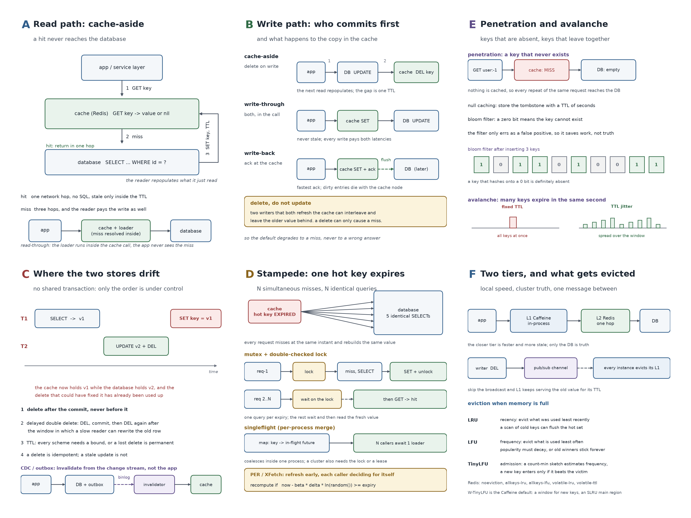

# [시스템 설계] 캐시 아키텍처와 일관성 전략 (Cache-Aside · Stampede 방어)

- 작성일: 2026-11-26
- 키워드: System Design, Cache, Cache-Aside, Read-Through, Write-Through, Write-Back, Cache Invalidation, Delayed Double Delete, CDC, Outbox, Cache Stampede, Thundering Herd, Singleflight, Distributed Lock, XFetch, PER, Cache Penetration, Bloom Filter, Avalanche, TTL Jitter, LRU, LFU, TinyLFU, Caffeine, Redis

## 1. 핵심 요약 (What & Why)

지난 편에서 병목은 이동한다는 것을 봤다. 애플리케이션 스레드를 늘리면 커넥션 풀이 차고, 커넥션을 늘리면 DB CPU가 차고, 읽기 부하를 견디려고 읽기 복제를 붙이면 복제 지연이 생긴다. 그 표의 다음 칸에 적혀 있던 것이 **캐시**다. DB가 같은 행을 하루에 수십만 번 읽는 동안 그 행은 몇 번만 바뀐다. 이 비대칭이 캐시의 존재 이유다. **읽기는 많고 쓰기는 드물며, 같은 데이터를 반복해서 읽는다**는 성질이 없으면 캐시는 그냥 돈과 복잡도를 쓰는 일이 된다.

캐시가 하는 일은 두 가지이고, 그 둘은 다른 자원을 아낀다. 첫째는 **DB 부하**다. 적중률(hit ratio)이 h라면 DB가 받는 읽기 요청은 원래의 `1 - h`배가 된다. 적중률 95%면 DB 읽기는 20분의 1이 된다. 둘째는 **지연 시간**이다. 같은 값을 디스크와 버퍼 풀을 거쳐 읽는 데 걸리는 시간과, 메모리에서 한 번의 네트워크 왕복으로 읽는 시간은 자릿수가 다르다. 그래서 캐시는 "빠르게 만들기"가 아니라 **"비싼 계층에 도달하는 횟수를 줄이기"** 로 이해해야 정확하다.

그런데 캐시를 넣는 순간 시스템은 **같은 데이터의 사본 두 개**를 갖게 된다. 하나는 DB에, 하나는 캐시에. 사본이 둘이면 반드시 어긋나는 순간이 생기고, 그 순간을 다루는 규칙이 필요하다. 이것이 **일관성 전략**이다. 캐시 문제의 절반은 성능이 아니라 이 사본 관리이고, 실무에서 캐시 도입이 실패하는 이유도 대개 성능이 아니라 여기다. "캐시를 붙였더니 가끔 옛날 값이 보인다"는 말은 캐시가 고장 난 것이 아니라 **일관성 모델을 정하지 않고 붙였다**는 뜻이다.

두 번째 문제는 **만료의 순간**에 몰린다. TTL이 있는 캐시는 정확히 TTL이 지난 그 순간에 값이 사라진다. 인기 있는 상품 하나를 초당 5,000명이 보고 있고 그 키의 TTL이 끝나면, 그 5,000명의 요청이 동시에 빈 캐시를 만나 **같은 DB 쿼리 5,000개**가 같은 밀리초에 몰린다. 각 요청은 자기가 첫 번째인 줄 안다. 이것이 **Cache Stampede**(또는 Thundering Herd)다. 캐시가 DB를 보호하려고 만든 장치인데, 캐시가 잠깐 비는 순간 DB에 **원래 부하보다 더 큰 스파이크**를 만들어 준다.

정리하면 네 문장이다.

1. **캐시는 사본을 하나 더 두는 결정이고, 사본을 두는 순간 일관성 모델을 골라야 한다.** TTL이 붙은 캐시는 원칙적으로 최종 일관성 모델이며, "얼마나 오래된 값을 허용하는가"가 곧 설계 파라미터다.
2. **읽기 전략은 Cache-Aside 하나로 수렴하고, 쓰기 전략은 "캐시를 갱신하지 않고 지운다"로 수렴한다.** 갱신 대신 삭제를 쓰는 이유는 실패했을 때의 결과가 다르기 때문이다. 삭제가 실패하면 미스가 되고, 갱신이 뒤섞이면 오답이 남는다.
3. **TTL은 성능 장치가 아니라 안전장치다.** 어떤 무효화 로직도 완벽하지 않으므로, 모든 캐시 항목에는 "이 시간이 지나면 최소한 이렇게 낡을 수 있다"는 상한이 있어야 한다.
4. **만료는 동시에 일어나도록 두면 안 된다.** 무작위 지터, 요청 병합, 확률적 조기 갱신 중 최소 둘을 겹쳐 두어야 만료 순간이 스파이크가 되지 않는다.

## 2. 내부 메커니즘과 구조 (How it works)

### 2.1 캐시가 실제로 아끼는 것

캐시의 효과를 계산하는 식은 단순하다. 다만 **어느 항목을 곱하고 나누는지**를 분명히 해야 오해가 없다.

```text
적중률 h, 전체 읽기 QPS R
  DB 읽기 QPS        = R x (1 - h)
  평균 지연          = h x (cache lookup)
                     + (1 - h) x (cache lookup + DB read + cache write)
```

여기서 놓치기 쉬운 것이 두 가지다.

**(1) 미스는 캐시가 없을 때보다 더 느리다.** 미스 경로는 `캐시 조회 -> DB 조회 -> 캐시 저장`이므로, 캐시를 안 쓸 때의 `DB 조회`보다 왕복이 하나 더 붙는다. 적중률이 낮으면 캐시는 성능을 깎는다. 적중률이 곧 캐시의 손익분기점이고, 그래서 캐시를 붙이기 전에 **키 설계와 접근 패턴**을 먼저 봐야 한다.

**(2) 평균 지연은 좋아지지만 꼬리 지연은 나빠질 수 있다.** 95%가 1ms, 5%가 20ms면 평균은 약 2ms다. 그런데 그 5%가 **동시에** 몰리면(핫 키 만료, 캐시 재시작) 순간적으로 DB가 포화되고, 그때 대기 중인 요청은 20ms가 아니라 초 단위가 된다. 평균만 보면 캐시는 성공이고, p99를 보면 실패다. 그래서 캐시 지표는 적중률과 함께 **미스의 시간 분포**를 봐야 한다.

산정 예시(아래 수치는 가정한 조건에서의 계산이며 특정 시스템의 실측치가 아니다).

```text
가정
  전체 읽기 QPS        12,000
  적중률               95 %
  캐시 조회 지연       1 ms
  DB 조회 지연         6 ms (버퍼 풀 적중 기준)
  재계산 시간 delta    15 ms

계산
  DB 읽기 QPS     = 12,000 x 0.05            = 600
  평균 지연       = 0.95 x 1 + 0.05 x (1+6+1) = 1.35 ms
  캐시 없을 때    = 6 ms  ->  약 4.4배 개선
  핫 키 만료 시   = 5,000 동시 미스 x 15 ms 재계산
                  -> 그 키 하나가 DB에서 초당 5,000건을 요구
```

마지막 줄이 이번 편의 주제다. 적중률 95%인 시스템에서도 **한 키의 만료**는 그 키의 전체 트래픽을 한꺼번에 DB로 보낸다. 전체 부하를 줄이는 계산과, 순간 부하를 견디는 설계는 다른 문제다.

### 2.2 읽기 전략: Cache-Aside와 Read-Through

**Cache-Aside(Lazy Loading)** 는 캐시를 **애플리케이션이 직접 조작하는 수동 캐시**다. 캐시는 아무것도 모르고, 애플리케이션이 "먼저 캐시를 보고, 없으면 DB를 읽고, 읽은 값을 캐시에 넣는다"를 코드로 쓴다.

```java
Product get(long id) {
    String key = "product:v1:" + id;
    Product cached = cache.get(key);          // 1. 조회
    if (cached != null) return cached;        //    적중
    Product loaded = repository.findById(id).orElse(null);  // 2. 미스 -> DB
    cache.set(key, loaded, ttlWithJitter());  // 3. 재적재
    return loaded;
}
```

이 구조의 성질은 네 가지다.

- **캐시가 죽어도 서비스는 산다.** 캐시 예외를 삼키고 DB로 내려가면(회로 차단과 함께) 성능만 떨어질 뿐 기능은 유지된다. 캐시를 "필수 의존성"이 아니라 "가속기"로 두는 유일한 배치다.
- **필요할 때만 채워진다.** 한 번도 읽히지 않는 데이터는 캐시를 차지하지 않는다. 캐시 메모리는 비싸므로 이 성질이 중요하다.
- **첫 요청은 항상 느리다.** 콜드 스타트, 배포 직후, 캐시 재시작 직후에는 적중률이 0에서 시작한다. 이 구간의 DB 보호 대책이 따로 필요하다(2.4, 6.2).
- **무효화를 애플리케이션이 책임진다.** 모든 쓰기 경로에서 삭제를 호출해야 하고, 하나라도 빠지면 그 키는 TTL까지 낡은 값을 유지한다. 실무에서 캐시 버그의 대부분이 여기서 나온다.

**Read-Through** 는 같은 흐름을 **캐시 라이브러리 안으로** 옮긴 것이다. 애플리케이션은 캐시에만 묻고, 미스가 나면 캐시가 등록된 로더(loader)를 호출해 DB에서 읽어 스스로 채운다. 캐시-어사이드와 성능 차이는 거의 없고, 차이는 **책임의 위치**다. 읽기 경로의 재적재 코드가 한 곳으로 모이고, 애플리케이션이 "미스"라는 상태를 볼 일이 없어진다. 대신 로더가 캐시 설정에 묶이므로, 여러 저장소를 조합해야 하는 조회에는 맞지 않는다. Caffeine의 `LoadingCache`, Guava의 `CacheLoader`가 이 형태다.

### 2.3 쓰기 전략: 누가 먼저 확정되는가

읽기는 선택지가 거의 없지만 쓰기는 네 갈래이고, 갈래마다 **무엇을 잃을 수 있는지**가 다르다.

**Write-Through.** 쓰기를 캐시에 하고, 그 쓰기가 같은 호출 안에서 DB까지 내려간다. 캐시와 DB가 항상 같이 갱신되므로 읽기 쪽에 낡은 값이 남지 않는다. 대신 **모든 쓰기가 두 저장소의 지연을 더한 만큼 느려지고**, 한 번도 읽히지 않을 데이터까지 캐시를 차지한다. 캐시를 "읽기 가속기"가 아니라 "주 저장소의 앞단"으로 쓰는 구성에 가깝다.

**Write-Back(Write-Behind).** 쓰기를 캐시에만 하고 즉시 응답한 뒤, 백그라운드에서 DB로 내려쓴다. 쓰기 지연이 가장 짧고, 같은 키에 대한 여러 쓰기를 하나로 합칠 수 있어 쓰기 폭주를 흡수한다. 대신 **응답한 시점에 데이터는 아직 디스크에 없다.** 캐시 노드가 죽으면 그 구간의 쓰기가 사라지고, 다른 경로로 DB를 읽는 쪽은 최신 값을 보지 못한다. 이 전략을 쓰려면 "잃어도 되는 쓰기"인지부터 답해야 한다.

**Cache-Aside 쓰기(삭제).** DB를 먼저 갱신하고, **캐시에서 그 키를 지운다.** 캐시는 다음 읽기에서 다시 채워진다. 갱신이 아니라 삭제인 이유는 2.4에서 따로 다룬다.

**Write-Around.** 쓰기는 DB에만 하고 캐시는 건드리지 않는다. 이후 읽기에서 캐시가 채워진다. 쓰기 직후 그 데이터를 다시 읽지 않는 워크로드(로그, 이력)에서 캐시 오염을 줄인다.

정리하면 이 표의 마지막 열이 실무의 선택 기준이다.

| 전략 | 쓰기 지연 | 일관성 | 잃을 수 있는 것 | 맞는 데이터 |
| --- | --- | --- | --- | --- |
| Cache-Aside (delete) | DB 지연 | 최종 (TTL 상한) | 낡은 값(짧은 구간) | 대부분의 조회성 데이터 |
| Write-Through | 캐시 + DB | 강함 | 없음 (대신 느림) | 자주 읽히고 반드시 최신이어야 하는 소량 |
| Write-Back | 캐시만 | 약함 (지연 반영) | 캐시 장애 시 최근 쓰기 | 카운터, 조회수, 로그 집계 |
| Write-Around | DB 지연 | 최종 | 낡은 값 | 한 번 쓰고 잘 안 읽는 데이터 |

### 2.4 사본이 어긋나는 장면들

#### (1) 갱신 대신 삭제하는 이유

쓰기 시점에 캐시를 **갱신**하면 이런 순서가 가능하다.

```text
W1: DB에 v1 저장
W2: DB에 v2 저장, 캐시에 v2 저장
W1: 캐시에 v1 저장          <- 늦게 도착
결과: DB는 v2, 캐시는 v1
```

두 쓰기가 서로 다른 스레드·인스턴스에서 일어나면 캐시에 쓰는 순서는 DB에 쓰는 순서와 다를 수 있다. 반면 **삭제**는 값이 아니라 "이 키는 없다"는 상태만 남기므로, 늦게 도착한 삭제는 그냥 한 번 더 지우는 것이다. **삭제는 멱등이고, 갱신은 멱등이 아니다.** 그래서 최악의 경우가 "미스(한 번 더 DB를 읽음)"와 "오답(틀린 값을 계속 서빙)"으로 갈린다.

#### (2) 읽기 재적재 경쟁 (stale set)

삭제를 써도 경쟁은 남는다.

```text
T1: 캐시 미스 -> DB에서 v1 읽음 (아직 캐시에 안 씀)
T2: DB에 v2 쓰고, 캐시 삭제
T1: 캐시에 v1 저장          <- T2의 삭제가 이미 지나갔다
결과: DB는 v2, 캐시는 v1, 그리고 이 v1을 지워 줄 삭제는 없다
```

이것이 Facebook의 memcache 논문이 **stale set**이라 부른 문제다. 해법은 세 가지 방향이다.

- **TTL**: 가장 단순하고 가장 확실하다. 위 상태가 TTL까지만 유지된다. 어떤 무효화 기법을 쓰더라도 TTL은 남겨야 하는 이유가 이것이다. TTL이 없는 캐시는 "영원히 틀릴 수 있는 캐시"다.
- **Delayed Double Delete**: 커밋 직후 한 번 지우고, 읽기 재적재가 끝날 만큼의 시간(수백 ms) 뒤에 한 번 더 지운다. 두 번째 삭제가 (2)의 v1을 지운다. 구현이 쉽지만 "얼마나 기다릴 것인가"가 트레이드오프이고, 그 사이 값이 다시 낡을 수 있다. 지연 시간과 재적재 시간이 예측 가능한 시스템에서만 안전하다.
- **버전·리스(lease) 기반**: 캐시 값에 버전을 함께 저장하고, 미스 시 발급한 리스 토큰을 재적재 시 함께 보내 **그 사이 값이 바뀌었으면 저장을 거부**한다. memcache 논문의 리스가 이 방식이며, stale set과 thundering herd를 같은 장치로 다룬다. 정확하지만 캐시 프로토콜과 애플리케이션 코드가 함께 바뀐다.

#### (3) 이중 쓰기와 CDC/Outbox

애플리케이션이 "DB 쓰기"와 "캐시 삭제"를 두 번의 별개 호출로 하면, 그 사이에서 프로세스가 죽을 수 있다. DB는 갱신됐는데 삭제는 사라진 상태이고, 이때 TTL이 없으면 영구 오답이 된다. **이중 쓰기(dual write)는 원자적이지 않다.**

해법은 무효화를 애플리케이션 코드에서 떼어내는 것이다. 커밋된 변경을 **변경 스트림**에서 읽어 무효화한다.

- **Outbox**: 도메인 변경과 같은 트랜잭션으로 `outbox` 테이블에 이벤트를 쓴다. 별도 릴레이가 outbox를 읽어 캐시 무효화 메시지를 발행한다. 커밋과 이벤트가 같은 트랜잭션이므로 유실되지 않는다(최소 한 번 전달, 소비자는 멱등하게).
- **CDC**: DB의 binlog/WAL을 커넥터(Debezium 등)가 읽어 변경 이벤트를 만든다. 애플리케이션이 무효화를 잊을 여지가 사라지고, 코드 밖에서 만든 변경(배치, 수동 UPDATE)까지 잡힌다. 대신 **반영 지연**이 생기고, 스키마·토픽 운영이 추가된다.

두 방식 모두 "삭제를 잊는 경로"를 없애지만 **지연**을 만든다. 그래서 이 구조에서도 TTL은 그대로 필요하다. 무효화는 빠르게, TTL은 최후의 보루로.

> [!NOTE]
> 무효화 설계의 판단 기준은 "정확한가"가 아니라 **"틀렸을 때 얼마나 오래, 얼마나 나쁘게 틀리는가"** 다. 게시글 조회수는 몇 분 낡아도 되고, 계좌 잔액은 1초도 안 된다. 전자는 TTL만으로 충분하고, 후자는 캐시 대상에서 빼거나 버전을 함께 읽어 검증해야 한다. 캐시 대상 선정이 무효화 기법 선택보다 먼저다.

### 2.5 Cache Stampede: 만료의 순간

**정의**: 하나의 인기 키가 만료된 직후, 그 키를 보는 모든 요청이 동시에 미스를 만나 **같은 재계산을 중복 수행**하는 현상. Thundering Herd, Dog-piling이라고도 한다.

발생 조건은 세 가지가 겹칠 때다. (1) 특정 키에 트래픽이 몰리고, (2) 재계산 비용(DB 쿼리 시간)이 크고, (3) 만료 시점이 모든 요청에 대해 같다. 세 번째 조건이 핵심이다. TTL은 키마다 정해져 있으므로 **만료 시각은 예측 가능하고, 예측 가능한 사건은 반드시 동시에 일어난다.**

피해는 선형이 아니다. 재계산에 15ms가 걸리는 키를 초당 5,000명이 보고 있으면, 만료 순간 DB에는 5,000건의 동일 쿼리가 들어온다. DB의 커넥션 풀이 100이라면 4,900건은 대기하고, 대기 중인 요청은 타임아웃으로 재시도해 부하를 더한다. **캐시가 DB를 보호하던 구조가, 캐시가 비는 순간 DB를 죽이는 구조로 뒤집힌다.**

#### 방어 1: 락 + 이중 확인 (Mutex / Double-Checked Locking)

미스 시 **키 단위 락**을 잡고, 락을 얻은 뒤 캐시를 **다시 확인**한다. 두 번째 확인이 핵심이다. 락을 기다리는 동안 다른 요청이 이미 채워 놓았을 수 있기 때문이다.

```text
if miss:
    if acquire_lock(key):
        try:
            value = cache.get(key)          <- double check
            if value != null: return value
            value = db.load(key)
            cache.set(key, value, ttl)
            return value
        finally:
            release_lock(key)
    else:
        wait_briefly(); return cache.get(key) ?? db.load(key)   <- 폴백 필요
```

분산 환경에서는 Redis `SET key value NX PX <ms>` 같은 방식으로 락을 잡는다. 주의할 점이 네 가지다.

- **락에 반드시 TTL을 준다.** 락 소유자가 재계산 도중 죽으면 락이 영원히 남아 그 키가 죽는다.
- **락 해제는 소유자 확인 후** 한다. TTL이 먼저 만료돼 다른 요청이 락을 잡았는데, 원래 소유자가 `DEL`하면 남의 락을 지운다. 값에 토큰을 넣고 compare-and-delete(Lua)로 지운다.
- **대기자에게도 타임아웃과 폴백을 준다.** 고QPS 핫 키에서는 락 하나에 수천 스레드가 매달려 커넥션과 스레드가 고갈된다. "짧게 기다리고, 안 되면 DB로" 또는 "낡은 값을 먼저 준다"가 필요하다.
- **락은 키 단위여야 한다.** 전역 락은 직렬화로 처리량을 죽인다.

#### 방어 2: Singleflight (요청 병합)

같은 키에 대한 **동시 재계산을 하나로 합치는** 방식이다. 프로세스 안에 `key -> 진행 중인 계산(Future)` 맵을 두고, 먼저 온 요청만 계산하고 나머지는 그 결과를 기다린다.

- 장점: 락 서버가 필요 없고, 대기자가 결과를 **공유**하므로 락처럼 "기다렸다가 다시 조회"하는 왕복이 없다.
- 한계: **프로세스 경계를 넘지 못한다.** 인스턴스가 6대면 최대 6건의 중복 계산이 남는다. 이 정도는 대개 견딜 수 있으므로, "DB를 죽이는 N건"을 "인스턴스 수만큼"으로 줄이는 것만으로 충분한 경우가 많다. 인스턴스 수가 많거나 재계산이 매우 비싸면 분산 락과 함께 쓴다.
- 구현: Go의 `golang.org/x/sync/singleflight`, Java에서는 `ConcurrentHashMap<String, CompletableFuture>` 또는 Caffeine의 `LoadingCache`(같은 키의 로드를 직렬화한다).

#### 방어 3: 확률적 조기 갱신 (PER / XFetch)

락도 병합도 없이 **만료 전에 미리 갱신**하는 방식이다. Vattani 등이 제안한 XFetch는 각 요청이 만료 시각에 따라 확률적으로 재계산을 앞당긴다.

```text
delta  : 재계산에 걸리는 시간 (관측값 또는 추정값)
beta   : 공격성 계수 (보통 1)
U      : (0, 1] 균등 난수
expiry : 현재 캐시 항목의 만료 시각

재계산 조건:  now - delta * beta * ln(U) >= expiry
```

의미는 이렇다. 만료가 멀면 `now`와 `expiry`의 차이가 커서 좌변이 우변에 닿지 않는다. 만료가 가까워질수록 확률이 올라가고, 만료 직전에는 **거의 매번** 재계산이 일어난다. 하지만 그 시점에는 모든 요청이 아니라 **가장 먼저 도착한 소수의 요청**만 갱신하고, 나머지는 갱신된 값을 읽는다. 결과적으로 만료 순간의 미스가 사라지고 부하가 시간축으로 퍼진다.

- 장점: 조정이 없다. 락, 리스, 별도 인프라가 필요 없고, 키마다 독립적으로 동작한다.
- 주의: `delta`가 실제 재계산 시간보다 작으면 갱신이 늦어 만료를 넘긴다. 크면 불필요한 재계산이 늘어난다. `beta`로 조절한다.
- 한계: **이미 만료된 키에는 효과가 없다.** 콜드 스타트나 캐시 재시작 뒤에는 전원이 미스이므로, 이때는 병합이나 락이 필요하다.

#### 방어 4: 만료된 값을 잠시 더 준다 (Stale-While-Revalidate)

값이 만료됐어도 **낡은 값을 즉시 반환하고, 갱신은 비동기로** 한 번만 수행한다. 지연은 캐시 수준으로 유지되고, DB에는 갱신 1건만 간다. HTTP의 `stale-while-revalidate`와 같은 발상이다. 대신 "만료 후에도 최대 N초는 낡은 값을 준다"는 사실을 **명시적으로 정해야** 한다. 이 방식은 4가지 중 가장 사용자 지연에 유리하고, 가장 일관성에 불리하다.

### 2.6 Cache Penetration과 Avalanche

**Penetration(관통)** 은 **존재하지 않는 키**를 반복 조회하는 상황이다. 캐시는 미스를 반환하고, DB도 빈 결과를 반환하고, 캐시에는 아무것도 저장되지 않는다. 그래서 같은 요청이 올 때마다 매번 DB까지 간다. 잘못된 ID를 부르는 클라이언트, 크롤러, 악의적 스캔이 원인이다. 적중률이 아무리 높아도 이 트래픽은 100% DB로 간다.

- **Null caching(부정 캐시)**: "없음"도 값으로 저장한다. TTL을 **짧게**(수십 초) 두는 것이 핵심이다. 길게 두면 그 사이 새로 생성된 데이터를 계속 없다고 답한다. 키 공간이 외부 입력에서 오면(사용자 ID, 검색어) 저장되는 쓰레기 키가 메모리를 먹으므로, 입력 검증과 호출 제한을 함께 둔다.
- **Bloom filter**: 키의 존재 여부를 비트 배열로 근사한다. 해시 함수 k개가 가리키는 비트가 **하나라도 0이면 그 키는 확실히 없다.** 그래서 캐시와 DB를 건드리기 전에 걸러낸다. 반대 방향의 오류(있는 키를 없다고 하는 것)는 없고, 없는 키를 있다고 하는 오탐만 있다. 오탐률은 비트 수 m, 원소 수 n, 해시 수 k에 대해 대략 `(1 - e^(-kn/m))^k`다. 삭제가 안 되므로(카운팅 블룸이나 주기적 재구축으로 보완) **"절대 변하지 않는 키 집합"** 이나 "삭제가 드문 집합"에 맞는다.

**Avalanche(눈사태)** 는 **대량의 키가 동시에 만료**되는 상황이다. 원인은 대개 사람이다. 배포 직후 캐시를 워밍하면서 모든 키에 같은 TTL을 주거나, 캐시를 flush하거나, 노드 하나가 죽어 그 몫이 다른 노드로 몰릴 때다. 증상은 Stampede와 같지만 규모가 다르다. 특정 키가 아니라 **캐시 전체의 적중률이 0으로 떨어진다.**

- **TTL 지터**: 만료 시각을 무작위로 흩는다. `ttl = base x (1 + rand(0, 0.1))` 또는 `base + rand(0, window)`. 지터 폭은 "재구축에 걸리는 시간"보다 크게 잡아야 의미가 있다. 5분 TTL에 3초 지터를 주면 거의 효과가 없다.
- **워밍과 재시작 순서**: 트래픽을 받기 전에 주요 키를 채우고, 캐시를 비운 채로 트래픽을 열지 않는다. 배포 절차에 포함시켜야 한다.
- **DB 쪽 최후 방어선**: 이 상황에서는 캐시가 아니라 DB가 버텨야 한다. 커넥션 풀과 동시성 제한(벌크헤드), 회로 차단, 읽기 전용 복제본으로의 분산이 함께 준비돼야 한다.

### 2.7 축출 정책과 2계층 캐시

캐시는 결국 **메모리가 꽉 찬다.** 그때 무엇을 버릴지가 적중률을 결정하고, 적중률이 캐시의 존재 이유를 결정한다.

- **LRU(Least Recently Used)**: 가장 오래전에 접근한 항목을 버린다. 해시 맵 + 이중 연결 리스트로 O(1)에 구현된다. "최근에 쓴 것은 다시 쓴다"는 가정에 기대며, 대부분의 웹 워크로드에서 잘 동작한다. 약점은 **스캔**이다. 한 번씩만 읽는 콜드 데이터가 대량으로 들어오면 핫 데이터가 전부 밀려난다. 이 현상을 캐시 오염(cache pollution)이라 하고, 이 때문에 캐시가 있어도 적중률이 0이 되는 사고가 난다.
- **LFU(Least Frequently Used)**: 사용 빈도가 가장 낮은 항목을 버린다. 스캔에 강하다. 약점은 **노화(aging)** 다. 과거에 인기였다가 지금은 아닌 항목이 빈도만 높아 계속 살아남는다. 그래서 실무의 LFU는 항상 **주기적 감쇠**를 붙인다. Redis의 LFU도 8비트 확률적 카운터와 감쇠 주기를 쓴다.
- **TinyLFU**: 정확한 빈도를 다 세는 대신 **count-min sketch**로 근사하고, **입장 심사(admission)** 를 한다. 새 키는 캐시에 들어오려면 **지금 축출될 후보(victim)의 추정 빈도보다 높아야** 한다. 즉 "버릴 것과 넣을 것을 비교"한다. 스캔이 핫 데이터를 밀어내지 못하게 만드는 장치다. Caffeine의 기본 정책인 **W-TinyLFU**는 여기에 창(window) 구간을 더한다. 새 키는 작은 LRU 창에 먼저 들어가고, 그 창을 통과한(재접근이 확인된) 키만 메인 영역(SLRU)의 심사를 받는다. 최근성과 빈도를 둘 다 쓰기 위한 구조다.

**2계층(L1/L2) 구성**은 지연과 공유를 동시에 얻으려는 배치다.

```text
app -> L1 Caffeine (프로세스 메모리, ns~us, 인스턴스마다 별도)
    -> L2 Redis      (네트워크 왕복, ms 이하, 클러스터 공유)
    -> DB            (원본)
```

L1은 가장 빠르지만 **인스턴스마다 따로 존재**한다. 무효화가 L2에서 끝나면 다른 인스턴스의 L1은 자기 TTL까지 낡은 값을 계속 준다. 그래서 무효화는 **브로드캐스트**해야 한다. Redis pub/sub(또는 keyspace notification)으로 삭제 채널을 발행하고 각 인스턴스가 자기 L1을 지우는 구조다. 이때 두 가지가 따라온다.

- **pub/sub은 유실될 수 있다.** 구독자가 재시작 중이거나 파티션이 나면 메시지를 놓치고, 그 인스턴스는 낡은 값을 유지한다. 그래서 **L1 TTL은 짧게**(초 단위) 두고, 브로드캐스트 유실을 TTL이 덮게 한다.
- **버전 키로 대신할 수 있다.** `product:42:v17`처럼 키에 버전을 넣으면, 버전이 올라간 순간 옛 키는 아무도 조회하지 않으므로 삭제 브로드캐스트가 필요 없다. 대신 옛 키가 TTL까지 메모리를 차지하고, 버전을 어디에 둘지(중앙 카운터)를 정해야 한다.

L1을 넣는 판단은 보통 **"조회 지연의 상당 부분이 Redis 왕복인가"** 로 한다. DB 지연이 5ms인데 Redis가 1ms라면 L1의 이득은 그 1ms를 0.01ms로 줄이는 것이고, 그 대가로 무효화 복잡도가 붙는다. 반면 초당 수만 건을 처리하는 서비스에서는 1ms x 수만이 곧 용량이므로 L1이 필수가 된다.

## 3. 구조 도식 (Architecture Diagram)



- **A 읽기 경로 (왼쪽 위)**: Cache-Aside의 세 걸음. 애플리케이션이 캐시를 먼저 묻고, 미스면 DB를 읽어 `SET key, TTL`로 되돌려 넣는다. 아래 두 줄이 이 구조의 성질이다. 적중은 한 번의 왕복으로 끝나고, 미스는 세 번의 왕복에 **읽은 쪽이 쓰기까지** 한다. 맨 아래 점선 흐름이 Read-Through로, 같은 재적재가 캐시 내부 로더에서 일어나 애플리케이션이 미스를 보지 않는 형태다.
- **B 쓰기 경로 (가운데 위)**: 네 가지 쓰기 전략을 같은 높이로 놓고 순서를 비교했다. Cache-Aside는 DB 갱신 뒤 캐시 삭제(점선 없음, 순차), Write-Through는 캐시와 DB를 같은 호출에서, Write-Back은 캐시에서 응답하고 DB는 나중에(점선 `flush`). 맨 아래 강조 상자가 "갱신하지 말고 삭제하라"는 규칙과 그 이유다. 늦게 도착한 갱신은 옛 값을 되돌려 놓지만, 늦게 도착한 삭제는 미스만 남긴다.
- **C 어긋나는 장면 (왼쪽 아래)**: T1이 v1을 읽고 T2가 v2를 쓰는 사이에 T1의 재적재가 끼어드는 타임라인이다. 결과 상자(빨강)가 "캐시는 v1, DB는 v2"이고, 그것을 고칠 삭제는 이미 지나갔다. 아래 네 줄이 방어선이고(커밋 후 삭제, 지연 이중 삭제, TTL, 멱등성), 맨 아래가 CDC/Outbox 흐름이다. 애플리케이션이 아니라 커밋된 변경 스트림이 무효화를 발생시키므로 이중 쓰기가 사라진다.
- **D Stampede 방어 (가운데 아래)**: 위쪽은 문제다. 만료된 핫 키 하나에 여러 요청이 몰려 같은 쿼리가 여러 번 나간다. 아래는 세 가지 방어다. 락을 잡은 하나만 재계산하고 나머지는 락을 기다렸다가 갱신된 값을 읽는 흐름, 프로세스 안에서 요청을 하나로 합치는 singleflight, 그리고 마지막 상자의 확률적 조기 갱신 조건식. 앞의 둘은 조정이 필요하고, 마지막은 조정 없이 만료를 분산시킨다.
- **E Penetration과 Avalanche (오른쪽 위)**: 위는 없는 키를 반복 조회하는 흐름이다. 캐시도 DB도 값을 주지 않으므로 아무것도 저장되지 않고, 다음 요청도 똑같이 관통한다. 아래 비트 배열이 블룸 필터로, 0인 비트에 걸린 키는 확실히 없다. 맨 아래 두 그래프가 아발란체다. 같은 TTL을 주면 만료가 한 초에 몰리고(왼쪽), 지터를 주면 창 안에 퍼진다(오른쪽).
- **F 2계층과 축출 (오른쪽 아래)**: 위는 `app -> L1 -> L2 -> DB`의 지연 순서다. 가까운 계층일수록 빠르고 낡을 수 있다. 가운데 흐름은 삭제 브로드캐스트로, writer의 삭제가 pub/sub을 거쳐 모든 인스턴스의 L1에 도달한다. 이 채널을 건너뛰면 L1은 자기 TTL까지 옛 값을 서빙한다. 아래 세 항목이 LRU, LFU, TinyLFU의 판단 기준이고, 마지막 두 줄이 실무의 기본값(Redis의 축출 정책 이름, Caffeine의 W-TinyLFU)이다.

## 4. 비교 표 (Comparison)

### 4.1 읽기/쓰기 전략

| 항목 | Cache-Aside | Read-Through | Write-Through | Write-Back |
| --- | --- | --- | --- | --- |
| 캐시를 조작하는 주체 | 애플리케이션 | 캐시(로더) | 캐시 또는 애플리케이션 | 캐시 |
| 미스 처리 | 앱이 DB 조회 후 저장 | 캐시가 로더 호출 | 해당 없음 | 해당 없음 |
| 쓰기 지연 | DB 지연 | - | 캐시 + DB | 캐시만 |
| 읽기 일관성 | 최종 (TTL 상한) | 최종 | 강함 | 약함 (지연 반영) |
| 캐시 장애 시 | DB로 폴백 가능 | 폴백 구현에 의존 | 쓰기 실패 | 쓰기 유실 |
| 데이터 유실 위험 | 없음 | 없음 | 없음 | 있음 (플러시 전) |
| 캐시 메모리 효율 | 높음 (읽힌 것만) | 높음 | 낮음 (안 읽는 것도) | 높음 |
| 구현 난이도 | 낮음 | 중간 (로더 결합) | 낮음 | 높음 (순서·재시도·유실) |
| 주 용도 | 조회 API 대부분 | 동일, 코드 정리 | 소량·최신 필수 | 카운터, 집계, 로그 |

### 4.2 캐시 장애 유형별 원인과 방어

| 유형 | 원인 | 증상 | 1차 방어 | 2차 방어 | 남는 위험 |
| --- | --- | --- | --- | --- | --- |
| Stampede (Thundering Herd) | 핫 키 만료 순간 동시 미스 | 특정 키의 쿼리가 폭주 | 락 + 이중 확인, singleflight | PER/XFetch, stale-while-revalidate | 락 대기열 고갈, 인스턴스 수만큼 중복 |
| Penetration | 존재하지 않는 키 반복 조회 | 적중률 무관하게 DB 100% | Null caching (짧은 TTL) | Bloom filter, 입력 검증, 호출 제한 | 부정 캐시 메모리, 블룸 오탐 |
| Avalanche | 대량 키 동시 만료, flush, 노드 손실 | 적중률 0에 가까운 급락 | TTL 지터 | 워밍, DB 동시성 제한, 복제본 분산 | 지터 창보다 긴 재구축 시간 |
| Stale read | 무효화 유실, 재적재 경쟁, L1 미전파 | 특정 키만 계속 옛 값 | 커밋 후 삭제 | TTL, 지연 이중 삭제, CDC/Outbox | TTL 동안의 오답 |
| Hot key | 단일 키에 트래픽 집중 | 한 키가 한 노드/샤드를 포화 | L1 캐시, 복제 | 키 분산(샤딩된 카운터) | 분산의 정합 비용 |
| Cold start | 배포·재시작 직후 빈 캐시 | 일시적 DB 폭주 | 워밍 | DB 벌크헤드, 점진적 트래픽 개방 | 워밍 중 일관성 |

## 5. 내가 깨달은 점 (My Insight)

- **캐시는 성능 장치가 아니라 "일관성 모델을 스스로 고르는 두 번째 저장소"다.** 처음에는 캐시를 DB 앞의 빠른 메모리로만 생각했다. 그런데 TTL을 정하는 순간 "이 데이터는 최대 N초 낡아도 된다"는 **비즈니스 결정**을 한 것이고, 삭제 시점을 정하는 순간 "어느 순간까지 낡은 값을 허용하는가"를 정한 것이다. 즉 캐시 설정 파일에 들어가는 TTL은 기술 값이 아니라 데이터의 성질에 대한 답이다. 이 관점으로 보면 "캐시를 붙일까"라는 질문은 "이 데이터가 낡아도 되는가"로 바뀌고, 답이 '아니오'인 데이터(잔액, 권한, 재고 확정)는 캐시 대상에서 빠진다. 캐시 설계의 절반은 무엇을 캐시하지 않을지 정하는 일이다.

- **삭제와 갱신의 차이는 성능이 아니라 실패의 모양이다.** 처음에는 "값이 바뀌었으면 캐시도 바꾸는 게 자연스럽지 않나"라고 생각했다. 그런데 두 쓰기가 경쟁하면 갱신은 **순서가 뒤집힌 오답**을 남기고, 삭제는 **미스**를 남긴다. 미스는 느릴 뿐이고 오답은 틀린 것이다. 시스템이 실패하는 방식은 두 가지뿐이고(느려지거나 틀리거나), 설계는 느린 쪽을 고르는 일이다. **"최악의 경우가 미스인 설계"** 라는 문장이 캐시 설계 전체를 관통하는 기준이라는 것을 이번에야 분명히 이해했다.

- **TTL은 귀찮은 만료가 아니라 유일하게 확실한 방어선이다.** 무효화 로직은 코드 경로가 하나 늘 때마다 깨질 수 있고, 메시지는 유실될 수 있고, 네트워크는 끊길 수 있다. 그 모든 경우에 TTL은 "이 시간이 지나면 최소한 맞는다"를 보장한다. 그래서 TTL은 "무효화가 잘 되니까 길게 잡아도 된다"가 아니라 **"무효화가 실패했을 때를 대비해 반드시 짧게 잡는다"** 가 맞는 방향이다. 캐시에 TTL을 안 넣는 것은, 무효화 버그가 하나도 없다고 가정하는 것이다. 그 가정은 거의 항상 틀린다.

- **실무 기본값이 Cache-Aside + 삭제 + TTL 지터인 이유를 이제 설명할 수 있다.** 이 조합은 성능이 최고가 아니다. Write-Back이 더 빠르고, Write-Through가 더 정확하다. 그런데 이 조합은 **모든 실패가 미스로 수렴하고, 각 방어가 서로의 빈틈을 메운다.** 삭제가 유실되면 TTL이 덮고, TTL이 동시에 만료되면 지터가 흩고, 지터로도 남는 스파이크는 병합이 줄인다. 반면 Write-Back은 빠르지만 유실의 가능성을 안고, Write-Through는 정확하지만 쓰기 경로가 두 배로 느려진다. 기본값은 "최고"가 아니라 **"틀렸을 때 가장 싸게 틀리는"** 선택이다.

- **만료는 반드시 동시에 일어난다.** TTL은 키마다 고정값이고, 캐시는 시계를 공유한다. 그래서 "같은 시점에 채워진 키는 같은 시점에 만료된다"가 기본 동작이다. 이 사실을 모르면 캐시를 붙인 뒤 트래픽이 늘 때 정확히 같은 시각에 DB가 죽는 현상을 겪는다. 지터는 사소한 트릭이 아니라 **분산 시스템에서 상관관계를 끊는 일반 원리**(재시도 백오프의 지터, 크론의 분산과 같은 원리)의 한 사례다. 무작위는 정밀함의 반대가 아니라, 동시성을 깨는 도구다.

## 6. 실무 관점 및 트레이드오프 (Trade-offs & Best Practices)

### 6.1 TTL을 정하는 기준

TTL은 "데이터가 사는 시간"이 아니라 **"낡은 값을 허용하는 시간"** 이다. 그래서 답은 항상 업무 쪽에 있다. "이 화면이 30초 낡으면 사용자가 문제를 겪는가"에 답하고, 그 답을 TTL로 옮긴다.

| 데이터 | TTL 감각 | 이유 |
| --- | --- | --- |
| 권한·세션·잔액 | 캐시하지 않거나 수 초 | 틀리면 곧 사고, 무효화 실패 비용이 큼 |
| 상품·게시글 상세 | 수 분 | 수정 후 반영 지연을 사용자가 견딤 |
| 목록·피드 첫 페이지 | 수십 초 ~ 수 분 | 개인화·정렬이 자주 바뀜 |
| 설정·코드 테이블 | 수십 분 ~ 수 시간 | 변경이 드물고 변경 시 명시적 무효화 가능 |
| 부정 캐시(없는 키) | 수 초 ~ 1분 | 새로 생성된 데이터를 가리지 않을 만큼만 |

세 가지 실무 규칙을 덧붙인다.

- **TTL > 재계산 시간(delta).** TTL이 재계산보다 짧으면 값을 넣자마자 만료되어 캐시가 항상 비어 있는 상태가 된다.
- **TTL에 지터를 넣는다.** 5~10% 정도면 충분하고, 아발란체 위험이 큰 캐시는 지터 폭을 "재구축 시간"에 맞춘다.
- **무효화는 TTL보다 짧게.** 삭제·이벤트가 정상 동작하면 TTL은 거의 쓰이지 않는다. TTL은 백스톱이고, 그 사실을 모니터링(만료로 인한 미스 비율)으로 확인한다.

> [!NOTE]
> TTL을 길게 잡고 싶은 유혹은 항상 적중률 지표에서 온다. 하지만 적중률은 TTL만의 함수가 아니다. 키 설계, 캐시 크기, 축출 정책, 접근 패턴이 함께 만든다. TTL을 늘려 적중률을 올리는 대신 **오답 구간을 늘리는** 경우가 많으므로, TTL 변경은 적중률이 아니라 "낡은 값 노출 시간"의 관점에서 승인해야 한다. 반대로 TTL을 줄여 DB가 버티지 못하면, 그때 필요한 것은 TTL이 아니라 병합·락·읽기 복제다.

### 6.2 캐시 장애와 폴백

> [!WARNING]
> 캐시는 DB 부하를 `1/h`로 줄이는 장치다. 즉 **캐시가 사라지면 DB 부하는 `1/h`배로 늘어난다.** 적중률 95%인 시스템에서 Redis가 죽으면 DB는 평소의 20배를 받고, 대개 그 즉시 포화된다. 이때 애플리케이션이 캐시 예외로 500을 내거나, 재시도를 반복하거나, 커넥션을 무한정 열면 **캐시 장애가 DB 장애로 번지고 서비스 전체가 멈춘다.** 캐시 장애 대응은 "Redis를 이중화한다"가 아니라 **"Redis 없이도 버티는 시간을 정한다"** 이다.

구체적으로 정해야 하는 것들이다.

- **타임아웃**: 캐시 클라이언트의 연결·읽기 타임아웃을 짧게(수십 ~ 수백 ms) 둔다. 캐시가 느려지는 상황은 죽는 상황보다 흔하고, 긴 타임아웃은 스레드를 잡아먹어 전체를 멈춘다.
- **회로 차단**: 캐시 오류율이 임계치를 넘으면 일정 시간 캐시를 건너뛰고 DB로 간다. 이때 **DB로 가는 동시성을 제한**해야 한다(벌크헤드, 세마포어). 그렇지 않으면 폴백이 곧 DB 과부하가 된다.
- **폴백 정책**: 오류 시 (a) DB 직결, (b) 낡은 값 제공, (c) 기능 축소(개인화 끄기) 중 무엇인지 **API별로** 정한다. 읽기는 (a)/(b)가 가능하지만, 캐시가 유일한 저장소인 Write-Back 구성에서는 쓰기를 거절해야 한다.
- **복구 순서**: 캐시가 돌아와도 비어 있으면 다시 아발란체다. 트래픽을 점진적으로 열거나, 주요 키를 워밍한 뒤 복귀시킨다.

### 6.3 직렬화와 키 설계

**직렬화 포맷**은 지연과 호환성의 트레이드오프다.

| 포맷 | 크기·속도 | 장점 | 단점 |
| --- | --- | --- | --- |
| JSON | 보통 | 사람이 읽음, 스키마 변경에 관대, 디버깅 쉬움 | 필드명 반복으로 큼, 숫자·날짜 타입 모호 |
| Protobuf / Avro | 작고 빠름 | 스키마·버전 관리, 하위 호환 규칙 | 스키마 배포 필요, 사람이 못 읽음 |
| Java 직렬화 | 큼 | 추가 작업 없음 | 클래스 변경에 취약, 보안 위험, 이식 불가 |
| Kryo / MessagePack | 작고 빠름 | 설정이 단순 | 스키마 진화 규칙이 약함 |

캐시 값은 **배포와 함께 스키마가 바뀌는 데이터**다. 구버전 인스턴스가 신버전 값을 읽는 순간이 반드시 생기므로, "읽을 수 없으면 미스로 취급하고 다시 채운다"는 규칙을 두고 **키에 스키마 버전을 넣는 것**(`product:v2:42`)이 가장 단순한 해법이다. 버전을 올리면 옛 키는 TTL로 사라진다.

**키 네이밍**은 사고를 줄이는 규칙이다.

```text
<서비스>:<엔티티>:<버전>:<식별자>[:<변형>]
  product:detail:v2:42
  user:profile:v1:42
  search:result:v3:<해시된 쿼리>
```

- 콜론으로 계층을 만들고, 앞에 서비스를 붙여 네임스페이스를 분리한다(같은 Redis를 여러 서비스가 쓸 때 충돌과 오삭제를 막는다).
- 식별자에 공백·제어문자를 넣지 않는다. 사용자 입력이 키가 되면 해시한다.
- **모든 키에 TTL을 준다.** TTL 없는 키는 언젠가 메모리를 다 먹고, 그때는 축출 정책이 핫 데이터를 밀어낸다.
- 키 길이를 줄인다. 수억 개 키에서 키 이름 10바이트 차이는 기가바이트 차이다.

### 6.4 스프링에서의 구현

Spring의 캐시 추상화는 기본이 **Cache-Aside**다. `@Cacheable`은 조회 시 캐시를 먼저 보고, 없으면 메서드를 실행하고 결과를 저장한다.

```java
@Cacheable(cacheNames = "product", key = "#id", sync = true)
public Product find(long id) {
    return repository.findById(id).orElseThrow();
}

@CacheEvict(cacheNames = "product", key = "#p.id")
public void update(Product p) {
    repository.save(p);
}

@CachePut(cacheNames = "product", key = "#result.id")
public Product refresh(Product p) { ... }
```

- `sync = true`는 **같은 키에 대한 동시 호출을 하나로 묶는다.** 2.5의 singleflight에 해당하고, 스탬피드 방어의 가장 싼 1차선이다. 다만 다중 키 조회나 `unless`와 함께 쓸 수 없는 제약이 있고, 프로세스 안에서만 동작한다.
- `@CacheEvict`의 `beforeInvocation` 기본값은 false다. **메서드가 성공한 뒤** 지운다는 뜻이고, 예외가 나면 지우지 않는다. 트랜잭션 커밋 전에 삭제가 나가는 것이 문제라면 `@TransactionalEventListener(AFTER_COMMIT)`이나 outbox로 커밋 이후로 옮긴다.
- TTL과 직렬화는 `RedisCacheConfiguration`에서 정한다. 엔트리별 TTL 계산 훅(예: Spring Data Redis의 `TtlFunction`)을 쓰면 지터를 캐시 설정 한 곳에 모을 수 있고, 코드 여러 곳에 흩어진 `Duration.ofMinutes(5)`를 없앨 수 있다.

```java
@Bean
RedisCacheConfiguration cacheConfig() {
    return RedisCacheConfiguration.defaultCacheConfig()
        .entryTtl(Duration.ofMinutes(5))
        .disableCachingNullValues()          // null은 부정 캐시로 따로 다룬다
        .serializeValuesWith(RedisSerializationContext.SerializationPair
            .fromSerializer(new GenericJackson2JsonRedisSerializer()));
}
```

`disableCachingNullValues()`를 켜 두면 `null`이 저장되지 않는다. 관통 방어가 필요하면 이 설정을 끄고 **짧은 TTL의 부정 캐시**를 별도 캐시 이름(`product-miss`)으로 두는 편이 안전하다. 정상 데이터와 부정 캐시의 TTL이 달라야 하기 때문이다.

### 6.5 점검 순서

캐시를 넣었는데 기대만큼 빠르지 않거나, 가끔 값이 이상할 때 확인할 순서다.

1. **적중률을 먼저 본다.** `hit / (hit + miss)`. 낮으면 캐시 크기, 키 설계, 축출 정책, TTL 중 어디가 원인인지 본다. 적중률이 높은데 느리면 캐시가 아니라 다른 구간이 병목이다.
2. **미스의 성격을 나눈다.** 만료(expired), 축출(evicted), 최초 적재(cold), 부정 캐시 미적용. 원인별로 처방이 다르다. 축출이 많으면 메모리 부족, 만료가 몰리면 지터 부족이다.
3. **만료 시각의 분포를 본다.** 시간대별 만료 건수를 그려서 한 점에 몰리는지 확인한다. 몰리면 지터를 넣는다.
4. **낡은 값 신고가 특정 키에 집중되는지 본다.** 집중되면 무효화 경로 누락(코드 경로 하나가 삭제를 안 함) 또는 L1 미전파다.
5. **재계산 시간(delta)을 측정한다.** 스탬피드 피해는 `delta x QPS`다. delta가 큰 쿼리는 캐시 대상에서 빼거나, 미리 계산(materialized)하거나, 병합을 건다.
6. **캐시 장애 훈련을 한다.** 스테이징에서 Redis를 내려 보고, DB가 버티는 시간과 폴백 동작을 확인한다. 이 훈련을 하지 않은 시스템은 실제 장애에서 처음으로 그 동작을 알게 된다.

```text
# 캐시 점검 체크리스트
1. 적중률                : hit / (hit + miss), 키 그룹별
2. 미스 사유 분포        : expired / evicted / cold / no-negative-cache
3. 만료 시각 분포        : 한 점에 몰리는가 (지터 여부)
4. 무효화 경로           : 모든 쓰기 경로가 삭제하는가, 커밋 이후인가
5. L1 전파               : pub/sub 유실 시 TTL이 덮는가
6. delta                 : 재계산 시간 x QPS = 최대 순간 DB 부하
7. TTL 존재              : TTL 없는 키가 0건인가
8. 장애 폴백             : 타임아웃, 회로 차단, DB 동시성 제한이 설정됐는가
```

## 7. 참고 자료 (References)

- Redis, *Client-side caching* 및 *Caching patterns* 문서 - 캐시 배치와 무효화(RESP3 tracking 기반 클라이언트 캐시 무효화, pub/sub을 이용한 전파)의 기준 동작
- Redis, *Key eviction* 문서 - `maxmemory`와 `maxmemory-policy`(`noeviction`, `allkeys-lru`, `allkeys-lfu`, `volatile-lru`, `volatile-lfu`, `volatile-ttl`, `allkeys-random`, `volatile-random`), 표본 추출 기반의 근사 LRU/LFU와 `maxmemory-samples`
- Redis, *Redis as an LRU cache* 문서 - 근사 LRU의 동작과 정확도-비용 트레이드오프
- R. Nishtala et al., "Scaling Memcache at Facebook", NSDI 2013 - 리스(lease)로 stale set과 thundering herd를 함께 다루는 방식, 리전 간 캐시 일관성, 무효화 경로 설계
- A. Vattani, F. Chierichetti, K. Lowenstein, "Optimal Probabilistic Cache Stampede Prevention", VLDB 2015 - XFetch/PER의 재계산 조건식 `now - delta * beta * ln(U) >= expiry`와 `beta`의 의미
- B. H. Bloom, "Space/Time Trade-offs in Hash Coding with Allowable Errors", CACM 1970 - 블룸 필터의 원 논문(오탐만 허용, 거짓 음성 없음)
- G. Einziger, R. Friedman, B. Manes, "TinyLFU: A Highly Efficient Cache Admission Policy", ACM TOS 2017 - count-min sketch 기반 빈도 추정과 입장 심사
- Ben Manes, Caffeine 문서 및 위키 - W-TinyLFU(창 + SLRU 메인 영역), `LoadingCache`의 키 단위 로드 직렬화, 비동기 로딩
- Spring Framework, *Cache Abstraction* 문서 - `@Cacheable`, `@CacheEvict`, `@CachePut`, `sync` 속성과 그 제약, Cache-Aside 기본 동작
- Spring Data Redis, *Redis Cache* 문서 - `RedisCacheConfiguration`, TTL 설정, 직렬화, `disableCachingNullValues`
- Martin Kleppmann, *Designing Data-Intensive Applications* (O'Reilly, 2017) - 5장 복제(복제 지연과 읽기 일관성), 6장 파티셔닝(hot key와 편향), 1장 확장성(캐시가 병목 이동의 한 단계라는 관점)
- Debezium 문서 - 변경 데이터 캡처(CDC)로 커밋된 변경을 스트림으로 노출하는 구성
