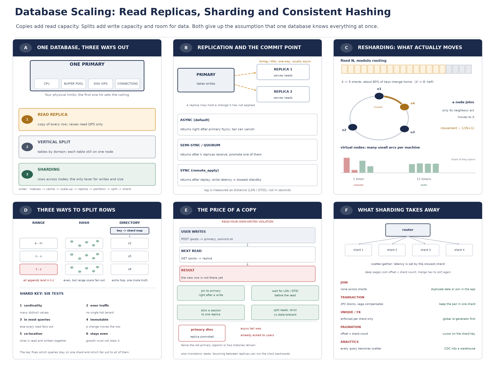

# [시스템 설계] 데이터베이스 확장과 샤딩 (Read Replica · Shard Key · Consistent Hashing)

- 작성일: 2026-11-27
- 키워드: System Design, Database Scaling, Read Replica, Replication Lag, Read-Your-Own-Writes, Failover, Split Brain, Vertical Partitioning, Functional Partitioning, Table Partitioning, Sharding, Shard Key, Hot Shard, Resharding, Consistent Hashing, Virtual Node, Rendezvous Hashing, Jump Consistent Hash, Scatter-Gather, Cross-Shard Join, Two-Phase Commit, Saga, Snowflake ID, ShardingSphere, Vitess

## 1. 핵심 요약 (What & Why)

앞의 두 편에서 병목이 애플리케이션에서 DB로 넘어오는 과정을 봤다. 인스턴스를 늘리면 무상태 계층은 늘어나지만 커넥션은 한 곳에 몰리고, 캐시로 읽기를 덜어내면 그 뒤에 남는 것은 결국 **한 대의 DB**다. 그 한 대가 감당할 수 있는 양은 네 가지 물리량으로 정해진다. CPU 코어 수, 버퍼 풀 크기(메모리), 디스크 IOPS와 순차 쓰기 대역, 그리고 동시 커넥션 수다. 이 넷 중 어느 하나라도 차면, 나머지가 남아 있어도 처리량은 더 늘지 않는다.

수직 확장(Scale-Up)은 이 네 가지를 한꺼번에 올리는 방법이고, 어느 지점까지는 가장 값싼 선택이다. 그러나 두 가지 벽이 있다. 첫째, **기계 한 대의 천장**이다. 코어를 두 배로 늘려도 2배가 되지 않는 구간이 있고, 그 위로는 장비 가격이 선형이 아니라 지수적으로 올라간다. 둘째, **데이터 크기**다. 버퍼 풀이 전체 데이터보다 작아지는 순간, 캐시 적중률이 떨어지고 디스크 읽기가 늘어나면서 같은 쿼리가 갑자기 느려진다. 데이터가 계속 쌓이는 서비스에서 이것은 시간 문제다. 즉 수직 확장은 "느려지는 시점을 미루는" 선택이지, 영원한 답이 아니다.

그래서 남는 선택지는 **데이터를 여러 대에 나누는 것**이고, 나누는 방식이 세 가지다. 이 셋은 서로 다른 것을 나누고, 서로 다른 자원을 늘린다.

| 수단 | 무엇을 나누는가 | 늘어나는 자원 | 한 대의 한계를 넘는가 |
| --- | --- | --- | --- |
| Read Replica | 같은 데이터의 **복사본** | 읽기 용량 | 아니다 (데이터 크기·쓰기는 그대로) |
| 수직 분할 | **테이블 묶음**(도메인) | 도메인별 독립 용량·격리 | 부분적으로 (각 테이블은 여전히 한 대) |
| 수평 샤딩 | **한 테이블의 행** | 쓰기 용량·데이터 크기 | 넘는다 |

이 표가 이번 편의 지도다. 읽기가 많으면 복제로, 테이블이 많고 도메인이 섞였으면 분할로, 한 테이블이 한 대를 넘으면 샤딩으로 간다. 실무에서 흔한 실수는 순서를 건너뛰는 것이다. 읽기 부하를 복제로 풀 수 있는 상황에서 샤딩을 들여오면, 얻는 것보다 잃는 것(조인·트랜잭션·전역 제약)이 먼저 온다.

그리고 이 세 수단은 모두 **공짜가 아닌 새로운 실패 모양**을 만든다. 복제본은 언제나 조금 뒤처져 있으므로 읽기가 낡을 수 있고, 승격(failover) 순간에 마지막 트랜잭션이 사라질 수 있다. 샤딩은 한 트랜잭션 안에서 여러 샤드를 건드리는 일을 불가능하게 만들고, 전역 유니크 제약과 자동 증가 ID를 앗아간다. 확장은 용량을 사는 대신 **"사본이 정확히 같다"는 단순한 가정**을 팔고, 그 가정을 코드에서 다시 만들어야 하는 일이다.

네 문장으로 정리한다.

1. **복제는 읽기 용량을, 샤딩은 쓰기 용량과 데이터 크기를 늘린다.** 둘은 대체재가 아니라 다른 병목의 약이다. 어느 쪽이 필요한지는 "읽기가 많은가, 쓰기가 많은가, 데이터가 한 대를 넘는가"로 갈린다.
2. **복제 지연(lag)은 고장이 아니라 설계 파라미터다.** lag가 0인 복제는 동기 복제뿐이고, 동기 복제는 쓰기 지연과 가용성을 대가로 낸다. 어느 정도의 lag를 허용할지는 데이터마다 다르게 답해야 한다.
3. **샤딩은 마지막 수단이다.** 수직 확장, 인덱스·쿼리 튜닝, 캐시, 읽기 복제, 테이블 파티셔닝을 다 해 본 뒤에 온다. 샤딩이 빼앗는 것은 성능이 아니라 **데이터베이스가 공짜로 해 주던 보장**이다.
4. **샤드 키는 제품 결정에 가깝다.** 한 번 정하면 바꾸는 비용이 크고, 무엇으로 자르느냐가 이후 모든 쿼리의 모양을 정한다. 그리고 고정 N 모듈러는 재샤딩 비용을 최악으로 만든다.

## 2. 내부 메커니즘과 구조 (How it works)

### 2.1 Read Replica: 복제는 무엇을 언제 따라잡는가

**Read Replica**는 주 DB(Primary, Source, Leader)의 변경을 다른 인스턴스(Replica, Standby, Follower)로 계속 흘려보내고, 읽기 요청을 그쪽으로 보내는 구성이다. 쓰기는 주 DB 한 곳에서만 일어나므로 **쓰기 처리량은 늘지 않는다.** 늘어나는 것은 읽기 처리량, 그리고 주 DB에서 빠져나가는 백업·리포트·분석 부하다.

복제의 경로는 DB마다 이름이 다르지만 구조는 같다.

```text
MySQL
  client COMMIT
    -> InnoDB redo log / binlog 기록 (binlog는 ROW 포맷이 기본)
    -> dump thread가 binlog event를 replica로 전송
    -> replica: relay log에 기록 -> applier(SQL) thread가 재실행
    -> 위치 추적: GTID (server_uuid:transaction_id) 또는 file+offset

PostgreSQL
  client COMMIT
    -> WAL record 기록 (wal_level = replica|logical)
    -> walsender가 WAL을 스트리밍
    -> replica: walreceiver가 WAL을 받아 replay (hot standby)
    -> 위치 추적: LSN (log sequence number)
```

여기서 중요한 구분이 **전송이 끝난 시점**과 **적용이 끝난 시점**이다. 복제본이 WAL을 받아 디스크에 내려놓은 것과, 그것을 실제로 재실행해 읽기 가능한 상태로 만든 것은 다른 사건이고, 그 사이가 곧 지연이다.

**동기/비동기/중간**은 "커밋 응답을 언제 돌려주는가"의 문제다.

- **비동기(기본값)**: 주 DB는 자기 디스크에 커밋하고 즉시 응답한다. 복제는 나중에 따라온다. 쓰기 지연이 가장 짧고, 복제본이 죽어도 주 DB는 멈추지 않는다. 대신 **응답한 시점에 복제본에는 그 트랜잭션이 없다.** 주 DB가 죽으면 마지막 구간이 사라진다.
- **동기(PostgreSQL `synchronous_commit = on` + `synchronous_standby_names`)**: 지정한 스탠바이가 WAL을 받아 flush할 때까지(또는 `remote_apply`면 재실행까지) 커밋을 기다린다. 잃는 구간이 0에 가까워지는 대신, **가장 느린 필수 복제본이 쓰기 지연을 정한다.** 그 복제본이 죽으면 설정에 따라 쓰기가 멈춘다.
- **쿼럼 동기(중간)**: `ANY 2 (r1, r2, r3)`처럼 "N개 중 k개만 확인하면 된다"로 두면, 한 대가 죽어도 나머지가 응답하므로 가용성과 무손실을 함께 얻는다. MySQL의 semi-synchronous replication도 같은 발상으로, source가 **복제본이 relay log에 기록했다는 ack**를 받은 뒤 커밋을 반환한다(`AFTER_SYNC` 지점이 기본). 이 경우 손실 구간은 "복제본이 받았지만 아직 적용하지 않은" 부분으로 줄어들고, 승격할 때 그 복제본을 골라야 무손실이 된다.

정리하면, 동기 복제는 **지연과 가용성을 내고 무손실을 사는** 거래다. "복제본을 붙였으니 안전하다"는 문장은 비동기 복제에서는 틀리다. 복제본은 백업이 아니라 **읽기용 사본**이고, 백업과 재해 복구는 별개의 설계다.

#### 복제 지연의 해부

지연이 생기는 자리는 네 곳이다.

1. **전송 지연**: 주 DB의 binlog dump / walsender가 밀리는 경우. 주 DB CPU가 포화하면 여기서부터 늘어난다.
2. **적용 지연**: 복제본이 재실행하는 속도. 가장 흔한 원인이다. 특히 **큰 트랜잭션**(수십만 행 UPDATE, 대량 DELETE, 긴 DDL)은 하나의 단위로만 전달되므로, 그 하나가 끝날 때까지 복제본은 그 뒤의 모든 변경을 못 본다. 1초짜리 배치가 복제본에서는 몇 분의 지연이 된다.
3. **복제본의 경합**: 복제본에서 무거운 리포트 쿼리나 백업이 돌면 재실행 스레드가 밀린다. 그래서 "복제본을 분석용으로도 쓴다"는 결정은 읽기 지연과 lag를 함께 키운다.
4. **다단 복제**: A → B → C로 이어 붙이면 지연이 누적되고, 중간 노드 장애가 하위 전체를 멈춘다.

지표도 조심해야 한다. MySQL의 `Seconds_Behind_Master`는 이름과 달리 **마지막으로 적용한 이벤트의 타임스탬프와 현재 시각의 차이**일 뿐이라, 복제가 멈춰 있어도 0으로 보이거나(유휴 상태), 큰 트랜잭션 중간에 멈춰 있어도 작게 보인다. 실제 거리는 **위치의 차이**로 재야 한다.

```sql
-- MySQL: 복제본이 primary의 어느 지점까지 적용했는가
SHOW REPLICA STATUS;            -- Retrieved_Gtid_Set / Executed_Gtid_Set / Relay_Log_Pos
SELECT WAIT_FOR_EXECUTED_GTID_SET('3f2a...:1-9182', 2);   -- 그 지점까지 기다린다 (초과 시 1)

-- PostgreSQL: 바이트 단위 거리
SELECT pg_wal_lsn_diff(pg_current_wal_lsn(), replay_lsn) AS bytes_behind
FROM pg_stat_replication;
```

#### 읽기 분리가 만드는 일관성 문제

읽기를 복제본으로 보내는 순간, 애플리케이션은 **"방금 쓴 값이 다음 읽기에 보인다"**는 보장을 잃는다.

```text
t0  사용자가 글을 쓴다      -> primary (커밋 완료, 응답)
t1  화면이 목록을 다시 읽는다 -> replica (아직 이 글을 받지 못함)
t2  결과: 방금 쓴 글이 목록에 없다. 사용자는 저장이 실패했다고 생각한다.
```

이것을 **Read-Your-Own-Writes** 위반이라 한다. 같은 뿌리에서 **Monotonic Reads** 위반도 나온다. 읽기 요청이 매번 다른 복제본으로 분산되면, lag가 다른 두 복제본을 오가며 사용자는 **시간이 거꾸로 가는 화면**을 본다(새로고침했더니 댓글이 줄어든다).

해법은 네 갈래이고, 보통 두 개를 겹쳐 쓴다.

- **쓰기 직후 일정 시간 primary로 고정**: 세션(또는 사용자) 단위로 "최근 쓰기 후 N초는 주 DB에서 읽기". 구현이 가장 쉽고, 그 창 안의 읽기 부하를 주 DB로 되돌리는 비용이 있다.
- **위치를 기다린 뒤 읽기**: 쓰기가 반환한 GTID/LSN을 클라이언트에 토큰으로 넘기고, 읽기 전에 복제본이 그 지점을 지났는지 확인한다. 정확하지만 왕복이 하나 늘고, lag가 크면 그만큼 기다린다.
- **세션 고정(sticky)**: 한 사용자의 읽기를 같은 복제본으로 고정해 Monotonic Reads만 보장한다. 가장 싸고, Read-Your-Own-Writes는 여전히 깨진다.
- **읽기 경로 분리**: "정확해야 하는 읽기"는 primary로, "조금 낡아도 되는 읽기"는 replica로. 결제·권한·재고 확정은 처음부터 primary로 보내고, 피드·목록·통계는 replica로 보낸다. 실무에서 가장 많이 쓰는 답이고, 가장 먼저 해야 할 일은 **어떤 읽기가 어느 쪽인지 목록으로 만드는 것**이다.

> [!NOTE]
> 복제 지연은 "몇 초"라는 하나의 숫자로 관리할 수 없다. 같은 시스템에서도 평시 lag는 수십 ms이고, 배치가 도는 시간에는 분 단위가 된다. 그래서 판단 기준은 평균이 아니라 **"이 화면이 허용하는 최대 낡음 시간"** 이고, 그 값을 넘으면 primary로 우회하거나 기다리게 하는 규칙이 코드에 있어야 한다.

### 2.2 Failover: 복제본이 주인이 되는 순간

주 DB가 죽으면 복제본 하나를 승격(promote)하고, 나머지 복제본과 애플리케이션의 접속을 새 주인으로 돌린다. 이 절차에서 조용히 사라지는 것이 있다.

- **비동기 복제의 꼬리**: 승격된 복제본에 없던 트랜잭션은 **이미 사용자에게 성공 응답을 준 커밋**이다. 되돌릴 수 없으므로, 복구 후 그 구간을 어떻게 처리할지(재입력 유도, 보상, 수동 대조)를 정해 두어야 한다. 무손실이 필요하면 쿼럼 동기 복제로 그 구간을 0으로 만들어야 한다.
- **Split brain**: 옛 주 DB가 살아 있는데 네트워크만 끊긴 경우, 새 주인과 옛 주인이 **동시에 쓰기를 받으면 두 개의 역사**가 생긴다. 나중에 어느 쪽도 다른 쪽의 변경을 모른다. 해법은 승격 규칙이 아니라 **펜싱(fencing)** 이다. 옛 주인의 디스크·네트워크를 강제로 차단(STONITH)하거나, 임기(epoch/term)를 발급해 옛 임기의 쓰기를 거부하게 한다. Patroni(etcd/Consul/ZooKeeper 합의), Orchestrator 같은 도구가 이 역할을 하고, "복제본 2대 중 1대만 보고 승격"하는 자동화는 이 문제를 반드시 안고 간다.
- **승격 뒤의 정리**: 나머지 복제본의 복제 원점 재지정, 애플리케이션 접속 정보(DNS TTL, 프록시), 2PC로 남은 in-doubt 트랜잭션 정리, 시퀀스·자동 증가 값 조정. 자동 failover의 어려움은 승격 자체가 아니라 이 뒷정리와, **잘못 승격했을 때 되돌리는 일**에 있다.

그래서 실무의 기본값은 "자동 승격"이 아니라 **"탐지와 알림, 그리고 사람이 승인하는 승격"** 인 경우가 많다. 자동화를 넣는다면 합의 기반 노드 3대 이상과 펜싱 수단이 함께 있어야 한다.

### 2.3 수직 분할: 행을 자르지 않고 테이블을 나눈다

**수직 분할(Vertical / Functional Partitioning)** 은 같은 인스턴스에 있던 테이블들을 도메인 단위로 다른 인스턴스로 옮기는 것이다. 사용자 DB, 상품 DB, 주문 DB, 결제 DB처럼 나눈다. 행은 자르지 않으므로 **각 테이블은 여전히 한 대에 통째로** 있고, 그래서 데이터 크기 문제는 해결되지 않는다. 대신 다음을 얻는다.

- **격리와 폭발 반경**: 주문 폭주가 상품 조회를 죽이지 않는다. 커넥션 풀, 버퍼 풀, 락 경합이 도메인별로 분리된다.
- **독립적 확장**: 읽기만 많은 상품 DB에만 복제본을 붙이고, 쓰기가 많은 주문 DB에만 좋은 디스크를 준다.
- **다른 저장 기술**: 상품은 검색 인덱스, 주문은 RDB, 로그는 컬럼형처럼 도메인마다 맞는 엔진을 고를 수 있다.
- **소유권**: 마이크로서비스에서 스키마 소유권을 서비스 경계와 일치시킨다.

대가는 **경계를 넘는 질의**다. 조인은 애플리케이션 조합(여러 번 조회해 합치기), 비정규화된 읽기 모델(CQRS), 또는 검색 인덱스로 옮긴다. 여러 도메인을 한 트랜잭션으로 묶어야 하면 Saga·Outbox 같은 보상 기반 설계가 필요해진다. 운영 대상도 1대에서 4대로 늘어난다(백업, 마이그레이션, 모니터링, 계정).

같은 인스턴스 안에서 테이블을 나누는 **테이블 파티셔닝**(MySQL `PARTITION BY RANGE|HASH|LIST`, PostgreSQL 선언적 파티셔닝)은 더 싼 수단이다.

- **파티션 프루닝**: `WHERE created_at >= '2026-11-01'`처럼 파티션 키 조건이 있으면 해당 파티션만 읽는다. 조건이 없으면 전체 파티션을 훑으므로 인덱스처럼 **쿼리 모양에 의존**한다.
- **유지보수 단위화**: 보관 기간이 지난 파티션을 `DROP PARTITION`으로 즉시 버린다. 대량 DELETE보다 훨씬 싸다.
- **한계**: 인덱스가 파티션별로 만들어져 파티션 수가 많아지면 플랜 비용과 열기 비용이 늘고, PostgreSQL에서는 **유니크 제약에 파티션 키가 포함되어야** 전역 유니크를 만들 수 있다. 그리고 여전히 한 대의 CPU·디스크를 공유한다.

### 2.4 수평 샤딩: 행을 나눈다

**수평 샤딩(Sharding)** 은 같은 스키마를 가진 여러 노드에 **행을 나눠 담는** 것이다. 각 노드는 전체의 부분집합만 갖고, 애플리케이션(또는 라우터)이 행의 키를 보고 어느 노드로 갈지 정한다. 이것만이 **한 테이블이 한 대를 넘는 것**을 가능하게 한다.

#### 샤딩 방식 세 가지

**Range(범위) 샤딩**: 키의 범위로 나눈다. `user_id 1~1,000,000 → shard 1`, `created_at 2026-01~03 → shard 3`처럼.

- 장점: 범위 조회가 한 샤드에서 끝난다. 보관 정책과 잘 맞는다(오래된 범위를 통째로 내린다). 라우팅이 사람이 읽을 수 있는 규칙이다.
- 약점: **단조 증가 키에서 마지막 샤드가 뜨거워진다.** 자동 증가 ID나 현재 시각으로 자르면, 모든 INSERT가 항상 같은 샤드로 간다. 샤드를 늘려도 새 데이터는 여전히 한 곳에만 쌓인다. 완화책은 키 앞에 해시 접두사를 붙이거나, 범위를 잘게 나눠 여러 샤드에 미리 흩어 두는(pre-split) 것이다.

**Hash(해시) 샤딩**: `shard = hash(key) mod N`(또는 해시 슬롯).

- 장점: 분포가 균등해진다. 단조 증가 키 문제가 사라진다.
- 약점: **범위 조회가 모든 샤드로 퍼진다.** 그리고 N이 바뀌면 거의 모든 키가 자리를 옮긴다(2.6).

**Directory(조회 테이블) 샤딩**: `key → shard` 매핑을 별도 저장소(테이블, 설정 서비스)에 둔다.

- 장점: 자유도가 가장 높다. 큰 고객 하나만 별도 샤드로 옮기거나, 규제상 국내 데이터는 국내 샤드로 고정하거나, 샤드 하나씩 점진적으로 이전할 수 있다.
- 약점: **매핑이 단일 의존성**이 된다. 캐시하지 않으면 매 요청이 한 번 더 왕복하고, 그 저장소가 죽으면 전체 라우팅이 멈춘다. 그리고 "매핑"과 "실제 데이터 위치"라는 **두 개의 진실**이 생기므로, 이전 중에는 반드시 버전·임기를 붙여 어느 쪽이 유효한지 판정해야 한다.

실무의 대규모 멀티테넌트 SaaS는 대개 **테넌트 키 기반 분할**(directory의 변형)을 쓴다. 테넌트 하나의 데이터는 한 샤드에 모으고, 큰 테넌트는 따로 격리한다. 사용자 입장의 트랜잭션 대부분이 테넌트 안에서 끝나기 때문이다.

#### 샤드 키를 고르는 기준

샤드 키는 성능 값이 아니라 **접근 패턴에 대한 답**이다. 판단 기준은 여섯 개다.

1. **카디널리티가 충분한가.** 값의 종류가 샤드 수보다 훨씬 많아야 나눌 수 있다. 상태 코드, 국가 코드처럼 값이 적은 컬럼은 샤드 키가 될 수 없다.
2. **분포가 균등한가.** 값의 개수가 균등해도 **데이터 양과 트래픽이 균등**해야 한다. 특정 사용자 한 명이 전체 트래픽의 상당 부분을 만든다면(연예인 계정, 대형 고객) 그 키는 핫 샤드가 된다. 샤딩은 키 공간을 나누지 트래픽을 나누지 않는다.
3. **대부분의 쿼리에 등장하는가.** 샤드 키가 없는 쿼리는 모든 샤드로 보내야 한다(scatter-gather). 주요 조회의 8~9할이 샤드 키를 포함하도록 골라야 한다.
4. **불변인가.** 샤드 키가 바뀌면 그 행은 **다른 샤드로 물리적으로 이동**해야 한다. 이동은 삭제+삽입이고, 그 사이 참조·유니크 제약·이벤트가 깨진다. 이메일이나 전화번호처럼 바뀌는 값을 키로 잡으면 이 비용을 계속 낸다.
5. **함께 읽히는 것을 함께 두는가.** 주문을 `user_id`로 샤딩하면 그 사용자의 주문 목록은 한 샤드에서 끝난다. `order_id`로 샤딩하면 "내 주문 목록"이 모든 샤드로 퍼진다. **조인 대신 같은 샤드에 두는 것**이 샤딩 환경의 정석이다.
6. **성장해도 규칙이 유지되는가.** 지금은 균등해도 1년 뒤 몰리는 구간이 생길 수 있다. 시간이 지나며 분포가 바뀌는 키(생성 시각, 가입 순번)는 편향을 예정하고 설계해야 한다.

여섯 기준은 서로 충돌한다. 단조 증가 ID는 3·4번에 강하고 2번에 약하다. 시각은 1번에 약하고 5번(보관 정책)에 강하다. 그래서 실무에서는 키를 하나만 쓰지 않는다.

```text
order 테이블 (샤드 키: user_id)
  - 라우팅: hash(user_id) -> 샤드
  - 보관:   created_at 기준 로컬 테이블 파티셔닝 (샤드 안에서 오래된 파티션 DROP)
  - 조회:   "내 주문 목록" = 한 샤드,  "오늘 전체 매출" = 모든 샤드 집계(별도 집계 파이프라인)

payment 테이블 (샤드 키: user_id)  <- order와 같은 키로 같은 샤드에 둔다 (조인/트랜잭션 유지)
```

### 2.5 샤딩이 빼앗는 것들

샤딩을 도입하면 데이터베이스가 공짜로 해 주던 것들이 사라진다. 이 목록이 곧 **샤딩의 실제 비용**이다.

**1) 크로스 샤드 질의: scatter-gather.** 샤드 키가 없는 조회는 모든 샤드에 같은 쿼리를 보내고 결과를 합친다.

- 지연은 **가장 느린 샤드**가 정한다. 샤드가 16개면 "16개 중 최악"이 응답 시간이 되고, 요청 수가 늘수록 꼬리 지연이 두꺼워진다.
- **페이지네이션**이 깨진다. `LIMIT 20 OFFSET 10000`은 각 샤드에서 10,020건을 받아 병합해야 한다. 깊은 페이지일수록 비용이 샤드 수만큼 곱해진다. 해법은 커서(마지막 키 기준) 페이지네이션과, 정렬 기준을 샤드 키 쪽으로 제한하는 것이다.
- **집계**는 2단계가 된다. 각 샤드에서 부분 집계(map), 라우터에서 병합(reduce). `COUNT(DISTINCT ...)`나 중앙값 같은 값은 단순 합산이 안 되므로 근사(HyperLogLog)나 별도 파이프라인이 필요하다.

**2) 크로스 샤드 조인은 없다.** 조인은 세 가지로 대체된다. 같은 샤드에 두기(비정규화·복제), 애플리케이션에서 두 번 읽어 합치기(N+1 위험), 또는 검색·분석 저장소로 복제해 그쪽에서 조인하기. 어느 쪽이든 **원본의 정규화를 포기**하는 일이다.

**3) 크로스 샤드 트랜잭션은 비싸다.** 한 트랜잭션이 두 샤드를 건드리면 선택지는 셋이다.

- **2PC(2단계 커밋)**: prepare → commit. 원자성은 보장되지만 **prepare 이후 커밋까지 락과 커넥션이 잡혀 있고**, 코디네이터가 그 사이에 죽으면 in-doubt 트랜잭션이 남아 수동 개입이 필요하다(PostgreSQL `PREPARE TRANSACTION`, MySQL XA). 지연도 왕복 2회 이상이다.
- **Saga**: 단계별 로컬 트랜잭션 + 보상. 비차단이라 처리량은 좋지만 **격리가 없다.** 중간 상태가 외부에 보이고, 보상이 실패하면 수동 정산이 남는다. 그래서 모든 단계가 멱등이어야 한다.
- **회피**: 트랜잭션이 필요한 데이터를 같은 샤드에 배치한다(2.4의 기준 5). 샤딩 설계에서 가장 값싼 답은 대개 이것이고, 그래서 샤드 키 선택이 트랜잭션 경계를 정한다.

**4) 전역 유니크와 ID 생성.** 유니크 인덱스는 샤드 안에서만 유효하다. 자동 증가 ID도 샤드마다 1부터 시작해 충돌한다. 그래서 샤딩의 첫 번째 실무 작업은 대개 **전역 ID 생성기** 도입이다.

- **Snowflake 계열**: `타임스탬프(41bit) + 노드ID(10bit) + 시퀀스(12bit)`. 시간순 정렬이 거의 유지되고, 노드별로 충돌하지 않는다. 시계 역행에 대한 대비(대기 또는 예외)가 필요하다.
- **ULID / UUIDv7**: 시간 성분을 앞에 둔 128bit 값. 생성기가 필요 없고 정렬 가능하지만, 128bit는 인덱스 크기와 버퍼 풀 효율에서 64bit보다 불리하다.
- **세그먼트 할당(Leaf 등)**: 중앙에서 번호 구간을 나눠 주고 각 노드가 그 안에서 발급. DB 왕복이 줄어들지만 중앙 의존이 남는다.
- **조회 테이블로 유니크 검증**: 이메일 유니크처럼 값 자체가 유니크해야 하면, 그 값의 해시로 별도 "유니크 인덱스 샤드"를 두고 삽입 전에 선점한다. 정확하지만 왕복이 늘고, 그 샤드가 핫해진다.

**5) 외래 키·제약·스키마 변경.** 외래 키는 샤드를 넘지 못한다. 스키마 변경은 샤드 수만큼의 배포가 되고, 그 사이 샤드 간 버전이 어긋난다(구버전 코드가 신버전 컬럼을 읽는 순간). 온라인 DDL 도구(gh-ost, pt-online-schema-change)를 샤드마다 순차 적용하는 절차가 운영에 들어온다.

> [!WARNING]
> 샤딩을 도입한 팀이 가장 자주 겪는 사고는 성능이 아니라 **"일부 데이터가 안 보인다"** 다. 샤드 키를 포함하지 않은 조회가 라우터에서 조용히 한 샤드로만 가거나, 새로 추가한 코드 경로가 라우팅을 우회해 직접 접속하면, 결과는 "에러"가 아니라 "일부만 있는 정상 응답"으로 돌아온다. 그래서 샤딩 환경에서는 라우팅을 애플리케이션 코드에서 감추고(미들웨어·프록시), 샤드 키 없는 쿼리를 **거부하거나 경고**하도록 강제하는 편이 안전하다.

### 2.6 Resharding과 Consistent Hashing

샤딩의 수명에서 가장 어려운 순간은 처음이 아니라 **샤드를 늘리는 순간**이다.

#### 모듈러 라우팅의 함정

`shard = hash(key) mod N`은 구현이 한 줄이고 균등하지만, N이 바뀌면 재앙이 된다. 키 집합이 고르게 분포한다고 가정하면, N에서 N+1로 바꿀 때 자리를 유지하는 키의 비율은 두 수의 최대공약수에 비례하는 정도로 작다. 예를 들어 4 → 5로 바꾸면 약 20%만 남고 **약 80%가 이동**한다. 8 → 9도 마찬가지다.

```text
N=4 -> N=5   이동 비율 약 4/5  (거의 전부)
N=4 -> N=8   이동 비율 약 1/2  (배수로 늘리면 절반)
N=1024 슬롯 -> 물리 4대에서 5대로   이동은 "슬롯 소유권"만 바뀐다
```

그래서 실무에서는 두 가지로 회피한다. **(a) 배수로만 늘린다**(2의 거듭제곱). **(b) 논리 샤드를 물리 노드와 분리한다.** 논리 샤드를 수백~수천 개로 미리 잘게 나누고, `논리 샤드 → 물리 노드` 매핑을 설정 서비스에 둔다. 노드를 늘릴 때는 논리 샤드 몇 개를 통째로 옮기기만 하면 되고, 각 논리 샤드가 작으므로 복사 시간이 짧다. Redis Cluster의 16384 해시 슬롯, Vitess의 키스페이스 샤드, Citus의 샤드 수가 모두 이 발상이다.

#### Consistent Hashing

**Consistent Hashing**(Karger 등, 1997)은 재배치를 키 단위가 아니라 **노드 경계 단위**로 줄이는 방법이다. 해시 공간을 하나의 원(보통 0 ~ 2^32)으로 보고, 노드도 키도 같은 함수로 그 원 위의 한 점에 놓는다. 키는 **자기 위치에서 시계 방향으로 처음 만나는 노드**에 배정된다.

```text
ring (0 ~ 2^32)

        n1
         o ......... keys between n4 and n1 -> n1
   n4 o                                   o n2
         o n3
   keys between n2 and n3 -> n3

노드 추가: n5가 n1과 n2 사이에 들어오면
  -> n2가 갖던 구간 일부만 n5로 넘어간다 (다른 노드는 손대지 않는다)
  -> 이동량 ≈ 전체 키의 1/(N+1)
노드 제거: 그 구간만 시계 방향 다음 노드로 넘어간다
```

핵심 성질은 **"하나의 노드가 사라지거나 생겨도 그 노드의 이웃 구간만 움직인다"** 는 것이다. 모듈러에서 80%가 움직이던 변화가 1/(N+1)로 줄어든다.

그런데 순수한 링은 세 가지 문제를 안는다.

1. **불균등**: 노드가 원 위에 무작위로 놓이므로 구간 길이가 들쭉날쭉하다. 노드가 5~10대일 때는 한 노드가 두 배를 갖는 일이 흔하다. 키 개수 기준 분산은 `1/√N` 수준으로 줄지만 작은 N에서는 크다.
2. **이질적 용량**: 성능이 다른 장비를 섞으면 구간 길이가 같아도 부하가 다르다.
3. **핫 키**: 링은 **키 공간**을 나눌 뿐 **인기**를 나누지 않는다. 한 키에 트래픽이 몰리면 그 키를 가진 노드 하나가 포화된다. 이 문제는 consistent hashing으로 풀리지 않는다(키 살팅, 로컬 캐시, 읽기 복제로 푼다).

**가상 노드(Virtual Node)** 는 1·2번을 푼다. 물리 노드 하나가 링 위에 **여러 개의 점**(보통 수십~수백 개)을 갖게 하고, 각 점이 작은 구간을 담당한다. 물리 노드의 부하는 자기가 가진 점들의 구간 합이 되고, 점이 많아질수록 합이 평균에 수렴한다(분산이 `1/√v`, v는 점의 수). 용량이 2배인 장비에는 점을 2배로 주면 가중치가 된다. Cassandra의 vnode, Dynamo의 선호 목록(preference list)이 이 구조다.

```text
vnode 없이 (물리 4대, 점 4개)     vnode 사용 (물리 4대, 점 12개)
  n1: 41%   n2: 8%                  n1: 24%  n2: 26%
  n3: 33%   n4: 18%                 n3: 25%  n4: 25%
  -> 한 대가 두 배를 받는다          -> 평균에 수렴, 장비별 가중치 가능
  (위 수치는 구조를 설명하기 위한 예시이며 측정값이 아니다)
```

가상 노드의 대가는 **메타데이터**다. 라우팅 테이블이 `N x v` 크기가 되고, 노드 하나가 죽으면 그 노드의 v개 구간이 각각 다른 노드로 흩어져 복구 트래픽이 여러 곳으로 퍼진다(재배치가 "한 곳에 몰리지 않는다"는 점에서는 장점이기도 하다). 또 복제는 링의 다음 v개 노드(서로 다른 물리 노드)로 두어야 하므로, 노드 배치가 물리적으로 겹치지 않게 관리해야 한다.

#### 다른 해시 방식들

- **Rendezvous(HRW) 해싱**: 링 상태 없이 `score = hash(key, node)`를 모든 노드에 대해 계산해 최댓값을 고른다. 노드 집합이 바뀌어도 **최소만 이동**하고, 클라이언트가 상태 없이 계산할 수 있다. 대신 조회가 O(N)이라 노드가 수백 대를 넘으면 불리하고, 노드 목록 자체는 여전히 공유해야 한다.
- **Jump Consistent Hash**(Lamping & Veach, 2014): 키를 0..N-1 버킷에 매핑하면서, 버킷 수가 늘 때 이동을 최소로 유지하는 O(log N) 함수. 상태가 전혀 필요 없고 균등도가 좋다. 단, 버킷을 **뒤에서만 늘릴 수 있고**(중간 제거 불가) 버킷 = 물리 노드라는 가정이 있어, 샤드 이전·격리 같은 유연한 운영에는 맞지 않는다.
- **Bounded Loads**(Mirrokni 등, 2017): consistent hashing에 **용량 상한**을 붙인다. 한 노드가 평균의 `(1+ε)`배를 넘으면 다음 노드로 넘긴다. 균등 분포를 "최악의 부하"까지 보장하는 쪽으로 바꾸는 방식이다.

#### 이전 절차

해시 방식과 무관하게, **데이터를 실제로 옮기는 일**은 남는다. consistent hashing은 "얼마나 옮길지"를 줄일 뿐 "어떻게 옮길지"를 없애지 않는다.

1. **이중 쓰기**: 새 샤드에 먼저 쓰고 옛 샤드에도 쓴다(또는 반대). 양쪽이 모두 최신이 되게 유지한다.
2. **백필**: 옛 샤드를 스캔해 과거 행을 새 샤드로 복사한다. 복사 중 들어오는 변경은 1번이 덮는다.
3. **섀도 읽기**: 새 샤드에서 읽어 옛 샤드 결과와 비교한다(표본). 불일치가 0에 가까워질 때까지.
4. **컷오버**: 라우팅 테이블을 새 매핑으로 바꾼다. 이 순간부터 읽기·쓰기가 새 샤드로 간다.
5. **정리**: 이중 쓰기를 끄고, 옛 데이터는 롤백 창이 지난 뒤 삭제한다.

이 절차의 위험은 3번과 4번 사이의 **경합**이다. 라우팅이 바뀌는 순간 이미 옛 샤드로 간 요청이 늦게 도착할 수 있으므로, 양쪽 샤드가 같은 키에 대해 멱등하게 동작하고(같은 값이면 덮어써도 같다), 충돌 시 어느 쪽이 이기는지(보통 타임스탬프 또는 버전)를 정해 두어야 한다.

## 3. 구조 도식 (Architecture Diagram)



- **A 한 대의 한계와 세 갈래 (왼쪽 위)**: 출발점은 한 대의 주 DB다. 그 위에 네 가지 물리 한계(코어, 버퍼 풀, 디스크 IOPS, 커넥션)를 적었고, 그중 **먼저 차는 것이 천장을 정한다**. 아래 세 상자가 각 수단이 나누는 대상이다. Read Replica는 같은 데이터를 복사해 읽기 QPS만 올리고, 수직 분할은 테이블을 도메인별 인스턴스로 나누되 각 테이블은 여전히 한 노드에 두며, 샤딩만이 행을 나눠 쓰기와 데이터 크기를 함께 늘린다. 맨 아래 한 줄이 판단 순서다.
- **B 복제 경로와 커밋 시점 (위쪽 가운데)**: 왼쪽은 쓰기(primary)와 읽기(replica)의 분리다. 점선 화살표가 binlog/WAL의 단방향 전송이고, 그 아래 문장이 핵심이다. **복제본은 변경을 "받은" 상태와 "적용한" 상태가 다르다.** 오른쪽 아래 세 상자는 커밋 응답을 언제 돌려주는지를 비동기, semi-sync/쿼럼, 동기(remote_apply) 순으로 비교한다. 아래로 갈수록 지연이 늘고 잃는 구간이 줄어든다. 맨 아래 줄은 lag를 초 단위가 아니라 LSN/GTID 거리로 재야 한다는 점이다.
- **C 재샤딩에서 실제로 움직이는 양 (오른쪽 위)**: 위쪽 격자는 키 20개 중 몇 개가 다른 샤드로 가는지를 나타낸다. 고정 N 모듈러에서 4→5로 늘리면 대부분이 이동하고(색칠된 칸), 4→8처럼 배수로 늘리면 절반만 이동한다. 가운데 링이 consistent hashing이고, 주황 점(n4)이 새로 들어왔을 때 **이웃 구간 하나만** 그쪽으로 넘어간다. 오른쪽 아래 두 막대 묶음이 가상 노드의 효과다. 점이 하나씩이면 한 노드가 두 배를 받고(빨강), 여러 개면 평균에 수렴한다.
- **D 행을 나누는 세 방식 (왼쪽 아래)**: RANGE는 범위로 잘라 새 행이 항상 마지막 샤드로 가고(빨강), HASH는 키를 흩어 균등하지만 범위 조회가 모든 샤드로 퍼지며, DIRECTORY는 매핑 테이블을 한 번 거친다. 아래 여섯 항목이 샤드 키 선정 기준이고, 마지막 한 줄이 그 기준들이 결국 **"어떤 쿼리가 한 샤드에서 끝나는가"** 로 수렴한다는 요약이다.
- **E 복제의 대가 (가운데 아래)**: 위에서 아래로 쓰기 → 읽기 → 결과의 세 걸음이 Read-Your-Own-Writes 위반이다. 방금 커밋한 행이 복제본에 아직 없어서 사용자에게는 저장 실패로 보인다. 네 상자가 처방이다(쓰기 후 primary 고정, LSN/GTID 대기, 세션 고정, 읽기 등급 분리). 아래쪽은 failover다. 비동기 복제에서 이미 사용자에게 성공 응답한 꼬리가 사라질 수 있고, 옛 주인을 펜싱하지 않으면 두 개의 역사가 남는다.
- **F 샤딩이 앗아가는 것 (오른쪽 아래)**: 위는 scatter-gather다. 라우터가 모든 샤드로 보내고 병합하며, 지연은 가장 느린 샤드가 정한다. 아래 다섯 줄이 손실 목록과 대체물의 짝이다. 조인은 없으니 데이터를 복제하거나 앱에서 합치고, 크로스 샤드 트랜잭션은 2PC나 Saga가 되며, 전역 유니크와 외래 키는 직접 만들어야 하고, 깊은 페이지네이션은 커서로 바꾸고, 분석 질의는 별도 파이프라인으로 빼야 한다. 오른쪽 초록 글씨가 각 손실의 대체물이다.

## 4. 비교 표 (Comparison)

### 4.1 세 가지 확장 수단

| 항목 | Read Replica | 수직 분할(도메인) | 수평 샤딩 |
| --- | --- | --- | --- |
| 나누는 것 | 같은 데이터의 복사본 | 테이블 묶음 | 한 테이블의 행 |
| 늘어나는 자원 | 읽기 용량·연결 수 | 도메인별 용량·격리 | 쓰기 용량·데이터 크기 |
| 데이터 크기 한계 | 그대로 (한 대가 전체를 갖는다) | 테이블 단위로는 그대로 | 넘는다 |
| 쓰기 처리량 | 변화 없음 | 도메인별로 분산 | 늘어난다 |
| 기존 SQL | 그대로 동작 | 조인이 경계를 넘으면 재작성 | 샤드 키 없는 쿼리 재작성 |
| 트랜잭션 | 그대로 (primary에서) | 경계 넘으면 Saga/2PC | 샤드 넘으면 2PC/Saga |
| 전역 유니크·외래 키 | 그대로 | 경계 안에서만 | 필요 (직접 구현) |
| 일관성 | lag만큼 낡음 | 도메인 간 최종 일관성 | 샤드 내 강함, 샤드 간 최종 |
| 장애 영향 | 승격 시 꼬리 손실, split brain | 도메인 단위 격리 | 샤드 단위 부분 장애 |
| 운영 복잡도 | 낮음 (복제·모니터링) | 중간 (인스턴스 수 증가) | 높음 (라우팅·재샤딩·ID) |
| 되돌리기 | 쉽다 (설정 해제) | 중간 | 매우 어렵다 |
| 첫 적용 시점 | 읽기가 먼저 병목일 때 | 도메인 경합·격리가 필요할 때 | 한 테이블이 한 대를 넘을 때 |

### 4.2 샤딩 라우팅 방식

| 항목 | Range | Hash (mod N) | Hash slots / Directory | Consistent Hashing |
| --- | --- | --- | --- | --- |
| 분포 균등성 | 키에 따라 편향 | 좋음 | 좋음 (슬롯 배분에 따름) | 보통 (vnode로 개선) |
| 범위 조회 | 한 샤드 | 모든 샤드 | 모든 샤드(또는 매핑에 따름) | 모든 샤드 |
| 단조 증가 키 | 마지막 샤드에 집중 | 문제 없음 | 문제 없음 | 문제 없음 |
| N 변경 시 이동 | 경계 조정만 | 거의 전부 | 논리 샤드 단위 | 1/(N+1) |
| 라우팅 비용 | 계산 1회 | 해시 1회 | 해시 1회 + 매핑 조회 | 해시 1회 + 링 탐색 |
| 추가 상태 | 없음 | 없음 | 매핑 테이블(HA 필요) | 링·토큰 목록 |
| 유연성 | 낮음 | 낮음 | 높음 (개별 이동·격리) | 중간 |
| 전형적 사용처 | 시계열·보관 정책 | 단순 분할 | Redis Cluster 슬롯, Vitess, 멀티테넌트 격리 | Cassandra vnode, Dynamo, 캐시 계층 |

### 4.3 샤드 키 후보의 성질

| 후보 | 카디널리티 | 분포 | 쿼리 포함 | 불변성 | 판정 |
| --- | --- | --- | --- | --- | --- |
| 자동 증가 ID | 높음 | 쓰기 편향(범위 샤딩 시) | 높음 | 높음 | 해시 샤딩에서만 안전 |
| 사용자 ID | 높음 | 대체로 균등(핫 유저 주의) | "내 데이터" 조회에 높음 | 높음 | 가장 흔한 정답 |
| 생성 시각 | 높음 | 쓰기 편향 | 목록 조회에 높음 | 높음 | 보관·범위용, 단독 샤드 키로는 부적합 |
| 테넌트 ID | 중간~높음 | 테넌트 크기에 좌우 | 대부분 | 높음 | 멀티테넌트 SaaS의 정답, 큰 테넌트 격리 필요 |
| 이메일·전화번호 | 높음 | 균등 | 일부 | 낮음(변경 가능) | 변경 시 행 이동 비용 |
| 상태·지역 코드 | 낮음 | 편향 | 높음 | 높음 | 샤드 키로 부적합 |

## 5. 내가 깨달은 점 (My Insight)

- **읽기 복제는 "확장"이 아니라 "일관성 모델의 변경"이다.** 처음에는 복제본을 그냥 읽기용 DB 한 대 더 붙이는 일로 생각했다. 그런데 붙이는 순간 시스템은 "쓰기는 한 곳, 읽기는 여러 곳"이 되고, 읽기가 **언제나 조금 낡을 수 있다**는 성질을 얻는다. 이것은 성능 설정이 아니라 사용자에게 보이는 동작의 변화다. "저장했는데 목록에 없다"는 버그 리포트의 상당 부분이 여기서 나오고, 해법은 코드가 아니라 **읽기 목록을 등급으로 나누는 결정**이다. 결제·권한·재고는 primary, 피드·목록·통계는 replica. 이 경계를 먼저 정하지 않으면 복제본을 붙일수록 이상한 버그가 늘어난다.

- **Read-Your-Own-Writes가 깨지는 지점은 "쓰기 직후의 첫 화면"이다.** lag가 평균 100ms라도, 사용자는 자기가 쓴 직후에만 그 100ms를 만난다. 다른 사람의 글은 조금 낡아도 아무도 모르지만, 내가 쓴 글은 내가 가장 먼저 확인한다. 그래서 확률적으로 드문 문제가 아니라 **모든 쓰기 사용자가 겪는 문제**다. 해법의 우선순위도 여기서 정해진다. 전역 lag를 줄이는 것보다, 쓰기 세션을 잠깐 primary로 고정하는 것이 훨씬 싸고 확실하다.

- **샤딩을 늦추는 이유는 "어려워서"가 아니라 "되돌릴 수 없어서"다.** 수직 확장, 인덱스 추가, 캐시, 읽기 복제, 테이블 파티셔닝은 모두 되돌릴 수 있다. 설정을 빼거나 파티션을 합치면 된다. 샤딩은 데이터를 물리적으로 나누고 라우팅을 코드에 심고 ID 체계를 바꾸므로, 잘못 고른 샤드 키를 되돌리는 비용이 처음 도입 비용보다 크다. 그래서 "지금 느리다"는 이유만으로 샤딩을 고르면 안 되고, **"한 테이블이 한 대의 용량을 넘었고, 나머지 수단을 다 썼다"** 는 조건이 확인돼야 한다. 대개는 그 전에 인덱스 하나와 캐시 하나로 1년을 더 벌 수 있다.

- **크로스 샤드 조인과 분산 트랜잭션의 비용은 "느리다"가 아니라 "보장이 약해진다"는 것이다.** 단일 DB에서 `JOIN`과 `BEGIN ... COMMIT`은 정확성의 문제가 아니라 문법의 문제였다. 샤딩 후에는 조인이 **여러 번의 질의와 애플리케이션 병합**이 되고, 트랜잭션이 **보상 로직과 멱등성**이 된다. 즉 개발자가 정확성을 직접 만들어야 한다. 2PC를 쓰면 원자성은 돌아오지만 락 보유 시간과 in-doubt 상태라는 새 운영 부담이 생긴다. 결국 샤딩 설계의 핵심은 "트랜잭션이 샤드를 넘지 않게 데이터를 배치하는 것"이고, 그것이 곧 샤드 키를 고르는 일이다.

- **샤드 키는 기술 선택이 아니라 도메인 모델의 결정이다.** "무엇으로 자를까"는 "이 서비스에서 무엇이 한 덩어리로 움직이는가"와 같은 질문이다. 사용자와 그 사용자의 주문·결제·알림이 한 덩어리라면 사용자 ID로 자르고, 그 덩어리 안에서는 조인과 트랜잭션을 그대로 쓴다. 이 결정을 나중에 바꾸려면 데이터 모델을 다시 그려야 한다. 그래서 샤딩 검토는 인프라 회의가 아니라 **제품·도메인 회의**에서 시작해야 한다.

- **Consistent Hashing이 푸는 것은 "이동량"이지 "균등"도 "핫 키"도 아니다.** 링을 도입하면 재샤딩이 싸진다는 것까지는 쉽게 이해했는데, 노드 하나에 트래픽이 몰리는 문제는 그대로 남는다는 점이 함정이다. 링은 키 공간을 균등하게 나누지만 키의 **인기**는 나누지 않는다. 그리고 가상 노드를 아무리 늘려도, 한 키를 초당 수만 번 읽는 상황은 그 키를 가진 노드 하나의 문제다. 결국 계층이 나뉜다. 키 공간 분산은 consistent hashing, 인기 분산은 캐시와 복제, 핫 키 하나는 키 살팅·로컬 캐시. 하나의 기법이 모든 층을 해결하지 않는다.

## 6. 실무 관점 및 트레이드오프 (Trade-offs & Best Practices)

### 6.1 어느 수단을 언제 쓰는가

순서를 정해 두면 회의가 짧아진다.

```text
1. 쿼리·인덱스     : 실행 계획, 인덱스 누락, N+1, 불필요한 정렬   (가장 싸다)
2. 스키마          : 정규화/비정규화, 컬럼 타입, 큰 객체 분리
3. 캐시            : 읽기 편중이면 앞단 캐시 (2편)
4. 수직 확장        : 한 대의 천장까지. 대개 여기서 1~2년을 더 얻는다
5. 읽기 복제        : 읽기 QPS가 쓰기의 수 배이고, 낡아도 되는 읽기가 많을 때
6. 테이블 파티셔닝   : 한 테이블이 커지고 보관 정책이 필요할 때 (한 인스턴스 안)
7. 수직 분할        : 도메인 간 경합·격리·소유권이 문제일 때
8. 수평 샤딩        : 한 테이블의 쓰기/크기가 한 대를 넘었고 위를 다 했을 때
```

각 단계의 판단 지표는 다르다. 1~3은 **쿼리 지연과 DB CPU**, 4~5는 **CPU·커넥션·읽기 QPS**, 6~8은 **테이블 크기와 쓰기 처리량**이다. "DB가 느리다"로는 어느 단계인지 알 수 없고, 지표를 나눠 봐야 한다.

> [!NOTE]
> 읽기 복제를 붙일 때 가장 먼저 할 일은 복제본을 만드는 것이 아니라 **읽기를 등급으로 나누는 것**이다. `read-after-write 필수 / 수 초 낡아도 됨 / 수 분 낡아도 됨` 세 칸으로 현재 읽기 경로를 분류하면, 그 목록이 곧 라우팅 규칙이 되고 테스트 대상이 된다. 이 분류 없이 "읽기는 복제본"으로 일괄 전환하면, 결제·권한 같은 경로에서 재현이 어려운 버그가 생긴다.

### 6.2 스프링에서 읽기/쓰기 분리

Spring에서 흔한 구현은 `AbstractRoutingDataSource`로 `readOnly` 트랜잭션 여부에 따라 DataSource를 고르는 방식이다.

```java
public class ReplicaRoutingDataSource extends AbstractRoutingDataSource {
    @Override
    protected Object determineCurrentLookupKey() {
        return TransactionSynchronizationManager.isCurrentTransactionReadOnly()
                ? "replica" : "primary";
    }
}
```

주의할 점이 네 가지다.

- **`@Transactional(readOnly = true)`는 라우팅 힌트일 뿐, 쓰기를 막지 않는다.** DB 드라이버·복제본 설정에 따라 read-only 세션에서 쓰기가 거부되기도 하지만, 그것에 기대면 안 된다. 쓰기 메서드에 readOnly를 붙이는 실수는 조용히 지나가거나, 더 나쁘게는 복제본에 쓰려다 실패한다.
- **커넥션은 트랜잭션 시작 시점에 잡힌다.** `LazyConnectionDataSourceProxy`로 감싸 실제 커넥션 획득을 첫 SQL까지 미루지 않으면, readOnly 여부가 정해지기 전에 커넥션이 잡혀 라우팅이 동작하지 않는다.
- **트랜잭션 밖 조회**는 readOnly가 없으므로 기본이 primary로 간다. 트랜잭션 없이 도는 목록 조회가 많다면 그 경로는 복제본 이득을 못 본다.
- **읽기 후 쓰기**가 한 트랜잭션에 섞이면 primary로 가야 한다. `readOnly = false`로 두고 내부 조회를 복제본으로 돌리는 최적화는 하지 않는 편이 안전하다.

무손실·낡음 허용치를 코드로 옮기는 방법도 있다.

```java
// 쓰기 후 첫 몇 초는 primary에서 읽는다 (가장 단순한 Read-Your-Own-Writes 보장)
void pinToPrimary(long userId, Duration window) {
    primaryPinnedUntil.put(userId, Instant.now().plus(window));
}
```

```sql
-- 정확성이 필요한 경로: 복제본이 특정 지점을 지났는지 기다린 뒤 읽는다
-- MySQL
SELECT WAIT_FOR_EXECUTED_GTID_SET(?, 1);
-- PostgreSQL: replay_lsn이 목표 LSN 이상이 될 때까지 애플리케이션에서 폴링
```

### 6.3 샤딩 도구와 그 경계

직접 라우팅을 구현하는 대신 미들웨어를 쓰는 선택지가 있다.

| 도구 | 성격 | 특징 | 주의 |
| --- | --- | --- | --- |
| Apache ShardingSphere | JDBC 프록시/드라이버 | 샤딩·읽기/쓰기 분리·암호화를 SQL 수준에서 처리, Spring 연동 | 샤드 키 없는 쿼리는 브로드캐스트, 페이징·집계 제약을 확인 |
| Vitess | MySQL 클러스터 | 키스페이스·vindex, VReplication 기반 온라인 재샤딩 | 운영 구성 요소가 많다(토폴로지 저장소, vtgate, vttablet) |
| Citus | PostgreSQL 확장 | 분산 테이블·코로케이션, 샤드 재배치 | 확장 설치, 분산 트랜잭션 비용 존재 |
| 애플리케이션 라우팅 | 직접 구현 | 요구에 정확히 맞출 수 있다 | 라우팅 누락을 컴파일·테스트로 막아야 한다 |

어느 쪽이든 **"샤드 키를 포함하지 않은 쿼리"** 를 다루는 정책이 먼저다. 브로드캐스트로 허용할지, 에러로 막을지, 별도 저장소로 우회할지를 정하지 않으면 미들웨어를 도입해도 사고는 그대로다.

> [!WARNING]
> 샤딩 환경에서 가장 위험한 배포는 **스키마 변경**이다. 샤드가 16개면 DDL이 16번의 배포가 되고, 그 사이 구버전 코드와 신버전 스키마가 섞인 구간이 생긴다. 컬럼 삭제·이름 변경·타입 축소는 이 구간에서 조용히 데이터를 깨뜨린다. 규칙은 단일 DB와 같다. **추가만 먼저, 사용은 다음 배포, 삭제는 마지막 배포**(expand-migrate-contract). 샤드가 많을수록 이 세 단계 사이의 간격을 길게 잡아야 한다.

### 6.4 점검 순서

확장을 검토하거나, 확장한 뒤 이상할 때 확인할 순서다.

1. **병목의 종류를 먼저 확정한다.** CPU / 버퍼 풀 적중률 / 디스크 IOPS / 커넥션 대기 / 락 대기. 이 다섯이 서로 다른 처방을 부른다. 커넥션 대기인데 샤딩을 하면 낭비다.
2. **읽기와 쓰기 비율을 센다.** 읽기가 압도적이면 복제·캐시가 먼저다. 쓰기가 문제면 복제는 답이 아니다.
3. **가장 큰 테이블의 크기와 증가율을 본다.** 한 대의 버퍼 풀보다 커지는 시점이 예측되면 그때가 파티셔닝·샤딩 검토 시점이다.
4. **복제 lag를 위치 기준으로 본다.** 초 단위 지표가 아니라 LSN/GTID 거리와, lag의 시간 분포(배치 시간대 급증 여부).
5. **Read-Your-Own-Writes 위반 신고를 경로별로 분류한다.** 특정 화면에 몰리면 그 경로만 primary로 돌린다.
6. **샤드 키 없는 쿼리를 목록화한다.** 샤딩 전에 이 목록을 만들면, 샤딩 후 브로드캐스트가 될 쿼리와 재설계할 조회를 미리 알 수 있다.
7. **재샤딩 리허설을 한다.** 스테이징에서 샤드를 하나 늘려 이중 쓰기·백필·컷오버를 돌려 본다. 이 리허설을 하지 않은 팀은 실제 재샤딩에서 처음으로 절차의 빈틈을 알게 된다.
8. **failover 리허설을 한다.** 비동기 복제에서 승격하면 어떤 트랜잭션이 사라지는지, 애플리케이션이 새 주인을 얼마 만에 찾는지 확인한다.

```text
# DB 확장 점검 체크리스트
1. 병목 종류        : CPU / buffer hit / IOPS / connection wait / lock wait
2. 읽기:쓰기 비율    : 읽기 편중이면 복제·캐시, 쓰기 편중이면 다른 답
3. 최대 테이블       : 크기, 증가율, 버퍼 풀 대비 비율
4. 복제 lag          : LSN/GTID 거리, 시간대별 분포, 큰 트랜잭션 유무
5. RYOW 위반 경로    : 화면별 분류, primary 고정 대상
6. 샤드 키 후보      : 카디널리티·분포·쿼리 포함률·불변성
7. 샤드 키 없는 쿼리 : 브로드캐스트 허용 여부
8. 재샤딩 절차       : 이중 쓰기 -> 백필 -> 섀도 읽기 -> 컷오버 -> 정리
9. failover 절차     : 승격 기준, 펜싱, 꼬리 트랜잭션 처리
10. 전역 ID          : 생성 방식, 정렬 필요성, 시계 역행 대비
```

## 7. 참고 자료 (References)

- MySQL Reference Manual, *Replication* - binlog 포맷(ROW/STATEMENT/MIXED), relay log와 applier thread, GTID 기반 위치 추적, `SHOW REPLICA STATUS`, `WAIT_FOR_EXECUTED_GTID_SET`
- MySQL Reference Manual, *Semisynchronous Replication* - `rpl_semi_sync_source_wait_point`(`AFTER_SYNC`/`AFTER_COMMIT`)와 ack 시점, 손실 구간의 정의
- MySQL Reference Manual, *Partitioning* - `RANGE`/`HASH`/`LIST` 파티셔닝, 파티션 프루닝, 파티션 교환과 `DROP PARTITION`
- PostgreSQL Documentation, *Log-Shipping Standby Servers* 및 *Streaming Replication* - `wal_level`, walsender/walreceiver, hot standby, `pg_stat_replication`의 `write_lag`/`flush_lag`/`replay_lag`
- PostgreSQL Documentation, *Synchronous Replication* - `synchronous_commit`(`remote_write`/`remote_apply`), `synchronous_standby_names`의 `FIRST`/`ANY` 쿼럼
- PostgreSQL Documentation, *Table Partitioning* - 선언적 파티셔닝, 프루닝, 유니크 제약에 파티션 키가 필요한 이유
- PostgreSQL Documentation, *PREPARE TRANSACTION* - 2PC와 in-doubt 트랜잭션 정리
- Patroni 문서 - 합의 저장소(etcd/Consul/ZooKeeper) 기반 승격과 펜싱
- D. Karger et al., "Consistent Hashing and Random Trees: Distributed Caching Protocols for Relieving Hot Spots on the World Wide Web", STOC 1997 - consistent hashing과 가상 노드의 원형
- D. Thaler, C. Ravishankar, "A Name-Based Mapping Scheme for Rendezvous", 1996 - Rendezvous(HRW) 해싱
- J. Lamping, E. Veach, "A Fast, Minimal Memory, Consistent Hash Algorithm", 2014 - Jump Consistent Hash
- M. Mirrokni, M. Thorup, M. Zadimoghaddam, "Consistent Hashing with Bounded Loads", 2017 - 용량 상한을 붙인 consistent hashing
- G. DeCandia et al., "Dynamo: Amazon's Highly Available Key-value Store", SOSP 2007 - 선호 목록과 링 기반 배치, 벡터 클록
- A. Lakshman, P. Malik, "Cassandra: A Decentralized Structured Storage System", 2010 - vnode와 토큰 링
- J. Corbett et al., "Spanner: Google's Globally-Distributed Database", OSDI 2012 - 샤드(스플릿) 경계를 넘는 트랜잭션의 비용과 시계 기반 커밋
- H. Garcia-Molina, K. Salem, "Sagas", SIGMOD 1987 - 보상 기반 장기 트랜잭션
- Twitter Engineering, "Announcing Snowflake", 2010 - 타임스탬프·노드 ID·시퀀스 조합의 전역 ID
- Redis Documentation, *Cluster specification* - 16384 해시 슬롯, 슬롯 소유권과 `MOVED`/`ASK` 리다이렉트
- Apache ShardingSphere 문서 - 샤딩·읽기/쓰기 분리·브로드캐스트 쿼리 처리
- Vitess 문서 - VSchema/vindex, VReplication 기반 재샤딩
- Citus 문서 - 분산 테이블, 코로케이션, 샤드 재배치
- A. Pavlo et al., "Scalability! But at what COST?", HotOS 2015 - 분산 확장이 단일 노드 최적화보다 항상 빠르지는 않다는 반증
- Martin Kleppmann, *Designing Data-Intensive Applications* (O'Reilly, 2017) - 5장 복제(복제 지연, Read-Your-Own-Writes, Monotonic Reads), 6장 파티셔닝(샤드 키, 핫 스팟, 재배치), 7장 트랜잭션(2PC), 9장 일관성과 합의(펜싱, 임기)
