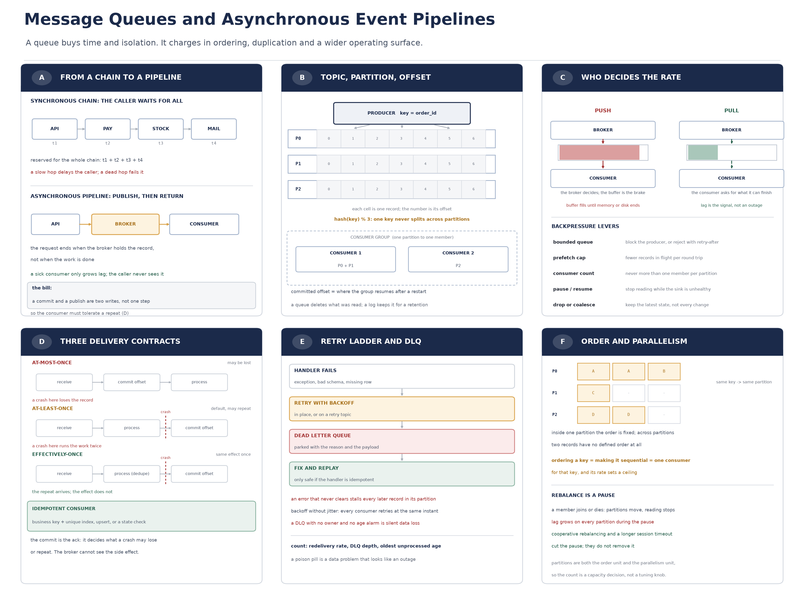

# [시스템 설계] 메시지 큐와 비동기 이벤트 파이프라인 (Backpressure · 멱등 컨슈머)

- 작성일: 2026-11-28
- 키워드: System Design, Message Queue, Event-Driven, Decoupling, Broker, Producer, Consumer Group, Partition, Offset, Pull vs Push, Backpressure, Consumer Lag, Little's Law, At-Least-Once, At-Most-Once, Effectively-Once, Idempotent Consumer, Deduplication, Ordering, Rebalance, Poison Pill, Retry Backoff, Jitter, DLQ, RabbitMQ, AMQP, Kafka, SQS, Transactional Outbox, Schema Evolution

## 1. 핵심 요약 (What & Why)

앞의 세 편은 한 요청이 지나가는 길을 넓히는 이야기였다. 인스턴스를 늘리고, 캐시로 읽기를 덜어내고, 데이터를 여러 대에 나눴다. 그런데 그 모든 최적화는 **한 가지 가정**을 건드리지 않았다. 요청을 처리하는 동안 호출한 쪽이 **기다린다**는 가정이다. 결제 요청이 재고 서비스를 부르고, 재고 서비스가 알림 서비스를 부르는 식으로 동기 호출이 이어지면, 시스템의 응답 시간은 **가장 느린 구간의 합**이 되고, 가용성은 **가장 약한 구간의 곱**이 된다.

이 구조의 문제는 세 가지로 나눠 볼 수 있다.

- **시간 결합(temporal coupling)**: 호출한 쪽은 응답이 올 때까지 스레드와 커넥션을 붙잡고 있다. 하위 서비스가 3초 걸리면 상위 서비스의 스레드도 3초 동안 일을 못 한다. 하위가 느려지는 것만으로 상위의 처리량이 같이 떨어진다.
- **가용성 결합**: 하위가 죽으면 상위가 실패한다. 알림 서비스가 죽었다고 주문이 실패하는 것은 비즈니스적으로 말이 안 되지만, 동기 체인에서는 그렇게 된다. 재시도가 겹치면 죽은 서비스에 부하가 더 몰리고(retry storm), 살아 있던 상위 서비스까지 스레드 풀이 마르면서 함께 쓰러진다(cascading failure).
- **처리량 결합**: 하위의 처리 속도가 상위의 처리 속도를 정한다. 하위가 초당 100건을 처리하면 상위도 100건이 상한이다. 상위는 이미 10배의 여유가 있어도 소용이 없다.

**메시지 큐**는 이 세 결합을 끊는 방법이다. 요청을 처리하라는 **명령**을 직접 전달하는 대신, "이 일이 일어났다"는 **사실**을 큐에 적어 두고 곧바로 응답한다. 실제 처리는 다른 프로세스가, 다른 시간에, 다른 속도로 한다. 이 순간 시스템은 하나의 호출 그래프에서 **여러 개의 독립된 파이프라인**으로 바뀐다.

큐가 실제로 사 주는 것은 네 가지다.

| 얻는 것 | 내용 | 대가 |
| --- | --- | --- |
| 버퍼링 | 순간적인 트래픽 스파이크를 큐에 쌓아 두고 처리 속도로 소화한다 | 큐 깊이가 곧 지연이고, 넘치면 버려지거나 막힌다 |
| 격리 | 소비자의 장애가 생산자에게 전파되지 않는다 | 장애가 사라지는 게 아니라 lag로 보이게 된다 |
| 팬아웃 | 하나의 이벤트를 여러 소비자가 각자 받는다 | 소비자마다 중복 처리와 순서 문제를 따로 다뤄야 한다 |
| 재처리 | 로그형 큐는 지난 이벤트를 다시 읽을 수 있다 | 다시 읽으면 부작용도 다시 일어난다 |

그리고 큐는 **공짜가 아닌 것**을 청구한다. 이번 편의 절반은 그 청구서에 대한 이야기다.

1. **순서**: 파티션 안에서만 순서가 보장된다. 순서를 지키려면 키를 하나로 묶어야 하고, 그러면 그 키의 처리량이 한 소비자로 제한된다.
2. **중복**: 브로커와 내 DB가 하나의 원자적 단위가 아니므로, "정확히 한 번"은 대개 **최소 한 번 전달 + 멱등한 처리**로 흉내 낸다. 즉 중복은 없어지는 게 아니라 **소비자가 견뎌야 하는 것**이 된다.
3. **운영면**: 브로커라는 새 계층, lag 모니터링, DLQ, 재처리 절차, 스키마 진화, 리밸런스라는 새 실패 모양이 생긴다.
4. **일관성**: 응답은 이미 갔는데 결과는 아직 없다. 사용자는 잠시 **최종 일관성**의 세계에 산다.

네 문장으로 정리한다.

1. **비동기는 응답을 빨리 주는 기법이 아니라, 처리 시점과 처리 주체를 분리해 결합도를 낮추는 설계다.** 빨라지는 것은 응답 시간이 아니라 회복력과 확장 자유도다.
2. **큐는 무한한 완충재가 아니다.** 도착률이 처리율을 넘는 동안 쌓이는 양은 시간에 비례하고, 결국 상한(메모리·디스크·리텐션)에 부딪힌다. 그래서 큐 설계의 핵심은 저장이 아니라 **압력의 배출구(backpressure)** 다.
3. **전달 보장은 브로커의 약속이 아니라 소비자의 책임이다.** 최소 한 번 전달을 전제로, 멱등 키와 조건부 쓰기로 중복을 흡수해야 한다.
4. **순서와 처리량은 같은 다이얼의 양 끝이다.** 파티션 수와 키 설계가 둘을 동시에 정하며, 나중에 바꾸면 재처리와 리밸런스 비용을 치른다.

## 2. 내부 메커니즘과 구조 (How it works)

### 2.1 두 가지 근본 모델: Queue와 Log

"메시지 큐"라는 한 단어 안에 성질이 정반대인 두 모델이 들어 있다. 이 차이를 먼저 잡지 않으면 이후의 모든 성질(순서, 리플레이, 소비자 확장, lag 지표)이 외워야 할 목록이 된다.

**Queue 모델(RabbitMQ, SQS, ActiveMQ)**: 메시지는 **소비되면 사라지는 우편물**이다. 브로커가 메시지를 보관하고, 소비자가 받아 처리한 뒤 ack하면 지운다. 소비자가 여러 개면 메시지가 **분배**된다(경쟁 소비자). 라우팅은 브로커가 한다 — exchange와 binding, 라우팅 키, 헤더 매칭. 메시지 단위의 TTL, 지연, 우선순위, 재전달 횟수 같은 **메시지 속성**이 풍부하다.

**Log 모델(Kafka, Kinesis, Pulsar, Redis Streams)**: 메시지는 **지워지지 않는 append-only 로그**의 한 칸이다. 소비자는 자기 위치(offset)를 스스로 기억하고, 읽어도 데이터는 남는다. 리텐션 기간이나 크기에 따라 오래된 구간이 통째로 잘려 나갈 뿐이다. 소비자를 늘리면 일을 나눠 갖는 게 아니라 **같은 로그를 다른 위치에서** 읽는다(그룹을 나누면 팬아웃). 대신 개별 메시지를 지우거나 우선순위를 주는 일은 못 한다.

이 차이가 실무에서 갈리는 지점은 명확하다.

- **"이 작업을 누군가 한 번만 처리하면 된다"** → Queue. 작업 큐, 이메일 발송, 이미지 리사이즈처럼 **일의 분배**가 목적이다. 처리 후 사라지는 것이 자연스럽다.
- **"이 사실을 여러 곳이 각자 알아야 하고, 나중에 다시 읽을 수도 있다"** → Log. 주문 생성, 결제 승인 같은 **사실의 전파와 축적**이 목적이다. 새 소비자를 붙일 때 과거 이벤트를 처음부터 재생할 수 있다는 것이 큰 무기다.

> [!NOTE]
> "Kafka는 큐가 아니다"라는 말은 정확히는 **"Kafka는 큐처럼 쓰면 큐의 장점을 잃는다"** 는 뜻이다. 개별 메시지 삭제, 우선순위, 지연 재전달, 메시지별 재시도는 로그 모델에 없다. 이 기능이 필요하면 재시도 토픽·지연 토픽 같은 **구조로 흉내** 내거나, RabbitMQ·SQS를 함께 쓰는 판단을 해야 한다.

### 2.2 생산자 → 브로커 → 파티션·오프셋 → 소비자 그룹

경로를 한 번 따라가 보자. 아래는 로그형(파티션 기반) 브로커를 기준으로 한 설명이고, 큐형 브로커는 "파티션"이 "큐"로, "offset"이 "ack 후 삭제"로 바뀔 뿐 압력 구조는 같다.

```text
Producer
  record(key, value, headers, timestamp)
    -> partitioner: hash(key) % partition_count  (키가 없으면 라운드로빈/스티키)
    -> accumulator: 레코드를 모아 배치로 전송 (linger / batch size)
    -> acks: 0(보내고 잊음) | 1(리더 저장) | all(ISR 전체 저장)
    -> 재시도: 같은 배치를 다시 보낸다 -> 중복 가능 (idempotent producer가 막는다)

Broker
  partition = append-only log (segment 파일 + offset 인덱스)
    -> 리더가 쓰기를 받고 팔로워가 복제 (ISR: in-sync replicas)
    -> min.insync.replicas + acks=all 이면 "N대 중 k대 저장" 뒤에 성공 응답

Consumer group
  poll() -> 레코드 배치
    -> 처리
    -> offset commit (__consumer_offsets 또는 브로커 내부 저장소)
  그룹 코디네이터가 파티션을 멤버에게 배정 (한 파티션은 한 번에 한 멤버)
```

여기서 설계 판단이 갈리는 지점이 네 개다.

- **파티셔너**: 키가 있으면 같은 키가 항상 같은 파티션으로 간다. 이것이 **순서와 집계(co-location)의 근거**다. 키가 없으면 분산은 좋아지지만 순서는 포기하는 것이다.
- **acks와 ISR**: `acks=all` + `min.insync.replicas=2`의 조합은 "최소 두 대에 기록됐다"는 뜻이고, 그 조건을 못 맞추면 생산 자체가 실패한다. 이때 선택은 **쓰기를 거부하며 가용성을 내주는 것**과, **acks를 낮춰 유실 가능성을 받는 것**이다. 메시지 큐에서도 결국 CAP의 같은 자리에 서게 된다.
- **오프셋 커밋 시점**: 소비자의 "ack"는 처리 완료가 아니라 **커밋**이다. 커밋을 처리 전에 하면 유실, 처리 후에 하면 중복이다(2.5).
- **그룹 배정**: 파티션 수가 멤버 수보다 적으면 남는 멤버는 논다. 반대로 파티션을 늘리면 리밸런스가 일어나고, 그 사이 소비는 멈춘다(2.7).

큐형 브로커의 대응 개념도 같은 자리에 있다.

| 개념 | Log 모델(Kafka) | Queue 모델(RabbitMQ / SQS) |
| --- | --- | --- |
| 저장 단위 | 파티션(로그) | 큐 |
| 소비 위치 | offset (소비자가 관리) | ack 후 삭제, SQS는 visibility timeout |
| 분배 방식 | 파티션 단위 배정(고정) | 메시지 단위 분배(동적) |
| 팬아웃 | 컨슈머 그룹을 나눈다 | exchange/binding, 또는 SQS는 별도 큐 복제 |
| 재처리 | offset을 되돌려 리플레이 | 재전달(nack/requeue), DLQ 재투입 |
| 순서 | 파티션 내 보장(전역은 불가) | 큐 단위(경쟁 소비자가 있으면 사실상 없음), SQS FIFO는 순서 보장 |

### 2.3 Pull vs Push: 누가 속도를 정하는가

비동기 파이프라인의 안정성은 결국 하나의 질문으로 수렴한다. **소비 속도를 누가 결정하는가.**

**Push(브로커가 민다)**: 소비자는 "나는 준비됐다"고 등록하고, 브로커가 메시지를 밀어 넣는다(AMQP `basic.consume`). 지연이 가장 짧다 — 새 메시지가 도착하는 즉시 소비자에게 간다. 위험은 **소비자 버퍼**다. 브로커가 빠르고 소비자가 느리면, 메시지는 소비자 프로세스의 메모리에 쌓인다. 브로커 입장에서는 "전달 완료"지만 애플리케이션은 터진다. 그래서 push 모델에는 반드시 **상한**이 붙는다. RabbitMQ의 `basic.qos(prefetch_count)`가 그것으로, ack하지 않은 메시지를 소비자·채널당 N개로 제한한다. `prefetch`를 지정하지 않으면 사실상 무제한이고, 이것이 push 모델에서 가장 흔한 사고 원인이다.

**Pull(소비자가 당긴다)**: 소비자가 "지금 처리할 수 있는 만큼"을 요청한다(Kafka `poll()`). 처리 속도가 곧 소비 속도이므로 **구조적으로 backpressure가 내장**되어 있다. 대신 두 가지를 감수한다. 첫째, 유휴 상태에서도 폴링이 필요하다(그래서 `fetch.max.wait.ms`로 롱폴링을 한다). 둘째, **배치 효율과 지연의 트레이드오프**다. 한 번에 많이 가져오면 처리량이 좋아지지만, 마지막 레코드는 다음 폴링까지 기다린다.

핵심은 "어느 쪽이 더 좋은가"가 아니라 **압력의 주인이 누구인가**다. pull은 소비자가 주인이고, push는 브로커가 주인이며 소비자는 prefetch라는 방어선을 두른다. 실무에서 push 모델을 쓰면서 prefetch를 비워 두는 것은, 방어선 없이 브로커의 속도를 신뢰하는 것이다.

> [!WARNING]
> "비동기로 바꿨는데 왜 메모리가 터지는가"의 대부분은 push 모델 + 무제한 prefetch, 또는 pull 모델 + 내부에서 별도 스레드풀로 메시지를 넘기는 구조에서 나온다. `poll()`로 받은 배치를 즉시 다른 큐(무제한 `LinkedBlockingQueue`)에 넣고 다음 `poll()`을 호출하면, **pull이 순식간에 push로 변한다.** 내부 큐에도 크기 제한이 있어야 하고, 가득 차면 `poll()`을 멈춰야 한다.

### 2.4 Backpressure: 큐는 시간을 벌 뿐, 일을 없애지 않는다

**lag**는 "아직 처리되지 않은 양"이다. 로그 모델에서는 `최신 offset - 커밋된 offset`으로 정확히 계산되고, 큐 모델에서는 큐 깊이와 미확인 메시지 수로 본다.

```text
lag_records  = produced_offset - committed_offset        (파티션별, 그룹별)
lag_seconds  ~ lag_records / 처리율(records per second)     (평균 처리율 기준의 대략치)

초당 유입 λ_in, 초당 처리 λ_out 일 때 T초 동안 쌓이는 양
  backlog(T) = (λ_in - λ_out) x T          (λ_in > λ_out 인 동안만)
```

이 식이 말하는 것은 단순하지만 자주 잊힌다. **유입이 처리율을 넘는 동안 lag는 선형으로 늘고, 처리율은 그대로다.** 그러므로 "큐가 있으니 스파이크를 흡수한다"는 문장은 정확히는 **"스파이크가 끝날 때까지 버틸 저장 공간이 있다면"** 이라는 조건부다. 스파이크가 30분 이어지고 그동안 못 따라잡는 양이 저장 한도를 넘으면, 큐는 넘친다.

대기 시간과 필요한 동시 처리량의 관계는 **리틀의 법칙(Little's Law)** 으로 정리된다.

```text
L = λ x W
  L: 시스템 안에 동시에 존재하는 항목 수
  λ: 도착률(초당)
  W: 한 항목이 머무는 평균 시간(초)

예: 도착 200건/초, 한 건 처리에 50ms 라면 동시에 처리 중이어야 하는 양 L = 200 x 0.05 = 10
```

리틀의 법칙은 두 방향으로 쓴다. **동시성 산정**: 목표 지연 W를 정하면 필요한 in-flight 수가 나온다. **지연 추정**: 동시 처리량 L과 도착률 λ로 대기 시간을 역산한다. 예를 들어 컨슈머 10개가 각 50ms에 한 건씩 처리하면 처리율은 200건/초이고, 유입이 그보다 많으면 lag가 늘어난다. 이때 소비자 수를 늘려도 **파티션 수를 넘을 수 없다**는 벽이 있다(2.7).

큐가 상한에 부딪혔을 때 선택지는 네 가지이고, 각각 다른 것을 포기한다.

| 전략 | 동작 | 포기하는 것 | 쓰는 곳 |
| --- | --- | --- | --- |
| Block | 생산자를 멈춘다(블로킹 큐, TCP backpressure) | 생산자 지연·가용성 | 내부 파이프라인, 스트림 처리 |
| Reject | 거부하고 `retry-after`를 준다 | 요청 하나 | 외부 API 앞단, 요청량 제한 |
| Drop / Coalesce | 오래된 것을 버리거나 최신 상태로 합친다 | 정확성·이력 | 위치 갱신, 대시보드, 알림 |
| Spill | 디스크로 넘긴다 | 지연, 디스크 비용 | 대용량 배치, 반드시 소비되는 데이터 |

> [!NOTE]
> **오토스케일링을 lag로 하는 것은 뒤늦은 신호다.** lag가 커진 뒤에 소비자를 늘리면, 새 소비자가 리밸런스에 참여하는 시간 동안 소비는 다시 멈춘다(2.7). 그래서 lag는 "지금 늦었다"는 지표이고, 앞서 알려면 **처리 시간(p95)과 큐 대기 시간, 유입률의 기울기**를 함께 봐야 한다. 그리고 소비자를 늘려도 파티션 수가 상한이라는 사실은 오토스케일러가 알려 주지 않는다.

### 2.5 전달 보장: at-most-once, at-least-once, effectively-once

전달 보장은 **커밋(또는 ack)의 위치** 하나로 결정된다. 처리와 커밋 중 무엇이 먼저인가.

```text
at-most-once       receive -> commit -> process
                   커밋 후 처리 전에 죽으면 그 메시지는 영원히 사라진다 (유실 0 중복 0)
                   실무에서 거의 쓰지 않는다. 로그·메트릭처럼 하나 빠져도 무해할 때만.

at-least-once      receive -> process -> commit
                   처리 후 커밋 전에 죽으면 같은 메시지가 다시 온다 (유실 0, 중복 있음)
                   대부분의 브로커·클라이언트 기본값. "정확히 한 번"을 여기서 만든다.

effectively-once   at-least-once + 부작용을 한 번만 남기는 처리
                   (멱등 키, 조건부 쓰기, 소비자 측 트랜잭션)
```

**정확히 한 번(exactly-once)이 왜 어려운가.** 브로커 안에서의 원자성과 브로커 밖에서의 원자성은 다른 문제다. Kafka 트랜잭션(`transactional.id`, `isolation.level=read_committed`)은 **Kafka로 쓰는 일과 offset 커밋을 한 트랜잭션**으로 묶어, Kafka 안에서는 "정확히 한 번"을 만든다. 그러나 소비자가 **외부 DB에 쓰거나 외부 API를 호출하면** 그 부작용은 그 트랜잭션에 들어가지 않는다. 결국 다시 두 개의 쓰기가 되고, 그 사이에서 프로세스가 죽으면 중복이 남는다. 2단계 커밋(XA)으로 묶을 수는 있지만, 락 보유 시간과 in-doubt 상태라는 운영 부담이 크다. 그래서 실무의 정답은 대개 **"최소 한 번 전달 + 멱등 컨슈머"** 다.

**중복은 실제로 어디서 생기는가.** 이론이 아니라 운영에서 자주 보는 경로들이다.

- **커밋 전 크래시**: 처리 로직은 끝났는데 offset 커밋 전에 죽었다. 재시작하면 그 구간을 다시 읽는다.
- **리밸런스**: 파티션이 다른 멤버로 옮겨 가면서, 이전 멤버가 처리 중이던 배치가 새 멤버에서 다시 시작된다.
- **생산자 재시도**: 응답을 못 받아 같은 배치를 다시 보냈다. 브로커에는 두 번 들어갔다(`enable.idempotence=false`일 때).
- **오프셋 초기화**: `auto.offset.reset=earliest/latest`, 그룹 ID 오타, 보존 기간 만료로 커밋된 offset이 사라진 경우. **그룹 ID가 바뀌면 처음부터 다시 읽는다.**
- **수동 리플레이**: 장애 복구나 버그 수정 후 offset을 되돌려 재처리했다.
- **auto commit의 함정**: `enable.auto.commit=true`는 **`poll()`이 반환한 시점 기준으로** 주기적으로 커밋한다. 즉 처리가 끝나기 전에 커밋될 수 있고, 그 상태에서 죽으면 **유실**이 된다. at-least-once를 원한다면 자동 커밋을 끄고 처리 후에 직접 커밋해야 한다.

**멱등 컨슈머를 만드는 네 가지 방법.** 좋은 순서대로다.

1. **유니크 키 + 같은 트랜잭션에 처리 기록**: 메시지 ID(또는 비즈니스 키)를 `processed_message` 테이블에 유니크 인덱스로 넣고, 업무 데이터 변경과 **같은 DB 트랜잭션**에서 커밋한다. 두 번째 도착은 유니크 위반으로 실패하고, 그 실패를 "이미 처리됨"으로 해석한다. 가장 확실하고 가장 흔하다.
2. **조건부 쓰기(상태 전이)**: "PENDING일 때만 PAID로 바꾼다"처럼 **이전 상태를 조건에 넣는다**. 중복 실행이 두 번째에 아무것도 바꾸지 않는다. `UPDATE ... WHERE status = 'PENDING'`이 대표적이다.
3. **업서트 / 값 기반 덮어쓰기**: "최종 값"을 쓰는 이벤트는 `INSERT ... ON CONFLICT DO UPDATE`(또는 `MERGE`)로 멱등하게 만들 수 있다. 단 **증분(delta) 이벤트에는 쓸 수 없다** — 더하기를 두 번 하면 두 배가 된다.
4. **버전·시퀀스 비교**: 레코드에 버전을 붙이고 더 새로운 버전만 반영한다. 늦게 도착한 옛 이벤트가 새 값을 덮어쓰는 것을 막는다(2.7의 순서 문제와 같은 뿌리).

```sql
-- 1) 처리 기록을 업무 변경과 같은 트랜잭션에 넣는다
BEGIN;
INSERT INTO processed_message (message_id, consumer_group, processed_at)
VALUES (?, 'order-projection', now());          -- UNIQUE(message_id, consumer_group)
-- 중복이면 여기서 unique violation -> ROLLBACK 후 ack
UPDATE order_view SET status = 'PAID', paid_at = ?
WHERE order_id = ?;
COMMIT;                                          -- 이 커밋이 곧 "처리 완료"

-- 2) 조건부 쓰기: 두 번째 실행이 아무것도 바꾸지 않는다
UPDATE orders SET status = 'PAID'
WHERE order_id = ? AND status = 'PENDING';
```

> [!WARNING]
> **"DB 저장과 offset 커밋을 같은 트랜잭션에"는 Kafka에서는 되지만 일반 DB에서는 안 된다.** 실무에서는 두 가지 우회가 쓰인다. (a) **offset을 DB에 저장한다** — `processed_message` 테이블이 사실상 오프셋 저장소가 되고, 브로커 커밋은 "그 이후 아무것도 처리 안 함"을 뜻하는 최적화로만 쓴다. (b) **아예 브로커 커밋을 신뢰하지 않는다** — 재처리해도 결과가 같다는 것(멱등)을 보장하고, 브로커는 편의를 위해 커밋한다. 두 방법 모두 **"중복은 온다"** 를 전제로 한다.

### 2.6 순서 보장: 파티션 안에서만

순서는 **파티션이라는 경계 안에서만** 존재한다. 토픽 전체의 순서는 없다. 파티션이 여러 개인 순간, 서로 다른 파티션의 두 레코드는 **정의된 순서가 없다**.

```text
key=A -> P0 :  A1  A2  A3      (A에 대한 순서는 보장)
key=B -> P1 :  B1  B2          (B에 대한 순서는 보장)
             A3 와 B2 중 무엇이 먼저인지는 알 수 없다
```

그래서 "순서가 필요하다"는 요구는 대개 **엔티티 단위로 좁혀야** 한다. 주문 하나의 상태 전이(생성 → 결제 → 배송)는 순서가 중요하지만, 서로 다른 주문 사이의 순서는 중요하지 않다. **키를 엔티티 ID로 두면** 두 요구가 동시에 만족된다.

여기서 중요한 트레이드오프가 나온다. **한 키의 순서를 지키려면 그 키는 직렬로 처리되어야 한다.** 파티션 하나를 한 소비자가 처리하므로, 그 키의 처리량 상한은 **소비자 한 개의 처리 속도**가 된다. 그래서 다음이 따라온다.

- **핫 키**: 특정 ID(대형 고객, 인기 상품)의 이벤트가 압도적으로 많으면 그 파티션만 lag가 커진다. 파티션을 늘려도 키는 하나다. 해법은 키를 쪼개는 것(키 살팅, 순서가 필요한 범위를 더 좁히는 것), 또는 그 키만 별도 토픽·전용 소비자로 분리하는 것이다.
- **순서를 포기할 수 있는 곳을 찾는 것이 설계의 절반**이다. 알림 발송, 검색 인덱스 갱신, 통계 집계는 대개 순서가 필요 없다. 순서가 필요한 곳은 상태 변경과 정산 정도로 좁다.
- **순서와 재시도는 충돌한다**. 앞 레코드가 실패해서 재시도하는 동안 뒤 레코드를 처리하면 순서가 깨진다. 그래서 in-place 재시도는 파티션을 세우고(2.7), 순서를 지키면서 재시도하려면 **키 단위로 실패를 격리**해야 한다.

### 2.7 리밸런스, 재시도, DLQ

**리밸런스**는 그룹의 멤버 구성이 바뀔 때 파티션 배정을 다시 하는 절차다. 멤버가 추가·삭제되거나, 세션 타임아웃으로 죽었다고 판정되거나, 구독하는 토픽이 바뀌면 일어난다. 문제는 그 사이에 **소비가 멈춘다**는 것이다.

```text
리밸런스 중 일어나는 일
  1. 코디네이터가 재배정을 시작 (eager 프로토콜이면 전 멤버가 자기 파티션을 반납)
  2. 이전 소유자는 처리 중이던 배치를 마무리하고 offset을 커밋 (여기서 실패하면 중복)
  3. 새 배정을 받고 각자 마지막 커밋 지점부터 다시 읽는다
  4. 이 구간 동안 모든 파티션의 lag가 함께 늘어난다
```

실무에서 리밸런스를 줄이는 수단은 정해져 있다. **협조적(cooperative) 재배정**으로 옮겨 가는 파티션만 반납하고, **정적 멤버십**(`group.instance.id`)으로 짧은 재시작에 재배정이 일어나지 않게 하고, **세션 타임아웃과 하트비트**를 처리 시간에 맞게 조정한다. 그리고 `max.poll.interval.ms`를 넘기면 소비자가 "죽었다"고 판정되어 리밸런스가 시작되므로, **한 배치의 처리 시간이 이 값을 넘지 않게** `max.poll.records`를 줄여야 한다. 이 둘의 관계를 모르면 "처리하다가 갑자기 같은 메시지가 계속 다시 온다"는 무한 루프를 만난다.

**재시도와 Poison Pill.** 실패는 두 종류다. **일시적 실패**(네트워크, 락 타임아웃, 외부 API 5xx)는 다시 하면 성공한다. **영구적 실패**(스키마 오류, 존재하지 않는 참조, 로직 버그, 역직렬화 실패)는 몇 번을 해도 실패한다. 후자를 계속 재시도하는 레코드가 **poison pill**이고, 이것이 파티션을 영원히 막는다(head-of-line blocking). 앞 레코드가 실패하면 뒤 레코드를 처리할 수 없으므로, 그 파티션의 lag는 무한히 늘어난다.

그래서 재시도는 **단계**로 설계한다.

```text
처리 실패
  -> 짧은 지연 후 재시도 (일시적 실패 흡수)
  -> 지수 백오프 + 지터 (재시도 폭풍 방지)
  -> 한도 초과: DLQ(dead letter queue)로 격리, 원본 payload + 실패 이유 + 원본 위치 보존
  -> 사람이 원인을 고친 뒤 재투입(replay)
```

두 가지 구현 방식이 있다. **in-place 재시도**는 같은 파티션에서 잠시 멈췄다가 다시 시도한다. 구현이 단순하지만 그동안 파티션이 서고, `max.poll.interval`을 넘기면 리밸런스가 일어나 무한 루프가 될 수 있다. **재시도 토픽(지연 토픽)** 은 실패한 레코드를 별도 토픽으로 보내고, 정해진 지연 뒤에 원래 토픽으로 되돌린다. 본선이 계속 흐르고 실패만 따로 늙어 가는 구조다. Spring Kafka의 `@RetryableTopic`이 이 방식이다.

> [!WARNING]
> **DLQ는 쓰레기통이 아니라 대기실이다.** DLQ를 만들고 소유자·알람·재투입 절차를 정하지 않으면, 그것은 **조용한 데이터 유실**이다. 최소한 세 가지가 있어야 한다. (1) DLQ 깊이와 **가장 오래된 레코드의 나이**에 대한 알람, (2) 실패 이유와 원본 위치를 담은 헤더, (3) 원인 수정 후 재투입하는 도구와 **재투입이 안전한지(멱등인지)** 에 대한 답.

## 3. 구조 도식 (Architecture Diagram)



- **A 동기 체인에서 파이프라인으로 (왼쪽 위)**: 위쪽은 API → PAY → STOCK → MAIL로 이어지는 동기 체인이다. 응답 시간은 각 구간의 합(t1+t2+t3+t4)이고, 호출자는 그 전부를 기다리며 커넥션을 붙잡는다. 느린 구간 하나가 전체를 늦추고, 죽은 구간 하나가 요청을 실패시킨다. 아래쪽은 같은 일을 큐로 바꾼 것이다. API는 브로커가 레코드를 보관한 시점에 응답하고, 실제 처리는 소비자가 나중에 한다. **아픈 소비자는 요청 경로가 아니라 lag로 보인다.** 맨 아래 상자가 이 구조의 청구서다 — DB 커밋과 발행은 하나의 원자적 단위가 아니므로, 소비자는 중복을 견뎌야 한다(D).
- **B 브로커 쪽 구조 (위쪽 가운데)**: 생산자는 `order_id`를 키로 레코드를 보낸다. 파티션 세 개가 각각 append-only 로그이고, 칸마다 번호가 붙는다 — 이 번호가 **offset**이다. `hash(key) % 3`이므로 같은 키는 같은 파티션에만 간다(순서의 근거). 아래 점선 상자는 컨슈머 그룹이고, **한 파티션은 한 번에 한 멤버**에게 배정된다(Consumer 1이 P0+P1, Consumer 2가 P2). 맨 아래 두 줄이 큐와 로그의 차이다. 큐는 읽은 것을 지우고, 로그는 리텐션 동안 남겨 두어 새 소비자가 처음부터 재생할 수 있다. 커밋된 offset이 곧 재시작 지점이다.
- **C 누가 속도를 정하는가 (오른쪽 위)**: 왼쪽 PUSH는 브로커가 밀어 넣는 모델이다. 소비자 버퍼가 거의 차 있고(빨강), 버퍼가 유일한 제동장치다 — prefetch 상한을 비워 두면 메모리가 터진다. 오른쪽 PULL은 소비자가 자기 처리량만큼만 당기는 모델이다. 버퍼가 비어 있고, **lag가 곧 신호**가 된다. 아래 다섯 줄이 backpressure 수단이다(유계 큐, prefetch 상한, 소비자 수, 일시정지, 버리기·합치기). 소비자 수가 파티션 수를 넘을 수 없다는 것도 여기서 나온다.
- **D 세 가지 전달 계약 (왼쪽 아래)**: 점선이 크래시 지점이다. at-most-once는 커밋을 먼저 하므로 크래시 시 **유실**된다. at-least-once는 처리를 먼저 하므로 크래시 시 **중복**이 온다. effectively-once는 같은 경로를 가되 처리에 dedupe(멱등 키)를 넣어, 두 번째 도착이 부작용을 남기지 않게 한다. 아래 초록 상자가 구현 수단이다 — 업무 키 + 유니크 인덱스, 업서트, 상태 조건부 쓰기. 마지막 두 줄이 핵심이다. **커밋이 곧 ack이고, 브로커는 부작용이 일어났는지 알 수 없다.**
- **E 재시도 사다리와 DLQ (가운데 아래)**: 핸들러가 실패하면 짧은 백오프로 재시도하고, 한도를 넘으면 DLQ에 격리한 뒤, 원인을 고쳐 재투입한다. 아래 경고 세 줄이 실무 함정이다. 영원히 실패하는 레코드는 **뒤의 모든 레코드를 막고**, 지터 없는 백오프는 모든 소비자를 같은 순간에 재시도하게 만들며, 소유자 없는 DLQ는 조용한 유실이다. 그 아래가 봐야 할 지표다(재전달률, DLQ 깊이, 가장 오래된 미처리 레코드의 나이).
- **F 순서와 병렬성 (오른쪽 아래)**: 같은 키(A, D)가 같은 파티션에 모여 있고, 파티션 안에서만 순서가 정의된다. 키를 순서대로 만들면 그 키는 직렬 처리되므로, **그 키의 처리량이 소비자 한 개의 속도로 제한**된다. 아래 절반은 리밸런스다. 멤버가 들어오거나 죽으면 파티션이 옮겨 가고 그동안 읽기가 멈추며, 그 사이 모든 파티션의 lag가 함께 는다. 마지막 두 줄이 결론이다. **파티션 수는 순서 단위이자 병렬성 단위이므로, 튜닝 값이 아니라 용량 결정이다.**

## 4. 비교 표 (Comparison)

### 4.1 동기 호출과 비동기 메시지 큐

| 항목 | 동기 HTTP / RPC | 비동기 메시지 큐 |
| --- | --- | --- |
| 결합 | 시간·가용성·처리량이 모두 결합 | 시간·가용성·처리량이 분리 |
| 응답 의미 | "처리 끝났다" | "접수했다" (결과는 나중에) |
| 응답 지연 | 하위 전 구간의 합 | 발행 1회 |
| 하위 장애 시 | 상위도 실패 (연쇄) | lag로 흡수, 상위는 성공 |
| 처리량 결정 | 가장 느린 하위 | 소비자 수와 파티션 수 |
| 순서 | 한 연결 안에서는 자연히 보장 | 파티션 단위로만 보장 |
| 중복 | 호출자 재시도 시 발생, 응답으로 판정 | 구조적으로 발생, 멱등성으로 흡수 |
| 실패 통보 | 즉시 (에러 응답) | 지연·간접 (DLQ, 알람, 보상) |
| 사용자 경험 | 즉시 결과 | "처리 중" 상태가 필요 |
| 디버깅 | 요청 하나의 추적(trace)이 직관적 | 비동기 경계를 넘는 상관관계 ID가 필요 |
| 새 소비자 추가 | 호출자 코드 수정 | 토픽 구독만 추가 (팬아웃) |
| 운영 대상 | 서비스 N개 | 서비스 N개 + 브로커 + lag·DLQ 운영 |

### 4.2 Queue 모델과 Log 모델

| 항목 | Queue (RabbitMQ / SQS) | Log (Kafka / Kinesis / Pulsar) |
| --- | --- | --- |
| 메시지 수명 | ack 후 삭제 | 리텐션 동안 보존 |
| 소비 위치 | 브로커가 관리 (SQS visibility timeout) | 소비자가 관리 (offset) |
| 재처리 | nack/requeue, DLQ 재투입 | offset 되돌려 리플레이 |
| 팬아웃 | exchange/binding, 큐 복제 | 컨슈머 그룹 분리 |
| 순서 | 큐 단위(경쟁 소비자 시 사실상 없음), FIFO 변형은 보장 | 파티션 단위 |
| 라우팅 | 풍부 (exchange 종류, 헤더, 라우팅 키) | 토픽/파티션 + 파티셔너 |
| 메시지별 제어 | TTL, 우선순위, 지연, 재전달 횟수 | 거의 없음 (구조로 흉내) |
| 확장 단위 | 소비자 수 (큐 하나에 경쟁 소비자) | 파티션 수 (그룹 멤버는 파티션에 묶임) |
| 처리량 상한 | 큐 하나의 브로커 처리량 | 파티션 수 x 파티션당 처리량 |
| 강점 | 작업 분배, 복잡한 라우팅, 낮은 지연의 개별 전달 | 순서, 재생, 장기 보존, 높은 순차 처리량 |
| 전형적 용도 | 작업 큐, 이메일·알림 발송, 요청 버퍼 | 이벤트 소싱, CDC, 로그 수집, 서비스 간 이벤트 버스 |

### 4.3 전달 보장과 구현 수단

| 보장 | 커밋 순서 | 유실 | 중복 | 구현 수단 | 적합한 경우 |
| --- | --- | --- | --- | --- | --- |
| At-most-once | 처리 전 커밋 | 발생 | 없음 | 자동 커밋 + 처리 전 ack | 로그·메트릭 등 손실 허용 |
| At-least-once | 처리 후 커밋 | 없음 | 발생 | 수동 커밋, ack after process | 기본값. 멱등성 전제 |
| Effectively-once | 처리 후 커밋 + dedupe | 없음 | 부작용 없음 | 유니크 키, 조건부 쓰기, 소비자 트랜잭션 | 결제·정산·재고 |
| Exactly-once (브로커 내부) | 트랜잭션 | 없음 | 없음 | Kafka transactions, read_committed | Kafka to Kafka, 스트림 처리 |

### 4.4 실패 처리 전략

| 전략 | 파티션 영향 | 지연 | 구현 난이도 | 적합한 실패 |
| --- | --- | --- | --- | --- |
| 즉시 재시도 (in-place) | 그 파티션 정지 | 짧음 | 낮음 | 순간적 경합, 짧은 네트워크 오류 |
| 지수 백오프 + 지터 | 그 파티션 정지(길어짐) | 중간 | 낮음 | 외부 API 혼잡 |
| 재시도 토픽 (지연 단계) | 본선 계속 진행 | 김 | 중간 | 대부분의 일시적 실패 |
| DLQ 격리 | 본선 계속 진행 | 매우 김 | 중간 | 영구적 실패(poison pill) |
| 버리기(coalesce/drop) | 없음 | 없음 | 낮음 | 최신 상태만 의미 있는 이벤트 |

## 5. 내가 깨달은 점 (My Insight)

- **비동기는 "빠르게 응답하는 기법"이 아니라 "처리 시점과 처리 주체를 분리하는 설계"다.** 처음에는 큐를 넣으면 응답이 빨라진다고만 생각했다. 그런데 실제로 바뀐 것은 응답 시간이 아니라 **실패의 모양**이다. 동기 체인에서 하위 장애는 상위의 장애였고, 큐에서는 lag라는 숫자였다. 즉 큐는 장애를 **없애는** 게 아니라 **번역**한다 — 즉시 실패를 지연으로, 연쇄 실패를 국소 실패로. 그래서 큐를 넣는 순간 "lag가 얼마까지 늘어나면 사용자에게 문제인가"라는 질문이 새로 생긴다. 이 질문에 답하지 않으면, 장애가 조용해진 것처럼 보이는 착각 속에서 더 큰 장애를 키운다.

- **큐는 트래픽 스파이크를 흡수하지만, 처리율 차이는 흡수하지 않는다.** `backlog = (유입 - 처리율) x 시간`이라는 식이 전부다. 스파이크가 짧으면 큐가 버틴다. 유입이 영구히 처리율보다 높으면 큐는 크기를 늘리며 시간을 벌 뿐이고, 결국 상한에 부딪힌다. 그래서 "큐를 붙이자"는 결정은 반드시 **"이 차이가 얼마나 오래 지속되는가"** 와 함께 가야 한다. 마케팅 이벤트처럼 지속 시간이 예측되는 부하는 **미리 소비자를 늘리거나 미리 처리율을 올려 두는 것**이 큐를 키우는 것보다 낫다.

- **정확히 한 번은 브로커가 아니라 내 코드에서 만들어진다.** 브로커의 "정확히 한 번"은 브로커 안에서만 참이다. 내 DB에 쓰는 순간, 그 쓰기와 offset 커밋은 다시 두 개의 행동이 된다. 이 사실을 받아들이면 설계가 단순해진다. **"중복은 반드시 온다"** 를 전제로, 모든 소비자를 멱등하게 만든다. 그 대신 소비자는 "이미 처리했는가"를 판단할 수 있어야 하고, 그 판단의 근거(비즈니스 키)를 이벤트에 반드시 넣어야 한다. 이벤트 설계에서 `event_id`와 `business_key`를 빼먹으면, 나중에 멱등성을 만들 수 없어 재처리 자체가 불가능해진다.

- **순서 보장은 성능을 파는 거래다.** "순서가 필요하다"는 말은 "그 키는 직렬로 처리한다"는 말과 같다. 파티션 하나를 소비자 하나가 처리하므로, 그 키의 최대 처리량은 소비자 한 개의 속도다. 그래서 순서 요구를 받으면 먼저 **범위를 좁혀야** 한다. 주문별 순서인지, 사용자별 순서인지, 전역 순서인지. 전역 순서가 정말 필요한 시스템은 생각보다 드물고, 대개는 **키 단위 순서 + 멱등성**으로 충분하다. 전역 순서를 요구하는 설계는 파티션 하나로 줄이는 것이므로, 확장성과 정면으로 충돌한다.

- **DLQ는 "실패를 버리는 곳"이 아니라 "실패를 늦추는 곳"이다.** DLQ를 만들면 장애가 사라진 것처럼 보인다. 파티션은 흐르고, lag는 줄고, 알람은 울리지 않는다. 그러나 DLQ에 쌓인 레코드는 **처리되지 않은 사건**이고, 그 사건이 사라진 것이 아니다. 주문 상태 변경이 DLQ에 있다면, 그 주문은 영원히 "결제 대기"로 남는다. 그래서 DLQ에는 반드시 **나이 알람**이 붙어야 한다. 깊이가 0이어도 가장 오래된 레코드가 3일 전이면 그것은 이미 사고다. 이 지표를 모니터링에 넣지 않은 팀은 데이터 정합성 문의를 받고 나서야 DLQ를 다시 본다.

- **동기와 비동기의 경계는 "사용자가 결과를 기다려야 하는가"로 정해진다.** 결제 승인 결과는 기다려야 하고, 포인트 적립·알림 발송·검색 인덱스 갱신은 기다릴 필요가 없다. 이 경계를 잘못 그으면, 사용자는 "처리 중" 화면에서 새로고침을 반복하거나, 반대로 즉시 결과가 나와야 하는 곳에 폴링을 붙이게 된다. 경계를 정하는 기준은 기술이 아니라 **제품의 약속**이다. "결제는 즉시 확정된다"는 약속이면 그 구간은 동기로 남겨야 하고, 큐는 그 뒤의 부수 효과에만 쓴다.

## 6. 실무 관점 및 트레이드오프 (Trade-offs & Best Practices)

### 6.1 트랜잭션 경계 분리: 두 개의 쓰기 문제

비동기 파이프라인에서 가장 흔하고 가장 조용한 버그는 **dual write**다.

```text
생산자 쪽
  BEGIN; INSERT INTO orders ...; COMMIT;        -- 성공
  kafka.send("order-created", ...);             -- 여기서 죽으면? DB에는 있는데 이벤트는 없다
  (반대 순서라면? 이벤트는 있는데 주문은 없다)

소비자 쪽
  poll() -> process (DB UPDATE) -> commit offset
  DB는 커밋됐는데 offset 커밋 전에 죽으면? 같은 일이 다시 온다 (중복)
```

두 개의 저장소(DB와 브로커)에 걸친 원자적 쓰기는 없다. 해법은 세 가지다.

- **Transactional Outbox**: 업무 데이터와 **같은 DB 트랜잭션**으로 `outbox` 테이블에 발행할 이벤트를 적는다. 별도 프로세스(CDC 또는 폴링 발행기)가 outbox를 읽어 브로커로 보내고, 성공하면 표시한다. "발행됐다"의 진실이 DB에 있으므로, 발행 실패는 재시도로 회복되고 유실은 없다. 대가는 **발행 지연**(최소 한 번의 폴링/CDC 지연)과 outbox 테이블 운영이다.
- **Listen to Yourself(자기 구독)**: 같은 서비스가 자기 outbox 토픽을 구독해 후속 작업을 한다. 발행과 소비가 같은 경로를 타므로 순서와 재처리가 단순해진다.
- **소비자 측에서는 offset을 DB에 저장**: `processed_message` 테이블을 오프셋 저장소로 쓰고, 업무 변경과 같은 트랜잭션에 넣는다(2.5). 브로커 커밋은 "여기까지는 확실히 처리했다"는 힌트로만 쓴다.

> [!NOTE]
> **"이벤트를 먼저 발행하고 DB를 나중에" 쓰는 설계는 거의 항상 틀린다.** 소비자가 존재하지 않는 주문을 조회하게 되고, 그 실패가 재시도로 굳어져 poison pill이 된다. 반대 순서(DB 먼저)에서는 이벤트가 유실되지만, **아웃박스 없는 유실은 조용하고, 존재하지 않는 데이터에 대한 실패는 시끄럽다.** 조용한 유실이 더 위험하므로, 순서를 정하는 것만으로는 부족하고 outbox나 재발행 스캔이 필요하다.

### 6.2 순서와 병렬성 조율

순서 요구를 받으면 다음 순서로 좁힌다.

```text
1. 전역 순서가 정말 필요한가?         -> 대개 아니다. 파티션 1개 = 처리량 상한
2. 어떤 키 단위의 순서인가?           -> 주문 ID, 사용자 ID, 계좌 ID
3. 그 키의 트래픽이 균등한가?          -> 핫 키가 있으면 그 키만 격리
4. 키를 바꿀 수 있는가?               -> 샤딩 키와 같은 문제. 나중에 바꾸면 재처리
5. 순서가 필요 없는 소비자는 분리했는가? -> 알림·인덱스는 순서 없이 병렬로
```

파티션 수는 **나중에 늘릴 수 있지만 키 배치는 바뀐다**. 파티션 수를 늘리면 `hash(key) % N`의 N이 바뀌어 같은 키가 다른 파티션으로 갈 수 있고, 그 순간 **같은 키의 두 이벤트가 서로 다른 파티션에서 병렬 처리**된다. 그래서 순서에 민감한 토픽은 파티션 수를 늘리지 않거나, 처음부터 여유 있게 잡거나, 파티션 수를 고정한 채 논리적 분할(키 살팅)을 설계한다. Kafka에서 파티션 수를 늘리면 키-파티션 매핑이 바뀐다는 점은 문서에 명시된 동작이고, 이것이 "파티션 수는 용량 결정"이라는 말의 실제 이유다.

### 6.3 Poison Pill과 DLQ 운영

| 항목 | 해야 할 일 | 하지 않으면 |
| --- | --- | --- |
| 재시도 한도 | 메시지 헤더에 시도 횟수, 한도 명시 | 영원히 같은 레코드 재시도 |
| 백오프 | 지수 + 지터 | 재시도 폭풍, 동시 재시도 |
| DLQ 헤더 | 원본 토픽·파티션·offset·예외·시각 | 재투입 위치를 모른다 |
| DLQ 알람 | 깊이 + **가장 오래된 레코드 나이** | 조용한 유실 |
| 소유자 | 팀·담당자, 런북 | 아무도 안 본다 |
| 재투입 | 멱등성 확인 후 도구로 재발행 | 중복 부작용 |
| 스키마 검증 | 발행 시점 검증(스키마 레지스트리) | 소비자에서 역직렬화 실패 |

> [!WARNING]
> **역직렬화 실패는 소비자 코드로 잡을 수 없는 poison pill이다.** 메시지를 객체로 바꾸는 단계에서 터지면 핸들러가 실행되지 않으므로, 핸들러의 try/catch로는 DLQ에 보낼 수 없다. 이 경우 브로커 클라이언트의 역직렬화 예외 핸들러(`ErrorHandlingDeserializer` 등)로 감싸 실패한 원본 바이트를 DLQ로 보내야 한다. 스키마 레지스트리와 호환성 규칙(BACKWARD/FORWARD/FULL)을 함께 두는 이유가 여기 있다 — 스키마 진화는 "필드 추가는 안전, 삭제·타입 변경은 위험"이고, 이 규칙을 발행 시점에 강제해야 소비자를 지킬 수 있다.

### 6.4 재처리 비용과 리플레이 안전성

로그 모델의 큰 장점은 리플레이지만, 리플레이는 **부작용을 다시 일으키는 일**이다. 리플레이 전에 답해야 할 질문이 있다.

- **소비자가 멱등한가?** 아니라면 리플레이가 곧 중복이다.
- **외부 부작용이 있는가?** 이메일 발송, 결제 승인, SMS는 다시 하면 사용자가 두 번 받는다. 이런 소비자는 리플레이 대상에서 분리하거나, "발송 완료" 기록을 남겨 재발송을 막아야 한다.
- **다운스트림이 같은 속도를 견디는가?** 리플레이는 과거 트래픽을 **지금** 다시 흘리는 일이다. 소비자와 그 뒤의 DB에 평소와 다른 부하가 걸린다.
- **저장 공간과 시간은?** 리텐션을 넘긴 구간은 리플레이할 수 없다. 재처리가 필요할 수 있는 데이터는 리텐션을 그만큼 길게 잡아야 한다.

그래서 리플레이는 **격리된 소비자 그룹**으로 돌리는 것이 안전하다. 새 그룹 ID로 처음부터 읽어 새 테이블·새 인덱스에 쓰고, 검증 후 전환한다. 본선 소비자의 offset을 되돌리면 처리 중인 다른 소비자와 충돌한다.

### 6.5 Spring에서의 구현 예

```java
// 생산: 발행 결과를 확인해야 하면 send의 future를 기다린다 (fire-and-forget은 유실을 감춘다)
kafkaTemplate.send("order-created", order.getId(), event)
    .whenComplete((result, ex) -> {
        if (ex != null) {
            // outbox에 남기거나, 실패를 기록해 재발행 스캔 대상으로 만든다
            outboxRepository.markFailed(event.getId(), ex.getMessage());
        }
    });

// 소비: 처리 후 수동 ack (at-least-once). 자동 커밋은 처리 전에 커밋될 수 있다.
@KafkaListener(topics = "order-created", groupId = "order-projection")
public void onOrderCreated(ConsumerRecord<String, OrderCreated> record, Acknowledgment ack) {
    // 1) 멱등: 처리 기록과 업무 변경을 같은 트랜잭션에
    processedRepository.insertIfAbsent(record.key(), "order-projection"); // unique
    orderProjection.apply(record.value());
    // 2) 여기까지 왔으면 커밋
    ack.acknowledge();
}
```

```java
// 실패 처리: 일시적 실패는 백오프 재시도, 한도 초과는 DLQ로
@Bean
public DefaultErrorHandler errorHandler(KafkaTemplate<String, Object> template) {
    var recoverer = new DeadLetterPublishingRecoverer(template);   // 원본 위치 헤더 보존
    var backOff = new ExponentialBackOffWithMaxRetries(5);          // 지터 포함
    return new DefaultErrorHandler(recoverer, backOff);
}
```

```yaml
# 소비자가 한 번에 가져오는 양과 최대 처리 시간의 관계를 맞춘다
spring:
  kafka:
    consumer:
      max-poll-records: 100          # 배치 처리 시간이 max.poll.interval을 넘지 않게
      enable-auto-commit: false      # at-least-once를 원하면 자동 커밋을 끈다
      properties:
        max.poll.interval.ms: 300000
        partition.assignment.strategy: org.apache.kafka.clients.consumer.CooperativeStickyAssignor
    listener:
      ack-mode: manual
```

> [!NOTE]
> **비동기 파이프라인에도 상관관계 ID가 필요하다.** 요청 하나가 큐를 넘어 여러 소비자를 거치면, 스택 트레이스는 끊기고 로그는 흩어진다. 이벤트 헤더에 `trace_id`(또는 `correlation_id`)를 실어 보내고, 소비자 로그에 그 값을 남기면 "이 주문이 어디까지 갔는가"를 한 줄로 추적할 수 있다. 이 헤더가 없으면 장애 분석이 사람의 기억에 의존하게 된다.

### 6.6 점검 순서

비동기 파이프라인을 설계하거나, 이미 있는 파이프라인이 이상할 때 확인할 순서다.

1. **이 일이 정말 비동기여야 하는가.** 사용자가 결과를 기다려야 하면 동기로 남긴다. 부수 효과만 큐로 보낸다.
2. **큐가 넘칠 때 무엇을 하는가.** block / reject / drop / spill 중 무엇인지 코드에 있는지 확인한다. "없음"이면 그것이 사고다.
3. **lag의 상한은 얼마인가.** 초 단위가 아니라 **사용자가 견디는 지연**으로 답한다. 그 값을 넘으면 알람이 울려야 한다.
4. **소비자는 멱등한가.** 이벤트에 `event_id`와 비즈니스 키가 있는지, 중복 시 무엇이 일어나는지 코드로 확인한다.
5. **순서 요구가 어디까지인가.** 파티션 키가 그 범위를 담고 있는지, 파티션 수 변경이 그 보장을 깨지 않는지.
6. **실패가 어디로 가는가.** 재시도 한도, DLQ 존재, DLQ 나이 알람, 재투입 절차.
7. **발행과 DB가 원자적인가.** outbox 또는 재발행 스캔이 있는지. 없다면 유실 구간이 어디인지 안다.
8. **리밸런스 동안 무슨 일이 일어나는가.** `max.poll.interval`과 배치 크기, 협조적 재배정, 정적 멤버십.
9. **리플레이가 안전한가.** 외부 부작용이 있는 소비자를 분리했는지, 리텐션이 재처리 기간을 덮는지.
10. **스키마 변경이 소비자를 깨지 않는가.** 호환성 규칙, 역직렬화 실패 처리.

```text
# 비동기 파이프라인 점검 체크리스트
1. 동기/비동기 경계     : 사용자가 기다려야 하는가
2. 큐 상한과 배출구     : block / reject / drop / spill
3. lag 허용치           : 사용자 지연 기준, 알람 임계
4. 멱등성               : event_id, business key, 중복 시 동작
5. 순서 범위            : 파티션 키, 파티션 수 변경 영향
6. 실패 경로            : retry 한도, backoff+jitter, DLQ, 나이 알람
7. 발행 원자성          : outbox / 재발행 스캔 / 유실 구간
8. 리밸런스             : max.poll.interval, 배치 크기, 협조적 재배정
9. 리플레이 안전성      : 외부 부작용 분리, 리텐션
10. 스키마 진화         : 호환성 규칙, 역직렬화 실패 처리
```

## 7. 참고 자료 (References)

- Apache Kafka Documentation, *Design* - 파티션과 로그 세그먼트, offset, 리텐션과 컴팩션, 컨슈머 그룹과 파티션 배정
- Apache Kafka Documentation, *Producer Configs* - `acks`, `enable.idempotence`, `linger.ms`, `batch.size`, `max.in.flight.requests.per.connection`, `retries`
- Apache Kafka Documentation, *Consumer Configs* - `max.poll.records`, `max.poll.interval.ms`, `session.timeout.ms`, `heartbeat.interval.ms`, `enable.auto.commit`, `auto.offset.reset`, `isolation.level`
- Apache Kafka Documentation, *Transactions* - `transactional.id`, `read_committed`, Kafka 트랜잭션의 범위와 한계
- Apache Kafka Documentation, *Consumer Group Protocol* - eager/cooperative 재배정, 정적 멤버십(`group.instance.id`)
- Kafka KIP-429 (Incremental Cooperative Rebalancing), KIP-345 (Static Membership) - 리밸런스 비용을 줄이는 프로토콜 개선
- RabbitMQ Documentation, *Reliability Guide* - publisher confirm, consumer ack/nack, prefetch(`basic.qos`), 재전달
- RabbitMQ Documentation, *Consumer Prefetch* - 미확인 메시지 상한과 푸시 모델의 backpressure
- RabbitMQ Documentation, *Dead Lettering* - DLX(`x-dead-letter-exchange`), `x-delivery-limit`, quorum queue의 재전달 처리
- AMQP 0-9-1 Specification - exchange 종류(direct/fanout/topic/headers), binding, ack 모델
- Amazon SQS Developer Guide - visibility timeout, long polling, `maxReceiveCount`와 DLQ, FIFO 큐의 순서 보장, 표준 큐의 at-least-once
- Spring for Apache Kafka Reference - `@KafkaListener`, `AckMode`, `DefaultErrorHandler`, `DeadLetterPublishingRecoverer`, `@RetryableTopic`, `ErrorHandlingDeserializer`
- J. H. Saltzer, D. P. Reed, D. D. Clark, "End-to-End Arguments in System Design", ACM TOCS 1984 - 신뢰성은 종단에서 만들어야 한다는 원칙(브로커의 보장이 애플리케이션의 정확성을 대신하지 못하는 이유)
- L. Lamport, "The Part-Time Parliament", ACM TOCS 1998 및 Raft 관련 문헌 - 복제된 로그의 합의 모델(ISR·쿼럼의 배경)
- M. Kleppmann, *Designing Data-Intensive Applications* (O'Reilly, 2017) - 11장 스트림 처리(로그 기반 메시징, 파티션과 순서, exactly-once와 멱등성), 7장 트랜잭션, 9장 일관성과 합의
- P. Helland, "Life Beyond Distributed Transactions: An Apostate's Opinion", CIDR 2007 - 분산 트랜잭션 대신 멱등성과 보상으로 가는 설계
- G. Hohpe, B. Woolf, *Enterprise Integration Patterns* (Addison-Wesley, 2003) - Message Channel, Dead Letter Channel, Idempotent Receiver, Competing Consumers
- C. Richardson, *Microservices Patterns* (Manning, 2018) - Transactional Outbox, Saga, 이벤트 기반 서비스 통합
- J. D. C. Little, "A Proof for the Queuing Formula: L = λW", Operations Research 1961 - 대기 시간과 동시 처리량의 관계
- N. Gunther, *Guerrilla Capacity Planning* (Springer, 2007) - 리틀의 법칙을 이용한 동시성·용량 산정
- M. Fowler, "What do you mean by Event-Driven?" (2017) - 이벤트 알림(event notification)과 이벤트 카빙(event-carried state transfer)의 구분
- Confluent Documentation, *Schema Registry* - 호환성 모드(BACKWARD/FORWARD/FULL)와 스키마 진화 규칙
